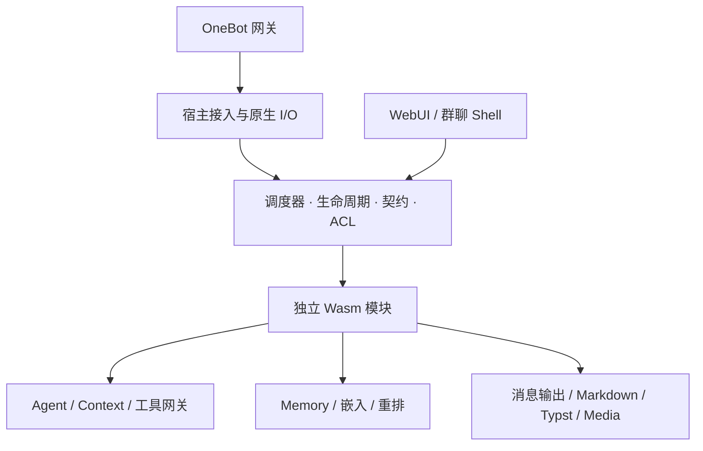

# Forest

Forest 是基于 Rust 与 WebAssembly 的模块化 Bot 框架。微内核负责调度、生命周期、接口契约、访问控制和宿主资源；消息处理、Agent、记忆、模型调用及工具由独立 Wasm 插件实现。

模块通过外部 `manifest.toml` 声明身份、元信息、接口、依赖、配置和事件订阅。Schema 与默认值引用 Forest 文本文件，包内文件使用 SHA-256 校验。调用方只依赖语言无关的接口契约，不链接目标模块的实现。

## 特性

- **模块隔离与热重载**：每个模块使用私有 Wasm 内存；支持排空、主动让出处中断和强制替换，替换前检查接口兼容性。
- **异步调度**：区分时间片让出与异步等待，按接口声明控制重入；同一实例只允许一次独占推进，不同实例可以并行。
- **类型化通信**：`call` 等待执行结果，`send` 返回接纳结果；Schema 同时约束请求和完整的模块返回值。
- **持久配置与静态 ACL**：SQLite 配置表保存当前值和默认值，宿主绑定真实来源并执行读、写及调用权限检查。
- **OneBot v11 接入**：支持正向 WebSocket，以及 HTTP API 配合反向 WebSocket；连接恢复与模块生命周期分离。
- **管理与扩展**：Vue/TypeScript WebUI 提供运行状态、依赖图、日志、配置编辑和模块装卸；群聊 Shell 提供授权管理命令。
- **可选 Agent 系统**：每群串行工作、多群异步对话，支持持续点、上下文裁剪、多主干多模态记忆、跨群联想及工具调用。

项目处于开发阶段，宿主、SDK 与插件应从同一份源码及锁文件构建。

## 架构



框架面向单个 Bot 账号，可同时处理多个群聊。Agent 与记忆系统均为可选模块，运行普通命令插件不需要模型服务或向量数据库。

## 构建

构建宿主与插件需要支持 Rust 2024 Edition 及锁定依赖的 Rust 工具链，以及 `wasm32-unknown-unknown` 目标。本机还需 C/C++ 编译与链接工具，用于 SQLite 等原生依赖；Windows 可使用 Visual Studio Build Tools，Linux 可使用发行版的构建工具包。WebUI 另需 Node.js 22.12+ 和 pnpm。依赖版本分别由 `Cargo.lock` 与 `webui/pnpm-lock.yaml` 固定。

在仓库根目录执行：

```sh
rustup target add wasm32-unknown-unknown
cargo fetch --locked
cargo build --locked -j 2 -p forest-cli
cargo run --locked -j 2 -p forest-test --bin package
```

最后一条命令生成示例包的 `module.wasm`、`manifest.toml`，以及 `generated/` 下的 Schema 和默认 Value 文本。包格式见[模块 Manifest](doc/07-module-manifest.md)。构建 WebUI：

```sh
pnpm --dir webui install --frozen-lockfile
pnpm --dir webui build
```

构建仓库提供的 Agent、工具和管理插件，可在 PowerShell 中执行；Linux 可通过 `pwsh` 运行同一脚本：

```powershell
./scripts/build-agent.ps1
```

该脚本使用离线构建，首次运行前需完成 `cargo fetch --locked`。也可单独运行各插件的打包程序，具体命令见[模块文档](doc/README.md)。

不需要 WebUI 时，可使用 `cargo build --locked -p forest-cli --no-default-features` 构建宿主。

## 运行示例插件

准备一个 OneBot v11 网关，并启用正向 WebSocket。根据网关设置，在启动环境中配置 `FOREST_ONEBOT_TOKEN`；启用 WebUI 时还需设置非空的 `FOREST_WEB_PASSWORD`。CLI 不自动读取 `.env` 文件。

```sh
cargo run --locked -p forest-cli -- --package packages/forest-test --events-ws ws://127.0.0.1:8080 --database data/config.sqlite3 --webui 127.0.0.1:8081
```

在浏览器打开 `http://127.0.0.1:8081`，使用管理口令登录，无需用户名。模块进入 `Serving` 后，在群中发送 `#forest-test`，示例模块回复 `hello world`。

上述地址为示例。测试时可通过 `--allow-group 123456789` 限定宿主接收与发送的群；正式运行通常由各模块的群配置决定处理范围。反向 WebSocket、HTTP API、启动参数和热重载说明见[运行时与 SDK](doc/13-runtime-and-sdk.md)。

首次加载 Wasm 需要编译，后续启动可复用持久编译缓存。缓存位置和预热方法也见运行时文档。

## 启用 Agent

完成插件构建后，启动记忆索引服务：

```sh
docker compose up -d qdrant
```

以 Agent 作为启动根包，宿主会根据 Manifest 加载其依赖：

```sh
cargo run --locked -p forest-cli -- --package packages/agent --events-ws ws://127.0.0.1:8080 --database data/config.sqlite3 --webui 127.0.0.1:8081
```

在 WebUI 配置聊天模型、嵌入与重排服务、记忆数据库和允许响应的群，再重载相应模块。Agent 默认不启用任何群。模型服务的 endpoint、模型配置与凭据由所属插件管理，不由消息调用方逐次提供。

完整配置步骤、初始化辅助程序、工具列表和模块职责见 [Agent 使用指南](doc/22-agent-guide.md)。Qdrant 也可独立安装；宿主无需运行在 Docker 中。

需要群内管理或直接排版命令时，可追加启动根包：

```text
--package packages/shell
--package packages/typst-command
```

Shell 需要单独配置授权用户和群。Agent 输出使用 Markdown 专用链接表达提及、回复、表情和受管图片；自动排版仅处理表格、独立行间公式和代码块，其他正文保留文本。

## 仓库结构

| 路径 | 内容 |
| --- | --- |
| `crates/` | 序列化、配置、协议、包读写、SDK、运行时、宿主管理与 CLI |
| `plugins/` | 独立 Wasm 插件及其本地接口类型映射 |
| `packages/` | 插件 TOML Manifest、Forest Schema/Value 和生成的 Wasm 工件 |
| `webui/` | Vue/TypeScript 管理前端 |
| `scripts/` | 插件构建脚本 |
| `deploy/` | Linux 服务模板和部署配置 |
| `doc/` | 使用指南、接口契约和架构说明 |
| `data/` | 本地运行数据，不进入版本控制 |

## 文档

- [文档导航](doc/README.md)
- [模块开发手册与完整示例](doc/module-development/README.md)
- [运行时、SDK 与 Wasm ABI](doc/13-runtime-and-sdk.md)
- [WebUI 与模块管理](doc/14-inspection-webui.md)
- [Agent 使用指南](doc/22-agent-guide.md)
- [群聊 Shell](doc/26-group-shell.md)
- [Linux ARM64 部署](doc/27-linux-deployment.md)
- [Markdown 消息与富文本](doc/33-markdown-messages.md)

## 验证

```sh
cargo test --locked --workspace --all-features -j 2
pnpm --dir webui build
```

运行时与插件集成测试使用真实 Wasm 工件和本地可控服务。外部模型、网关与浏览器验证的配置方式见对应模块文档。
