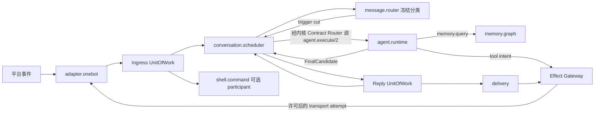

# Forest 架构总契约

> **权威性：最高。** 本文是当前重构和后续实现的入口规范。其他设计、历史 Git 记录、现有代码和测试若与本文冲突，必须删除或重写冲突部分。旧 P0–P5 纵向切片已经从工作树删除，不能作为实现输入。Forest 尚未发布，开发数据库直接重建，不为错误对象模型、旧表、旧 API、旧页面或旧 DTO 编写迁移、兼容读取、双写和转发层。

本文及 01–16 只描述**目标契约**，不证明任何能力已经实现。完成度、测试证据和暂时缺口只允许写入 [implementation-status.md](implementation-status.md)；目标文档不得使用“已落地”“当前实现已经”“已接管”等措辞把工作树偶然形态升级为架构。代码与状态页也不能反向削弱本文契约。

## 0. 已废止语义与阅读门禁

下列早期方案已经失去设计权威，后续实现、测试、WebUI 和数据库基线不得继续沿用，也不得以“先兼容再重构”为由保留：

1. 以 Bot 对象、`BindingRuntime`、Supervisor 或 Web 应用组合根持有 Agent、Memory、Adapter、Shell、Scheduler 与 Delivery 实例；
2. 把 Agent 当成框架调度中心、在群聊中派生产品子 Agent，或用另一个 Agent 表示下一次模型调用；
3. 把控制台做成固定 Bot CRUD、Agent/Memory/OneBot 专页集合，或在壳层按官方组件 ID 写业务分支；
4. 用无服务端筛选、无稳定分页的消息/记忆长表表示数十万条来源，或用不含端点、方向、类型、证据和状态的字符串表示关系；
5. 把“执行链”实现为可编辑工作流，把业务命令策略塞进 Shell 或 Web 壳，形成第二套路由与执行状态；
6. 为尚未发布的旧表、旧 DTO、旧页面和错误对象模型编写迁移、双写、fallback 或兼容代理。

调研文档只提供源码证据，Git 历史只用于追查原因，`implementation-status.md` 只报告完成度。三者都不能作为对象模型或模块边界的实现输入。准备编码前必须从本文和对应领域文档重新确定模块所有权、契约、生命周期、管理贡献、并发仲裁与删除行为。

## 1. 产品语义

Forest 是一个可长期运行的重型 Bot **微内核宿主**。核心产品能力来自可安装、可替换、可观察的模块组合；Agent 只是其中一个可选业务模块，Bot 只是身份、资源、授权和数据作用域事实。Bot 不是持有 Agent、Memory、Adapter 或 Scheduler 的运行时聚合对象；控制台也不能把 Bot 或 Agent 重新塑造成整个系统的中心。

以下语义不可更改：

1. 一个部署可以运行多个 Bot。每个 Bot 拥有独立身份、配置、授权、预算和一个全局记忆域。
2. 一个 Bot 的群聊共享该 Bot 的长期记忆域；每个群在全局图中拥有独立来源主干，联想边可以跨主干。
3. 不同群聊可以并发执行；同一群聊始终只有一条活动 Agent 响应链。
4. 所有已接纳群消息都进入 Context，并保留真实作者、群、Binding、时间和引用关系。消息是否触发回复与消息是否进入历史是两件事。
5. Agent 忙碌时，新触发排队。在下一次模型调用前，只接入连续队列中截至最后一个新触发记录的前缀；其后的普通尾部继续等待。Agent 结束且没有新触发时，尾部静默排空，不额外调用模型。
6. Agent 采用 QiYu Agentlib 风格的单状态机：固定 CorePrompt、独立 PresetContext、原子 ModelTurn、顺序工具循环、持久 checkpoint。不存在产品子 Agent，也不能把“下一轮模型调用”实现成另一个 Agent。
7. Context 裁剪不调用 LLM，不生成记忆摘要。归档、窗口选择和来源引用维护必须是确定性的。
8. 记忆、归档和嵌入原生保留有序文本与图片。文本、图片和混合输入都能查询；text-only LLM 只在本次请求投影中移除图片，不修改完整历史、媒体或索引。
9. VL embedding 的模型种类、修订、维度、归一化与融合语义在 Bot 创建时冻结。之后只允许更换协议兼容的 endpoint 或凭据。
10. 管理员可经群聊 Shell、WebUI 或 CLI 发起同一类型化管理操作；入口不同，目标 authority、授权、幂等、版本冲突和审计规则相同。

## 2. 微内核与模块边界

微内核只拥有不能由普通模块安全替代的机制：

- bootstrap 信任根与最小 Bot 身份；
- 包校验、模块注册、依赖解析、Generation 与 RuntimeGraph 发布；
- 生命周期、任务和资源监督；
- 版本化 Contract Router；
- 能力授权、Effect Gateway、外部效果账本和最终提交 guard；
- 跨模块 UnitOfWork 协调；
- 最小健康、审计和救援入口。

以下均是平级模块，不得被 Supervisor、Bot 对象或 Agent 组合为一个业务对象图：

| 模块 | 独占语义 |
|---|---|
| `adapter.onebot` | Binding、连接代际、平台事件观察与 OneBot 传输端口 |
| `codec.onebot` | 无状态 OneBot 事件规范化与获许可发送载荷编码；不拥有连接、凭据或业务状态 |
| `conversation.scheduler` | Inbox、分类水位、trigger、InputBatch、Context、同群 actor 与正式回复顺序 |
| `agent.runtime` | Session/Run、CorePrompt 协议、ModelTurn、工具步骤、模型 attempt 与 checkpoint |
| `memory.graph` | Bot 全局记忆、群主干、来源、图关系、召回、遗忘与派生索引资格 |
| `shell.command` | 管理员策略、命令注册、控制请求、优先级资格与结果 |
| `process.executor` | 预登记 ExecutionProfile、固定 argv 投影、子进程隔离、资源限制与输出工件 |
| `delivery` | CHAT/CONTROL lane、SendIntent、part、attempt、UNKNOWN 与对账 |
| `provider.*` / `embedding.*` / `media.*` / `tool.*` | 对应外部能力、客户端、预算、工件和执行观察 |
| `routing.graph` / `command.router` / `message.router` | 冻结路由、业务命令/消息处理策略、dispatch trace 与相关持久工作 |
| `scheduler.jobs` | 定时任务定义、occurrence、lease 与 misfire 处理 |

模块只能经版本化契约交换 DTO、稳定引用和受管 `PayloadRef`。模块不得持有另一模块的 Repository、数据库表、客户端或运行实例，也不得把进程内模块对象、Repository bound method 或共享 `modules` 字典伪装成“端口注入”。普通调用由 Contract Router 返回绑定准确 RuntimeGraph/Generation 的有界句柄；跨模块原子提交由内核 UnitOfWork 协调器解析并调用已注册 participant。每个 participant 仍只写自己的 namespace，业务模块只提交计划和稳定引用，不取得其他 participant 对象。

多模态索引同样遵守该边界：`memory.graph` 拥有来源资格、facet/claim、索引发布、召回和删除屏障；`embedding.*` 拥有 endpoint 客户端、请求投影、批量传输、费用/usage 观察与外部 attempt。Memory 的生命周期 Worker 领取自己的 facet 后，只能经冻结的 `embedding.encode/2` 句柄提交受管内容引用和准确空间身份；Embedding 不读取 Memory 表，Memory 不持有 Embedding 客户端。返回向量先成为 Embedding 所有的受管结果载荷，服务回执只传准确受管引用与用量，避免批量向量溢出 Worker 帧；Memory 再在自己的最终事务中复核 claim、Generation、空间、来源修订和删除 epoch 后发布。两者不能重新合并成一个直接拿 Repository 和 HTTP Client 的运行对象。

`BotRuntimeSupervisor` 只监督冻结的模块图、宿主 lease、资源和健康，不得 import、构造或保存具体 Agent、Memory、Adapter、Shell、Scheduler、Job 或 Delivery 对象。`BindingRuntime`、巨型 `BotStore`/`MessageStore` 和类似业务组合根属于必须删除的错误抽象。

### 2.1 builtin 也是插件，不是宿主源码目录

`builtin` 只表示“随 Forest 发行且默认可安装”，不表示“可以由宿主直接 import”。每个 builtin 必须是完整、可独立捕获的插件包，至少包含 `module.toml`、契约 schema、Worker 入口；有存储、配置或管理界面时还必须包含自己的 schema bundle、配置 schema 与 UI 工件。官方 builtin 与第三方包经过同一条发现、校验、内容寻址、Worker 启动、Generation 发布和回收链路，差异只能来自签名、信任等级和部署授予。

以下实现一律不算模块化，也不得作为过渡层保留：

- 把业务文件移动到 `forest.builtin.*` Python 命名空间后继续由宿主 import；
- 用 `RuntimeModuleDescriptor.factory` 在宿主进程构造业务类，再把进程内对象登记成 Generation；
- 由 Supervisor、Bot Host 或 provisioning 代码按组件 ID import、验证或拼装具体业务实现；
- 用 `importlib.reload()`、覆盖已加载包目录、修改共享单例或重建一组宿主内对象冒充热重载；
- 新旧实现双轨并存，并以 forwarding shim、fallback 或兼容 DTO 维持错误路径。

宿主只能读取经校验的不可变 `PackageSnapshot` 和声明，创建运行时 Driver，并保存不透明 Worker/Generation 句柄。插件代码只允许在其 Worker 中导入和执行。模块间调用只能携带契约 DTO、稳定引用和受管 Payload，不能越过 IPC 返回 Python 对象、Repository、客户端或闭包。

复杂持久模块也不得以“受信 builtin”为由向宿主注入 Python Authority Capsule。包必须以 `domain_queries` 与 `domain_commands` 分别声明自己的私有持久端口，并把实现作为同一内容摘要下 storage bundle 中的 PostgreSQL JSON 函数发布；隔离 Worker 只能经不同的 `ctx.queries`、`ctx.commands` 句柄调用。宿主通用 Domain Authority Driver 只负责 schema 校验、准确 Generation/member fence、只读或可写事务、固定函数 ABI 和结果 envelope，不导入包代码、不理解表结构或业务状态。Query 在数据库只读事务中执行，禁止初始化和写入；Command 接收稳定 operation identity，并由模块函数在自身 namespace 内完成幂等、状态转换和结果生成。函数不能访问其他模块 schema；跨模块原子提交必须由 manifest 声明的 UnitOfWork participant 进入内核协调事务，不能把另一个模块的 SQL 函数伪装成本地 Command。

包级 UnitOfWork participant 只能由内核 coordinator 在调用方拥有的单一事务中解析和执行。participant 句柄必须绑定准确组件与 Generation，只允许调用 manifest 冻结的函数和 schema；它不是 Worker 服务、通用 SQL 接口或模块运行实例。协调器的 participant 集合在 RuntimeGraph 中固定，运行时计划只能为这些 participant 提供各自子载荷和稳定 operation，不能动态选择新的组件、跨 namespace 写入或在部分成功后做业务补偿。

拥有持久后台工作的包必须声明 `owned_work_handlers`，不能在宿主保留业务循环。包私有工作由包的 claim/settle SQL 函数持有账本；内核基础 Bot 身份等权威账本可以用 manifest 明示的受限 `authority = "kernel"` 端口，包仍须拥有 Worker handler，不得复制第二份 Job 队列。每个 handler 冻结输入/输出 schema、并发、轮询、执行 deadline 与覆盖执行和结算的 lease；内核端口须有有界续租。Package Adapter 只运行统一的生命周期泵：整图开放后才领取，claim 在同一事务中复核 active Generation，已领取调用以稳定 work operation 进入隔离 Worker 和持久调用账本，settle 以 claim token 和 member fence 幂等收敛。所属权威决定队列状态和重试，Worker 决定业务处理，Adapter 不解释业务字段。替换时先同步关闭领取门，再等待所有已领取项写入终态；旧 Generation 排空前不得回收 Worker 或效果驱动。

需要 Secret、网络、文件或进程能力的 builtin 仍必须是完整插件包。包在 manifest 中声明有界 `effect_service`，持久任务执行器同时以 `job_type` 声明 Job 身份、服务契约、输入/输出 schema、超时、重试与并发上限；部署环境按 `effect kind` 解析原生宿主驱动或已批准的 Host/Deployment 包导出。导出方是独立的控制范围 Generation，消费方须冻结其准确 Generation、服务契约和 schema；Bot 侧 `PackageGenerationAdapter` 用冻结配置与自身 Generation 身份创建本 Bot 所有的驱动实例或代理，随 Worker 共同经历 start、quiesce、resume、close。跨图换代必须先冻结受影响的 Bot 调用并排空在途效果，再让新提供方与消费方接管；不能只改注册表指针。Bot Worker 不接触 Secret 明文或原始客户端。

每个 `effect_service` 必须声明 `semantics`：`at-most-once` 表示不可安全重复的外部效果，必须先进入持久操作账本并在不确定交接后停止自动重试；`idempotent` 表示目标由稳定业务键收敛，可在准确 Generation fence 下重复执行；`read` 表示无业务写入的查询。调用方不能用宿主私有约定猜测语义，Package Adapter 也不能把所有效果一律写成最多一次，从而永久缓存派生索引的瞬时失败。

`provides` 可声明 `allowed_callers`，只接纳冻结路由中列出的组件身份。运行时必须在解析输入和派发 Worker 之前执行该约束；通用 `service.call` 授权不能绕过提供者的调用方限制。该列表是组件间准入边界，不能代替目标 authority 对操作、租约、Generation 和持久事实的复核。涉及另一作用域权威事实的端口须经受信任的内核桥核验，再将准确声明的桥组件作为唯一调用方。

`job_type` 是包贡献给 `job.scheduler` 的持久执行端口，不是宿主注册一个业务 Python 回调。Scheduler 独占排队、claim、续租、取消和终态；Package Adapter 把 `DurableJobExecutionRequest` 经冻结服务路由交给声明该类型的准确 Generation，并以 `(job_id, attempt)` 形成稳定操作身份。Job 必须由包内 Worker handler 执行；需要外部副作用时，handler 经单独声明和授权的普通 JSON effect service 调用最小宿主 capability。旧 Generation 排空覆盖已经接纳的 Job、嵌套 effect 与终态提交，候选失败时 Worker 与驱动一并回收。

持久工作泵的空队列探测必须有界退避。Bot 内包 Command、管理 Action、owned-work settle 和跨包 UnitOfWork 只在事务提交后发出同一 Bot 作用域的通用唤醒信号；信号不携带业务 DTO，不改变队列所有权，也不能替代 claim 时的 Generation/存储围栏。工作泵收到信号立即重新探测，信号与进行中的空 claim 交错时不得丢失；无信号时仍定期探测，以发现到期重试和恢复漏通知。热替换期间只有当前 ACTIVE 图接收宿主信号，新图开放 admission 时主动探测。Bot 基础身份与期望运行意图仍由部署内核持有，`deployment.bot-catalog` 仅通过受限端口管理。

### 2.2 插件热重载是强制生命周期，不是开发辅助

所有普通插件（包括 builtin）必须完整支持 `drain` 热重载。唯一合法路径为：捕获新源码形成不同内容摘要 → 静态校验 manifest/schema/依赖/能力 → 创建新 Worker 与新 Generation → 在无生产写权限下 prepare/start/health → 冻结旧路由准入 → 排空旧代在途调用和持久安全点 → 原子提交新 route/registry/config effective → 本地开放新代 admission → 停止并回收旧 Worker、任务、连接与临时环境。候选在提交前任一步失败时，必须销毁候选并恢复旧代准入；提交后不得把旧对象重新激活为当前代，回退也要创建新的 Generation。

热重载的单位是不可变包/Worker/Generation，不是 Python module 对象。配置生效、UI 工件、服务路由、命令、订阅、Job、状态 schema 和能力授予都绑定同一 Generation，不能分别切换。`prepare_generation` 必须对将要启动的准确 desired revision 重跑声明 schema 与模块领域 validator；WebUI、Shell、直接 authority 写入或恢复路径都不能绕过候选代门禁。内核或不可卸载 bootstrap 代码只允许受控宿主重启，不能借“builtin”身份绕过该规则。

## 3. 权威执行链

“执行链”是已经发生的路由和因果事实，不是可编辑工作流：

关键提交边界：

1. **入站接纳**：Adapter 平台事实、Conversation Inbox 和可选 Shell 请求在同一 Bot UnitOfWork 中提交。接纳后才视为 Forest 已收到消息。
2. **模型安全点**：Conversation Scheduler 冻结 InputBatch；Agent 只消费该引用，不读取并修改 Inbox 游标。
3. **工具/模型外部调用**：事务外执行；调用前后分别持久化 attempt、fence、实际可见输入与观察。已交接但结果丢失必须为 `UNKNOWN`。
4. **正式回复**：Agent 只产生 `FinalCandidate`。Agent 关闭准确 Run、Conversation 写正式 `REPLY` 并将 trigger 标为 `ANSWERED`、Delivery 创建 SendIntent，在一个 UnitOfWork 中整体提交或整体回滚。
5. **记忆发布**：原始来源先有稳定身份和顺序；异步 embedding、图归约和联想只发布可重建派生物，完成先后不能改写来源真值。

dispatch trace 只读投影上述事实，按稳定 `caused_by`、RuntimeGraph 和 Generation 连接。WebUI 中的“执行链”不得成为拖拽编排器，也不得维护第二套执行状态。

## 4. 命令与 Shell 策略

> 当前实现说明（2026-10-09）：Adapter 先调用可热重载的 `shell.ingress.inspect` Worker，再进入 Inbox/分类事务；尚无本节所述的内核 ShellGate、ingress proof 或独立救援路由。这里描述目标边界，最终归属待明确后须同步代码与协议。

ShellGate 只保留有界 `#forest` 前缀识别、入口容量隔离和最小救援能力。管理员名单、群/Binding 策略、命令 schema、优先级和执行结果属于 `shell.command`。

- P0/P1 是经当前策略计算出的控制服务资格，只影响调度资源，不改变群历史顺序。
- CONTROL 回执和 CHAT 回复使用独立 lane；它们共享真实 Adapter 限流与外部效果账本。
- CONTROL_COMMAND 仍在原 `ingress_seq` 位置进入安全 Context 投影，但不创建 Agent trigger。
- 业务命令属于发布它的模块与 `command.router`，不是 Shell 或控制台壳内的固定菜单。
- 每次执行都重新检查当前管理员策略、目标 revision、Binding/Generation fence 和精确授权票据。昵称、群主标记、消息正文和模型输出不能授予管理权限。

## 5. WebUI 是模块控制台

WebUI 壳只拥有登录会话、作用域选择、模块发现、工作区容器、通用 schema 控件、沙箱承载和管理传输。它不硬编码 Agent、Memory、Bot、OneBot、Job、备份或存储业务页面。

每个可管理模块随准确包摘要和 Generation 发布 `ManagementContribution`：

- 适用 scope 与导航元数据；
- 版本化配置 schema、desired/effective 状态和生效策略；
- 有稳定游标的 query；
- 有类型输入、权限和幂等语义的 action；
- 可选的受限 UI 工件。

模块 UI 在无同源权限的 sandbox iframe 中运行，经有界 `MessageChannel` 只能请求描述符已声明的 query/action。它不能读取 Cookie、父页面 DOM、任意 URL、数据库或管理员密钥。没有自定义 UI 时由 schema 表单兜底。

Memory 模块的管理贡献必须面向数十万至数百万来源：服务端组合筛选、固定 snapshot 的键集分页、有界正文加载、虚拟列表、以节点为起点且有深度/节点/边预算的关系图、逐边来源/作者/证据/状态，以及 text/image/mixed 的真实召回试验。整库下发、浏览器内筛选、无限纵向卡片和无法说明边语义的“关系列表”都不合格。

## 6. 存储与激进重构规则

当前阶段只支持从空数据库安装：

1. 最小 `forest_kernel` bootstrap；
2. 每个 kernel/业务模块自己的内容寻址 schema bundle；
3. 每个模块自己的 Repository 和 management contract。

开发期 schema 变化直接修改 baseline、删除旧代码并重建数据库。当前源码和测试不得包含未发布结构的编号迁移、`ALTER old_*`、旧列 fallback、legacy marker、双写、旧 API 转发或非空旧库升级夹具。

热重载时对**已声明模块状态**做有界、版本化 handoff，是生命周期协议；它不等于为当前开发数据库保存历史 schema。任何 handoff 必须由候选 Generation 声明、在 shadow 状态验证，失败时继续使用旧代。首发前没有需求的 handoff 可以删除，不能以“未来兼容”为由保留错误对象模型。

正式首版发布后如需数据升级，应为具体模块单独设计版本边；该未来协议不进入当前实现任务，也不能形成宿主级全产品迁移链。

## 7. 并发与合流规则

- 可重试操作使用稳定 operation ID 与规范输入摘要；同 ID 同输入返回原结果，同 ID 不同输入冲突。
- 身份、来源和顺序在接纳事务固定；Worker 完成时间不是业务顺序。
- 可交换事实以集合并集、稳定 key 和版本化归约收敛；配置、删除、取消和外部效果等不可交换操作使用 CAS、lease、epoch 和明确仲裁。
- 异步派生采用 capture → compute → publish。publish 必须复核输入 revision、删除 epoch、Generation、授权和目标 head。
- 遗忘与新写共享线性化屏障：写先提交则进入删除闭包，删除先提交则迟到发布失败。
- 外部效果不承诺 exactly-once；`DISPATCHING` 后失去结果必须保留 `UNKNOWN`，只能由真实证据对账。

## 8. 实现顺序与门禁

后续每个实现切片必须按以下顺序进行：

1. 在本文及领域详细设计中确定 owner、namespace、契约、因果身份、事务 participant、并发仲裁和管理贡献；
2. 删除冲突的旧文档、API、表、对象图与测试；
3. 从空数据库实现模块 baseline 与 Repository；
4. 实现运行契约和模块自带管理贡献；
5. 先做隔离模块测试，再做跨模块 UnitOfWork、并发乱序、崩溃恢复和真实外部边界验证；
6. 在 `implementation-status.md` 只记录已运行的证据，不能把候选文件或设计条款写成已完成。

每个实现切片在步骤 3 之前必须填写并评审以下设计门：`owner`、`namespace`、`provides`、`requires`、`Repository contract`、`UnitOfWork participants`、`Generation fence`、`authority/effect`、`management contribution`、`concurrency arbitration`、`deletion/recovery behavior`。任何一项只能通过读取其他模块内部表、持有其他模块对象或在 Web 壳中按组件 ID 分支才能实现时，说明边界尚未闭合，必须先改设计。

出现以下任一情况应立即停止编码并先修正文档/方案：

- 新增产品子 Agent，或用另一个 Agent 实现下一次模型调用；
- Supervisor/Fleet/Web 壳直接构造业务模块或读取其表；
- Adapter 持有 Conversation、Shell 或 Delivery；Agent 直接发送消息；
- 新增固定业务后台、模块专用宿主 API 或按 `component_id` 分支页面；
- Memory 管理只提供无筛选全量表格，或关系无法表达端点、方向、来源和证据；
- 为未发布结构新增迁移、兼容层、双写或 fallback；
- 为赶进度弱化同群单链、触发切口、作者标记、多主干、多模态、删除 epoch 或合流规则。
