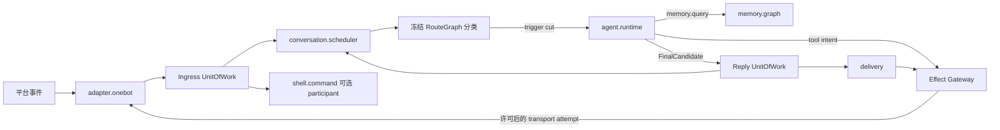

# Forest 架构总契约

> **权威性：最高。** 本文是当前重构和后续实现的入口规范。其他设计、历史 Git 记录、现有代码和测试若与本文冲突，必须删除或重写冲突部分。旧 P0–P5 纵向切片已经从工作树删除，不能作为实现输入。Forest 尚未发布，开发数据库直接重建，不为错误对象模型、旧表、旧 API、旧页面或旧 DTO 编写迁移、兼容读取、双写和转发层。

## 1. 产品语义

Forest 是一个可长期运行的重型 Bot **微内核宿主**。核心产品能力来自可安装、可替换、可观察的模块组合；Agent 只是其中一个业务模块，Bot 只是身份、资源、授权和数据作用域。控制台不能把两者重新塑造成整个系统的中心。

以下语义不可更改：

1. 一个部署可以运行多个 Bot。每个 Bot 拥有独立身份、配置、授权、预算和一个全局记忆域。
2. 一个 Bot 的群聊共享该 Bot 的长期记忆域；每个群在全局图中拥有独立来源主干，联想边可以跨主干。
3. 不同群聊可以并发执行；同一群聊始终只有一条活动 Agent 响应链。
4. 所有已接纳群消息都进入 Context，并保留真实作者、群、Binding、时间和引用关系。消息是否触发回复与消息是否进入历史是两件事。
5. Agent 忙碌时，新触发排队。在下一次模型调用前，只接入连续队列中截至最后一个新触发记录的前缀；其后的普通尾部继续等待。Agent 结束且没有新触发时，尾部静默排空，不额外调用模型。
6. Agent 采用 QiYu Agentlib 风格的单状态机：固定 CorePrompt、独立 PresetContext、原子 ModelTurn、顺序工具循环、持久 checkpoint。不存在产品子 Agent，也不能把“下一轮模型调用”实现成另一个 Agent。
7. Context 裁剪不调用 LLM，不生成记忆摘要。归档、窗口选择和来源引用维护必须是确定性的。
8. 记忆、归档和嵌入原生保留有序文本与图片。文本、图片和混合输入都能查询；text-only LLM 只在本次请求投影中移除图片，不修改完整历史、媒体或索引。
9. VL embedding 的模型种类、修订、维度、归一化与融合语义在 Bot 创建时冻结。之后只允许更换协议兼容的 endpoint 或凭据。
10. 管理员可经群聊 Shell、WebUI 或 CLI 发起同一类型化管理操作；入口不同，目标 authority、授权、幂等、版本冲突和审计规则相同。

## 2. 微内核与模块边界

微内核只拥有不能由普通模块安全替代的机制：

- bootstrap 信任根与最小 Bot 身份；
- 包校验、模块注册、依赖解析、Generation 与 RuntimeGraph 发布；
- 生命周期、任务和资源监督；
- 版本化 Contract Router；
- 能力授权、Effect Gateway、外部效果账本和最终提交 guard；
- 跨模块 UnitOfWork 协调；
- 最小健康、审计和救援入口。

以下均是平级模块，不得被 Supervisor、Bot 对象或 Agent 组合为一个业务对象图：

| 模块 | 独占语义 |
|---|---|
| `adapter.onebot` | Binding、连接代际、平台事件观察与 OneBot 传输端口 |
| `conversation.scheduler` | Inbox、分类水位、trigger、InputBatch、Context、同群 actor 与正式回复顺序 |
| `agent.runtime` | Session/Run、CorePrompt 协议、ModelTurn、工具步骤、模型 attempt 与 checkpoint |
| `memory.graph` | Bot 全局记忆、群主干、来源、图关系、召回、遗忘与派生索引资格 |
| `shell.command` | 管理员策略、命令注册、控制请求、优先级资格与结果 |
| `delivery` | CHAT/CONTROL lane、SendIntent、part、attempt、UNKNOWN 与对账 |
| `provider.*` / `embedding.*` / `media.*` / `tool.*` | 对应外部能力、客户端、预算、工件和执行观察 |
| `routing.graph` / `command.router` / `message.router` | 冻结路由、业务命令/消息处理策略、dispatch trace 与相关持久工作 |
| `scheduler.jobs` | 定时任务定义、occurrence、lease 与 misfire 处理 |

模块只能经版本化契约交换 DTO、稳定引用和受管 `PayloadRef`。模块不得持有另一模块的 Repository、数据库表、客户端或运行实例。需要原子提交时，由内核调用已注册 participant；每个 participant 仍只写自己的 namespace。

`BotRuntimeSupervisor` 只监督冻结的模块图、宿主 lease、资源和健康，不得 import、构造或保存具体 Agent、Memory、Adapter、Shell、Scheduler、Job 或 Delivery 对象。`BindingRuntime`、巨型 `BotStore`/`MessageStore` 和类似业务组合根属于必须删除的错误抽象。

## 3. 权威执行链

“执行链”是已经发生的路由和因果事实，不是可编辑工作流：

关键提交边界：

1. **入站接纳**：Adapter 平台事实、Conversation Inbox 和可选 Shell 请求在同一 Bot UnitOfWork 中提交。接纳后才视为 Forest 已收到消息。
2. **模型安全点**：Conversation Scheduler 冻结 InputBatch；Agent 只消费该引用，不读取并修改 Inbox 游标。
3. **工具/模型外部调用**：事务外执行；调用前后分别持久化 attempt、fence、实际可见输入与观察。已交接但结果丢失必须为 `UNKNOWN`。
4. **正式回复**：Agent 只产生 `FinalCandidate`。Agent 关闭准确 Run、Conversation 写正式 `REPLY` 并将 trigger 标为 `ANSWERED`、Delivery 创建 SendIntent，在一个 UnitOfWork 中整体提交或整体回滚。
5. **记忆发布**：原始来源先有稳定身份和顺序；异步 embedding、图归约和联想只发布可重建派生物，完成先后不能改写来源真值。

dispatch trace 只读投影上述事实，按稳定 `caused_by`、RuntimeGraph 和 Generation 连接。WebUI 中的“执行链”不得成为拖拽编排器，也不得维护第二套执行状态。

## 4. 命令与 Shell 策略

ShellGate 只保留有界 `#forest` 前缀识别、入口容量隔离和最小救援能力。管理员名单、群/Binding 策略、命令 schema、优先级和执行结果属于 `shell.command`。

- P0/P1 是经当前策略计算出的控制服务资格，只影响调度资源，不改变群历史顺序。
- CONTROL 回执和 CHAT 回复使用独立 lane；它们共享真实 Adapter 限流与外部效果账本。
- CONTROL_COMMAND 仍在原 `ingress_seq` 位置进入安全 Context 投影，但不创建 Agent trigger。
- 业务命令属于发布它的模块与 `command.router`，不是 Shell 或控制台壳内的固定菜单。
- 每次执行都重新检查当前管理员策略、目标 revision、Binding/Generation fence 和精确授权票据。昵称、群主标记、消息正文和模型输出不能授予管理权限。

## 5. WebUI 是模块控制台

WebUI 壳只拥有登录会话、作用域选择、模块发现、工作区容器、通用 schema 控件、沙箱承载和管理传输。它不硬编码 Agent、Memory、Bot、OneBot、Job、备份或存储业务页面。

每个可管理模块随准确包摘要和 Generation 发布 `ManagementContribution`：

- 适用 scope 与导航元数据；
- 版本化配置 schema、desired/effective 状态和生效策略；
- 有稳定游标的 query；
- 有类型输入、权限和幂等语义的 action；
- 可选的受限 UI 工件。

模块 UI 在无同源权限的 sandbox iframe 中运行，经有界 `MessageChannel` 只能请求描述符已声明的 query/action。它不能读取 Cookie、父页面 DOM、任意 URL、数据库或管理员密钥。没有自定义 UI 时由 schema 表单兜底。

Memory 模块的管理贡献必须面向数十万至数百万来源：服务端组合筛选、固定 snapshot 的键集分页、有界正文加载、虚拟列表、以节点为起点且有深度/节点/边预算的关系图、逐边来源/作者/证据/状态，以及 text/image/mixed 的真实召回试验。整库下发、浏览器内筛选、无限纵向卡片和无法说明边语义的“关系列表”都不合格。

## 6. 存储与激进重构规则

当前阶段只支持从空数据库安装：

1. 最小 `forest_kernel` bootstrap；
2. 每个 kernel/业务模块自己的内容寻址 schema bundle；
3. 每个模块自己的 Repository 和 management contract。

开发期 schema 变化直接修改 baseline、删除旧代码并重建数据库。当前源码和测试不得包含未发布结构的编号迁移、`ALTER old_*`、旧列 fallback、legacy marker、双写、旧 API 转发或非空旧库升级夹具。

热重载时对**已声明模块状态**做有界、版本化 handoff，是生命周期协议；它不等于为当前开发数据库保存历史 schema。任何 handoff 必须由候选 Generation 声明、在 shadow 状态验证，失败时继续使用旧代。首发前没有需求的 handoff 可以删除，不能以“未来兼容”为由保留错误对象模型。

正式首版发布后如需数据升级，应为具体模块单独设计版本边；该未来协议不进入当前实现任务，也不能形成宿主级全产品迁移链。

## 7. 并发与合流规则

- 可重试操作使用稳定 operation ID 与规范输入摘要；同 ID 同输入返回原结果，同 ID 不同输入冲突。
- 身份、来源和顺序在接纳事务固定；Worker 完成时间不是业务顺序。
- 可交换事实以集合并集、稳定 key 和版本化归约收敛；配置、删除、取消和外部效果等不可交换操作使用 CAS、lease、epoch 和明确仲裁。
- 异步派生采用 capture → compute → publish。publish 必须复核输入 revision、删除 epoch、Generation、授权和目标 head。
- 遗忘与新写共享线性化屏障：写先提交则进入删除闭包，删除先提交则迟到发布失败。
- 外部效果不承诺 exactly-once；`DISPATCHING` 后失去结果必须保留 `UNKNOWN`，只能由真实证据对账。

## 8. 实现顺序与门禁

后续每个实现切片必须按以下顺序进行：

1. 在本文及领域详细设计中确定 owner、namespace、契约、因果身份、事务 participant、并发仲裁和管理贡献；
2. 删除冲突的旧文档、API、表、对象图与测试；
3. 从空数据库实现模块 baseline 与 Repository；
4. 实现运行契约和模块自带管理贡献；
5. 先做隔离模块测试，再做跨模块 UnitOfWork、并发乱序、崩溃恢复和真实外部边界验证；
6. 在 `implementation-status.md` 只记录已运行的证据，不能把候选文件或设计条款写成已完成。

出现以下任一情况应立即停止编码并先修正文档/方案：

- 新增产品子 Agent，或用另一个 Agent 实现下一次模型调用；
- Supervisor/Fleet/Web 壳直接构造业务模块或读取其表；
- Adapter 持有 Conversation、Shell 或 Delivery；Agent 直接发送消息；
- 新增固定业务后台、模块专用宿主 API 或按 `component_id` 分支页面；
- Memory 管理只提供无筛选全量表格，或关系无法表达端点、方向、来源和证据；
- 为未发布结构新增迁移、兼容层、双写或 fallback；
- 为赶进度弱化同群单链、触发切口、作者标记、多主干、多模态、删除 epoch 或合流规则。
