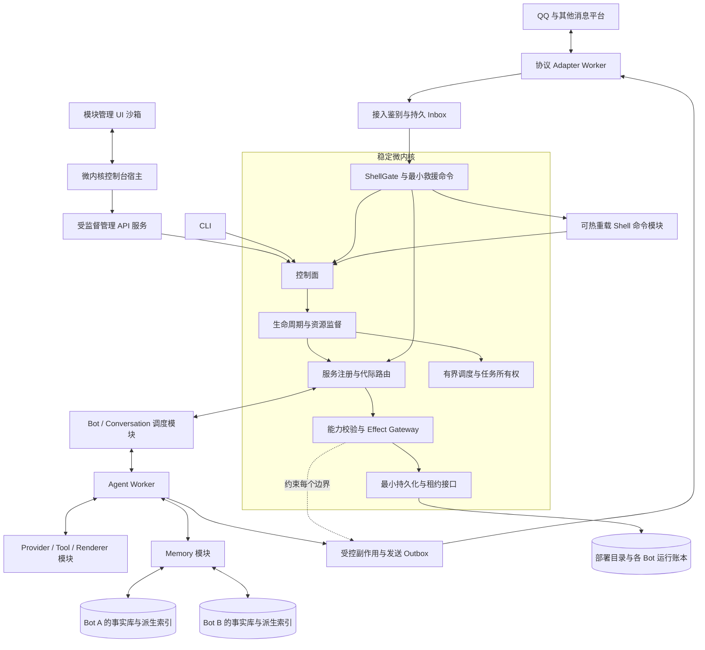

# Forest 架构设计

## 1. 目标与范围

Forest 面向长期在线、插件较多、存在复杂 Agent 行为的机器人宿主。重型能力来自完整的运行治理、持久执行、记忆与可观测性；微内核保持小而稳定，复杂业务放在模块中。

必须支持：

- 同一部署运行多个 Bot，分别配置平台绑定、人格、模型、模块、权限、资源预算与记忆存储。
- 每个 Bot 的长期记忆覆盖它参与的全部会话；不同 Bot 默认不共享记忆，不能按群创建互不相通的记忆库。
- 同一个Bot全局记忆图中，每个群聊拥有独立主干；跨主干建立显式联想，顺序边不跨群，召回向模型明确呈现来源群及作者。
- 上下文、归档、记忆图与向量索引完整保留文本和图片；原生多模态嵌入支持图片查询及跨模态召回，独立于对话LLM是否支持视觉。
- 每次API调用前按实际LLM能力生成独立输入投影；不支持图片时移除请求中的图片载荷，保留合法文本和来源，不改变持久上下文或媒体。
- 不同群聊并发对话，保持同一会话中的确定提交顺序、正确回复目标和可恢复执行状态。
- 模块的显式安装、准备、运行、排空、替换、停止和卸载；热重载失败可诊断、可恢复。
- 命令、服务调用、事件、流与外部副作用各有确定的投递、重试、超时和权限语义。
- Agent 工具、长任务、定时任务和记忆维护受同一生命周期体系管理。
- 多群并发写入的可合流事实在重复、乱序和不同批次下语义一致；不可交换的命令明确仲裁，LLM 结果不得最后写入覆盖全部记忆。
- 插件作者使用普通 Python 模块/类和异步钩子，修改文件后可自动触发受控重载，无需编写 Wasm 或 IPC。
- 所有群消息进入上下文流水并参与裁剪；同群仅一条 Agent 执行链，新触发在下一次模型调用的安全边界接入至最后触发记录，结束后静默排空普通尾部。
- 流式裁剪不调用LLM、不生成记忆摘要；先可靠归档，再按本地token预算维护原文/来源引用视图，降低高流量下的调用频次。
- 保留每条消息的可信作者 ID、当时昵称、来源与引用关系；历史和摘要不能把多个群成员合成一个用户。
- 管理员可通过群聊 Shell 查询、取消、暂停、重载和处理持久任务；控制入口与短回执具有独立容量，不因 Agent 忙碌或普通插件故障失效。
- WebUI作为首版后台入口，但它是作用域感知的微内核模块工作台，不是 Bot CRUD 后台。壳层只提供身份、作用域选择、模块发现和工作区容器；内核、Agent、记忆、Adapter、调度器、安全、存储与恢复页面均由对应模块贡献。
- 模块包可以携带版本固定的管理 UI。宿主在隔离 iframe 中加载其不可变资源，经版本化 MessageChannel 只传递模块公开 schema、脱敏配置和类型化操作；模块 UI 不持有管理会话、密钥或任意管理 API 访问权。没有自定义 UI 时由 schema 表单兜底。

首版不承诺内核自身无中断热替换、任意运行栈迁移、外部消息恰好发送一次、跨独立数据库的全局事务。首个可部署版本以单节点内核和多个隔离 Worker 为边界，集群模式在所有权与恢复协议验证后扩展。

## 2. 对三个项目的取舍

详细依据见[源码调研索引](README.md#源码调研依据)。以下是架构推导，不把现有原型能力当成成熟保证。

| 来源 | 继承的设计思想 | 必须重新设计的部分 |
|---|---|---|
| synthase | 元数据声明输入/输出与依赖能力；Wasm 经 `perform_effect` 请求宿主；模块可以重新加载 | 不可变代际、在途调用排空、原子路由、状态迁移与回滚；principal 必须实际进入执行链 |
| QiYu | Provider/Tool/Context/Memory 分层；追加式上下文与轮次提交；会话级串行、不同会话并发；持久作业与 outbox | 实例内暂停对象改为持久 checkpoint；自动归档检索的 conversation scope 改为 Bot 全局域；生命周期从 Web 应用提升为框架契约 |
| AliceBot | QQ 消息编解码、插件处理链、命令、工具、渲染等完整业务能力 | 直接传 Bot/WebSocket 改成能力句柄；线程替换模块改成受监督代际切换；按群 Chroma collection 改成 Bot 存储域；补足多 Bot 路由 |

特别注意：QiYu 的显式记忆与自动 archive RAG 作用域不同，后者当前按 conversation 派生向量作用域；AliceBot 的聊天上下文和长期向量集合也按群处理。Forest 不能只改一个变量名就获得 Bot 全局记忆，需重建身份、存储、召回和来源可见性契约。

## 3. 总体结构



图中模块之间的箭头均表示经内核路由的契约消息。Memory 模块通过限定作用域的存储接口访问数据，业务 Worker 不获得事实库超级用户连接。图上多个 Memory Worker 可以分别绑定不同 Bot 的存储配置。

控制面负责期望状态与变更：安装包、授予能力、配置 Bot、切换代际、停机和审计。数据面负责接收消息、执行服务/Agent、提交事实和发送回复。控制面变更需要 durable operation 记录；文件监视器只提出重载请求，不能自行修改运行对象。

群聊同时承载数据与管理入口。ShellGate 在任意业务插件之前识别保留前缀，并将受权命令送往控制面；其历史投影仍走普通输入顺序。WebUI经管理API，与CLI及群聊Shell使用同一类型化操作和授权守卫；Web管理动作自身不是群消息，不推进群输入水位或触发Agent。Shell命令模块可以热替换，核心保留很小的救援命令集，详见[09 群聊 Shell](09-group-shell-command-system.md)。

WebUI提供正式配置界面和运维流程；管理API独立于平台Adapter、Agent与记忆模型，由宿主监督，页面逻辑不放入微内核。控制台壳只理解作用域、模块贡献、配置计划、生命周期、路由、授权和观测等通用协议，不硬编码 Agent、Memory、Bot、存储或安全业务页面。配置以权威存储中的不可变修订和生效指针管理，文件导入/导出仅为可选工具。首启由安装器提供的最小bootstrap服务引导建立管理员和存储连接，不能要求先启用Bot或手改管理插件配置才能打开后台，详见[12 WebUI设计](12-webui-administration.md)与[13 微内核控制面重构](13-microkernel-control-plane-redesign.md)。

## 4. 微内核边界

### 4.1 内核必须保留

| 能力 | 原因与边界 |
|---|---|
| Bootstrap、KernelStore 与恢复器 | 启动信任根、读取部署目录和所有权账本；业务 SQL 不进入内核 |
| 包校验与依赖解析 | 防止不兼容模块被部分启用，形成不可变部署计划 |
| 生命周期协调器 | 唯一能改变运行实例状态及发布服务路由的主体 |
| Contract Router | 持久发布 service/命令/消息处理器/事件/job 路由，检查版本、身份、代际、route epoch 和 deadline；不理解聊天内容 |
| Effect Gateway 与授权执行器 | 模块无法通过换一个调用通道绕过能力检查 |
| Task/Resource Supervisor | 管理执行者、取消、配额、子进程和故障清理 |
| 最小遥测、审计与健康接口 | 模块损坏时仍可定位故障并管理宿主 |
| ShellGate、保留命名空间与最小救援命令 | 在业务插件之前识别管理输入，维护受限控制容量；不能被插件 priority 或卸载拦截 |

策略可以由模块生成，但最终允许/拒绝、scope 绑定和失效校验由内核执行。不能把鉴权执行器热卸载后继续放行。

### 4.2 模块职责

| 模块 | 核心输入/输出 | 状态所有者 | 缺失或故障行为 |
|---|---|---|---|
| `adapter.onebot` | 平台事件 → `InboundMessage`；`SendIntent` → 回执 | 连接与待回执映射归 Adapter 代际；绑定归 Bot 目录 | 绑定离线，持久发送排队；不拖垮其他绑定 |
| `bot.directory` | Bot 配置快照、binding 解析 | 部署目录与 Bot 元数据 | 启动依赖；新绑定操作暂停 |
| `conversation.scheduler` | 全量入站 → 分类流水、输入切口、会话 Session 与串行 Run | 每会话邮箱、输入游标、触发记录、lease 与 sequence | 暂停消费，Inbox/触发状态保留 |
| `message.pipeline` | 规范化消息 → 过滤/命令/触发结果 | 不可变策略快照 | 错误按阶段策略隔离，禁止全链静默吞错 |
| `agent.runtime` | Run 输入 → checkpoint、轮次提交、发送意图 | Bot 事实库中的 Run 与上下文 | 从安全边界恢复，其他会话继续 |
| `provider.*` | 实际模型能力快照、规范投影请求 → 规范流事件 | 客户端、限流器与逐请求manifest | 切换实际模型须重做模态投影/预算，不改完整历史；记录真正可见parts |
| `embedding.*` | text/image/mixed输入 → 对齐空间向量 | 版本化EmbeddingProfile、异步批量任务与工件 | 图片索引失败显式降级/修复，不能用caption假装原生图片嵌入 |
| `media.*` | 平台媒体引用 → Bot域受管不可变媒体与派生版本 | MediaAsset、来源关联、载荷引用与获取作业 | 原始来源不丢；限时获取失败保持明确不可用，不永久阻塞分类或控制入口 |
| `tool.*` | 受权工具请求 → 有类型结果 | 工具执行账本；外部操作结果 | 按幂等分类恢复、对账或失败 |
| `memory.*` | 存储、召回、整理、遗忘 | Bot 全局事实库；索引为派生数据 | 降级至授权后的事实检索；不切换其他 Bot 库 |
| `scheduler.jobs` | 定时/事件触发 → 持久 Job/Run | job 表与 lease | 恢复后按 misfire 策略处理 |
| `renderer.*` | 类型化文档 → 媒体引用 | 临时资源、媒体对象引用 | 返回明确失败或文本备选 |
| `delivery` | outbox → Adapter 发送 → 结果 | 发送账本与绑定发送租约 | 平台限流、重连、UNKNOWN 对账 |
| `management.web` 与控制台宿主 | 模块注册投影、沙箱 UI 消息、HTTP查询与事件订阅 → 类型化控制操作 | 账号会话、配置修订与请求关联按05划定权威；复用既有执行账本 | 官方首版必需；不硬编码 Agent/Memory 业务语义；UI/API故障不影响已接纳操作和其他业务，CLI/可用Shell仍可维护 |
| `shell.command` | 显式群命令 → 类型化控制操作、持久回执 | 命令注册快照、command_requests 与会话偏好 | 完整命令可暂停；核心救援入口独立存活，依赖在线 Adapter 与可写权威库 |

Bot 和会话模块是首套官方发行配置的必需模块，但不成为通用内核类型系统的一部分。没有 Agent 时仍能提供命令型 Bot。

内核数据库基线同样不能把官方发行配置固化成内核类型。最小 baseline 只包含模块安装账本、RuntimeGraph/Generation、契约路由、授权、调用、效果与操作等通用事实；Agent、Memory、Adapter、Conversation Scheduler、Shell、Job 和 Delivery 的业务表由各模块的内容寻址 schema bundle 创建并拥有。跨模块原子操作由内核主持已注册 participant，不允许模块直接写另一模块的表。详细规则见[14 干净数据库基线](14-clean-schema-and-payload-provenance.md)。

## 5. 实现方向与隔离

### 5.1 语言和运行时决策

基于当前仓库 Python `>=3.11` 起点与两个 Python 项目的经验，主方案采用 Python 异步内核、Python SDK 和独立 Worker 进程。插件开发沿用 AliceBot 的便利性：普通模块/类、异步 handler、可选 on_load/on_unload、文件 watch；SDK 生成完整声明，宿主透明管理 Worker 和通信。详见[Python 插件设计](07-python-plugin-development.md)。I/O 接口端到端异步；CPU 密集渲染、嵌入和不可靠同步 SDK 在独立进程/外部服务中执行，通过有界异步 IPC 返回。

Python 模块以新 Worker 加载新版本，不依赖 `importlib.reload()` 清除旧引用。生产热重载承诺只适用于受管理 Worker；内核内置代码采用受控重启。每个包有不可变内容摘要，Worker 使用锁定依赖环境；不得在活跃环境中覆盖安装依赖。

保留 `RuntimeDriver` 扩展点。Wasm 仅在未来有具体隔离/跨语言需求时作为可选插件实现，不是核心里程碑或 Python 路径依赖。synthase 主要贡献 effect 边界、元数据和鉴权建模经验，原有代码不能直接充当已完成的安全边界。

普通子进程提供故障隔离，不能自动隔离恶意代码。首版原生 Python 插件定位为已信任代码；运行不可信插件必须选择经过验证的 Wasm 受限导入模式或操作系统隔离配置。无法提供所声明隔离级别时拒绝启动。

### 5.2 作用域

```text
Deployment
  ├─ Kernel：稳定信任根
  ├─ Host components：限定为无 Bot 私有可变状态的共享服务
  ├─ Bot A：配置快照、能力、MemoryStoreProfile、预算
  │    ├─ Binding QQ-1
  │    ├─ Conversation 群甲 → Actor → Run
  │    └─ Conversation 群乙 → Actor → Run
  └─ Bot B：另一份配置、能力、MemoryStoreProfile、预算
       └─ Conversation 群甲 → 不同 Actor 与 Run
```

包可全局安装，组件实例默认 `scope=bot`。`scope=host` 需要声明多租户输入、无私有全局状态及按请求配额；不得缓存未带 `bot_id` 的聊天/记忆数据。Conversation 与 Run 是组件管理的资源作用域，不为每个群复制整个插件进程。

Bot 逻辑隔离是最低要求。默认部署为每 Bot 独立事实数据库/凭据与向量命名空间；可以共用数据库服务器。优化部署可显式采用共享物理数据库加存储网关强制 scope/RLS，但不得把是否传入过滤器的责任交给插件。物理配置选择不能改变 Bot 级 API 语义。

## 6. 核心运行链路

### 6.1 消息到回复

1. Adapter 认证平台连接，使用绑定目录确定 `bot_id`；规范化消息、去重键与来源身份。
2. 在对应 Bot 的事实库写入 Inbox 并分配会话 `ingress_seq`，同一短事务完成 ShellGate 最小分流、控制请求 RECEIVED 记录或普通分类工作与持久唤醒；提交成功才视为 Forest 已接收。协议不支持确认/回放时，记录其能力限制。
3. 控制命令的完整参数解析在事务外进行，解析结果冻结后独立授权入场，不等待 Agent 或前面尚未分类的记录。Pipeline 分别记录上下文可读性与触发决策；未触发、命令已消费仍保留群消息历史，敏感控制正文只提供安全投影。异步分类维护连续完成水位，不能改变 ingress_seq 顺序。
4. 无活跃 Agent 且无触发时，Actor 静默追加群消息并裁剪；有触发则建立唯一 ConversationSession，在安全边界冻结截至最后触发记录的 InputBatch，持久追加输入后调用模型。
5. Agent先用合法文本/图片查询全局记忆，再按实际LLM能力投影输入并计算请求预算；文本LLM请求不含图片载荷。模型与工具串行推进；工具闭合后的下一安全点若出现新触发，先保存前序完整步骤，再追加截至该触发的消息前缀。普通尾部和迟到媒体不修改已冻结请求。
6. 最终 ModelTurn、实际覆盖触发的处理状态、Run 状态、记忆整理任务与回复 outbox 同事务提交；群消息输入另有独立事务，Agent 失败不删除已入历史的消息。
7. 若有待触发记录，同一 Session 继续下一个串行 Run；否则静默排空尾部并裁剪，在原子检查后退回空闲。Delivery 的 CHAT 通道按会话 response_seq 发送；CONTROL 回执按 command_id/control_seq 独立排序，两者均使用持久化 ReplyRoute 并遵守平台限流。

群甲等待模型时，群乙可进入另一个 Actor；二者读同一 Bot 记忆域，但不共用可变 Prompt 列表。并发写记忆使用 revision/幂等键协调，不持有跨模型请求的全局记忆锁。

这里的“下一轮”已明确为下一次模型调用，而不是必须等待整次回答结束。完整交互时序与输入/响应边界以[08 群聊上下文设计](08-group-context-interaction.md)为准。

### 6.2 自主行为

计划任务或外部事件创建持久 `Job`，授权服务生成 Bot 服务身份，经过相同 Run、预算、工具与发送链路。不得通过无所有者无限 `while` 循环绕过调度器。主动消息必须具有明确绑定与目标，默认沿用任务创建时批准的目标范围。

### 6.3 模块替换

新包验证、准备、预热 → 冻结受影响路由的新工作 → 旧实例排空/安全 checkpoint → 迁移可序列化状态 → 在 Bot 事实库提交新路由 epoch → 发布路由并恢复队列 → 清理旧实例。

这是对受影响组件的局部暂停，其他 Bot 和无依赖模块继续运行。具体状态机、崩溃恢复点与外部副作用边界见[生命周期详细设计](02-kernel-lifecycle.md)。

## 7. 一致性与失败模型

| 数据/行为 | 一致性承诺 |
|---|---|
| 单会话 Context | Session 独占与 Actor epoch 保证单写者；输入按来源 sequence 追加，模型步骤按因果顺序发布，读视图可持续裁剪 |
| 同 Bot 跨群长期记忆 | 共享事实域和全局多主干图，每群独立来源序列；查询使用一致快照及显式群来源，新归档经异步索引后最终可见 |
| 记忆权限与遗忘 | 以事实库实时状态复核；索引滞后不能恢复已失效内容 |
| 单 Bot 模块路由切换 | 同一 Bot 事实库中的路由/写入 epoch 是线性化点 |
| 多 Bot 批量升级 | 每 Bot 独立提交、记录进度；不声称跨库原子成功或回滚 |
| 事务事件 | 事实 + outbox 原子提交，消费者至少一次投递与幂等处理 |
| 平台发送/外部工具 | 按提供方幂等和查询能力处理；不确定结果进入对账状态 |

持久写操作必须在最终落库事务内校验当前 epoch，不能只在 RPC 入站时检查。部署目录可汇总路由状态，但各 Bot 事实库才是该 Bot 路由和写权限的权威。该选择避免把控制库与每 Bot 数据库误当成一个事务。

## 8. 扩展与部署

首版拓扑为单内核、按包与 Bot 隔离的 Worker、PostgreSQL 事实存储和可替换向量索引。先用数据库持久队列完成可靠性闭环，避免首版同时维护多套消息事实源。通知只负责唤醒，轮询恢复必须能够从账本找回未完成工作。

官方发行同时提供WebUI静态资源与受监督管理服务，不要求管理员另写前端或登录服务器编辑业务配置。初始化后的后台登录、配置保存、插件启停和操作查询均能在浏览器完成；业务模块故障时管理入口仍能诊断，宿主停机或权威存储不可用时明确显示可用性限制。前端升级和连接重建不能成为重复执行后台操作的原因。

后续扩展可按 Bot 或 Conversation 分片。必须先实现数据库 lease、单调 fencing、持久 checkpoint 和幂等恢复，再引入多个调度节点。Redis/NATS 等只能作为传输和加速适配器；切换后继续满足本设计中的顺序、持久接收和重放契约。

内核升级采用停止接新工作、排空/保存 checkpoint、释放租约、重启恢复；多节点才提供滚动升级。业务模块热重载与内核滚动升级是不同运维动作。

## 9. 架构决策记录

| 编号 | 决策 | 理由与代价 |
|---|---|---|
| ADR-001 | 稳定内核 + 版本化模块协议 | 降低模块耦合；代价是 DTO、schema 与兼容性管理 |
| ADR-002 | Python Worker 为首版，Wasm 为可选 Driver | 保留现有 Python 能力并接纳 synthase；需统一跨运行时错误和资源模型 |
| ADR-003 | 代际替换，禁止原地修改活跃模块 | 清晰确定旧引用、任务与资源的寿命；增加预热资源与短暂排空时间 |
| ADR-004 | Bot 为全局记忆域，Conversation 为执行域 | 同 Bot 跨群积累知识且上下文不混写；需来源与可见性过滤 |
| ADR-005 | 单会话单提交者，不同会话并发 | 保持对话顺序，避免一群阻塞全部群；需公平调度和冲突检测 |
| ADR-006 | 所有业务副作用经过能力网关和账本 | 权限可撤销、操作可审计、重试有依据；增加调用和持久化开销 |
| ADR-007 | 数据库事实 + outbox + 派生索引 | 不依赖不可靠通知保存事实；需要任务维护与索引修复 |
| ADR-008 | 每 Bot 独立存储配置，群不是存储分片 | 支持独立迁移、备份、模型嵌入版本；连接与运维成本需要容量控制 |
| ADR-009 | 持久化边界恢复，不迁移运行栈 | 可以解释崩溃、热重载和取消后的行为；工具必须声明可恢复性 |
| ADR-010 | 首版单节点，契约保留分片与 fencing | 先验证正确性，集群开发不阻塞完整单节点框架 |
| ADR-011 | 权威记忆采用不可变操作集与确定性投影 | 同源操作合流且冲突可追踪；显式非裁剪语义任务的LLM工件冻结并复核输入，默认裁剪不调用模型 |
| ADR-012 | Python 简易接口生成完整组件契约 | 插件作者不承担 IPC/manifest 样板；便利层与高级组件共用同一生命周期与权限路径 |
| ADR-013 | 全量群消息与触发记录分离，按最后触发切口接入 | 同群串行且普通消息不丢失；输入游标、触发生命周期和裁剪需独立持久化 |
| ADR-014 | Session 逻辑所有权与可释放的执行租约分离 | WAIT/RELOAD 不开启第二条同群 Agent 链，其他群仍可利用释放的运行资源 |
| ADR-015 | 核心控制入口与可热替换 Shell 模块分离 | 普通插件和 Agent 无法吞掉管理请求；同群控制可独立执行，仍受资源事务与平台可用性约束 |
| ADR-016 | 区分命令路由、服务优先级与输出排序域 | 紧急控制获得有界保留容量，CONTROL 不受 CHAT 未知回执阻塞；代价是明确的公平性、授权和多通道顺序契约 |
| ADR-017 | Bot全局图内每群独立主干，联想允许跨主干 | 保留群内序列并共享知识；需稳定群来源、边类型约束及模型可见来源，详见[10](10-multi-trunk-memory-graph.md) |
| ADR-018 | 裁剪采用无LLM的确定性视图维护 | 流式消息不引发摘要API调用；移出正文需按需召回，完整归档与实际模型可见清单分开 |
| ADR-019 | 文本/图片共享完整来源模型，嵌入能力独立于LLM能力 | 支持以图找图/文字及混合查询；需版本化对齐空间、受管媒体与逐part授权 |
| ADR-020 | 模型能力投影仅作用于单次API输入 | 文本LLM不接收图片，完整记忆仍可供后续视觉模型使用；每次请求保存包含/省略清单，详见[11](11-multimodal-memory-and-model-projection.md) |
| ADR-021 | WebUI为首版必需后台，复用统一控制协议 | 首启和日常配置无需手改文件；UI保持内核外的受监督管理组件，详见[12](12-webui-administration.md) |
| ADR-022 | 配置使用不可变修订、显式生效与乐观并发控制 | 区分保存和生效，WebUI/Shell并发不盲写；复杂变更复用生命周期/迁移工作流，多目标状态分别呈现 |
| ADR-023 | Agent 使用宿主固定 CorePrompt、独立 PresetContext 和原子 ModelTurn | 保持协议、人设与历史边界，工具结果前不接受伪造后续；代价是结构化输出 token 与一次有界修复成本，详见[P3](p3-agent.md) |
| ADR-024 | 不提供产品级子 Agent | 同群只有一个 Agent 状态机；自主任务通过 trigger 入队，组件并发使用 Kernel RPC/Job，避免第二套 Prompt、上下文和提交语义 |
| ADR-025 | WebUI 采用作用域感知的模块贡献协议 | 壳层只提供身份、scope 和工作区；内核及业务模块自行贡献配置、查询、动作与 UI，避免重新形成以 Bot/Agent 为中心的固定后台 |

## 10. 实施出口

架构只有在故障路径成立时才算实现：两个 Bot、多个群并发运行时替换一个 Agent/Tool 模块，旧代不能越权写入、另一个 Bot 继续服务、已接收消息有最终状态、记忆不会串 Bot、回复不会串群。详细的事务模型与验收矩阵见[持久化、鉴权与运维设计](05-storage-security-operations.md)。

后台验收另要求：管理员从未初始化的安装进入浏览器，完成账号、两个Bot、模型/原生多模态嵌入和插件配置，随后在界面修改配置、处理冲突、观察热重载和失败恢复，全程不手改日常配置文件；仅有只读监控页不满足本项需求。
