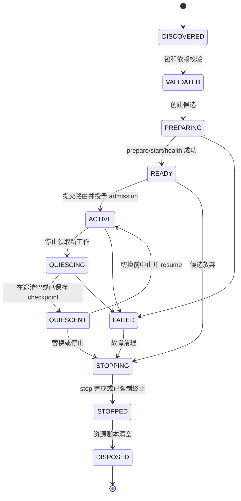
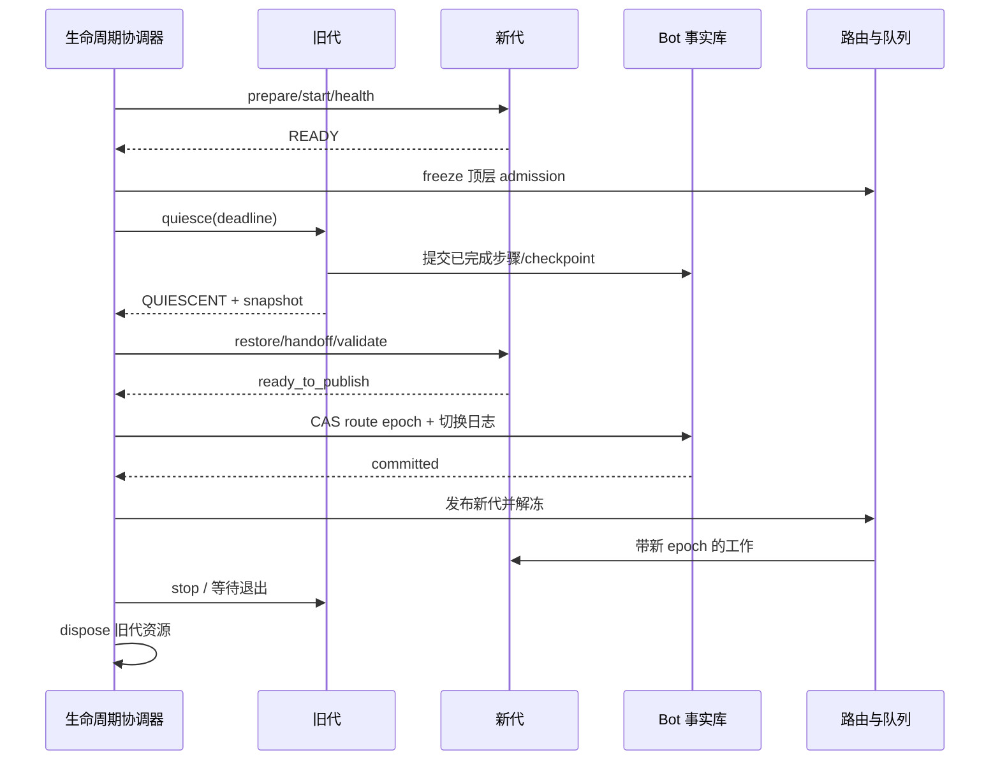

# 微内核与生命周期详细设计

## 1. 运行对象与身份

下面的对象必须分开持久化，不能用模块名或路径兼任所有身份。

| 对象               | 身份                                                   | 可变性                                         |
| ------------------ | ------------------------------------------------------ | ---------------------------------------------- |
| Package            | `package_id + version + content_digest`              | 内容不可变；同版本不同摘要拒绝静默替换         |
| ComponentSpec      | `package_digest + component_id`                      | 声明契约、作用域、运行时、资源和能力请求       |
| Instance           | `instance_id`                                        | 对应一个 Worker/受管理执行容器                 |
| Generation         | `component_id + scope_key + generation_id`           | 完整绑定代码、schema、依赖、能力授予与配置快照 |
| Route              | `bot_id + service_name + contract_major`             | 指向 Generation，带单调`route_epoch`         |
| ResourceOwner      | `scope(host / bot:bot_id) + generation_id + run_id?` | 树状所有权，父级退出必须回收子级               |
| LifecycleOperation | `operation_id`                                       | 持久操作日志，记录每步完成与失败原因           |

Generation ID 在部署中全局唯一，是不可变身份；`route_epoch` 是单条组件路由的发布顺序，两者不可互换。Bot 的 `registry_revision` 只表示路由集合修订，不能作为所有组件共用的失效开关。重新部署同一二进制也创建新 Generation；token 同时绑定宿主和 Worker incarnation。按文件路径重新查找身份会导致旧代码携带新权限，因此实际执行代码和调用身份在领取请求时一次绑定。

## 2. 包与声明契约

示意包结构：

```text
forest-agent/
  module.toml
  contracts/
    agent-v1.schema.json
  python/forest_agent/
  schema/
    baseline.sql
  ui/
  lock/
  checksums.json
```

下面是拟定 manifest 格式，不表示当前存在对应解析器：

```toml
manifest_version = 1
package_id = "org.forest.agent"
version = "0.1.0"
kernel_api = ">=1.0,<2.0"
runtime = "python-worker"
entrypoint = "forest_agent.worker:main"

[[components]]
id = "agent.runtime"
scope = "bot"
state_mode = "durable"
state_schema = 1
checkpoint_schema = 1
reload_mode = "drain"

[components.storage]
schema_id = "forest.agent.runtime"
schema_version = "1.0.0"
baseline = "schema/baseline.sql"
baseline_sha256 = "..."
repository_contract = "forest.agent.repository/1"

[[components.provides]]
name = "agent.run"
contract = "1.0"
schema = "contracts/agent-v1.schema.json"

[[components.requires]]
name = "memory.recall"
contract = ">=1.0,<2.0"
required = true
startup_dependency = true

[[components.requires]]
name = "renderer.document"
contract = ">=1.0,<2.0"
required = false
startup_dependency = false

[components.resources]
max_inflight = 16
max_queue_items = 128
max_queue_bytes = 8388608
memory_mb = 512

[components.lifecycle]
prepare_timeout_s = 30
start_timeout_s = 15
drain_timeout_s = 60
stop_timeout_s = 10

[components.capabilities]
requests = ["memory.recall", "context.commit", "provider.generate", "tool.invoke", "reply.propose"]
```

校验顺序：包摘要/信任策略 → manifest 格式 → 内核 API 兼容 → 运行时可用 → schema bundle 身份与 Repository contract 完整 → 服务依赖解析 → 可序列化组件状态转换可用 → 资源容量 → 能力授予。任何必需项失败都不能发布部分服务。

组件选择的只读预览和提交前事务复核必须用同一存储身份规则读取已安装 bundle：候选 SQL 身份与现有账本不一致、又没有受支持的版本升级边时，必须在写入期望选择前拒绝，不能让预热阶段才发现不兼容并留下无法冷启动的选择事实。新组件的空 namespace 仍由安装器原子创建；同一 SQL bundle 的 Python、UI 和 manifest 版本变更不应被误判为 schema 升级。

部署和 Host 作用域的 Graph 变更预览也按相同的只读身份规则核对各自的 `schema_bundles` 账本；执行变更前再次核对，SQL 身份不符时返回 `SCHEMA_BUNDLE_UPGRADE_REQUIRED`，不先排空旧 Graph。三种作用域目前只支持同一存储身份的运行中换代；这里的前置围栏不是 SQL 在线升级协议。

Forest 首次发布前，一个模块只有从空 namespace 安装的内容寻址 baseline；包里不存在按开发历史累积的 SQL migration 目录。首次发布后的 schema 升级边才随模块独立定义，不能重新形成宿主级编号迁移链。

声明 `capabilities.requests` 只是申请，实际集合为 manifest、部署授予、Bot 策略和请求身份的交集。`required=false` 的依赖缺失必须产生显式降级能力清单，不能在运行中随机 `ImportError`。

对外可配置组件还须声明版本化`config_schema_ref/config_schema_revision`，字段包含类型、默认值、约束、敏感性及`reload_policy`。WebUI据此生成表单，管理服务按同一schema验证；包校验只读取声明，不能为绘制设置页先运行任意插件代码。运行所需配置必须可经管理API提供，不能把手改插件目录中的文件作为唯一配置入口，详见[12](12-webui-administration.md)。

## 3. SDK 与 Driver 边界

以下是契约伪代码，真实实现需生成跨进程 DTO；不把 Python 对象作为线协议。

```python
class Component:
    async def prepare(self, ctx, config, restored_state): ...
    async def start(self): ...
    async def health(self): ...
    async def quiesce(self, reason, deadline): ...
    async def snapshot(self): ...
    async def restore(self, state): ...
    async def resume(self): ...
    async def stop(self, reason): ...

class RuntimeDriver:
    async def create_candidate(self, immutable_plan): ...
    async def invoke(self, instance, envelope): ...
    async def cancel(self, instance, call_id): ...
    async def terminate(self, instance): ...

class ResourceSupervisor:
    async def dispose(self, owner_id): ...
```

`ComponentContext` 只提供受权的 `services.call`、`events.publish`、`tasks.spawn_owned`、`jobs.schedule`、`state`、`clock`、`logger` 和只读配置。跨 Worker 时这些都是 IPC 句柄，不是共享对象。调用者不能从句柄反查底层数据库、平台 WebSocket 或其他实例。

`prepare` 可以分配受监督资源、读取允许的数据；`start` 启动待命循环并报告 ready。候选尚未获得业务执行权，无法发送消息、执行真实工具、提交正式记忆或消费生产队列。预热写入只能落隔离临时空间。排空后取得的最终快照通过 READY 状态下的 `restore` 应用于候选，再验证健康；Worker 退出后的 `dispose` 由宿主执行，不要求已退出的 Python 对象继续调用方法。

内核提交路由后才开放 admission token，待命循环才能领取工作；发布正确性不依赖另一个可能失败的业务 `on_activate` 回调。需要推进 Binding、订阅头或其他模块私有生效事实时，模块提供事务型 publication participant，由内核在同一目标 Bot 数据库事务中与配置 effective、Generation、Route 和 RuntimeGraph head 一起调用；participant 失败则整个提交回滚。提交后的本地 activation 只允许打开已预热的内存 gate，不做 I/O。候选准备成功但切换失败时，回收整个候选进程。

## 4. 组件状态机



`DISPOSED` 和 `FAILED` 实例不能重新激活；恢复创建新 Instance/Generation。包可以留在缓存中，但活跃实例不能因 LRU 淘汰而失去运行身份。

| 阶段      | 允许行为                          | 成功条件/失败处理                               |
| --------- | --------------------------------- | ----------------------------------------------- |
| VALIDATED | 读取声明，无用户代码副作用        | 依赖和授权计划固定；失败返回诊断                |
| PREPARING | 临时资源、只读预热、恢复候选状态  | 超时终止候选，不影响旧代                        |
| READY     | 健康探测、待命                    | 无生产订阅/写权限；可直接回收                   |
| ACTIVE    | 持有效 token 接单和执行           | readiness 与 liveness 分开判断                  |
| QUIESCING | 完成已领取工作、写安全 checkpoint | 禁止新顶层请求；既有调用树保留有限执行权        |
| QUIESCENT | 导出状态、健康维护                | 无可提交的用户任务、未交接的资源或外发临界区    |
| STOPPING  | 释放资源                          | 不允许新增任务，超时后 Driver 强制终止          |
| STOPPED   | 内核清理残余账本                  | Worker 已退出，不能仅因 callback 返回就认定完成 |
| DISPOSED  | 无                                | 订阅、句柄、租约、子进程和临时对象均已回收      |

生命周期命令携带 `operation_id + phase`。宿主记录完成结果，重复命令返回同一结果；组件清理方法应幂等。callback 本身不保证 exactly-once，崩溃恢复依靠持久阶段与资源所有者校验。

## 5. 依赖与启动/停止顺序

依赖分为启动依赖、运行服务依赖和事件订阅。启动依赖形成 DAG；出现环就拒绝部署，报告最短环和声明位置。互相通信的业务通过事件或已经激活的服务解耦，不能用互相等待 ready 的方式启动。

启动按 DAG 拓扑序，独立节点可以有界并行准备；每个依赖稳定 ready 后才准备调用方。失败时按逆拓扑回收此次新建资源，不停止原先已运行且不属于此次操作的模块。

冻结贡献目录的消费权来自组件 manifest 的 `contribution_directories.kind`，同一 RuntimeGraph 内每种目录只能有一个消费组件；Contract Router 只向该组件提供目录句柄，不按 `component_id` 名称授予权限。`agent-tools`、`shell-commands`、`job-types` 的消费组件依赖各贡献组件，确保贡献方先就绪；`routing-routes` 则由事件发布、订阅和 ComponentJob 贡献组件依赖路由目录消费组件，确保路由服务先就绪。缺少路由目录消费组件的路由贡献拒绝成图。路由目录消费组件还持有指向各贡献组件的冻结引用：任一方热替换均将双方纳入替换闭包，这条引用只用于保留规划，不形成反向启动依赖。目录消费声明、启动依赖与保留引用进入 Generation 描述符摘要。

停机先关闭顶层 admission 和定时器，再按“调用方先排空、被调用方后停止”的顺序。调用方在排空中发出的子请求使用原调用树令牌及剩余 deadline；不能借此建立新顶层工作。

正常 Bot 暂停与真正停机分别处理。`data_admission` 控制新 Agent/业务作业，`control_admission` 控制受权运维入口；普通 `pause` 关闭前者并提升 `maintenance_epoch`，保留接收绑定、核心 ShellGate、状态/恢复命令及必要回执。停止宿主、关闭绑定或封闭整个 Bot 事实库时，原群控制链也可能中断，操作应提前返回持久 operation_id 并明确恢复入口。稳定核心命令不能作为普通插件被卸载，完整 Shell 模块的替换不应冻结核心救援路由，详见[09](09-group-shell-command-system.md)。

替换前构造影响集合：目标组件、同一 Worker 中的其他组件、必须共同交接的状态组件、仅兼容旧契约的调用方及其必要依赖。首版一个包/Bot 的组件默认共用 Worker，因此整体属于进程替换集合。依赖兼容且进程独立时无需重载调用方，因为其持有稳定服务句柄。破坏性契约替换先并行提供新 major，再切换消费者，最后移除旧 major。

## 6. 热重载协议

首版只承诺 `drain`。无状态组件的 `overlap` 留待单独定义旧代只读令牌和退休协议后实现。有状态组件不允许新旧代同时写；不能通过声明无状态隐藏数据库或后台任务。

### 6.1 单 Bot 的 drain 替换

1. **PLAN**：写 `lifecycle_operations`，锁定目标包摘要、旧 Generation、候选 Generation、受影响路由、状态版本、预计资源和回滚条件。对相交的 route/state/binding 资源集合按规范顺序取得持久 operation lease 与 `op_epoch`；相交操作必须排队。FREEZE、RESUME、COMMIT 都校验操作所有权，过期协调器不能解冻另一操作的队列。
2. **PREPARE**：建立候选 Worker，加载完整代码和当前 baseline contract，解析依赖、恢复可用的只读快照、执行无副作用健康检查。旧代继续服务。首发前若模块数据库 schema 已变化，本次热重载不负责升级旧库，开发环境必须先重建。
3. **FREEZE**：在该 Bot 的协调账本冻结受影响路由的顶层 admission。相关业务命令保留在有界持久队列，查询按策略返回 `SERVICE_RELOADING` 或等待至 deadline。独立核心控制入口继续接收取消、状态与维护意图；若其具体目标正被升级占有，目标操作等待资源协调，不能直接调用已冻结 Worker。
4. **DRAIN**：旧代停止计时器和新消息领取。在冻结新任务入口后、等待在途任务排空前，协调器先把本次 operation_id 通知受影响 Worker；长 Agent 才能在下一模型/工具安全边界写 checkpoint、进入 `RELOAD_WAIT` 并释放执行租约。内核随后等待已入场调用树和自有任务归零，调用受影响包声明的只读 `replacement_guard_query` 检查其持久交接约束；拒绝时在发布前回滚，不改变已冻结请求的身份。通过后再关闭旧调用入口并签发排空证据；QUIESCENT 后不能新增子调用。若候选发布前失败，旧代先撤销替换信号或恢复已 quiesce 的 Worker，再开放任务入口；只有获得该恢复身份的原代才可领取自己停驻的 Run。仍可能调用目标的外部调用方必须完成原调用树或暂停于可重试边界。外部结果未知的调用转交账本，不能谎报已取消。
5. **SNAPSHOT**：确认旧代没有可提交的用户任务，按模块明确声明的 handoff contract 导出带 state schema、revision、checksum 的有界组件状态；候选执行纯确定性状态转换并验证不变量，输出只写候选 shadow 状态。没有明确需求的模块跳过此步并从权威事实恢复。这一步不执行 SQL、不安装或修改业务 schema；首发前只允许在空 namespace 安装完整 baseline。
6. **COMMIT**：一个 Bot 数据库事务锁定相关 `component_routes`，确认操作所有权、旧 epoch/代际、源 revision 及排空证据，递增 epoch，替换候选路由和已验证的 handoff 状态指针，写 `route_committed` 日志。任何旧写事务也必须锁定/验证这些 fence 行，二者形成确定先后顺序。
7. **PUBLISH**：宿主从已提交账本更新不可变路由快照，按当前 Bot 维护策略发放新 admission token，解冻允许执行的队列。COMMIT、PUBLISH 和失败后的 RESUME 均复核最新 `maintenance_epoch/data_admission`，不凭 PLAN 时的旧快照重新开放已被管理员暂停的业务。即使内存缓存仍暂存旧路由，Worker/写网关也会因旧 epoch 拒绝请求并触发重解析。
8. **RETIRE**：停止并回收旧代；记录健康观察和资源差额。旧包在回滚保留期内可缓存，旧实例不保留写权。

路由表替换和业务写入的权威记录放在同一Bot数据库。该Bot的配置期望与生效指针也以目标库为准；部署控制库保存部署资源期望、批量请求及Bot状态汇总，不成为另一个需要跨库同步提交的写入裁判。

优先级不会撤销 operation lease。紧急取消/暂停可通过独立短事务先写 `cancel_requested` 或维护意图，目标协调器在合法阶段观察；它不等待长操作持有的逻辑资源租约，也不能窃取该租约或与其并行发布路由。短事务仍遵守共同锁序和数据库争用上限。已提交路由的“取消”只能停止后续可取消步骤，回到旧包需要新操作；已有外部效果继续对账。最终业务准入是当前 Bot 策略与组件路由 admission 的交集。

群聊 RELOAD_WAIT 保留 active_session_id、已冻结 InputBatch、context_applied_seq、连续分类水位、触发 claim 与尚未 flush 的完整步骤 checkpoint。释放 Worker/Actor 执行租约不清除群的逻辑 Session 所有权；到达的新消息继续持久排队，不能另开同群 Agent。候选接管后按原输入批次恢复，在下一安全边界选择新切口，不能把整个队列无条件注入 Prompt。详见[08](08-group-context-interaction.md)。



### 6.2 热重载时的提交与副作用边界

Router 校验不是最终保护。持久提交事务必须同时验证组件 `route_epoch`、会话/Job `owner_epoch`、Run 状态、授权版本和幂等键。切换先提交，旧事务失败；旧事务先锁住 fence 并完成，则其事实属于切换前合法结果。

已经合法提交的 `SendIntent`/`ToolIntent` 是独立业务事实，不因产生它的模块退出而丢弃。由 Delivery/Effect Executor 使用自己的有效租约执行，并在执行前重验当前授权。模块的旧 callback 不能再提交第二份意图。

外部网络请求与数据库事务不能原子切换。Adapter/Effect Executor 升级必须排空实际正在发送的调用，或记录 `UNKNOWN` 并禁止自动接力重发。强制杀进程只能停止本机执行，不能撤销平台已经收到的请求。连接所有权交接见[通信设计](03-communication-scheduling.md)。

### 6.3 回滚与崩溃恢复

| 失败点                                 | 恢复动作                                                                                                                                        |
| -------------------------------------- | ----------------------------------------------------------------------------------------------------------------------------------------------- |
| 新包校验、预热或状态 handoff 失败      | 回收候选，旧代按最新维护策略继续/恢复 admission，记录失败                                                                                       |
| freeze 后协调器崩溃，尚无 route commit | 恢复器读旧路由，校验旧代健康；恢复旧代或以旧包创建新代并提升 epoch                                                                              |
| route commit 成功，内存发布前崩溃      | 以 Bot 数据库已提交路由为准；可重新握手接管仍存活的候选。若需重建 Worker，则创建新 Instance/Generation 并再次递增 epoch，不能按控制库缓存回旧代 |
| 新代已接单后健康失败                   | 执行一次新的替换操作；回旧包也必须创建新 Generation、递增 epoch                                                                                 |
| 旧实例 stop 失败                       | 撤销句柄、终止 Worker、检查资源账本；残余资源使操作标记 `CLEANUP_FAILED`                                                                         |
| 外部副作用结果不明                     | 意图保持 UNKNOWN，由专用对账路径处理；不能恢复 Run 后重新生成同一效果                                                                           |

切换后的回滚不等于恢复旧快照。新代已经提交的数据必须保留；仅在旧代码能读取当前 baseline contract、checkpoint 与事件版本时才允许部署旧包。当前未发布阶段的 schema 不兼容变化不走热重载或回滚，直接重建开发数据库；不得预埋 expand/contract、旧列 fallback 或双写。

### 6.4 多 Bot 与共享组件

一个包升级多个 Bot 时，每个 Bot 有自己的替换操作和结果，可先金丝雀 Bot，再批量推进。某 Bot 失败不会回滚其他 Bot 已提交的业务事实。

Host 共享组件只允许无 Bot 私有状态的服务。新旧 Host Worker 可同时存在，各 Bot 路由逐个切换；所有 Bot 离开旧代后才回收它。需要共享可变全局状态的服务必须单独声明所有者及存储事务域，不纳入首版自动跨 Bot 原子热重载。

### 6.5 WebUI配置变更与生效版本

WebUI的“应用”提交固定schema、配置修订、目标集合和预期版本的控制计划，候选构建绑定该计划。保存期望配置不修改旧Generation持有的构造快照；generation字段仅在上述COMMIT事务中随路由/状态指针一并发布对应生效修订。候选失败时旧生效配置继续可用，页面显示失败原因和仍未生效的期望修订，不能把数据库已保存或HTTP已接纳显示为运行成功。

dynamic字段以新的不可变请求配置覆盖层发布，Generation的构造快照保持不变；默认在后续Run/任务取新快照，在途请求保留原修订。需要改变客户端、资源池或已在on_load中缓存的配置必须声明generation，不能靠更新同一个Python字典实现动态生效。授权撤销、紧急暂停及发送/删除守卫仍按当前权威状态即时判定，不等待普通配置生效边界。

同一组件混合多类字段时，计划必须采用足以安全发布整份依赖配置的流程；多组件或多Bot变更按资源记录生效与失败，不承诺跨事务域整体原子切换。后台和Shell并发修改仍检查目标库expected_revision及操作资源lease；配置回退是基于当前状态创建的新修订/新操作，不能恢复旧快照抹去已提交事实。浏览器关闭只断开进度订阅，生命周期操作及其取消决定继续由原持久账本负责。

构建失败后，`desired_revision` 可以领先于 `effective_revision`。管理员修复或回退时，以当前 **desired** 修订为 CAS 前提创建并应用新修订；不能要求两者相等，否则失败修订会永久堵住恢复入口。候选 Generation 仍只绑定最新 desired 修订及其 Payload 身份；发布事务在锁住配置头后确认该修订仍是 desired，再将 effective 从任意较早修订推进到候选修订。先前失败的候选不能越过新 desired 发布，旧 effective 在新图成功发布前继续服务。

管理API/UI自身也属于受监督组件，其替换不迁移HTTP连接或浏览器执行栈；未完成操作依靠权威账本恢复。管理服务故障不停止Bot业务，QQAdapter故障不停止Web管理；整个宿主重启仍有管理连接中断，页面重连后核验同一操作和实际运行状态，不能因请求超时重新发起重启。

## 7. 状态分类与代际交接

| 状态              | 示例                         | 替换策略                                                                                                  |
| ----------------- | ---------------------------- | --------------------------------------------------------------------------------------------------------- |
| 无状态/可重建缓存 | schema 缓存、只读索引句柄    | 丢弃并预热，不要求 snapshot                                                                               |
| 会话临时状态      | Prompt 视图、stream 缓冲     | 在安全边界结束/取消后重建；不交接活跃流                                                                   |
| 小型组件状态      | 有界游标、计数快照           | 序列化 snapshot，检查基准 revision 与 checksum                                                            |
| 持久业务状态      | Context、记忆、Job、工具结果 | 保留模块 Repository 中的事实；随准确 schema bundle 身份重新挂载，不混入 Generation snapshot              |
| 外部资源          | WebSocket、浏览器、模型流    | 原实例关闭，新实例重建；必要时交接持久游标                                                                |

snapshot 至少包括 `bot_id, component_id, generation_id, state_schema, source_revision, captured_at, checksum, payload_ref`。禁止序列化凭据、Python 对象引用、锁、执行栈或模块数据库。handoff 转换函数输入旧值对象、输出新值对象，不访问数据库、模型、网络或真实平台；重复转换应得到相同结果。持久事实不进入 snapshot；首发前 schema 变化直接重建数据库，不能借 handoff 回调绕过。

## 8. 资源所有权与监督

所有资源注册到 `ResourceRegistry`，记录 owner、类型、数量/字节、创建点、关闭方法、超时和最终状态。`tasks.spawn_owned` 必须保存任务引用、观察异常、继承取消和 deadline。Worker 内 TaskGroup 之外的长任务必须登记为 Job 或组件后台任务。

Bot 宿主必须持续监督当前 RuntimeGraph 报告的全部 owned task、HostLease 续租任务和图替换任务。任一仍属于当前图的任务取消、异常或无异常提前返回，都使该 Bot 宿主失败；多 Bot Supervisor 将准确错误码写入该 Bot 的 `FAILED` 观测并关闭其管理准入，不影响其他 Bot。热替换期间只在 replacement lock 两侧比较任务所有权：已经属于旧图的完成任务不得误伤新图，候选发布后新图任务立即进入监督集合。宿主关闭会先撤销监督，再按反向依赖排空模块，避免把预期取消误报为运行故障。

Generation 持有的 Effect Driver 若启动长期任务，必须通过 `owned_tasks` 端口将任务逐级交给 Package Generation 和 RuntimeGraph；WebSocket 读取、入站消费等任务不能只由 Driver 私下持有。当前图中的连接读取任务即使正常返回，也表示该传输已停止，宿主应按上述故障路径关闭本代并让 Supervisor 依据运行意图重试。HTTP 健康检查只能说明管理进程可连接，不能代替 Bot 图与外部传输的运行观察。

当 Bot 启动失败且 Host 已关闭时，Supervisor 记录 `FAILED` 和有界重试时间。失败次数由部署库的观察行持有；下一次 `STARTING` 不清零，失败结算在同一行更新中按该次数计算指数退避，默认从 5 秒开始、最多 3600 秒。成功 `ONLINE` 或明确停止流程才清零，因此外部 OneBot 长期不可用不会使 Bot 每次都以首次失败的间隔重建运行图。管理员随后把运行意图撤为 `OFFLINE`，管理动作只修改内核意图，不伪造运行观察；Supervisor 回收该 Bot runner 后，按当前 Supervisor lease、意图修订和 `FAILED` 观察修订在同一事务中结算为 `OFFLINE`，并清除重试时间。任一修订变化、意图重新变为 `ONLINE`、观察不再是无图的 `FAILED`，都不得覆盖新状态。若 Host 清理失败（`BOT_RUNTIME_CLOSE_FAILED`），不得将故障观察伪装为 OFFLINE，必须保留故障供人工处理。其他 Bot 的运行不受该结算影响。

Bot 正常停止、取消和运行异常都必须先拒绝新的管理准入，等待已准入的管理请求退出，再关闭该 BotHost；异常路径不能绕过这道排空屏障。等待仅覆盖当前 Bot 的管理请求，其他 Bot 的管理入口继续服务。

包自有工作排空以领取循环存活为前提。若任一被排空的循环提前终止，无论是否已观察到队列暂空，都必须使本次排空以明确错误结束，触发发布前回滚；不能无限等待只会由存活循环发出的排空信号，也不能把失败循环视为已成功排空。
领取事务的超时不构成“队列为空”的证据：事务回滚后按原队列租约语义重试，只有已完成的空领取才能推进 backlog 排空。重试总时长仍受组件声明的 `drain_timeout_s` 约束；无法在期限内排空应返回有类型的失败。内核回滚只调用通用 Generation 生命周期端口，不按组件 ID 调用 Agent、Conversation 或 Shell 的私有方法。

Python 的 TaskGroup 在退出上下文时等待组内任务，裸 create_task 也需要保留强引用；SDK 在此基础上增加持久所有者与卸载协议，不能把 TaskGroup 本身当成崩溃恢复机制。基础行为见[Python asyncio 官方文档](https://docs.python.org/3.11/library/asyncio-task.html#task-groups)。

关闭顺序：禁止新增资源 → 取消/排空子任务 → 停止订阅和计时器 → 关闭流和客户端 → 终止子进程 → 删除临时文件 → 释放句柄与租约。关闭每项有上限；超时仍需回收进程并报告未清理资源。

静态包缓存与活跃资源分别计费。热重载资源预留至少覆盖同时存活的旧代和候选；容量不足时在 PREPARE 前返回 `INSUFFICIENT_HEADROOM`，不能通过杀旧代腾空间后宣称无损重载。

监督策略按组件配置：`never`、`on_failure` 或 `always`，重启必须指数退避并有时间窗上限。连续崩溃进入 `QUARANTINED` 管理状态，停止自动拉起，保留队列与诊断。一次工具异常属于调用失败，不自动重启整个 Bot。

## 9. 可选 Wasm Driver 的适配约束

本节仅预留扩展契约，不构成首版依赖或开发任务。原生 Python 的完整加载与热重载方案见[07](07-python-plugin-development.md)。

Wasm guest 的所有宿主能力经显式 imports，effect 身份由对应 Store 的不可变执行上下文生成。输入/输出 schema 检查、能力存在性与授权判断分别执行。每次新建 Store/Instance 的模式可以保留，持久状态外置。

Driver 必须约束线性内存、执行预算、宿主调用次数、结果字节数和整体 deadline；具体 Wasmtime API 与版本在实现阶段锁定验证。默认不授予任意文件、网络、环境变量或 WASI 权限。

effect 采用 `submit(operation_id, payload_digest)` 与 `query(operation_id)` 的可查询结果协议。guest 输出缓冲不足不应再次执行真实副作用，可返回结果长度或结果句柄再读取。所有偏移、长度、整数转换和包内路径都要校验，包路径规范化后不得越出内容根。

## 10. 生命周期验收

- 重载准备失败：旧代仍可服务，配置/schema 不混代。
- 旧代在 route commit 后迟到提交：返回 `STALE_EPOCH`，事实与 outbox 均无新增。
- prepare、freeze、commit、publish 各阶段杀掉宿主：恢复后只有一套有效路由和写权。
- 长工具无法及时结束：保留原操作的确定/未知状态，其他不依赖组件继续运行。
- 重复 stop/dispose 和进程意外死亡：资源计数回到基线，没有孤立任务或订阅。
- 从新包回到旧包：epoch 继续增加，新代合法事实不被旧 snapshot 覆盖。
- 重载进行中收到群聊 pause/cancel：意图可先持久化，但不夺取 operation lease；迟到 PUBLISH/RESUME 不重新打开已暂停业务，核心查询仍可用。
- 依赖环、状态版本不兼容、资源不足、未授予必需能力：发布前拒绝并给出具体原因。

并发写入的交换性与合流性不由生命周期机制自动提供，必须同时满足[并发合流设计](06-concurrent-convergence.md)。
