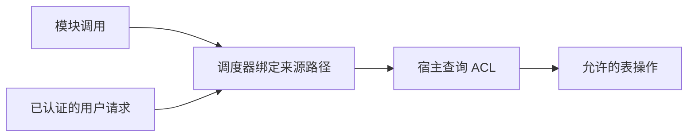

# 状态表、访问控制与热重载

本文记录宿主托管状态表、可信来源与 ACL 的设计方向。令牌路径与匹配工具已实现，状态表、宿主来源绑定及授权尚未实现。运行时总体边界见[模块运行时架构](01-module-runtime.md)。

## 1. 宿主托管、模块定义的状态表

每个模块实例对应一张独立的数据表。宿主维护类似 HashMap 的键值容器，模块通过宿主接口读取或修改值。表独立于某次 Wasm 执行实例存活，也可以序列化到磁盘。

这里的“模块拥有数据”表示模块定义数据结构与含义；宿主负责保存和提供受控访问。表与 ACL 不因替换 Wasm 而重新创建。

| 内容 | 存放或恢复方式 |
|---|---|
| 配置 | 表中保存，可接入管理 UI |
| 可恢复运行状态 | 表中保存，重建实例时读取 |
| 可重建缓存 | 实例内按需建立 |
| 连接、锁、文件和宿主资源句柄 | 执行资源，按生命周期管理 |
| Future、调用栈 | 不编码进表中，重载前等待已有处理完成 |
| 尚未派发的请求 | 由调度器保存，与模块数据表区分 |

表可以同时承载配置和可恢复状态，但每个条目的用途与访问权限需要明确。是否把它扩展为全部模块数据的通用存储，尚未决定。

## 2. 类型化读写与持久保存

表的值使用 Forest `Value` 表达，配置和状态项的结构来自 Rust 类型声明。SDK 可以用类型化的键暴露访问，以下仅表示预期使用方式：

```rust
let count: i64 = state.get(COUNTER)?;
state.set(COUNTER, count + 1)?;
```

宿主内部的映射不应迫使模块内部到处使用动态字典。读取不隐式写入、补默认值或初始化状态；这些修改需要明确表达。

单次写入顺序与多步读改写不是同一件事。`get → 计算 → set` 不能自然保证不丢更新，尤其是模块与 UI 都可以写入时。条件写入或其他合流方式的具体接口尚待确定，不在当前文档中默认把这三步视为原子操作。

内存修改成功与已保存到磁盘成功分开表达。磁盘编码、显式保存接口、保存时机以及恢复流程尚未决定。

包更新导致条目类型或含义变化时，由模块明确处理转换。结构子类型兼容不能代替数据转换：当前 Record 和 Tuple 的解码支持有损投影，不能据此静默丢弃旧数据。具体语义见[序列化说明](serialization.md)。

## 3. 可信来源路径与 ACL

访问控制采用两项机制：

1. 调度器根据真实执行上下文生成、附加来源路径。
2. 宿主使用 ACL 判断该来源能否对目标资源执行指定操作。

本设计中的“路径形状的令牌”表示调度器维护的可信来源信息。模块只有发起调用的能力，不能指定自己的来源、伪造管理员路径或通过参数覆盖宿主附加的身份。路径无需交给 Wasm 保管后再传回。



ACL 是权限事实的来源。其概念规则为：**来源匹配条件、目标表或键、允许的操作**。确切的数据类型及编码方式尚未固定。

路径本身不授予权限，也不因为具有父子形状就天然产生管理权。精确来源匹配与显式子树匹配需要区分；匹配按路径段进行，不使用普通字符串前缀判断。`forest-util::token` 已实现泛型路径及 `*`、`**` 模式，具体语义见[令牌设计](03-token.md)。

普通数据写入权不自动包含修改 ACL 的权限。授权管理入口及其初始授权来源仍需讨论。

当前不引入完整的凭证发行、委派和子令牌派生体系。路径的父子关系仅表达结构，不承担能力派生协议。

## 4. WebUI 对接

模块包可以携带配置界面，UI 使用条目类型声明及模块提供的显示信息展示和提交修改。

| 条目用途 | UI 预期行为 |
|---|---|
| 配置 | 根据用户权限提供编辑 |
| 内部运行状态 | 根据用户权限展示，是否可修改由声明和 ACL 决定 |

UI 操作的来源由宿主绑定已认证用户，不因页面来自某个模块就获得该模块身份或完整权限。UI 与模块都经过同一个宿主表访问入口。

配置变更如何通知模块、哪些变更立即生效、哪些需要重建实例，尚待定义。写入表成功不应被直接展示为“运行实例已经应用”。

## 5. 热重载交接

热重载保留稳定的模块实例身份及其表、ACL，替换对应的 Wasm 执行实例。调度器不再接受已退出执行实例的调用，不额外引入一棵执行令牌树。

交接的基本顺序为：


- 已经开始的处理在旧实例完成；尚未开始的请求由调度器保留。
- 状态表不随旧 Wasm 销毁，不需要模块导出一份通用 `snapshot`。
- 新实例根据表中数据重建其内存对象，不复制旧实例的原始内存布局。
- 不预设排空期限，不引入自动超时、自动取消或强行迁移执行栈。
- 当前不承诺迁移尚未结束的长任务。是否需要模块声明安全点，取决于后续任务模型。

交接期间必须明确 UI 和模块写表的顺序，以免新实例读取到未确定的初始化状态。以下细节尚待讨论，不能在实现中自行补成既定规则：

- 暂停派发期间如何处理新的 UI 写入及其他获授权来源的写入。
- 候选 `create` 是否只读；若会修改表，修改何时生效。
- 新实例创建失败时，如何保留旧实例及其可继续使用的数据。
- 新实例开始工作后发生错误时，如何处理后续恢复；不能直接假定旧内存状态仍然有效。
- 连接、定时任务等执行资源的启动和释放顺序。

## 6. 来源与调用的边界

模块的直接表访问由宿主绑定实际执行模块；用户入口绑定已认证用户。跨模块调用保留原始发起者，同时由宿主确定当前执行模块，不能用其中一个身份覆盖另一个。

对于 `A → B → 表`，B 读取自身内部配置按 B 的权限；代用户修改目标配置则检查发起用户对该目标的授权。接口调用权不能替代目标操作权。Bot 与群聊作为作用域，Agent 的上下文内容不授予权限，详见[来源令牌设计](03-token.md)。

通用路径支持类型化段，文本格式与通配符规则已经确定。框架身份段的具体类型、调用上下文、ACL 规则组合、无匹配规则时的行为、表和键的授权接口，仍需在对应接口设计时明确。

这些未定项不要求先构造完整的认证平台或授权委派系统。当前设计边界仍然是：**可信来源由调度器生成，访问权由 ACL 表达，数据操作由宿主统一执行。**
