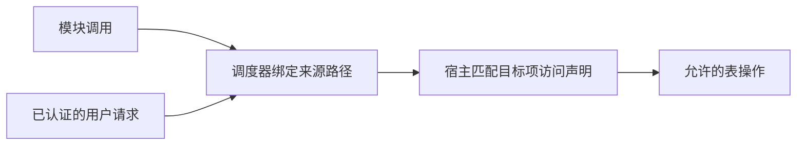

# 状态表、访问控制与热重载

本文记录宿主托管状态表、可信来源与 ACL 的设计方向。令牌、ACL、SQLite 及宿主鉴权已实现，状态交接和限制见[运行说明](13-runtime-and-sdk.md)。运行时总体边界见[模块运行时架构](01-module-runtime.md)，配置表接口见[配置表实现](05-config-table.md)，ACL 规则以[配置访问声明](06-config-access.md)为准。

## 1. 宿主托管、模块定义的状态表

宿主维护一张对象大表：键为实体 Token，值为该实体的配置表；配置表的键为配置项路径 Token，值为包含 Schema、默认值和当前值的 Entry。模块、用户等实体复用同一存储机制，模块通过受控宿主接口选择访问目标。

条目声明必须提供默认值。注册实体时建立全部 Entry，当前值初始化为默认值；不引入 `Option<Entry>` 或未初始化条目。重置恢复默认值，不删除条目。没有声明的路径返回错误，不在读取时补项。

表由宿主使用 SQLite 持久化，独立于某次 Wasm 执行实例存活；后台连接提供异步接口，Schema、默认值和当前值以 JSON 文本保存，可用普通 SQLite 工具查看。

这里的“模块拥有数据”表示模块定义数据结构、含义及自身配置项的访问规则；宿主负责保存和提供受控访问。配置值不因替换 Wasm 而重新创建；ACL 随所属声明装载，更新声明时与执行交接一起切换。

| 内容 | 存放或恢复方式 |
|---|---|
| 配置 | 表中保存，可接入管理 UI |
| 可恢复运行状态 | 表中保存，重建实例时读取 |
| 可重建缓存 | 实例内按需建立 |
| 连接、锁、文件和宿主资源句柄 | 执行资源，按生命周期管理 |
| Future、调用栈 | 不编码进表中，按外部选定的卸载方式结束，不迁移 |
| 尚未派发的请求 | 由调度器保存，与模块数据表区分 |

表可以同时承载配置和可恢复状态，但每个条目的用途与访问权限需要明确。是否把它扩展为全部模块数据的通用存储，尚未决定。

## 2. 类型化读写与持久保存

表的值使用 Forest `Value` 表达，配置和状态项的结构来自 Rust 类型声明。SDK 可以用类型化的键暴露访问，以下仅表示预期使用方式：

```rust
let counter = Key::<i64>::new(counter_path);
store.register(module_token.clone(), [counter.declare(&0)?]).await?;
let count = store.get(&module_token, &counter).await?;
```

宿主内部的映射不应迫使模块内部到处使用动态字典。读取不隐式写入、补默认值或初始化状态；这些修改需要明确表达。

模块侧先只提供单项 `get/set/reset`，保证各次操作独立、原子地完成。分开的 get/set 中间允许其他写入，不组成原子读改写；冲突如何协调由模块决定。当前不引入条目版本、CAS、自动重试、批量操作或事务内模块回调，见[宿主接口设计](08-host-interfaces.md)。

现有 `forest-config` 原生库另有宿主侧 `read/apply/update`，其事务和同步 Rust 回调仅属于原生存储 API，不要求 Wasm 模块提供回调，也不作为模块协议的必要部分。模块计算和异步等待不跨越宿主配置事务。

SQLite 是配置数据的唯一权威；写操作成功返回表示事务已提交，不只是内存变更或保存入队。宿主重启直接打开数据库；显式序列化副本仅用于导出和导入。Wasm 模块通过受限宿主接口访问，不获得 SQL 连接。

包更新导致条目类型或含义变化时，由模块明确处理转换。结构子类型兼容不能代替数据转换：当前 Record 和 Tuple 的解码支持有损投影，不能据此静默丢弃旧数据。具体语义见[序列化说明](serialization.md)。

## 3. 可信来源路径与 ACL

访问控制采用两项机制：

1. 调度器根据真实执行上下文生成、附加来源路径。
2. 插件在自身配置项声明中提供 readers/writers，在接口声明中提供 callers，宿主根据目标资源及操作检查来源。

本设计中的“路径形状的令牌”表示调度器维护的可信来源信息。模块只有发起调用的能力，不能指定自己的来源、伪造管理员路径或通过参数覆盖宿主附加的身份。路径无需交给 Wasm 保管后再传回。

模块可以在 create 时收到自身稳定 Token，并把它作为配置表操作的目标地址，也可以选择其他实体目标；目标是普通数据，不是授权凭证。调度器仍独立附加可信来源并检查 ACL 与入口操作限制。



配置项的访问声明是权限依据。每项声明分别提供可读和可写主体列表，主体匹配可以引用所属逻辑模块或 Token 通配符模式；没有匹配就拒绝。接口调用使用同一 AccessPolicy 的 callers，调用与读写权限相互独立，不存在隐式自身权限或管理员旁路。

路径本身不授予权限，也不因为具有父子形状就天然产生管理权。精确来源匹配与显式子树匹配需要区分；匹配按路径段进行，不使用普通字符串前缀判断。`forest-util::token` 已实现泛型路径及 `*`、`**` 模式，具体语义见[令牌设计](03-token.md)。

规则属于插件元数据，宿主装载并绑定后持有；普通写入只改变当前值，不能修改访问规则、Schema 或默认值。不建立独立 SQL ACL 表，不提供运行中授权增删接口。插件不能通过声明其他目标的地址修改其规则，详见[配置访问声明](06-config-access.md)。

当前不引入完整的凭证发行、委派和子令牌派生体系。路径的父子关系仅表达结构，不承担能力派生协议。

## 4. WebUI 对接

模块包可以携带配置界面，UI 使用条目类型声明及模块提供的显示信息展示和提交修改。

| 条目用途 | UI 预期行为 |
|---|---|
| 配置 | 根据用户权限提供编辑 |
| 内部运行状态 | 根据用户权限展示，是否可修改由声明和 ACL 决定 |

UI 操作的来源由宿主绑定已认证用户，不因页面来自某个模块就获得该模块身份或完整权限。UI 与模块都经过同一个宿主表访问入口。

配置变更如何通知模块、哪些变更立即生效、哪些需要重建实例，尚待定义。写入表成功不应被直接展示为“运行实例已经应用”。

## 5. 热重载交接

热重载保留稳定的单例模块对象 Token 及其配置数据，替换对应的 Wasm 执行实例；访问规则随配置声明在交接时一起切换，候选声明不能提前覆盖当前规则。旧/候选执行实例不构成两个具名对象。调度器不再接受已退出执行实例的调用，不额外引入一棵执行令牌树。

对其他包，调用地址始终是原来的 `(对象 Token, 接口路径)`，无需重新绑定。生命周期采用 RAII 风格，卸载/重载由外部明确选择三种方式，完整顺序见[模块生命周期](10-module-lifecycle.md)：

| 方式 | 旧实例如何结束 | destroy |
|---|---|---|
| Drain | 阻止新请求进入旧实例，完成此前已接纳的全部请求 | 运行，宿主操作受限 |
| AtYield | 等当前推进正常返回，停止其他旧请求 | 运行，宿主操作受限 |
| Force | 中断运行中的 Wasm，废弃旧实例 | 不运行任何来宾清理代码 |

默认 Drain，不设置超时或自动切换方式。主动让出并不表示调用完成；AtYield 是外部明确允许中断未完成调用，时间片被动暂停不是运行 destroy 的安全边界。

热重载先校验候选，关闭旧入口并按选定方式结束旧实例，释放其连接与资源，再运行新 create。初始化成功后切换活动实现、声明和静态 notifier 注册关系，处理交接期间宿主有界队列中保留的新请求。不同方式的旧队列处理和调用结算按生命周期文档执行，不自动重放已经开始的旧操作。

状态表不随旧实例销毁，新实例读取已有配置重建内存。create 禁止 send/call，包括宿主原生服务对象；destroy 同样禁止 send/call，并且不得新建连接，可显式读写配置和执行资源清理。Force 或 trap 跳过 destroy，资源由宿主回收。初始化失败不自动恢复已经销毁的旧实例，已提交配置写入不因 RAII 回滚。

外部 UI 与其他获授权主体的写表顺序及 Schema/default 替换仍需确定；不据此引入事务内模块回调、数据版本或迁移分支。

## 6. 来源与调用的边界

模块的直接表访问由宿主绑定实际执行模块；用户入口绑定已认证用户。跨模块调用保留原始发起者，同时由宿主确定当前执行模块，不能用其中一个身份覆盖另一个。

对于 `A → B → 表`，B 读取自身内部配置按 B 的权限；代用户修改目标配置则检查发起用户对该目标的授权。接口调用权不能替代目标操作权。Bot 与群聊作为作用域，Agent 的上下文内容不授予权限，详见[来源令牌设计](03-token.md)。

配置及接口 ACL 的规则组合与默认拒绝已在[访问声明](06-config-access.md)确定。框架身份段的具体类型、内部访问与代用户操作的入口契约以及宿主 ABI，仍需在对应接口设计时明确，不能由目标地址或来宾参数猜测授权主体。当前只考虑单 Bot 账号，先挂载模块自身声明；用户等其他实体的声明挂载在实际需要时再确定，不为多 Bot 预设配置层次。

这些未定项不要求先构造完整的认证平台或授权委派系统。当前设计边界是：**插件声明自身配置的访问规则，调度器绑定可信来源，宿主检查后执行数据操作。**
