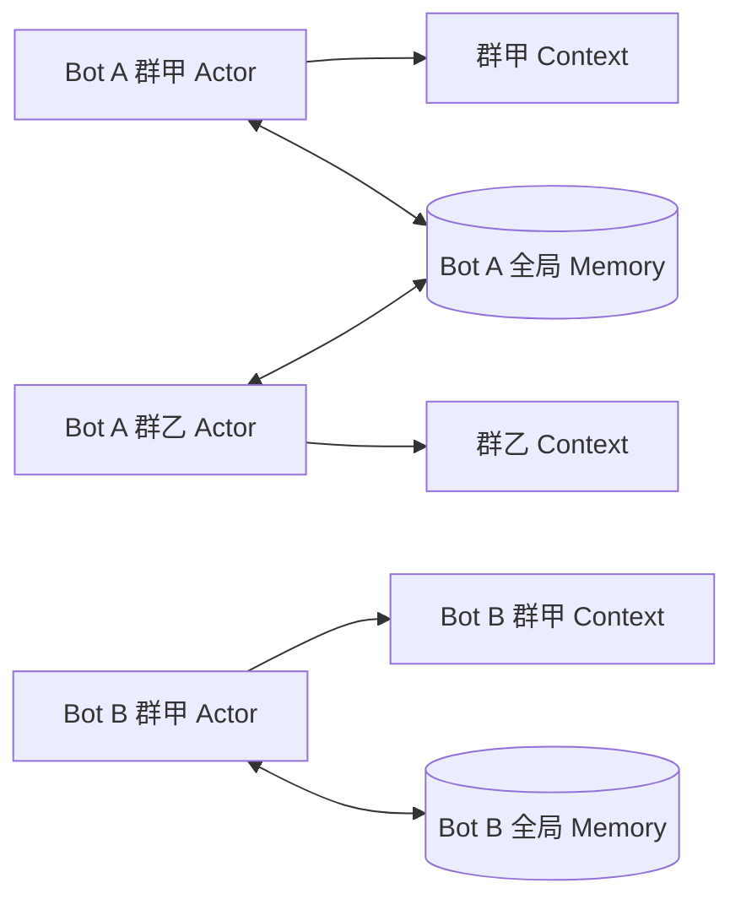
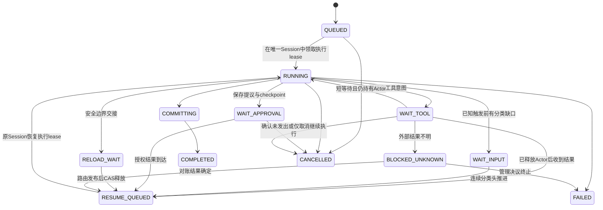

# 多 Bot、Agent 与记忆详细设计

## 1. Bot 实体与身份边界

Bot 是长期存在的逻辑主体，Agent 是为 Bot 工作的一次执行器。Bot 不等于 Python 实例、平台连接、群聊或单个 LLM 会话。

```text
BotEntity
  bot_id                  稳定不可复用身份
  display_name            可修改展示名
  persona_profile_ref     人格/系统指令版本
  model_profile_ref       模型、备用模型与预算策略
  memory_store_profile_id 独立长期记忆存储配置
  module_set_revision     安装/启用组件集合
  policy_revision         当前权限和行为策略
  config_revision         运行配置快照修订
  status                  生命周期状态
```

`BotBinding` 包括平台、外部账号、adapter、凭据引用与启用状态。一个 Bot 可有多个账号/平台绑定；同一个 Bot 的各绑定读写同一个全局记忆域。默认一个外部账号只归一个 Bot，binding_id 固定归属原 Bot/账号。账号重新分配先撤销旧绑定、处理旧发送和关闭连接，再创建新的 binding_id，见[迁移与账号转移](05-storage-security-operations.md#25-存储迁移与账号转移)。

用户身份使用 `(platform, external_user_id)`，需要跨平台关联时由身份模块保存可审计映射；不能按昵称自动合并，也不能让模型生成的“这就是某用户”成为可信身份关系。

### 1.1 Bot 生命周期

```text
CREATED → PROVISIONING → READY → ONLINE
                            ↗       ↓
                         PAUSED ← PAUSING
ONLINE / PAUSED → STOPPING → STOPPED
STOPPED → PROVISIONING（重新启动）
STOPPED → DELETING → DELETED
```

创建 Bot 必须先验证独立 MemoryStoreProfile 和必需模块，存储未就绪不能上线。普通暂停关闭 `data_admission`，停止创建新 Run 与业务任务，保留绑定接收、Inbox、持久 Job 记录以及 `control_admission`，因此管理员仍可在群里查询、取消或恢复。已运行工作按 pause 的类型化参数选择排空或取消，不能含糊地假定已停止。恢复按明确积压/过期策略消费，并使用最新 `maintenance_epoch`；旧重载不能覆盖新暂停。真正停止会排空组件并关闭连接，不删除记忆，也不保证该绑定仍能接收群管理命令。

删除是独立管理工作流：先冻结接入、取消/对账执行、撤权、清理索引及媒体、执行存储保留政策，再标记 DELETED。bot_id 不再复用；备份恢复使用同一身份并通过 epoch 提升重新建立执行权。

## 2. 会话与工作上下文

`ConversationKey` 见[通信设计](03-communication-scheduling.md#41-规范身份)。每个会话维护 ingress_seq、连续分类水位 classified_through_seq、Context 输入水位 context_applied_seq、context_revision/context_view_revision、actor_epoch、唯一 active_session_id、触发记录和本地短期上下文视图；Run 另有 owner_epoch 与 input_revision。



群甲的活动 Prompt 不直接拼接群乙的聊天历史。需要跨群知识时从 Bot 全局记忆召回证据，每项在实际模型输入中标明原始来源群、作者与当前使用群，不能只在日志/metadata保存来源。会话本地缓存不是第二套长期记忆库，淘汰后从 Context 事实恢复。

一个群只有一个活跃 ConversationSession，内部 Run 与 Provider 调用串行。所有群消息先进入该会话的持久输入流水；触发只决定是否调用 Agent，不决定是否保存上下文。下一次模型调用前的安全边界选取截至最后一个待触发记录的连续消息前缀，包含中间其他用户的普通发言；其后的非触发尾部保留到下一触发或工作结束后的静默排空。无触发的空闲群也会持续入 Context 和裁剪。完整契约见[08 群聊交互设计](08-group-context-interaction.md)。

同群唯一响应链是强约束，不能以“只串行最终提交、允许多个模型并行生成”替代。子 Agent 可以做受监督的独立分析，但不拥有另一条群对话链或直接回复权。

每个 GroupMessage 保留可信 sender_id/subject_id、当时显示名快照、source_ingress_seq、时间、平台来源、回复/转发引用与内容段。模型中的多用户消息即使共享 `role=user`，也必须有结构化作者边界；昵称、引用中的作者和正文自述不能替换真实发言者。摘要和长期事实沿用这些归属，不能把全群“我”的陈述归给触发 Agent 的最后一个用户。

## 3. Agent 运行模型

### 3.1 Run 输入与资源

一次 Run 固定 `bot_id, conversation_id?, session_id?, ReplyRoute 的会话目标, config_revision, persona_revision, agent_contract, module_generation, budgets, service_principal_ref`。它的输入使用追加式 InputBatch，不再假定整个 Run 的 input_event_ids 从启动到结束永远不变；每批冻结来源前缀、trigger_ids、逐触发 principal_ref 与 input_revision，每次模型调用固定其所见输入版本。

Agent 的 Prompt 使用冻结的配置版本；安全权限与删除状态始终重验，不能冻结一份权限后无限有效。Run 读取的长期记忆附 `source_revision, projection_revision, evidence_ids, deletion_epoch`，其结果可能在执行期间失效。

Run 拥有自己的 Context 工作分支、工具调用集合、模型流、取消树和 token/时间预算，不拥有数据库或平台连接。共享 Provider 客户端属于 Provider 组件，关闭某 Run 只关闭它的流。

同一批中多个用户的消息是各自独立的授权来源。普通上下文发言不授予工具能力；工具提议必须指向具体 trigger/request 及其主体，不能取所有发言者权限并集，也不能给整批套用最后一个用户的权限。群输出还需满足目标群可见性，不能因批次中出现某私有记忆的所有者就向全群公开。

### 3.2 状态机



`COMPLETED` 表示本轮业务事实和发送意图已提交，不表示平台已收到。平台状态由 Delivery 单独给出。CANCELLED 不表示已发出的外部效果已撤销。

Run 状态机不负责释放整个群的响应资格：WAIT_TOOL、WAIT_APPROVAL、WAIT_INPUT、BLOCKED_UNKNOWN、RELOAD_WAIT 均保留 active_session_id。一次 Run 完成后，如果还有待触发消息，Session 调度器创建后继串行 Run；无待触发则静默排空后结束 Session。没有新触发的工具继续调用仍属于当前 Run，不因为存在普通尾部而扩大输入。

### 3.3 一轮执行算法

1. 在当前会话唯一 Session 下取得执行 lease，选择并持久化下一 InputBatch 的固定切口。初次触发和忙时接入均包含从 context_applied_seq 之后直到最后待触发记录的所有消息，不能只取触发文本。
2. 输入批次独立追加 Context、更新输入水位并 claim 对应触发；执行正常裁剪，固定本次 context_revision/context_view_revision/input_revision。输入已提交不等于触发已回应。
3. 从冻结输入的合法text/image parts构造记忆查询，召回Bot全局多模态证据；按实际Provider/模型能力投影历史、证据及工具结果并校验请求预算。事务外构建精确载荷，最终许可事务保存语义ModelRequestManifest、传输ModelTransportAttempt及预算预留后发送，详见[11](11-multimodal-memory-and-model-projection.md)。图片嵌入/查询能力不因对话LLM仅支持文本而失效，运行中的请求不随新消息或迟到图片变化。
4. 解析输出为 TextPart/ToolProposal/ControlProposal。工具按其具体请求主体校验参数、权限、预算、幂等与目标，提交意图并等待结果或保存 checkpoint。
5. 模型流和工具结果闭合后形成安全边界。完整步骤先保存有序 RunStep/checkpoint；若有新触发，在下一输入批次追加之前或同一事务中 flush 前序尚未发布的完整步骤，再按新切口接入消息。未闭合的工具调用与流之间禁止插入新群消息。
6. 每次安全边界更新视图并检查裁剪预算；没有新触发时不吸收普通尾部，仅按当前任务决定是否继续调用模型。裁剪不能只在首次创建 Agent 时执行。
7. 最终回复事务校验 epoch、Session、输入版本、Run 状态与证据权限，原子追加完整 ModelTurn、标记实际覆盖的触发、完成 Run、分配 CHAT response_seq、写回复 outbox 与记忆 Job。仅因为队列中有新触发，不默认丢弃当前已生成的合法回答。
8. Session 调度器再次检查持久队列：有触发则启动后继串行 Run；无触发则不再请求对话模型，静默追加剩余普通消息、归档/裁剪，最后原子检查水位并退出。并发入站或分类完成必须留下待调度工作，不能丢失唤醒。

输入事实、完整模型/工具步骤、最终可见回复采用不同提交边界；ModelTurn 仍整体提交，不逐 token 写 Context。前序完整步骤在后来的用户输入之前发布，来源时间与 commit_seq 各自保留。取消/失败保留已经入库的群消息与工具事实，仅将未完成输出标记为失败分支，不把它们冒充群回复。恢复复用已确认工具结果，也不能重复追加同一 InputBatch。

## 4. 持久 checkpoint 与恢复

```text
RunCheckpoint
  run_id, checkpoint_seq, checkpoint_schema
  phase, continuation_kind, pending_step_id
  session_id, session_epoch, input_revision, input_batch_ids
  context_base_revision, context_view_revision, context_applied_seq
  selected_input_end_seq, claimed_trigger_ids, flushed_step_ids
  committed_step_ids, tool_operation_ids
  evidence_ids, source_revision, deletion_epoch
  model_request_manifest_refs, model_transport_attempt_refs, model_call_epoch
  actual_model_ref, capability_snapshot_ref, projection_version
  included_part_refs, omitted_part_refs, projected_content_digest
  config_revision, agent_contract, tool_contract_digests
  remaining_step_budget, consumed_tokens, deadline_at
  reload_operation_id?, branch_payload_ref, checksum
```

checkpoint 只引用已持久的输入与步骤结果，写入与 Run 状态转换同事务。读取时校验 Bot、schema、checksum 和契约兼容；不兼容时明确终止或执行受控迁移，禁止以新模型猜测旧工具是否做过。

模型输出绑定实际产生它的request manifest与transport attempt，不能把原始多模态Context当作该模型已经看到的内容。manifest固定语义投影，attempt单独固定精确请求体的payload_digest；URL续签不能改写旧attempt。请求切换实际Provider/模型时，从同一合法输入切口重新计算能力投影与预算，并记录新attempt及manifest；不能将视觉请求原样交给文本模型，也不能用新清单覆盖旧调用所见。RunStep以model_request_id/transport_attempt_id/model_call_epoch及Run/Session fence校验唯一有效候选；旧请求必须终态或被明确放弃并失去提交权后才能接替，迟到结果只作对账，UNKNOWN费用仍保留。纯图片被省略时仍保留触发和明确不可见标记，不能宣称已分析原图。

`RELOAD_WAIT` 带 lifecycle operation_id，普通调度器不能领取；新路由发布且 checkpoint 兼容后，协调器 CAS 为 RESUME_QUEUED。切换前中止则由原操作所有者恢复旧代。防止旧代交出 lease 后又在切换前领取同一 Run。

宿主崩溃后由恢复器扫描未终结 Run：QUEUED 重排；RUNNING lease 失效后从最后安全 checkpoint 接续；WAIT_TOOL 查询原操作；WAIT_APPROVAL 保持等待；UNKNOWN 阻止重复执行。恢复创建新的执行 incarnation，并递增 owner_epoch。

### 4.1 等待用户与 continuation

等待确认/长任务时先提交等待事实和 checkpoint，原子置 `holds_actor=false` 后释放执行 lease，但不清空 active_session_id。短工具等待可保持 lease；长 WAIT_TOOL 结果到达时转 RESUME_QUEUED，只有原 Session 的恢复器能够重新领取。后来群消息继续入队和分类，不能形成另一条同时存在的同群 Agent 响应链。

确认/取消走受权控制通道按 approval_id/run_id 定位，不需要启动新 Agent。等待有 deadline；超时、拒绝或取消形成终态后才处理后续触发。BLOCKED_UNKNOWN 也可以通过明确终止 continuation 释放会话，外部未知操作仍留账，不能靠另起并发 Agent 绕过。

[群聊管理 Shell](09-group-shell-command-system.md)把显式管理员命令路由到这个控制通道，完整支持忙时查询、取消、批准、暂停与重载。命令识别不等待普通分类水位，执行按目标 Run/Job/组件的所有权和最终事务校验，回执使用 CONTROL 通道。管理消息保留带作者的安全历史投影，但 `CONTROL_COMMAND` 不产生 conversation_trigger，不扩大本轮最后触发切口。

`context compact/reset` 等命令提交给 Context 状态所有者：默认在安全点发布新视图，或先显式取消并隔离旧 Run 后重建视图，不能从 Shell 线程直接清空模型正在读取的列表。已有 FINAL_READY 默认先完成合法最终提交；重置后原视图的迟到结果失效，后续推理绑定新视图。重置活动视图不删除 Inbox、回退输入游标、把未回答触发标为已回答，也不隐含遗忘长期记忆；必要触发原文继续保留，实际删除走独立遗忘屏障。

恢复先验证原 Session、输入批次和 context revision，flush 原模型/工具闭合步骤，再在安全点选取新的待触发切口；不存在新触发时不顺手排空忙时普通尾部。需要重新规划只重算后续推理，不重发已有副作用、不把旧分支覆盖到最新 Context。

不同群的 continuation 各自归原 ReplyRoute；主动任务若没有会话，只能写 Bot 任务事实和记忆，在产生新发送意图时显式选择被授权目标。

## 5. 工具系统

| ToolSpec 字段 | 含义 |
|---|---|
| `tool_id, contract_version, schema_digest` | 稳定身份与参数/返回契约 |
| `effect_class` | `pure_read / idempotent_write / non_idempotent_external` |
| `required_capabilities` | 能力、资源范围和委托约束 |
| `timeout, concurrency, result_max_bytes` | 可执行预算 |
| `supports_query, supports_cancel, idempotency_scope` | 恢复与结果判断能力 |
| `confirmation_policy` | 是否需要持久确认，谁可以确认，何时过期 |
| `compensation_tool` | 可选补偿操作；补偿失败也要留账 |

ToolExecution 以稳定 `(bot_id, run_id, logical_step_id)` 形成 operation_id，绑定参数摘要与契约版本。并发请求首先以唯一约束 reserve，只有持有效 lease 的执行者可推进；`RUNNING` 记录不能仅因重试到达就重新执行。

纯读取可按同 deadline 有限重试；幂等写传递同操作 ID 并查询结果；不可幂等外部操作一旦进入 DISPATCHING 后失联，转 UNKNOWN。工具代码、命令执行、浏览器、文件系统和通用平台 API 必须是独立受限工具，不能获得一个包罗全部操作的超级句柄。

确认记录绑定 `bot_id, principal, target_scope, operation_id, input_digest, tool_contract, expires_at`。只确认展示的具体操作，参数改变需要新的确认。Run 恢复或模块重载不能扩大已确认范围。

## 6. 自主 Agent、子 Agent 与计划任务

触发源包括消息、定时器、记忆维护事件、外部订阅和人工任务。统一写 Job/Run，不在模块 import 或后台无限循环中偷偷启动自主行为。

计划任务定义 cron/interval、时区、misfire（跳过/补一次/有界补跑）、最大重叠数、dedupe key、过期时间和目标范围。默认同一 Job 定义不重叠执行，接管通过 lease；不因重连重新注册重复定时任务。

子 Agent 使用 parent_run_id 与受衰减的权限/预算，可并行完成独立读取或分析。返回值是候选结果与来源；默认由父 Run 决定会话提交和回复。被允许独立写记忆时也提交事实操作，不能共享修改父 Agent 的 Context 列表。

自主反思、关系推断、记忆整理等行为有独立速率和预算，并在 source digest 未变化时跳过。事件携带 causation chain 和 hop 上限，禁止“记忆更新→反思→同内容写记忆→再次反思”的无限自激环。

## 7. Bot 全局记忆模型

### 7.1 四类信息分开

| 层 | 内容 | 归属与写入方式 |
|---|---|---|
| 活动 Context | 当前群全量消息的近期视图、作者信息、工具交互、完整 ModelTurn | Conversation 全量追加日志与可裁剪视图；有/无触发均可输入提交 |
| Episode/Archive | 可长期追溯的对话片段、事件与来源 | Bot 事实域中的不可变记录，绑定稳定群来源、主干和逐项来源引用 |
| Assertion/Relation | 用户偏好、实体事实、关系、行为经验 | Bot 全局操作集与确定性投影；支持显式冲突 |
| Projection/Index | 确定性视图、向量、多主干图邻接、检索排序特征 | 可重建派生数据，有源集digest、版本与水位；裁剪不生成LLM摘要 |

一个 Bot 的 MemoryStoreProfile 在所有层中保持一致归属。禁止通过 `group_id` 派生独立 collection、数据库或隔绝跨群检索的 memory_scope_id；**图内按群建立主干是必要的数据结构**，不是按群分库。索引可以技术分片，但分片不改变全局检索语义。

共享公共知识库作为单独只读资源，由 Bot 明确挂载；不能把公共知识源与另一个 Bot 的私人长期记忆视为同一种默认共享。

### 7.2 记忆事实的最小字段

```text
MemoryOperation
  bot_id, operation_id, operation_kind, input_digest
  logical_key, subject_id, predicate, value_ref
  source_manifest_ref, source_refs[], actor_id
  source_revision, deletion_epoch, causal_parent_ids
  visibility_policy_ref, provenance, recorded_at
  retracts_operation_ids?, resolves_operation_ids?
```

每个 `source_ref` 明确 source_kind、source_unit_id、group_source_id?、trunk_id?、source_conversation_id?、source_event_id、作者和时间，群来源另含平台/realm/外部群ID及群名快照。`source_conversation_id` 表示具体执行来源，group_source_id 决定群主干；主键与存储路由仍属于 Bot 域。单源操作可提供 source_conversation_id 快捷字段，多源事实以 source_refs/source_manifest 为准，不得只留最后调用者的群。多个群对同一用户的陈述可写入同 logical_key 下的多个断言，通过证据、时间语义和显式裁决处理，而非覆盖一个可变 JSON 对象。

重复写入采用稳定 operation_id 与 input_digest；不同真实事件即使文本相同仍保留各自来源。内容摘要可去重存储字节，但不能抹去多来源证据与撤回关系。

### 7.3 可见性与跨群使用

全局存储不表示任何私聊原文都能展示到任意群。可见性是记录级使用条件，不是群级记忆库：

- `bot_shared`：经策略允许的事实、偏好或脱敏经验可在该 Bot 的多个会话召回。
- `source_restricted`：原始群/私聊片段只有满足来源授权时可引用。
- `subject_private`：限特定用户与授权管理/任务主体使用。

默认原始聊天保留来源限制；是否提升为 bot_shared 由明确策略与授权操作决定，LLM 不能自行放宽标签。为了实现跨群连续人格，Bot 自身设定、已批准共享偏好与一般经验直接进入 bot_shared 层。

摘要和图边继承所有来源中最严格的适用约束；脱敏提升是新的可审计派生操作，保留 lineage。冲突投影也先过滤可见来源，不能通过“还有一个隐藏断言”泄露其他群内容。

跨群共享不能删除群来源标签。若某种脱敏产物不允许向模型透露具体来源群，则必须使用策略批准的稳定来源别名，明确标注“其他群的受限来源”；若连可区分的群来源标识也不能提供，该证据不得进入本次模型输入。不能用当前群名称或空来源填补缺失字段。裁剪路径不生成摘要；显式任务产生的其他派生内容仍受这些来源约束。

### 7.4 每群独立主干与跨主干联想

每个 Bot 具有一个全局记忆图，其中每个群聊恰有一个持久主干根。`group_source_id` 是 `memory_sources` 中 GROUP 来源的稳定 source_id，由 `(bot_id, platform, realm_id, external_group_id, identity_incarnation)` 注册；群名、Binding 连接代际、线程和 ConversationSession 不能创建另一条主干。群内线程与多个执行会话保留 source_conversation_id/thread_id，仍归同一主干。私聊、Bot 自身任务与外部知识使用显式非群来源类型，不冒认当前群。

主干由稳定来源单元构成，`TRUNK_NEXT` 仅连接同 Bot、同 trunk_id 的相邻单元。`source_order_seq` 在来源权威提交时按 source_id 分配，归档任务只引用原位置；同一已接纳来源集合无论分批、重试或乱序归档，都按固定位置重建同一条链。它既不是全 Bot memory_clock，也不是 Context 可见水位；来源时间和模型实际所见次序分别保留。Inbox 登记来源不立即授予长期召回资格，仍须有已提交 InputBatch 与可靠归档。

不同主干可以通过 `ASSOCIATES_WITH`、证据或矛盾关系连接；语义关联不表示同群、先后发生或因果成立。全局实体可以连接来自多群的断言，但每条断言保留全部来源。群乙召回群甲的节点不会把它复制为群乙主干的原始事件；仅真正发生在群乙的新消息/模型步骤获得群乙的来源位置。图的schema、发布与召回输出详见[10 多主干记忆图](10-multi-trunk-memory-graph.md)。

### 7.5 完整多模态记忆与独立嵌入能力

CanonicalContext、Archive、稳定源单元和Evidence均保留有序`ContentPart(part_id, part_index, kind=text|image, text?|media_ref?)`，记录图片在消息中的位置、作者和来源群。图片使用`ManagedMediaRef(bot_id, media_id, media_revision)`引用Bot域内受管媒体，不能只存过期的平台URL或图片说明。裁剪移出旧单元前必须可靠归档消息、媒体状态和稳定引用；已取得的原图必须有可恢复对象，尚未完成获取的引用由持久Capture任务与保留策略pin，允许窗口继续裁剪。获取失败则保留明确不可用状态，不声称图片已完整保存，详见[11的媒体获取协议](11-multimodal-memory-and-model-projection.md#4-图片接纳归档和可恢复性)。

`EmbeddingProfile`与LLM模型配置分别选择。合格记忆嵌入配置必须原生接收文本和图片、支持这两类查询，并明确对齐的space_id及模型/预处理版本；可以是已对齐的双编码器，不能把同维度但不相关的文本/图像向量混算。OCR、caption只是显式授权且有预算的可选派生文本，不代替图片资产/原生图像向量，也不因裁剪或文本LLM降级自动生成。

图片和文本按有界批量、稳定工件键异步建立索引，分别报告完成水位与失败状态。相同图片在两个群出现时，可以在授权域内复用字节或嵌入计算，但每次source_unit/ContentPart/作者/主干来源都保留；向量命中回到当前可见的来源关联，不能按图片hash把两个群的证据合并成一次发言。删除和撤权同时覆盖媒体来源、派生图像、可选描述、向量及缓存，详情见[11 多模态设计](11-multimodal-memory-and-model-projection.md)。

## 8. 并发追加、合流与整合

完整操作代数见[06 并发写合流设计](06-concurrent-convergence.md)。这里规定 Agent/Memory 模块必须遵守的调用方式：

1. 群甲和群乙在 Bot 同一删除 epoch 下分别生成不可变操作 A、B；以唯一键接纳，写入事实集，处理顺序不改变已接纳事实集合。
2. 确定性 reducer 按固定版本从事实集合建立投影。A 与 B 含不同断言时保留 conflict，不用最后完成的 Worker 覆盖先完成的值。
3. 对 counters、集合关系等，仅允许满足约定交换/结合/幂等性质的合并；预算扣减、唯一选择和配置修改走事务裁决，不假装自然合流。
4. 显式且有预算的LLM整理任务读取冻结源集，记录input_digest、source_revision、deletion_epoch与reducer/model/prompt版本；其文字是候选派生产物，不是可交换事实reducer，也不是裁剪必需阶段。
5. 发布确定性视图/图或显式语义工件时校验对应scope head、source_manifest/input_digest、当前route/deletion epoch与预期projection revision。固定历史覆盖可声明滞后并继续追赶，不能冒充最新全图；已有同输入产物仍须通过当前删除屏障才能复用。裁剪没有LLM工件阶段。
6. 处理冲突的 LLM 建议必须形成可追溯 ResolutionProposal，经策略/人工裁决后追加 resolution 操作；不能删掉原始断言来制造一致假象。

Bot 全局 `source_revision` 用于快照与水位，可在短事务中分配；不在整个检索/模型调用期间持有全 Bot 锁。revision 只说明落库顺序，不代表哪一个相互矛盾的陈述更可信。

读到旧记忆的 Run 可以继续推理，但最终引用及 Delivery 领取发送许可时必须再验证源仍可见且未删除；若影响回答的证据失效则重建证据并重新生成，或返回明确失败，不能原样发送含已撤回内容的结果。遗忘前已获准并在途的外部请求按其结果记账，不能承诺撤回。

## 9. 检索管线

```text
可信 bot + 请求主体 + 当前 ReplyRoute
→ 选定 Bot 的 MemoryStoreProfile
→ 确定删除屏障与查询快照
→ 从合法text/image query_parts构造原生多模态查询向量
→ 授权范围内关键词/兼容空间向量候选ID
→ 有预算的图扩展
→ 从事实库重新物化并复核可见性/删除/版本
→ 按节点身份去重与排序、保留多来源及冲突标注
→ 组装逐项带来源群的 EvidenceBundle，并渲染进实际模型输入
```

向量库只提供候选ID、分数和必要过滤元数据；最终内容parts、权限和生效版本由事实库确定。活动Prompt缓冲不是长期索引的事实源，但其中已冻结且获权的原始text/image parts可以作为查询输入；已经召回的EvidenceBundle不再次归档向量化，避免自我引用放大。

查询支持文本→文本/图片、图片→图片/文本及图文混合。图片查询来自冻结输入内获权的media part或显式工具参数，不要求先由LLM描述图片；对话LLM是文本模型时也能先完成图片召回。查询与结果记录space_id、EmbeddingProfile版本、ordered_parts_digest及source manifest，不同空间只允许按显式策略分别检索再做排名融合。命中内容按typed parts物化，保留源图/原文跨度、逐part作者和群来源；不能将图片命中默认串成纯文本。

当前群本轮尚未纳入 InputBatch 的尾部不能通过 RAG、observer 或摘要刷新旁路进入模型输入。基于当前群消息的自动记忆抽取至少等该来源已进入持久 InputBatch；物化按模型固定 selected_input_end_seq/来源清单过滤同会话的更晚输入及其派生物。其他群的获准共享事实仍按 Bot 全局域检索，不把这一切口过滤变成群级长期记忆库。

图检索限制起点数、访问节点数、访问边数、最大跳数、查询次数和整体 deadline，不能只在遍历结束后截断结果。没有向量索引时，可降级到授权后的词法/近期事实检索；返回 completeness 与 index_watermark，避免声称已检索全部新记忆。

图扩展还限制跨主干跳数和不同来源数，区分顺序边与联想边的权重/用途，并在扩展中检查端点、边和沿途来源权限。EvidenceBundle 明确 current_source 与每项 sources；显示稳定来源群标识、可见名称快照、作者、时间及证据ID。来源标题计入 token 预算，空间不足时减少正文/整项证据，不能只留下无来源文本；多源结论逐 claim 关联来源，不只列一份混合群名。来源包装是Provider的强制渲染契约，不能作为可能被序列化器丢弃的 metadata。具体示例见[10](10-multi-trunk-memory-graph.md)。

召回后再为实际LLM做非破坏性ModelInputProjection：文本模型去掉历史、Evidence和工具结果中所有image part及媒体传输字段，保留合法文本、来源与“图片未提供给当前模型”的标记；不把URL/base64或media handle伪装成文本输入。模型只能依据实际收到的文本作答，图像相似度不能被说成已经看懂图中内容。原始多模态Evidence/Context与嵌入查询保持完整，后续视觉模型可在合法边界重新物化图片。

缓存键至少含 `bot_id, storage_generation, current_source_id, query_digest, visibility_context_digest, policy_revision, deletion_epoch, graph_revision, projection_revision, embedding_version`，并绑定当前模型输入切口与遍历策略版本。权限变化、输入边界变化或遗忘会使旧缓存不可用；不能只用 query 文本作为全局缓存键。

## 10. 归档、整理、遗忘与存储更换

Context 归档先写可靠 Archive 和来源映射，再提交确定性裁剪视图；索引异步失败可以重试，不能把未可靠归档的上下文直接裁掉。**裁剪不调用摘要模型，不创建记忆摘要或摘要Job**：按本地token预算保留近期完整单元、必要触发及工具因果组，将其余已归档单元移出活动视图，保留准确来源范围/引用。裁剪改变活动视图，不删除已提交日志；遗忘操作另行处理。

群聊 InputBatch 和 SILENT_DRAIN 也触发同一归档/裁剪流程，不能依赖模型产出最终回答才整理上下文。超长普通前缀先分块持久化；模型只看到预算内的原文单元及明确的归档省略范围，不能宣称看过被移出的正文。保留未回应触发的必要原文、作者及工具边界；最小必要集合仍超预算时明确 INPUT_BUDGET_EXCEEDED，不偷偷用LLM摘要补救。context_applied_seq 不随裁剪回退，视图manifest保存author/source覆盖，异步旧视图发布仍遵守06的输入与删除屏障。详见[08](08-group-context-interaction.md)。

归档/索引 Job 使用稳定源单元及覆盖源集digest去重，主干结构无需LLM生成。向量可以按有界批量异步建立，Embedding失败不阻塞裁剪；不能把一次裁剪自动变成逐消息的摘要、事实抽取或联想模型调用。显式 Agent/管理任务若需要语义提取，独立申请预算并沿用06的工件协议，不成为接入/裁剪的隐藏依赖。多模态媒体采用引用计数/lineage，清理前确认没有合法剩余引用。

遗忘先在事实库提高 Bot 的 deletion_epoch，标记目标 tombstone 并登记 suppressed_sources，再异步清理向量、图、摘要和对象。旧 epoch 的写入与投影发布拒绝；重放路径不能给被遗忘来源换一个新 epoch 再抽取。新查询即时过滤失效源。派生摘要不得因旧 Worker 晚完成而重新发布被删内容。

删除屏障为保守的 Bot 级版本，影响该 Bot 在途记忆派生任务；它不是一个跨模型调用的锁。删除事务为全部已注册的旧 epoch 派生 scope 登记 epoch_revalidation，未受影响者核验源集后可复用字节/向量，受影响者重建，防止无关投影永久失效。普通 Context/发送事务也要检查所引用证据的删除状态。精确屏障与删除闭包见[06](06-concurrent-convergence.md)。

MemoryStoreProfile 更换不是普通配置刷新。只更换向量/embedding 配置时可以仅冻结相关记忆派生；更换 fact_store_ref 则迁移整个 Bot 的事实与协调库，必须暂停该 Bot 的所有写入，包括接入、Delivery、Job、Run、授权和记忆，按[05 的持久切换协议](05-storage-security-operations.md#25-存储迁移与账号转移)执行。导出必须包含操作幂等账本、tombstone/suppression、修订与删除水位及工件 lineage。其他 Bot 可继续运行，不能重配后默默把旧事实丢在另一库。

## 11. 核心场景

| 场景 | 预期结果 |
|---|---|
| Bot A 在群甲知道已授权共享偏好，在群乙聊天 | 从 Bot A 全局记忆召回该偏好，不复制群甲的完整 Prompt |
| Bot B 同时也在群乙 | 查询走 Bot B 的 profile，无法读取 A 的事实、索引、缓存或媒体 |
| 两群同时更正同一事实 | 保存两份带因果来源的断言，按 reducer 得到确定 conflict/后续 resolution |
| 群甲模型耗时，群乙快速回答 | 独立 Actor 与预算，不等待群甲持锁 |
| 等待群甲用户批准工具时又来消息 | 群消息持久排队，确认走控制通道；保留唯一 Session，恢复安全点按最后待触发记录推进 |
| 忙时收到普通 A、触发 B、普通 C、触发 D、普通 E | 下一模型调用前推入 A–D，E 保留；无后续触发且 Agent 结束时静默推入 E 并裁剪 |
| 全群只聊天，没有触发 Agent | 消息与作者持续入短期 Context，照常归档/裁剪，机器人不主动生成回复 |
| Agent 模块热替换时一个工具已发出 | 保存操作 ID；新代查询原结果，UNKNOWN 不自动重做 |
| 旧摘要任务执行期间发生遗忘 | 发布被 deletion_epoch/lineage 校验拒绝，旧内容不复活 |
| 多 Worker 重复处理同一记忆事件 | 操作集只接纳一次，投影语义不依赖重试次数与到达顺序 |
| 图片触发查询，当前LLM只接受文本 | 原生图片嵌入完成召回；API请求仅含合法文本/来源/未见图片标记，原图记忆保留 |
| 同一消息先用文本LLM、后在合法新请求中改用视觉LLM | 分别建立请求投影与可见清单；后者可从原始媒体恢复图片，不重建源事件 |
