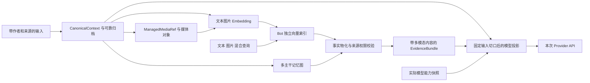

# 多模态记忆、图片召回与模型输入投影详细设计

本文定义 Forest 的文本与图片完整记忆链路，以及实际调用的 LLM 不支持图片时的出站投影。它补充 [04 记忆设计](04-bot-agent-memory.md)、[08 群聊交互](08-group-context-interaction.md)和 [10 多主干记忆图](10-multi-trunk-memory-graph.md)。以下接口与验收条件均为待实现设计，不代表已集成某个模型供应商。

## 1. 必须同时成立的约束

1. 接纳、Context、归档、图证据、索引、查询和恢复都保存有序的文本/图片内容段；图片不是一段临时 URL，也不以 OCR 或描述替代原图。
2. 每个 Bot 的生产记忆配置必须有经过验证的文本与图片 EmbeddingProfile；图片可以直接构成召回查询。其能力与对话 LLM 的能力独立。
3. 一个 Bot 一个共享记忆域、一个群一条来源主干。图片证据和文本证据一样，实际送入模型时逐项标明来源群、作者、事件和当前群关系；联想可跨主干。
4. 不支持图片的 LLM 只收到本次输入的纯文本投影。投影不改写持久 Context，不删除归档图片，不关闭图片索引，也不改变图片查询资格。
5. 投影继承已冻结 InputBatch 的切口。换模型、重试、图片下载完成或索引追上均不能借机吸入同群尚未选取的排队尾部。
6. Context 裁剪不调用 LLM，不产生记忆摘要、自动 OCR、自动图片描述或逐图理解任务。Embedding 的异步工作使用独立的有界预算。

首版“完整多模态”至少覆盖文本和图片。音频、视频等可增加有类型的内容段和驱动，但未安装相应能力时必须报告不支持，不能宣称已完整索引这些模态。

## 2. 分离四种表示

| 表示 | 保存什么 | 生命周期与使用方 |
|---|---|---|
| CanonicalContext / Archive | 稳定来源、作者、有序 ContentPart、原始媒体引用、修订和可见性 | 事实表示；裁剪只改变活动视图及归档组织 |
| EmbeddingInput / EmbeddingArtifact | 被授权来源的原生文本/图像编码输入、空间与模型版本、冻结向量工件 | 可重建索引；异步失败不破坏原始记忆 |
| EvidenceBundle | 从事实库物化的有序内容段及逐项来源、lineage、检索完整性 | 召回结果；图片与来源不可脱离 |
| ProjectedModelInput | 面向本次实际部署及能力快照的合法、预算内 API 载荷 | 单次模型请求；不得回写前三种表示 |

`CanonicalContext` 是现有 Context 事实内容的称呼，不新增第二套并行会话数据库。Context 活动窗口可以只有可靠归档引用；重新物化后仍恢复原有段顺序、图片引用和作者。



投影箭头没有指回事实表示。用户切回支持图片的模型时，下一合法模型调用可以重新物化仍然保留、获准且位于输入范围内的图片；不依赖旧文本投影去恢复。

## 3. 规范内容与稳定媒体引用

```text
ContentPart
  part_id, part_index                 单元内稳定身份与原有顺序
  kind                               text | image
  text?                              仅 text 段
  media_ref?                         仅 image 段，ManagedMediaRef
  derived_from_refs?                  人工标注/OCR 等文本的来源
  representation_kind                ORIGINAL | HUMAN_ANNOTATION | OCR | ...

ManagedMediaRef
  bot_id, media_id, media_revision    版本固定；不携带平台临时 URL

MediaAsset
  bot_id, media_id, media_revision
  blob_digest?, object_ref?           STORED起必有摘要及可恢复对象，PURGED后对象已回收
  mime?, width?, height?, byte_size?  验证后记录真实格式，待获取时可未知
  state, retention_policy_ref, deletion_epoch

MediaCapture
  capture_id, source_part_ref, locator_ref, expected_digest?
  media_ref, capture_revision, state, attempt_count, lease_epoch, error_code
  materialization_ref?               成功获取/验证后产生的版本化物化事实

MediaSourceLink
  bot_id, source_unit_id, source_revision, part_id, part_index
  media_ref, source_refs, lineage_ref, visibility_policy_ref

MemoryContent
  source_unit_id, source_revision, ordered_parts_digest
  parts[]                            有序 ContentPart
  author_snapshot, sources[], visibility_policy_ref
```

`part_id` 随来源身份和内容修订稳定确定；段位置改变或内容编辑形成新的 source_revision 与有序段摘要，不原地替换旧请求看到的内容。初收图片已分配稳定媒体引用与 MediaCapture，之后获取成功追加 materialization 事实，不重分配 part_id 或 source_order_seq。若原下载定位符后来返回不同内容，必须产生新修订及变更事件，不能覆盖既有字节。图节点和检索 chunk 指向具体 source_unit/修订/段集合，不能仅保存一段拼接字符串。

相同图片被群甲的小林和群乙的小陈分别发送时，可以在 Bot 内复用同一份合规存储字节或编码结果；仍保留两个源单元、两个 MediaSourceLink、各自作者和主干位置。内容 digest 相同不证明是同一次事件，也不构成主体、来源或权限合并依据。

引用和转发图片保存当前实际发送者与被引用来源，不能把图片中的文字签名、文件名、EXIF 或转发包装中的昵称升级为可信作者。图像文字与普通正文一样属于不可信内容。

## 4. 图片接纳、归档和可恢复性

Adapter 接纳时把临时下载信息交给受限媒体获取任务，Context 只保存稳定引用。下载凭据和临时地址不作为聊天文本、检索正文或通用日志传播。接纳事务记录明确状态，不等待网络或持有 Conversation 行锁下载图片。

```text
MediaCapture.state
  PENDING_FETCH → FETCHING → STORED → READY
  FETCHING → RETRYABLE_FAILURE → PENDING_FETCH
  FETCHING → UNAVAILABLE / REJECTED
  STORED → REJECTED
  任意非终态 → CANCELLED

MediaAsset.state
  PENDING → STORED → READY
  PENDING → UNAVAILABLE / REJECTED
  STORED → REJECTED
  任意非删除状态 → TOMBSTONED → PURGED
```

两套枚举分别属于捕获任务和资产，不能混用。捕获从PENDING_FETCH/FETCHING/RETRYABLE_FAILURE阶段尚未取得字节时，资产保持PENDING；捕获提交STORED、READY、UNAVAILABLE或REJECTED时，在同一最终守卫事务发布对应资产状态与物化事实。`STORED`表示原始字节已可靠写入且digest校验通过，`READY`表示已完成本策略要求的媒体验证；已有可复用且合法的READY资产允许捕获任务核验后直接完成READY，不重新下载。阶段与字节绑定只能前进，旧Worker不得回退已发布状态。

捕获的READY、UNAVAILABLE、REJECTED、CANCELLED为终态；Worker的FETCHING lease过期经接管后可进入RETRYABLE_FAILURE再重试，STORED验证中崩溃则从已存字节恢复，不重新下载覆盖。删除来源取消其未终结捕获并立即使该来源不可访问；已完成捕获只保留受限历史，不改写成资产删除状态。资产仅在合法引用与保留策略允许删除时进入TOMBSTONED/PURGED；删除一条来源不使另一条合法来源的共享字节消失。取消最后一个捕获且没有其他合法保留依据的待物化资产也按此回收。终态失败保留来源和失败类别，不伪造“空图片”成功结果；首次保存前地址已失效且平台无法重新取回时报告UNAVAILABLE，系统不能承诺恢复从未获得的字节。

媒体获取器限制来源、跳转、凭据范围、下载字节数、并发和期限；图片解码在有资源上限的执行环境中验证真实格式、像素数、尺寸、帧数和解码内存，拒绝不符合策略的载荷。原始文件名不参与本地路径拼接。格式处理和预处理是版本化驱动规则，不依赖用户提供的 MIME 字符串断言。

原图成功保存后不可变；面向模型的缩放、裁切、颜色转换、格式转换或动图帧选择生成独立派生对象，记录原图引用、preprocess_revision 与精确变换参数。不能覆盖原图，不能未经声明只取第一帧却声称完整理解动态图。首版不支持的动态图策略明确返回受限能力结果。

普通纯文字接纳、静默排空与其他群的工作不因一张图片暂未下载而停止。待移出单元必须先有可靠的消息归档、媒体任务/状态和稳定引用；未完成获取的媒体引用由持久任务与保留策略 pin，不能随活动窗口裁剪丢弃。对已经保存的媒体，可靠归档包含可恢复对象引用；对尚未保存或最终失败的媒体，归档明确记录该事实，不把消息元数据可恢复写成原图可恢复。

在需要图片的调用期限内仍不能物化时，采用已配置的有界等待或显式缺失投影，并记入请求 manifest；不能无限占据群执行槽。逻辑 Session 仍按 08 保持唯一，不为等待媒体另开一条响应链。每次模型请求固定具体 materialization 版本和当时的可用性；后来的下载/验证结果只供下一合法请求重新选取，不回写既有请求或已领取的编码输入。

## 5. EmbeddingProfile 与跨模态空间

```text
EmbeddingProfile
  profile_id, profile_revision
  actual_deployment_id, model_revision
  input_modalities                   至少 {text, image}
  query_modalities                   至少 {text, image}
  space_id, dimensions, distance_metric, normalization_revision
  cross_modal_alignment_revision     文本和图片可比较的已验证空间契约
  preprocess_revision, chunker_revision, supports_joint_input
  max_parts, max_images, max_pixels, max_bytes, batch_limits, budget_ref
```

合格配置必须能原生编码文本和图片，并在声明兼容的向量空间内执行 `text→text`、`text→image`、`image→image` 和 `image→text` 检索。一个双编码器可以分别处理文本与图片，但必须属于验证过的对齐空间；相同维数、相同供应商品牌或相同模型别名不能证明兼容。

EmbeddingProfile 是 Bot 生命周期身份的一部分。Bot 的首次记忆配置确定实际部署身份、模型种类、模型/预处理修订和维度，此后这些字段不可变；endpoint、凭据和预算可以轮换，但新 endpoint 必须实现同一空间契约。不能在同一 Bot 内把历史向量就地解释为另一模型的空间。确需更换模型或维度时创建新 Bot，在隔离索引中重建后通过显式业务迁移切换 Binding，并保留旧 Bot 的审计与来源边界。

实现上，`embedding.multimodal` 的包清单声明 `/profile` 为不可变配置路径，`vector.index` 声明 `/space_id`、`/dimensions`、`/metric` 不可变；通用配置账本在计划和候选装配中执行这些约束。`memory.graph` 自身的 `/embedding` 也被冻结。Embedding 和 Milvus 的 endpoint、凭据及传输限制仍可按正常配置换代。Bot Host 不得导入这两个包的身份仓库或另写一份身份表来代行配置策略；Milvus 私有持久化只保留删除 ref 的 tombstone 围栏。部署首次装配仍须校验三个包的空间身份相符，实际请求再由冻结 Generation 检查精确空间。

仅文本 Embedding 加 OCR/caption 不能满足该准入条件。Bot 的完整多模态记忆配置缺少图片编码/查询能力时，配置验证报告 `MULTIMODAL_EMBEDDING_REQUIRED`；运行期图片服务故障报告降级状态，可继续可靠接纳和稍后补索引，但不得悄悄将“完整多模态就绪”改成文本就绪。

`space_id` 表示完整的兼容性契约，绑定模型修订、预处理、归一化和度量。同一 Bot 的 space 不原地升级；新 Bot 的新索引回填后按事实水位和覆盖情况显式发布。新查询不能拿新模型向量去搜索旧空间，也不能对不同空间的向量做 cosine、平均或相加。

若配置额外的专用索引，可分别在各自空间内查询，再通过版本化 rank fusion 合并候选名次。跨空间分数不视为同一刻度，融合不能替代必需的合格多模态基线。此处保证接口和空间可比性，不承诺模型对所有图片语义的检索质量。

## 6. 异步索引、成本与合流

```text
EmbeddingArtifact
  embedding_id, bot_id, artifact_slot_id
  source_manifest, ordered_parts_digest, encoded_part_refs
  encoded_media_manifest             实际 materialization/原图 digest/变换引用
  profile_id, profile_revision, space_id, model_revision
  preprocess_revision, chunker_revision, normalization_revision
  input_modalities, input_mode        TEXT | IMAGE | MIXED
  vector_ref, vector_digest
  admitted_deletion_epoch, source_revision, state

cache_key = H(bot_id, storage_generation, profile_revision, space_id,
              model_revision, preprocess_revision, chunker_revision,
              normalization_revision, ordered_parts_digest,
              source_content_revisions, encoded_media_manifest_digest,
              input_modalities, input_mode)
```

来源注册和媒体获取不等于可检索发布。普通群消息必须满足 10 的 InputBatch/静默输入归属、可靠归档与权限条件后才进入长期检索候选；提前下载图片仅保存字节，不允许 observer 或向量查询绕过同群输入切口。

图片下载慢于 Conversation 输入选择时，InputBatch 正常提交并留下不可检索的 `PENDING_CAPTURE` 资格事实，不能让整个群的串行 Agent 等待网络。图片完成校验和受管载荷发布后，在同一事件锁下继承该批次资格；若图片先完成，后续选择直接资格化。两条路径必须得到相同 occurrence/InputBatch 归属，失败或永久缺图只形成可观测覆盖缺口，不把 URI、占位文本或空向量发布为图片记忆。

Worker 使用有界批次、积压阈值、每 Bot 预算和重试退避。媒体未就绪时图像部分状态为 `WAIT_MEDIA`；文本部分可独立完成，但同一条图文消息的索引完整性仍是 `PARTIAL`。向量发布明确包含成功的段与失败段，不能以一段文字成功就标记整条多模态消息已完成。

### 6.1 Memory 调度与 Embedding Provider 边界

索引流水由两个平级 Generation 协作：

| 所有者 | 拥有 | 禁止拥有 |
|---|---|---|
| `memory.graph` | 来源资格、facet、claim/lease、重试时机、`index_ref_id`、召回、删除 epoch 与索引删除 outbox | Embedding endpoint、Milvus client、向量 collection、Provider 私有 attempt 表 |
| `embedding.*` | 与 Bot 空间绑定兼容的 endpoint 配置、凭据引用、客户端、请求 manifest、网络 attempt、usage/费用观察、结果载荷 | Memory 来源/主干/可见性表、facet 状态、召回结果或删除决策 |
| `vector.index` | Milvus endpoint/凭据、Bot 独立 collection 身份、向量的幂等 upsert/delete、按 QUERY ref 执行 ANN 并返回 DOCUMENT ref | 消息正文、作者/群来源、图关系、资格、权限、删除 epoch 和 EvidenceBundle |

`memory.graph` 领取一批 facet 后物化有界 `EmbeddingEncodeRequest`，其中只包含受管 text/image payload 引用、逐项来源摘要、purpose、空间身份、请求 deadline 和稳定 effect identity。它经内核 Contract Router 调用准确 `embedding.encode/2` Generation。Embedding 在实际发送前验证这些引用、实际输入模态、大小和冻结空间，写自己的 transport attempt；它不根据 Memory 表补字段，也不决定某个来源是否有资格进入索引。

Memory 必须在预算预留前完成本地 facet 物化、来源投影与逐项输入校验。空白文本、超过单图限制或其他确定不可编码的部分保留为 `SUPPRESSED` facet，以便管理面解释索引缺口，但不得进入 claim；批次领取还必须限制累计图片字节，不能生成 Provider 必然拒绝的请求。若 claim 已建立而网络交接尚未发生，本地失败必须把整批 attempt 结算为 `NOT_SENT`，并释放或避免建立预算预留。单批异常只能触发有界退避；生命周期 Worker 继续运行并在后续循环执行过期 attempt 与预算恢复，不能让一条消息永久终止整个 Bot 的索引任务。

Embedding 返回 `EmbeddingEncodeObservation`：固定 request/attempt、空间、逐 facet 向量结果载荷、usage 与 `RESPONDED | REJECTED | NOT_SENT | UNKNOWN`。向量字节由 Embedding 以自身 owner 身份发布，Memory 只能引用和读取获准结果。Memory 的结算事务重新验证 claim/lease、当前 RuntimeGraph member、facet/input revision、删除 epoch、空间和结果摘要，成功时先推进 `EMBEDDED`。生命周期 Worker 再经冻结的 `vector.index.upsert/2` 以 facet ID 作为稳定 `ref_id` 幂等发布；返回相同 ref 后才把 facet 推进 `READY`。索引只接收 ref、空间、用途和向量，群来源、修订、作者和模态仍由 Memory 权威库保存。网络调用、向量计算和 Milvus 写入均不在 PostgreSQL 结算事务内。

召回时 QUERY facet 走相同 `EMBEDDED → READY` 路径。`vector.index.search/2` 只接受 QUERY `ref_id`、冻结 `space_id` 与有界 limit，只返回 DOCUMENT `ref_id` 和相似度。Memory 必须回 PostgreSQL 验证命中 ref 的当前状态、来源修订、可见性和删除屏障，随后才可读取内容和关系。Milvus 不能直接生成 EvidenceBundle，也不能提供群或作者的来源结论。

热替换时，Memory claim 固定准确 Embedding Generation 与契约版本。交接前失败可按相同 facet 创建新 attempt；交接后失去结果必须保持 `UNKNOWN` 并向原 Generation/外部 effect 查询，不能换 endpoint 重发。Embedding endpoint 或凭据轮换会建立新 Generation，但只有声明与 Bot 已冻结 `EmbeddingSpaceIdentity` 完全兼容时才可进入 RuntimeGraph；模型种类、修订、维度、预处理、归一化或对齐语义变化仍必须拒绝。

`QUEUED / WAIT_MEDIA / ENCODING / READY / RETRYABLE_FAILURE / UNSUPPORTED / SUPPRESSED` 是索引工件状态，独立于媒体状态和来源是否可见。积压、预算耗尽和模型暂不可用进入可恢复状态；源删除后进入 SUPPRESSED，不继续向旧索引写入。

领取编码前固定实际媒体物化版本、blob_digest 和全部变换，纳入 encoded_media_manifest 与缓存键。仅有 media_id 或“图片稍后可用”的占位不能命中一个有效图片向量；媒体尚未获取时也不能先编码空值，随后以相同 cache key 偷换成真实图片。

同一来源修订和编码配置形成稳定 artifact slot。并发 Worker 重试复用 slot，外部编码在事务外执行，候选结果按 [06 工件协议](06-concurrent-convergence.md)选择一次并冻结；接受向量的发布事务检查路由、源集、profile/space、删除屏障和当前期望水位。不能假设外部 Embedding 每次调用都逐位相同，也不能让最后完成的 Worker 覆盖已选工件。

编码字节可复用与检索发布权限分离。缓存命中仍需要创建/验证本来源的发布记录；相同图片的另一合法来源不会被遗漏，也不能让已删除来源借其他上传者的缓存复活。默认缓存含 Bot 身份，不跨 Bot 复用可检索载荷、媒体访问凭据或命中结果。

裁剪器只处理预算、可靠归档、来源覆盖与 ViewPlan。图片 Embedding 不属于裁剪的同步依赖，也不能把裁剪完成事件解释为必须立即逐图调用模型。可选 OCR、人工标注和语义联想分别声明任务、授权、lineage 与费用，不默认生成。

## 7. 文本、图片和混合召回

```text
MultimodalMemoryQuery extends MemoryQuery
  query_parts[]                      有序 ContentPart，图片使用 ManagedMediaRef
  query_source_manifest              绑定合法输入来源与原始 lineage
  embedding_profile_ref, space_id, query_mode
  fusion_policy_revision?, modality_weights?
  max_query_images, max_query_pixels, max_query_bytes
  max_result_images, max_result_bytes, index_watermark_requirement

MultimodalEvidence extends EvidenceBundle.evidence[]
  parts[], matched_part_refs, retrieval_modalities
  sources[], claim_source_refs, media_lineage_refs
  source_revision, ordered_parts_digest
  completeness                       分别说明 text/image、媒体物化与索引覆盖
```

图片查询从本次合法来源的原始内容段构建，不从已经去图的 LLM 投影反向构造。即使当前对话模型只支持文字，框架仍能用用户图片进行向量召回，并将获准的文本证据投影给该模型；模型必须知道自己未接收原图，不能声称亲自看见图片。

| 查询 | 编码与候选 | 返回约束 |
|---|---|---|
| 纯文本 | 在合格空间中查询文本和图片向量 | 图片命中保留图像段与来源，不强制先生成描述 |
| 纯图片 | 编码查询图片，在同空间中搜索图片和文本 | 保留查询图像引用、命中模态、来源和索引完整性 |
| 图文混合 | 优先使用 profile 声明的联合编码；否则分别编码后按固定 rank fusion 合并 | 不任意平均向量，不丢失文本约束或其中一张图片 |
| 多图片 | 按稳定段顺序、单图/总量预算执行联合或分路查询 | 超预算明确报错或采用已声明且可审计的部分查询策略 |

纯图片无法编码时返回 `IMAGE_QUERY_UNAVAILABLE`，不能把空字符串当成功查询。混合查询可以在调用方允许时返回明确标记的文字部分结果，并列出未执行模态；不将这种结果写成完整图文召回成功。

候选 ID 只是检索线索。最终回事实库验证 Bot、source_revision、删除状态、逐来源权限、当前群输入切口和全部必要 lineage，再物化原始内容。跨主干图片联想继承双方证据来源；图片相似度不是事实等价、同一作者或跨群授权的证明。

## 8. 多模态证据如何表达来源

每个图像段与文本段共同属于一个明确的证据单元。Provider 的实际输入必须先给该单元输出 10 定义的来源头，再渲染对应合法内容段；不能只在不可见 metadata 中记录群号，或把多群图片平铺在同一个无归属图片列表里。

```text
证据 ev-17；来源关系=其他群；来源群=群乙 / src-g-b。
作者=u-7 / 当时昵称“小林”；事件=event-b-72；源单元=unit-b-72。
内容段 0：文本“这是周五的排期截图。”
内容段 1：图片，对应 unit-b-72 / part-image-1。
```

上例图片是否真正进入 API 由下一节的能力投影决定；宿主来源标签和人工文本说明不代表模型已经看过图。多源实体/联想返回 sources 数组及逐 claim 依赖；相同图片的多个有效来源可以并列，不能取一个来源覆盖全部。

缩略图、裁切图、OCR 文本与人工标注都记录 `representation_kind` 和 `derived_from_refs`。召回 OCR 时写明“工具提取文本”，召回人工说明时写明具体作者；它们的错误、权限和来源闭包可单独审计，不冒充原始群消息或模型视觉观察。

## 9. ModelCapabilities 与出站投影

```text
ModelCapabilities
  actual_deployment_id, provider_adapter_revision, capability_revision
  model_revision, supported_input_modalities
  supported_roles, modalities_by_role, accepted_image_types
  supported_detail_modes
  tool_protocol_revision, structural_mapping_revision

ModelRequestManifest
  request_id, run_id, logical_step_id, input_revision, input_batch_refs
  context_revision, context_view_revision, source_cut_digest
  actual_deployment_id, model_revision, capability_snapshot_ref
  capability_revision, projection_version, evidence_renderer_revision
  included_part_refs, omitted_part_refs, omission_reasons
  projected_units_ref, source_manifest, media_transform_refs
  input_digest, projected_content_digest

ModelTransportAttempt
  transport_attempt_id, request_id
  serializer_revision, payload_digest  精确 API 请求体字节的摘要
  permit_ref, permit_expires_at, budget_receipt_ref, created_at
```

manifest 的 source_manifest 描述批准进入请求的文本/图片及其必要派生依赖；included_part_refs 表示投影载荷内的源段，omitted_part_refs 是仅供审计的省略记录，不算模型已见。只有准备记录不能证明已发送；某次响应实际使用的输入由其 transport_attempt_id 及派发/回执状态确定。来源占位标记只能证明发送过该来源的存在/不可见说明，不能证明发送过该图片像素。媒体变换清单固定实际 materialization 和字节 digest，长期 manifest 不保存会过期的访问令牌。

`ModelRequestManifest` 与 `ModelTransportAttempt` 的上述载荷字段均不可变。请求的可变派发状态、未知结果、Provider 回执和实际用量复用 RunStep/调用执行记录与 checkpoint，通过 transport_attempt_id 关联，不写回已冻结语义字段或摘要。状态可为 PREPARED、DISPATCHING、RESPONDED、FAILED 或 UNKNOWN，PREPARED 不能当作模型已收到请求。

存储名称与本 DTO 的明确对应如下；05 与 11 不再并用 request_manifest_id、含糊的 attempt_id、dimension、alignment_contract、mime_type 或 materialization_state 作为这些相同字段的别名。

| DTO | 05 权威表/字段 | 存储区别 |
|---|---|---|
| ModelRequestManifest.request_id | model_request_manifests.request_id | 一次固定部署、能力及语义投影的请求身份 |
| ModelTransportAttempt.transport_attempt_id | model_transport_attempts.transport_attempt_id | 一个已经构建精确请求体的传输尝试，外键 request_id |
| ModelRequestManifest.source_manifest | model_request_manifests.source_manifest_ref | DTO 为已物化清单，数据库可保存不可变清单引用 |
| EmbeddingProfile.dimensions | embedding_profiles.dimensions | 相同字段名与向量维数语义 |
| EmbeddingProfile.cross_modal_alignment_revision | embedding_profiles.cross_modal_alignment_revision | 兼容空间对齐契约修订 |
| MediaAsset.mime / state | media_assets.mime / state | 媒体格式与资产状态；不代替 MediaCapture.state 或索引工件状态 |

能力来自实际选中的部署与 adapter 契约，不能仅检查“首选模型名称包含 vision”。能力未知时默认不发送未经确认支持的模态，报告未知能力；部署更新、路由变化或 fallback 必须重新解析真实能力。EmbeddingProfile 不继承该 LLM 能力开关。

每次 API 调用严格依次执行：

1. 在既有安全边界固定 InputBatch、Context 视图、工具闭合步骤和合法召回来源，不改变最新触发切口。
2. 解析本次真正使用的 Provider、模型修订与能力快照；该快照不包含 Context 预算或裁剪策略。
3. 从规范事实构建独立 ModelView；对所有角色、历史消息、引用/转发、工具结果、RAG 证据及嵌套内容逐段执行允许模态规则。
4. 移除不支持的内容段，保留真实作者、来源头、文本和工具协议结构；记录被省略段和原因。
5. 完整投影 Context 已发布的活动视图和 Memory 已选定的证据；serializer 不估算 token 预算，不删除单元、不截断证据。需要缩小历史时，Agent 只能在新 Run 的首次调用前请求 Context 所有者发布持久 ViewPlan；需要原图变换时保存具体派生引用，不得自动调用 LLM 摘要补洞。
6. 事务外按冻结来源与当前授权物化媒体，由 adapter 使用固定序列化版本构建精确 API 请求体；此时可申请仅覆盖本次需要的短效媒体 URL。计算请求体字节的 payload_digest，不记录令牌明文，也不在此时发出模型调用。
7. 短事务重验权限、删除状态、输入切口、运行 fence、能力和媒体物化绑定，为该精确载荷签发限时发送许可，并原子保存语义 manifest 与不可变 transport attempt。锁内不下载媒体、不签 URL、不做编码或网络请求。
8. 提交后 Gateway 核验许可仍适用于这个 transport_attempt_id、payload_digest、绑定与时限，以已经构建的相同请求体发送。过期、失权或未通过现有发送 fence 时拒绝发送；不能在许可后另行改图、改 URL 或重新序列化成不同字节后沿用旧摘要。

能力限制包含角色限制。例如一个模型只允许在用户消息接受图片时，工具结果中的图片不能原样透传。Adapter 仅可采用已声明的结构映射，把图片放入受支持的数据容器并保留原工具/来源语义；未声明映射时省略该段，不把工具数据升级成 system 指令。工具调用 ID 与对应结果边界不能因省略图片破坏。

## 10. 不支持图片的 LLM

纯文本投影删除所有 image/file 内容段、图片 data URL、base64、签名下载 URL 和作为媒体载荷的附件包装。不能先把媒体对象序列化成 JSON 字符串再伪装成普通 text；SDK 和 Provider adapter 都应保持类型边界直到最后序列化。

用户原本发送的普通文本 URL 仍按普通文本策略处理；这不允许 adapter 把隐藏在媒体字段中的地址转写进模型文本。内部媒体凭据、文件路径和对象访问令牌永远不因省略图片而暴露。

可保留宿主生成的有来源纯文本标记，例如“该消息含图片；当前模型未接收图片内容”。标记不能包含图像描述，也不暗示模型看到了原图。纯图片触发保留触发、作者和这条标记，按正常单 Session 响应，明确说明当前模型无法查看图片；不能因为剔除后正文为空而取消触发、发送空消息或触发第二条响应链。

原消息已有的文字说明、明确授权生成的 OCR 文本或人工标注可按权限保留，但标注为各自来源和派生类型。它们不能被改写成模型自己的视觉识别结果。模型可根据图片检索得到的合法文本作答，必须区分“检索记录表明”和“我看到图片”。

不隐式调用 OCR/caption 服务、不自动切换更贵的视觉模型、不替用户上传到额外服务。后续显式选择视觉模型属于新的合法调用；从规范内容重新投影，当前图片是否仍在活动输入或可召回范围内由既有记忆规则决定。

### 10.1 同一规范输入的两个投影例子

规范输入如下，假定所有源均已获准进入本次输入：

```json
{
  "source_unit_id": "unit-a-31",
  "group_source_id": "src-g-a",
  "author_snapshot": {"subject_id": "user-8", "display_name_at_event": "小陈"},
  "parts": [
    {"part_id": "p0", "part_index": 0, "kind": "text", "text": "这张图之前在哪个群聊出现过？", "representation_kind": "ORIGINAL"},
    {"part_id": "p1", "part_index": 1, "kind": "image", "media_ref": {"bot_id": "bot-a", "media_id": "media-24", "media_revision": 1}, "representation_kind": "ORIGINAL"}
  ]
}
```

支持图片的 ModelView 保留来源头、p0 和 p1；adapter 在授权边界内解析 p1 为受支持的图片载荷。若召回群乙的同图证据，则作为另一个带群乙、原作者和源单元的证据块展示，不能归到小陈名下。

纯文本 ModelView 保留来源头、p0，并以“unit-a-31 中的图片未传给当前模型”代替 p1 的呈现；manifest 的 omitted_part_refs 包含 p1，实际请求完全没有图片载荷。图片召回仍可返回“群乙的小林在 event-b-72 发送过匹配图片”的可信来源记录；模型只能据检索结果说明来源，不能补写图片中未有文本证据支持的内容。

## 11. ContextView、缓存与重试

规范活动视图由独立且版本化的 `context_view_profile` 管理年龄、条目、估算 token/字节和媒体引用上限；预算算法、低水位、pin 与归档选择都属于 Context 模块。空闲 `SILENT_DRAIN` 持续执行这套持久维护；Agent 在新 Run 第一次调用模型前冻结当前 ViewPlan，此后同一 Run 只追加有界因果单元。Provider 能力和请求 manifest 不包含这套策略。

持久 ViewPlan 可以依据既定策略将旧的完整源单元移出活动窗口，保留可靠归档与必要 pin；不能因为当前 LLM 不支持图片而从事实或规范活动视图删除图像段。每请求投影只允许做由目标 API 能力必然要求的模态转换，例如文本模型用明确缺失标记替代图片；不得再按 token/image 估算选择历史或 RAG 证据。原始触发的图片 pin、持久 Context 裁剪记录与本请求 omitted_part_refs 是三类不同事实，不能相互替代。

必需触发原始段不能被无提示裁剪。若 Context 已无法缩小必要集合，则由 Context/Agent 的显式有界失败策略终止，不能把这项决定推给 Provider，也不能静默删除后声称完成视觉任务。上游 API 的真实拒绝只作为该 transport attempt 的失败结果处理，不在同一 Run 中临时重选历史。为不支持图像模型生成的缺失标记本身是明确能力降级，不把图片视作已经读过。

检索缓存含 Bot、权限/删除/输入边界、query ordered_parts_digest、实际媒体物化/digest、profile/space/预处理版本、索引水位与 fusion 策略。模型投影缓存再包含 actual deployment、capability revision、projection/renderer 版本与准确 Context 视图修订。仅以同一文本或同一 media_id 为键不够。

`input_digest` 固定本次规范输入及证据来源；`projected_content_digest` 固定投影后的有序语义内容与稳定媒体/变换引用；`ModelTransportAttempt.payload_digest` 则对实际 API 请求体字节计算，包含体内使用的短效 URL 或图像编码，但不把 HTTP 鉴权头当作普通内容。临时凭据不得写入语义清单；精确请求体只在受限发送缓冲中保存，必要的恢复对象必须按凭据级策略加密、限权、限期保留。

URL 续签、图片传输编码变化或重新序列化导致请求体字节不同，必须构建新的 transport_attempt_id、payload_digest 与许可，不能覆盖旧记录。若语义图片、来源、模型、能力、投影内容均未变化，可引用原 request_id；否则生成新语义 manifest。崩溃后丢失发送缓冲时不能凭稳定媒体引用假称重建了旧精确载荷；先根据持久派发状态对账，UNKNOWN 不盲重发，允许重试后建立新的传输尝试。

Provider fallback 生成新的 request_id/manifest 及 transport attempt，从同一冻结 InputBatch、ContextView 和来源修订重新投影。视觉模型失败后回落纯文本时图片被移除；纯文本回落视觉模型时也必须重新鉴权。两者都不能复用不兼容 payload，也不能吸入后来群消息或重新裁剪历史。每次真实传输尝试单独对账费用；未发送、结果不明与已响应不能统一按零费用结算。

新尝试只有在旧尝试进入终态，或经过明确允许的放弃决议并使旧候选提交 fence 失效后，才能接续同一 logical_step。RunStep 的调用子记录只允许一个当前有效 `model_request_id/transport_attempt_id`，其中 model_request_id 外键指向 manifest.request_id；尝试接替通过 CAS 推进 `model_call_epoch`。最终结果比较这三个字段与现有 Run/Session fence，新旧结果不能同时提交。迟到的旧响应只能入受限对账记录，不能追加第二个 ModelTurn、继续工具或覆盖新结果。放弃本地等待和切换模型不表示外部请求已撤回；已许可且可能发出的请求继续记账，保留 UNKNOWN 与后续费用核对。

图片获取完成、向量回填或模型能力变更不会修改已发送请求的 manifest。后续合法调用可获取新的状态；同一请求的重放只重建其实际载荷与可用引用，并再次检查当前授权。涉及工具外部效果的恢复继续沿用效果账本，不因换模型而重执行已确认工具。

## 12. 生命周期、删除与输出依据

Run checkpoint 保存本次 ModelRequestManifest、ModelTransportAttempt 引用与调用执行状态、实际能力快照、投影单元、媒体变换和源集，模块热重载迁移这些稳定引用。新 generation 若无法解释旧投影协议，进入声明的不兼容恢复路径；不能用新版本临时猜一个旧 Prompt 并声称等价重放。

媒体、图像向量、缩略图、OCR/caption、联想边和模型派生内容均保留 lineage。删除先在权威事实库提交 tombstone/suppressed_sources 与 deletion_epoch，查询立即过滤，再异步清理索引和对象；旧下载/编码/描述任务在最终发布守卫被拒绝，不能换个任务 ID 复活来源。

对象引用计数只是回收辅助，合法可见性由来源及删除规则决定。删除一条投稿不自动删除另一条独立合法投稿仍依赖的相同字节，也不能继续返回被删除投稿的作者/群来源。物理删除前对原图、派生物和在途保留 pin 作一致性核验；备份恢复也重放删除屏障。

最终模型输出、可审计解释与工具决策关联实际响应对应的 request_id、transport_attempt_id 与回执。被省略图片不能登记为模型已见证据，模型输出不能被事实抽取器直接升级为“视觉观察”。需要视觉依据的工具动作必须验证该响应对应请求包含所需图像或存在明确获准的替代证据；没有依据则要求明确输入或返回能力不足。协议能够结合发送状态证明请求包含哪些内容，不能保证模型一定正确理解已发送图片。

## 13. 可观测性与验收

这些能力通过[WebUI后台](12-webui-administration.md)直接管理：LLM与EmbeddingProfile分开设置，分别显示实际部署能力、可用模态、索引空间和图片覆盖情况。界面可以上传图片进行受权记忆检索并查看逐项群/作者来源；该操作不自动创建群聊触发或模型调用。修改LLM能力不改变原生图片索引，修改嵌入空间必须走独立重建与发布流程；不能通过一个“启用图片”开关绕过两套能力校验。图片预览、完整请求查看与导出分别鉴权，默认展示省略原因与安全元数据，不把临时媒体URL或凭据暴露在配置中。

指标分别观察媒体获取积压/失败、文本与图片索引覆盖、各 space 水位、图像查询次数/成本、实际投影省略原因、图像预算拒绝与 LLM 调用数。普通日志只记录引用和安全摘要，不记录图片 base64、下载凭据或原始像素。裁剪 LLM 调用计数必须始终为零。

| 编号 | 场景 | 必须满足的结果 |
|---|---|---|
| MM-01 | 接纳交错的文字、两张图片、文字 | Context、Archive 与物化结果保留稳定段 ID、顺序和作者 |
| MM-02 | 平台 URL 过期后恢复已保存图片 | 从受管原图引用恢复；模型请求不依赖原临时地址 |
| MM-03 | 首次获取前 URL 失效且无法刷新 | 明确 UNAVAILABLE，不伪报原图已归档 |
| MM-04 | 同图由两群不同用户分别发送 | 可复用字节/编码，保留两个来源、作者与主干位置 |
| MM-05 | 文本查询历史图片；图片查询历史文本 | 都使用合格对齐空间并返回有来源证据 |
| MM-06 | 图片查询历史图片与多图混合查询 | 保留每张查询图的输入资格，应用明确联合/融合策略 |
| MM-07 | 使用文本 Embedding 加自动 caption 冒充支持图片 | 配置准入拒绝，不能标记完整多模态就绪 |
| MM-08 | 新旧模型维数相同但 space 不同 | 拒绝跨空间距离/平均，显式独立检索与 rank fusion 才可合并 |
| MM-09 | 图片索引失败而文字索引成功 | PARTIAL 明示图像缺口；可靠接纳和零 LLM 裁剪继续 |
| MM-10 | 多 Worker 重复编码、乱序完成 | 同 slot 只发布冻结结果，来源修订和水位不被晚任务覆盖 |
| MM-11 | 图片尚在同群未选尾部，已被媒体缓存/另一 Binding 观察 | 查询、图扩展和派生 lineage 均不能绕过冻结输入切口 |
| MM-12 | 图片证据来自其他群或多个群 | 实际模型输入包含各自来源与作者，不归入当前群 |
| MM-13 | 纯文字模型处理图文混合输入 | 图片载荷、签名 URL、base64 均不进入 API，规范内容保持完整 |
| MM-14 | 纯文字模型处理纯图片触发 | 保留一次触发和来源，以明确不可见提示正常结束或请求文字说明 |
| MM-15 | 图片隐藏于 tool result、旧历史、引用或 RAG | 全路径投影，无嵌套字段或 JSON 字符串绕过 |
| MM-16 | 文字模型期间以图片做召回 | 图片查询仍执行；只投影合法文字，答案不登记为视觉观察 |
| MM-17 | 原文有人类说明或已授权 OCR | 保留说明及派生来源，不假称模型看过原图 |
| MM-18 | 下一合法调用切回视觉模型 | 从规范来源重建图片输入，重验权限和预算 |
| MM-19 | 视觉 Provider 失败后 fallback 到文字部署 | 同一输入切口生成新 manifest，图片移除，不吸入后续消息 |
| MM-20 | 图像预算不足或 tokenizer/成本规则变化 | 固定能力与预算版本，明确拒绝/受限投影，不把图片成本计零 |
| MM-21 | 请求准备后源被删除或权限撤销 | 发送前守卫拒绝失效证据；晚媒体/向量任务不能复活来源 |
| MM-22 | 删除同图的一条来源，另一条仍合法 | 被删来源立即不可检索；剩余来源不丢失，物理回收尊重合法引用 |
| MM-23 | 热重载并恢复正在等待工具的多模态 Run | 恢复实际 manifest 和原始输入，不重做已确认效果或篡改所见图片 |
| MM-24 | 图像解码超像素/字节/帧数或来源非法 | 有界失败并保留明确状态，不拖垮整个 Bot 或阻塞其他群 |
| MM-25 | 连续普通群图片造成反复裁剪 | 无摘要、caption、OCR 或逐图 LLM；媒体/Embedding 有界积压可恢复 |
| MM-26 | 模型声称看见已省略图片并申请视觉依赖动作 | manifest 不支持该依据，动作校验拒绝，不将声称写成视觉事实 |
| MM-27 | 图片 URL 在准备后过期，需要续签 | 新建 transport attempt、精确 payload_digest 和许可；不覆盖旧请求字节记录 |
| MM-28 | manifest 已准备后崩溃，无法确定请求是否发出 | 依据持久调用状态对账；PREPARED 不冒充已收到，UNKNOWN 不盲重发 |

验收应同时捕获实际 Provider 请求与持久事实快照：仅检查内部 DTO 或最终回答措辞，不能证明图片确已从纯文字 API 请求中移除，也不能证明原始多模态记忆没有被破坏。
