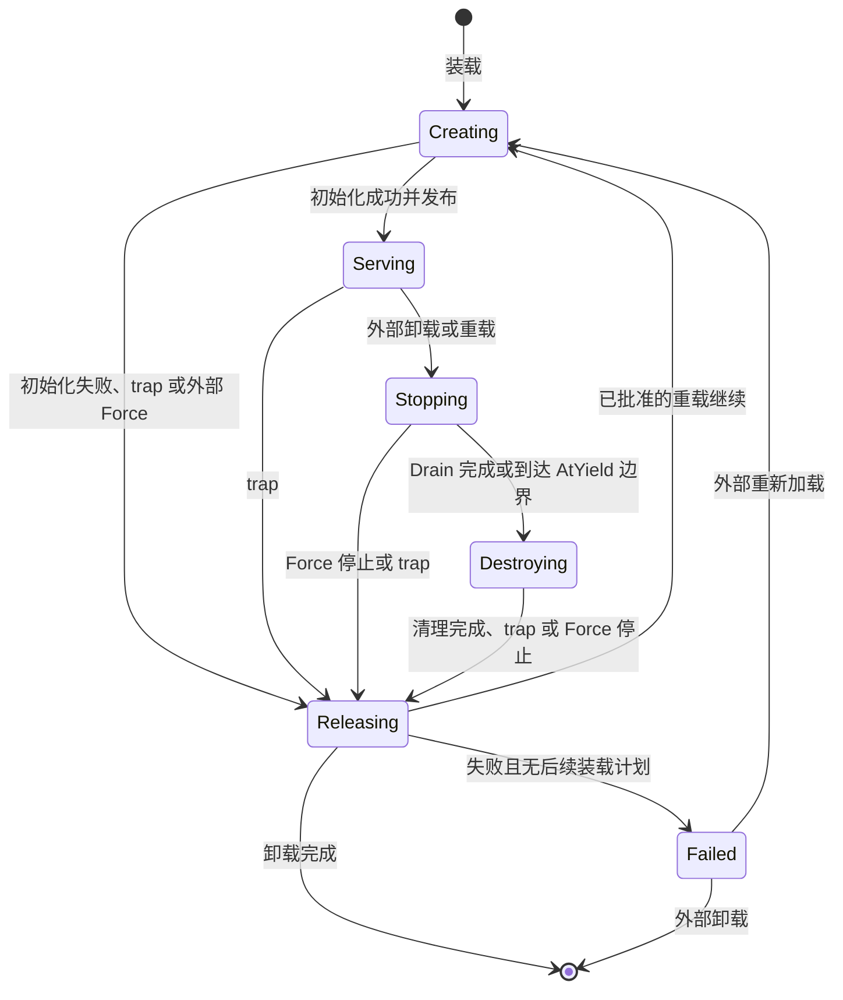
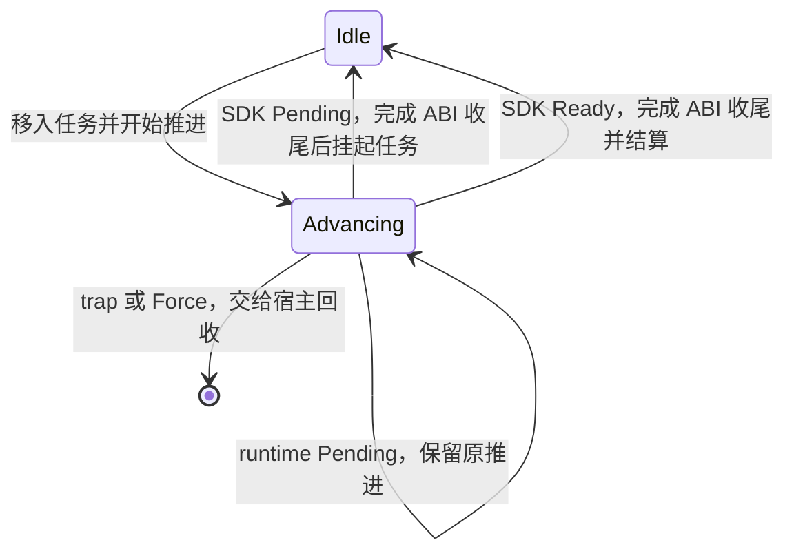

# 调度器状态机与所有权

本文将[调度语义](09-scheduling.md)、[模块生命周期](10-module-lifecycle.md)和已讨论的任务推进 ABI 收敛为可实现的状态机，并检查其必要性与不变量。运行时与基础 SDK 已实现，见[运行与 ABI](13-runtime-and-sdk.md)；下文示意类型表达所有权关系，不要求与 Rust API 同名。

设计目标是让正确行为来自状态转换和资源归属：内部路径不靠重复判断“是否还活着”“是否已经返回”“是否正在重载”维持一致性。来自 Wasm、网络和管理入口的数据仍在边界校验；外部操作失败仍是正常可表示的结果。

## 1. 唯一事实与转换边界

调度控制状态由一个所有者管理，每次转换独占修改它。请求接纳、就绪选择、执行结果结算、卸载决定和声明发布都在这个边界排序。实现可使用控制循环或短临界区，但不得持有调度状态的可变访问权跨越 I/O 等待或 Wasm 执行。

Wasm 执行驱动器独占自己的 Store 和执行 Future；I/O 执行器只拥有具体操作和一次性的完成出口。它们将结果交回控制边界，不能直接修改模块阶段、任务队列或其他实例内存。不同实例仍可在线程间并行推进。

这些内部完成通知不是插件事件接口。notifier 仍只负责将宿主事件提交为普通新请求；I/O 完成只通知已有任务。

| 事实 | 唯一持有者 | 不能再维护的副本 |
|---|---|---|
| 模块阶段和卸载后去向 | 逻辑对象的状态枚举 | accepting、reloading、destroyed 等独立布尔值 |
| 当前 Wasm 推进及其任务 | 执行驱动器 | 各任务上的 running/preempted 标记与另一份 owner |
| 未开始请求 | 所属接口的 FIFO | 与队列分开维护的“待派发任务” |
| 可推进工作 | 去重就绪队列 | 任务上的 ready 标志和第二份通知计数 |
| 不可重入接口占用 | 唯一接口许可 | 占用布尔值、持有者、计数三份事实 |
| 接纳额度 | 请求携带的额度凭据 | 重载时重算或重新扣除的一套额度 |
| call 的结算权 | 请求持有的一次性返回出口 | 可重复调用的回调与 completed 布尔值 |
| 宿主操作结果 | 操作自己的完成槽 | 按模块名称重新寻找接收者的结果队列 |

查询方法只借用状态，不能补任务、插入默认值、消费结果或执行调度。产生修改的操作分别命名为 admit、begin、notify、take、settle、stop、publish。

## 2. 逻辑模块状态机

只保留六个有实际资源含义的阶段；未装载表示运行目录中没有该模块的活动状态，持久配置可以继续存在。

```rust
enum ModuleState {
    Creating(CreateRun),
    Serving(LiveInstance),
    Stopping(StopRun),
    Destroying(DestroyRun),
    Releasing(HostCleanup),
    Failed(Failure),
}
```

| 阶段 | 持有的工作 | 普通请求规则 |
|---|---|---|
| Creating | 候选实例的初始化任务；重载时还持有交接队列 | 不派发；重载沿用有界交接队列，首次装载不开放入口 |
| Serving | 正常实例、接口队列与任务 | 检查声明、权限和容量后接纳 |
| Stopping | 已截止的旧请求集合、当前推进、选定的停止方式 | 卸载拒绝；重载新请求只进入下一实例队列 |
| Destroying | 受限清理任务及旧实例资源 | 不派发普通请求；重载仍可接纳到交接队列 |
| Releasing | 仅宿主清理及尚未结束的本地原生操作 | 不执行来宾代码；重载仍可保留交接队列 |
| Failed | 失败原因，没有可执行实例 | 拒绝；等待外部重新加载或卸载 |



重载不是第七个布尔维度，而是停止过程持有的明确后续动作：

```rust
enum AfterRelease {
    Unload,
    Reload {
        candidate: ValidatedPackage,
        inbox: DeferredRequests,
    },
    Fail(Failure),
}
```

Stopping、Destroying、Releasing 依次移交同一后续动作，不复制候选或交接队列。旧实例被销毁后不会再有“尝试恢复旧实例”的分支。

候选的读取、声明校验和编译先在活动实例之外完成，不执行 create。管理提交时再确认目标仍是所检查的活动实现；不能把一个针对旧实现准备的重载计划套到另一次替换之后。此处比较内部实例身份即可，不增加 ABI 版本或配置版本。

同一对象一次只执行一个管理交接。已有交接时，不隐式追加第二个候选或覆盖去向；外部可以明确要求现有停止过程改用 AtYield/Force。进入 Destroying 后不能恢复普通派发，Force 仍可结束清理。不存在自动超时升级。

Creating 也接受外部 Force，用于结束尚未完成的初始化；半初始化对象不运行 destroy，交接队列按中断结算，资源回收后依管理意图卸载或进入 Failed。Drain/AtYield 针对已经初始化的普通工作，不将未完成的 create 当成可正常析构的对象。Releasing 已没有来宾代码，重复 Force 不能跳过本地原子操作的终结。

### 2.1 三种停止方式只改变一个选择

| 停止方式 | 仍允许的旧工作 | 转入下一阶段的条件 |
|---|---|---|
| Drain | 旧集合的排队请求、任务恢复与既有推进 | 旧请求全部结算且相关任务收尾完成，进入 Destroying |
| AtYield | 只完成当前已经开始的一次推进 | 执行权空闲时中断其余旧请求，终结其本地操作后进入 Destroying |
| Force | 只驱动当前 runtime 调用到中断返回，不开始任何新的来宾入口 | 运行中的调用已退出后进入 Releasing，跳过 Destroying |

入口截止与旧集合确定是一次控制转换。截止后的新请求属于 DeferredRequests；Drain 不再因这些请求延长。真正卸载没有下一实例队列。

AtYield 遇到当前推进正常完成时，该请求正常结算；返回 Pending 时，它仍属于需要中断的旧任务。没有推进存活时即可开始清理，不要求所有等待任务再运行一遍。

进入 Destroying 前，先终结被中断普通任务直接持有的本地操作：可取消的本地等待解除，不可中断的原子写入等待结束。不得让旧文件写入在 destroy 保存最终状态之后才落盘。这一步留在 Stopping 内完成，不恢复旧 Future，也不等待远端撤销或下游模块完成。

Force 与普通完成同时发生时，以控制边界的先后为准：已经结算的结果不撤回；Force 被接受后仍未结算的旧请求按中断处理。随后 runtime 即使交回结果，也不为取回或释放它再调用来宾导出。

### 2.2 Releasing 不能省略

停止 Wasm 不代表原生操作已经停止。例如 SQLite 工作线程可能已经接受一次写入，丢弃等待结果的 Future 并不会证明该写入不再提交。

因此旧实例退出分两步：

1. 停止一切来宾执行，关闭旧任务的完成出口，结算不能继续的 call。
2. 宿主释放资源；已经不可中断的本地文件或数据库操作必须结束后，才允许下一实例 create。

Releasing 不进行来宾析构，不执行 alloc/free/destroy，也不重放任务。网络请求可以结束本地等待并释放连接，不等待远端“撤销成功”；远端已经发生的修改无法由框架回滚。

本地操作从提交到真正终结的所有权必须可追踪，不能向后台线程扔完命令后立即报告资源已回收。这里等待的是实际资源终结，不引入超时、补偿或事务版本。

这里只等待退出实例直接持有的原生操作。已接纳到其他模块的 send/call 属于接收方，关闭原等待出口不取消或递归排空接收方；其他获授权模块仍可正常访问配置。它们与外部配置写入的声明交接顺序不由本实例资源回收代替。

普通 trap 没有后续重载计划时最终进入 Failed。若外部已批准一次替换，旧实例在停止或清理期间 trap，则跳过剩余来宾清理，回收后继续已批准的候选；这不是故障自动重启。新 create 失败则结算交接队列并进入 Failed，不循环重试候选。

## 3. 执行权只有两种形态

```rust
enum Execution {
    Idle(ExclusiveInstance),
    Advancing(OwnedAdvance),
}
```

Idle 表示没有存活的来宾推进，不表示没有未完成任务。OwnedAdvance 独占当前任务、执行上下文和实例驱动权；这些值都不能 Clone 后交给另一工作线程。



不另存 Preempted 状态。时间片让出和 runtime 内部等待都属于原 OwnedAdvance 尚未完成；区别只在驱动器何时再次就绪。前者由运行时安排继续，后者等实际唤醒。不能把任意 runtime Pending 都立即重排为可运行，否则会忙轮询。

也不另存 Running 标记。工作线程暂时取得驱动权并 poll，是 Advancing 的执行动作；它不是又一份决定可否重入的事实。

### 3.1 ABI 收尾也是推进的一部分

一次普通推进包围以下全部操作：

```text
取得实例执行权并绑定任务上下文
→ 必要的输入缓冲区分配与复制
→ 必要的 forest_invoke 任务建立
→ forest_poll
→ 读取、解码输出并释放 ABI 缓冲区
→ 向控制面交回完整推进结果
```

恢复任务省略重复的建立步骤；create/destroy 采用相同驱动方式。参数与结果都通过 Forest 序列化边界传递，入口实际符号和字节编码在 ABI 定稿中固定。

实例化中的启动代码与 ABI 辅助入口也必须处于已绑定的宿主阶段和实例上下文中，不能在建立控制状态之前裸调用来宾代码。Creating 的通信禁令不会因执行位置早于 forest_create 而失效。

forest_poll 已返回 Pending，但 forest_free 尚未完成时，OwnedAdvance 仍然存在。任何辅助入口发生被动暂停也保留原执行权。AtYield 必须等到整个推进交回，不能趁两个 ABI 函数之间插入 destroy。

一旦 trap/Force，驱动器不运行“无论成功失败都 free”的来宾 finally 逻辑，直接走宿主回收。必须完成的宿主内存释放与禁止执行的来宾释放分开。

### 3.2 Rust 实现不伪造生命周期

Store 只由一个实例驱动器拥有。`call_async(&mut store)` 的 Future 在驱动器内部的异步作用域中存活；控制面只持有独占驱动权及结果关联，不同时保存一份可以再次调用的 Store。

可以用拥有 Store 的固定异步驱动循环保存跨等待的借用，不构造手写的“结构体同时拥有 Store 和借用自身 Store 的 Future”，也不通过 unsafe 延长借用来实现轮转。具体执行线程归属不进入协议。

Wasmtime 的执行 Future、epoch/fuel 让出和可变 Store 参数见[异步执行说明](https://docs.rs/wasmtime/latest/wasmtime/#asynchronous-wasm)及 [TypedFunc::call_async](https://docs.rs/wasmtime/latest/wasmtime/struct.TypedFunc.html#method.call_async)。本方案在它们之上保留实例独占权，不使用第二次独立调用模拟恢复。

## 4. 请求、任务与终态

未开始请求与已经进入 Wasm 的任务是不同对象，不能仅用一个带大量 Option 字段的 Task 表示全部阶段。

```rust
struct AcceptedRequest {
    invocation: ValidatedInvocation,
    admission: AdmissionPermit,
    outcome: OutcomeSink,
}

struct StartedTask {
    request: AcceptedRequest,
    task: TaskKey,
    interface: InterfacePermit,
}

enum OutcomeSink {
    Call(ReplySender),
    Send,
}
```

ValidatedInvocation 保存已校验的目标、类型契约与可信上下文，不让恢复路径重新读取消息正文来寻找身份。TaskKey 包含内部执行实例身份和实例内任务编号，不是稳定模块 Token；同一实例内不重复使用存活或已退休任务的编号。

普通请求只沿以下所有权路径移动：

| 位置 | 意义 | 可以进行的动作 |
|---|---|---|
| 接口 FIFO | 已接纳、未建立来宾任务 | 等待接口许可与调度 |
| OwnedAdvance | 当前独占推进 | 继续原 runtime 调用或交回完整结果 |
| 挂起任务表 | 来宾 Future 保留，当前没有推进 | 等待通知或按就绪索引恢复 |
| 已被消费 | 已完成或中断并结算 | 无调度动作；可另存不可变诊断记录 |

Ready 与 Waiting 是挂起任务是否具有就绪通知的投影，不再另外存任务状态枚举。Finished 不是调度表的一行：结算消费 StartedTask 和返回出口，移除索引，归还接口许可及请求额度。

ReplySender 是一次性所有权。正常输出、trap 和中断都必须取得同一份任务才能结算，因此不能各自克隆一份回调后争相返回。调用方已经不再接收结果，不改变目标执行结果，也不触发重新执行。

send 在接纳时返回，OutcomeSink::Send 不持有之后可返回给发送者的结果出口。后续失败只能记入诊断，不把 send 变相升级为带隐含完成回执的 call。

资源收尾尚未完成的凭据由收尾对象继续持有，不能为了显示终态提前释放容量。历史记录是只读观测，不参与许可和队列判断。

## 5. 接纳、重入与就绪选择

### 5.1 接纳只有一个提交点

输入在外部边界解码为明确类型。控制边界在当前声明下完成目标、Schema、callers、生命周期入口和容量检查；成功时一次性保留额度并将 AcceptedRequest 放入对应 FIFO 或交接队列。到此才向 send 返回成功。

失败不留下请求或额度，QueueFull 保持“未接纳、未执行”的含义。不能在接纳前先塞进无界控制邮箱，绕过目标容量建立隐藏等待队列。

AdmissionPermit 覆盖一个请求的输入与名额，随请求、任务和必要收尾移动。主动等待、恢复、DeferredRequests 转入新实例都不重新申请额度；稳定对象只维护同一套接纳账目。

接口策略在接纳时检查。已接纳请求携带对应的校验事实，不在每次 poll 重新鉴权或重新预留。新声明发布后的请求使用新规则；静态 ACL 替换不追溯撤销此前已经接受的请求。交接队列遵循同样规则，候选必须满足已确认的接口契约。

### 5.2 接口许可

不可重入接口拥有一份唯一许可，开始请求时将它移入 StartedTask；该任务只有在完成或被中断并收尾时才归还。主动 Pending 不归还，因此无需通过扫描任务表判断“是不是已经有人在执行”。

可重入接口没有此项独占许可，但每个任务仍持有接纳额度和唯一任务身份。两者共用任务推进机制，不为 reentrant=true 另写一套调度路径。

每个接口的未开始请求使用 FIFO。可开始的接口只向就绪队列贡献一个 Start(interface) 项；取出后开始队首请求，有资格继续开始下一条时，再把同一个接口加入队尾。被占用接口不占着全局队首阻挡其他工作。

### 5.3 两级就绪队列

实例内的候选工作只有：

```rust
enum ReadyWork {
    Start(InterfaceKey),
    Resume(TaskKey),
}
```

按变为可执行的顺序入队。新请求与恢复任务公平轮转；不能连续优先清空所有新请求，或连续优先执行某个可重入接口。

实例之间另有去重的就绪队列。一次只能取走一份实例驱动权。已有 OwnedAdvance 时只能恢复它，实例内其他就绪记录保留到主动边界；没有 OwnedAdvance 时才选择 ReadyWork。

去重与插入顺序由一个封装的 ReadyQueue 提供，不在各调用位置组合 `if !queued { push; queued = true; }`。队列键是准确的接口或任务身份，每个键最多占一个位置；任务退休时同时注销对应通知目标。

## 6. 唤醒没有“先睡着再检查”的窗口

对一个已开始任务，只需要一份可合并的就绪通知。开始推进时消费已有通知，推进期间的新通知保留；返回 Pending 时不清空通知。

| 通知发生时间 | 处理 |
|---|---|
| 任务等待期间 | 插入一个 Resume(TaskKey) |
| 任务已经就绪 | 合并，保留第一次进入就绪队列的位置 |
| 任务推进或被动暂停期间 | 保留新的就绪记录，但不进入同一实例 |
| 推进返回 Pending 之前 | Pending 交回后仍有就绪记录，可再次选择 |
| 推进返回 Pending 之后 | 按普通等待任务唤醒 |
| 任务已经结算或实例退休之后 | 原通知目标已关闭，不能重新建立任务 |

开始推进与通知插入经同一通知原语排序。通知在消费之前发生，由本次推进覆盖；在消费之后发生，保留给下一次推进。不存在“返回 Pending 后再注册等待”这一步。

宿主操作必须先保存完成结果，再通知任务。SDK 自身的 Waker 也使用同一通知目标，覆盖任务内同步原语、自唤醒等情况；不把 I/O 当作唯一唤醒来源。重复通知可以合并，但不能导致两个执行线程同时推进任务。该语义与 [Rust Waker 的合并唤醒约定](https://doc.rust-lang.org/std/task/struct.Waker.html#method.wake)一致。

来宾任务通知与 runtime Future 的 Waker 分开：

- 来宾任务通知表示下一次 SDK 推进可以尝试继续。
- runtime Waker 表示同一次 Wasmtime 调用可以继续。

前者不释放或抢占 OwnedAdvance，后者不建立新的模块任务。唤醒目标只引用所属实例/任务，不按稳定模块 Token 重新解析路由；因此旧实例迟到通知不会落到新实例上。

就绪通知和结果发布所需的原子性集中在队列/完成槽原语内。调度状态机本身不散布原子变量和多套“通知是否丢失”的补偿路径。

## 7. 宿主操作状态机

每次操作属于具体执行实例和任务，建立操作记录及完成出口后才交给原生执行器。其状态只有：

```text
Pending → Ready(result) → 被领取并移除
    └───────────────→ 所有者退出，关闭本地结果接收
```

| 操作 | 状态效果 |
|---|---|
| submit | 创建操作与一次性完成出口，执行实际请求 |
| complete | 消费完成出口，发布 Ready 结果，再通知任务 |
| status | 只读 Pending 或 Ready 的长度，不消费、不补项 |
| take | 校验目标缓冲区并复制 Ready 结果，成功后消费并移除结果 |
| 所有者退出 | 关闭接收并回收本地资源，不撤销已发生的外部修改 |

即时失败也成为 Ready 的 Result。OperationId 只标识结果位置，不意味着 send 已接纳、HTTP 成功或配置已提交。

原生执行器持有的是原操作的一次性完成出口，不是“模块名 + 下次查找”回调。旧接收端关闭后，迟到完成无法发布到其他操作或新实例；这是出口寿命的结果，不需要每个 I/O 回调重复比较若干状态字符串。

模块可以处理的 DispatchError 和服务错误通过正常结果数据返回。Wasm trap/无法完成 ABI 的错误交给实例失败路径；不把普通权限拒绝变成引擎 trap。Wasmtime 宿主函数返回 Rust Err 会终止 Wasm，见[宿主函数错误语义](https://docs.rs/wasmtime/latest/wasmtime/struct.Func.html#method.new)。

结果接收端关闭与底层本地操作真正结束是不同事实。后者仍按第 2.2 节留在宿主资源所有者内，不能因为没人领取结果就提前完成重载交接。

## 8. 三条完整路径

### 8.1 普通 call 与宿主 I/O

```text
接纳请求并取得 AdmissionPermit
→ 按 FIFO 取得 InterfacePermit，建立 TaskKey
→ OwnedAdvance 建立并 poll 来宾任务
→ 任务提交 HTTP，SDK 返回 Pending，ABI 收尾
→ 任务移入挂起表，实例执行权空闲
→ HTTP 发布结果并通知该任务
→ 再次取得 OwnedAdvance，领取结果并完成
→ 取回输出、完成收尾、消费返回出口及许可
```

任一 runtime 时间片暂停只延长当前 OwnedAdvance，不改变上述路径，也不释放 InterfacePermit。

### 8.2 Drain 重载

```text
校验候选
→ Serving 移入 Stopping(Drain, Reload)
→ 已接纳请求留在旧集合；新请求进入 DeferredRequests
→ 旧请求全部结束
→ Destroying
→ Releasing，等待宿主本地操作终结
→ Creating，读取保留配置
→ 初始化成功后发布实现、声明与接收注册表
→ DeferredRequests 移入 Serving 的接口 FIFO
```

整个过程不复制请求、不重新扣容量、不迁移来宾 Future。notifier 和普通 send/call 经过同一个接纳点，不各自实现一套重载缓存。

### 8.3 AtYield 与 Force

AtYield 等当前 OwnedAdvance 交回，禁止再选其他旧 ReadyWork，消费其余旧请求的中断出口，并在 Stopping 内终结其既有本地操作；SDK 随后在 Destroying 阶段丢弃旧 Future 并执行清理。析构只能使用清理阶段允许的宿主操作，不能恢复被丢弃 Future 中 await 之后的代码。此时新产生的基础 I/O 由清理任务及最终 Releasing 负责收尾。

Force 要求驱动器停止当前 runtime 调用，禁止开始任何后续来宾入口。运行中的调用退出后直接 Releasing；没有存活推进时直接进入 Releasing。宿主原生操作的终结仍须完成，不把强制停止解释为可任意终止操作系统线程。

## 9. 不变量检查

以下结论由构造和转换保持，不靠每个分支事后检查全局表。

| 不变量 | 构造与保持方式 |
|---|---|
| 同一实例至多有一次推进 | 独占驱动权只能移动，OwnedAdvance 不可复制 |
| 未完成的不可重入调用至多一个 | 唯一 InterfacePermit 从开始持有到结算；Pending 不归还 |
| 已接纳请求只有一个去向 | AcceptedRequest 在 FIFO、任务、交接队列或收尾之间移动 |
| call 至多结算一次 | 只有持有原 OutcomeSink 的消费动作才能结算 |
| 不漏掉跨 Pending 的唤醒 | 推进前消费通知，推进期间保留新通知，Pending 后不再清空 |
| 重复唤醒不重复执行 | 去重 ReadyQueue，加上不可复制的实例驱动权 |
| 重载不串入旧结果 | 操作和 Waker 引用执行实例所属出口，永不按逻辑名称重新路由 |
| 队列满不产生半次请求 | 预留额度与入队同一提交点，失败不产生 AcceptedRequest |
| 内部恢复不再次受接纳限制 | StartedTask 已携带原 AdmissionPermit |
| Force/trap 不进入来宾清理 | Releasing 的载荷没有可调用的普通执行入口 |
| 来源不因恢复变化，阶段限制及时生效 | 身份上下文属于任务；宿主操作提交时从当前 ModuleState 判定阶段 |
| 新实例不被旧本地写入追上 | Releasing 完成本地操作终结后才创建候选 |

可按归纳法检查：空运行目录没有任务与许可冲突；admit 只创建一个有额度的请求；begin 移入唯一许可；yield 只移动任务；notify 只改变就绪索引；settle 消费唯一出口；stop 固定旧集合；release 不执行来宾；publish 只接收资源已释放、初始化已完成的候选。每个动作只需维护它拥有的局部事实。

身份与阶段不能混为一个永不更新的权限快照。Force 已被接受后，旧推进即使尚未到达运行时中断点，也不能继续提交新的宿主操作；已经提交的操作按原归属终结。此检查只位于宿主操作提交边界，不在模块处理代码中反复插入状态判断。

## 10. 交错情况复核

| 情况 | 所需处理 | 是否需要新增状态或重试 |
|---|---|---|
| I/O 在 SDK 返回 Pending 前完成 | 结果先就绪，通知保留到推进交回 | 否 |
| 重复或自唤醒 | 合并一份就绪通知 | 否 |
| 被动暂停时新群消息到来 | 正常接纳入队，当前推进独占权不变 | 否 |
| 输出复制后 free 被时间片暂停 | 原 OwnedAdvance 继续持有实例 | 否 |
| 非重入任务等待 I/O，另一个接口有请求 | 后者按自身许可选择，前者继续持有自己的接口许可 | 否 |
| 排空时还有未开始的旧请求 | 继续选择旧集合的 Start 项 | 否 |
| 排空期间持续收到新事件 | 放入有界 DeferredRequests，不扩大旧集合 | 否 |
| AtYield 时所有旧任务已经等待 | 无推进即可清理，无需再次唤醒所有任务 | 否 |
| Force 与完成同时到达 | 控制边界排序，原返回出口只能消费一次 | 否 |
| create 或 destroy trap | 跳过来宾清理，进入同一 Releasing 路径 | 否 |
| 初始化始终不返回，外部要求 Force | 结束当前初始化推进，跳过 destroy 并回收 | 否 |
| 新 create 失败 | 结算交接队列，回收后 Failed | 否 |
| 旧 HTTP/模块调用的结果迟到 | 原接收端关闭，不产生新路由 | 否 |
| AtYield 时旧原子写入仍在后台执行 | 先在 Stopping 终结该操作，再让 destroy 保存状态 | 不增加状态 |
| Force 时 SQLite 写入已进入工作线程 | 在 Releasing 等实际本地操作结束 | 需要保留此阶段，不需要补偿 |
| 调用方放弃接收结果 | 目标正常结算，不重试、不复活调用方 | 否 |

这些是状态模型的逻辑审查，不能代替代码验证。真实 Wasm 集成验证及未覆盖范围见[运行说明](13-runtime-and-sdk.md)。

## 11. 简洁性结论与范围

保留六个模块阶段，是因为每个阶段允许的动作和持有的资源确有不同。实例执行权只有 Idle/Advancing；普通任务没有独立 Running、Preempted、Finished 字段；宿主结果只有 Pending/Ready。内部句柄使用具名类型，转换使用明确枚举匹配，不解析状态字符串，不使用动态字典分发控制动作。

四项不宜继续省略：Releasing、一次性结果出口、接口许可、可合并的唤醒目标。省略任何一项，都会迫使实现用重复完成检查、额外锁标志、迟到结果过滤或重载后补救重新表达同一事实。

边界仍保留 Wasm 地址与长度校验、数据解码与 Schema、句柄所属关系、ACL 和接纳容量检查。它们处理外部输入，不应删除后假定插件永不违反协议；通过边界后才使用 ValidatedInvocation、TaskKey 和所有权对象，内部不重复验证同一事实。

内部不变量若被实现破坏，应暴露为实现错误，不能用默认值、吞错或“任务可能已完成所以忽略”让损坏状态继续流转。任务退休后的外部迟到通知则是已定义的出口关闭语义，两者不混为同一类异常。

安全性与进展性分开：本方案保证独占、归属、结算和交接规则；不保证模块永远返回、远端网络永远完成或嵌套 call 没有等待环。Drain 可以一直等待，Force 也不回滚外部修改。按既定范围不引入自动超时、自动恢复、运行时死锁处理、普通 call 取消或数据迁移系统。

配置 Schema/default 的变更策略、候选 create 使用的配置声明及正在执行的外部配置写入如何交接，仍由配置设计明确。本状态机给出宿主操作终结和统一发布的衔接位置，但不假装已经解决配置数据转换问题。
