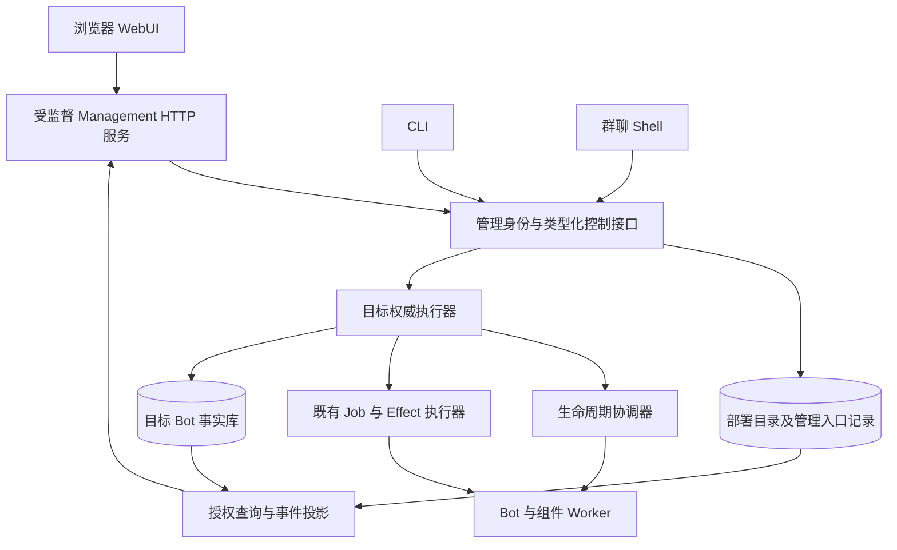

# WebUI 后台管理详细设计

## 1. 目标与强制边界

WebUI 是 Forest 首版正式管理入口。管理员通过浏览器完成初始化、配置、部署、诊断和恢复；日常运行不要求进入服务器编辑 TOML、JSON、数据库行或插件源码。CLI 与[群聊 Shell](09-group-shell-command-system.md)保留自动化和远程救援用途，与 WebUI 共用类型化控制契约、授权、持久操作及审计。

本文定义需要实现的产品与协议，不表示后台已经实现。遵循[生命周期](02-kernel-lifecycle.md)、[存储与鉴权](05-storage-security-operations.md)、[并发合流](06-concurrent-convergence.md)和[多模态记忆](11-multimodal-memory-and-model-projection.md)的既有边界。

必须满足：

1. 正常配置以权威存储中的版本化对象为准；配置文件只用于安装引导及受控导入/导出，不与 WebUI 双向覆盖。
2. 浏览器、管理 HTTP 服务均不能直接修改运行对象、数据库业务表、内核路由或群 Agent 队列。
3. 管理入口独立于 QQ 连接、Agent、LLM 和普通插件；业务拥塞或 Adapter 故障时仍可查询并提交恢复操作。
4. 草稿、期望配置、实际生效配置、运行观测分别展示；保存成功不得伪装为已全部生效。
5. 每次写入有明确目标、可信主体、规范参数、预期版本与幂等键；多个标签页及 Shell 并发修改不执行最后写入覆盖。
6. 群消息、记忆、图片或密钥的显示、预览、下载和测试分别授权，控制权限不隐含读取全部内容的权限。

## 2. 运行拓扑与组件生命周期



`management.web` 是受 Supervisor 管理的独立服务进程；静态前端、HTTP/SSE 连接、表单呈现及查询投影不进入微内核。内核只保留已有控制契约、身份/能力校验、资源监督和最小健康接口。管理服务申请必要管理能力，仍须在目标执行边界复核用户权限；不能拥有任意业务表写连接。

控制查询和紧急意图有独立、有限的连接池与准入额度；WebUI、CLI、Shell 共享主体/Bot 总配额及 P0–P4 服务等级，不能通过换入口绕过限额。重建索引、导出、包安装、模型测试和迁移均移交持久任务，HTTP 请求不长期占用 P0 或持有数据库事务。P0 只提交有界取消/维护意图，不抢夺生命周期资源所有权。

管理服务升级先停止新连接领取、排空有界请求，再替换进程；已接纳操作由原有生命周期/Job/Effect 执行器继续。浏览器资源使用版本化 URL，API 与前端进行兼容性握手；不兼容版本进入明确只读/刷新状态，不能错误解释新 schema。WebUI 故障不会暂停群消息，也不会让操作回退至未执行。

## 3. 首次启动、登录与安装边界

最少安装参数仅包含应用运行前必须获知的引导信息：受限部署数据目录、管理监听地址、外部 HTTPS 入口/可信代理以及可选部署库或 Secret Resolver 引导引用。发行安装器/启动向导提供参数设置，不要求手写复杂配置。Bot、模型地址、令牌、插件开关、记忆策略、预算和权限全部在浏览器设置。

初始化不能依赖用户先配置管理模块自身或 Bot 存储。部署目录库尚未可用时，安装器创建仅服务账户可读的本地 bootstrap 状态、部署信任根和一次性 setup 凭据，启动只依赖这些底座的最小 setup 服务。此阶段不能执行 Bot 管理或访问业务记忆；默认本机访问，远程初始化必须显式启用受保护入口。

首启流程：

1. 安装器向部署者交付短时、单次使用的初始化凭据或带外配对码；不设置默认管理员密码。凭据不进入 URL、普通日志或群聊；无人值守安装可通过受控 secret 注入交付。
2. 浏览器输入配对码并建立受限 setup session，配置并测试部署目录存储，创建第一个管理账号和认证方式。未经配对不能成为首管理员，不能采用第一个访问者抢占规则。
3. 本地 bootstrap 先以 CAS 冻结 deployment/setup ID、唯一目标存储标识、初始化计划摘要和唯一执行 lease/fence，再在该目标部署库幂等创建部署身份、首管理员与 `web_setup_state`，同事务 CAS 初始化状态并消费凭据摘要。不同窗口最多一个成功；本地记录迁移完成引用并关闭 setup 写入口。
4. 目标提交后本地完成标记前崩溃，重启按同一 setup ID 查询目标结果再关闭入口，不能重新创建管理员。目标提交前失败可继续向导；不得因目录库暂时不可达而把已初始化部署重置为开放注册。
5. 自动创建或接入凭据加密所需的密钥引用；界面说明密钥用途、恢复材料和丢失影响。继续配置默认存储、LLM、多模态 Embedding、首个 Bot 及平台绑定，保存为未启用草稿。
6. 展示离线校验与可选连接测试结果，提交部署计划；实际生效及健康探测通过后显示就绪。平台是否在线、LLM 是否可用、图文嵌入是否就绪分别显示。

关闭或刷新向导不丢失已确认的非敏感步骤。密钥明文只通过专用写入请求短暂传输，服务保存 `secret_ref`，普通草稿不保存明文。恢复材料若需要下载只提供一次受控交付；再次登录不能从普通配置接口取回原密钥。

本地冻结使用可跨进程原子提交的受限 bootstrap 存储，落实进程间事务/锁、原子替换及所需 fsync，不能只靠页面按钮或进程内锁。唯一执行 lease 过期后恢复器提升 fence，只能接管原冻结计划；目标按 setup ID/计划摘要幂等，旧执行器不能改换目标或参数。首版冻结后不提供解除并重选数据库的快捷路径；一次查询未发现记录不证明旧请求永远不会提交。向导失败继续表示接续同一计划，初始化完成后的存储变更使用独立迁移协议。

冻结目标后不能因请求超时改用另一数据库重新初始化；先查询原目标确定是否已提交，不能确定时保持待恢复。重新选择目标必须在受控恢复中确认原目标未提交、终止原初始化执行并使其旧请求不能再获准后解除本地冻结；不能只凭一次查询未命中就换库。目标已提交则只能完成本地封闭，避免两个窗口或迟到旧请求建立第二个初始化权威。

管理员忘记凭据可使用预设恢复凭据、另一名授权管理员或受控部署恢复命令。恢复写审计、撤销原会话并要求建立新凭据；不能通过删除初始化标记重新开放首启。全部管理员凭据和恢复材料都丢失时允许需要部署访问权的恢复边界，这不构成日常配置依赖服务器文件。

## 4. 首版页面与闭环操作

界面主视图使用待应用、应用中、已生效、失败以及短暂离线、需要重启、正在重建索引等具体描述。revision、epoch、摘要和协议水位放入可展开详情，不要求普通管理员理解内部字段才能修改配置。

| 页面 | 可见信息与操作 | 关键约束 |
|---|---|---|
| 部署概览 | Bot/组件健康、控制可用性、积压、预算、失败操作及待批准入口 | 状态有采集时间和过期提示，可直接进入恢复操作 |
| Bot 管理 | 新建/复制配置、人格、启停/暂停/恢复、预算、模型、模块组合 | 新 Bot 使用新身份和独立记忆存储；复制配置不复制私有记忆或密钥授权 |
| 平台与 Binding | 连接方式、令牌引用、上线/下线、目标权限、路由、受控账号转移 | 同一账号唯一归属；转移建立新 binding_id，旧回复不能投到新归属 |
| 配置中心 | schema 表单、继承来源、差异、草稿、版本历史、期望/生效状态 | 每字段显示来源和生效方式；支持清除本层覆盖 |
| LLM / Provider | 内置 CorePrompt 全文/version/digest、PresetContext、模型部署、能力快照、凭据、超时、并发、上下文预算、回退策略 | CorePrompt 只读且不可被配置覆盖；PresetContext 单独版本化；实际端点能力独立验证；明确文本模型的逐请求图片投影 |
| Embedding | 原生图文编码/查询、对齐空间、预处理、批量预算和索引版本 | 与 LLM 分开配置；首次保存后模型/修订/维度随 Bot 生命周期冻结，endpoint 可轮换；缺图像能力不能显示完整多模态就绪 |
| 媒体管理 | 用量、捕获失败、原图/变体关系、保留策略、合法重试 | 原文及下载单独授权；永久缺失和待获取明确区分 |
| 插件与组件 | 包来源、版本、摘要、依赖、申请能力、启用范围、配置、代际、重载/回退 | 安装包、授予能力和启用分开；候选失败保留旧代可见状态 |
| 账号与权限 | 账号、会话、角色、Bot/资源 scope、平台身份映射、授权历史 | 最终目标库授权；平台群管理员不自动等于部署管理员 |
| 全局记忆 | 每 Bot 多主干图、群来源筛选、跨主干关系、冲突处理、遗忘和重建 | 群筛选只是视图；不按群建立独立记忆库 |
| 记忆检索试验 | 文本/图片/混合查询、证据来源、覆盖水位、索引完整性 | 查询按 scope 授权，费用与长期写入分别显式控制 |
| 会话与 Agent | 各群 Session/Run、输入水位、待触发前缀、普通尾部、实际模型请求 | 同群只有一条逻辑响应链；界面不能越过安全边界补入消息 |
| 任务与批准 | 计划、阶段、发起者、影响范围、取消、批准/拒绝、UNKNOWN 对账 | 复用既有账本；请求取消不等于外部效果已经撤回 |
| 日志与审计 | 结构化查询、关联 trace/request/operation、受限详情与导出 | 默认脱敏；日志和记忆中的文本不能成为执行命令 |
| 存储与备份 | Profile、容量、连接测试、备份导入/校验/恢复、迁移阶段 | 外部密文先流式暂存并完整校验；目标库切换沿用迁移协议 |
| 系统与管理服务 | 管理入口、认证策略、通知、版本、资源配额、受控重启 | 变更管理地址前显示重新连接信息；重启不丢操作 |

首版完成从空部署到浏览器建立 Bot、配置图文记忆及 LLM、绑定平台、启动、观察群交互、修改配置、处理失败/批准、备份的全过程。必要操作不能以请去服务器改文件作为最终实现；高级图可视化、复杂报表、主题和移动端专用布局可后续增强。

## 5. 表单、继承和有效配置

### 5.1 同一 schema 驱动所有入口

模块发布版本化配置 schema，包含稳定字段路径、类型、必填/默认、范围、枚举、敏感标记、可写 scope、依赖条件、`reload_policy` 和说明。表单、服务端 DTO 校验、CLI/Shell 参数适配使用同一 schema revision。插件提供声明式字段与受限展示扩展，不能注入同源任意脚本获得管理员会话。

表单提供常用项与高级项；可选结构化 JSON 编辑器用于批量编辑或尚无专门控件的字段。高级编辑提交相同 DTO，仍校验未知字段、类型、权限与计划；不接受任意 Python、SQL、Shell 或绕过验证开关。错误定位到具体字段并说明关联问题。

配置按 deployment → Bot → component → Run 合成，同时展示本层覆盖值、继承值、最终值及来源修订。`UNSET` 表示恢复继承，`null` 是否合法由 schema 决定；二者不能混淆。Run 覆盖仅限预授权字段且不能扩大安全 scope。权限不是普通可覆盖配置，收紧策略仍经实时最终守卫生效。

编辑父层默认值时，预览列出实际受影响 Bot/组件与已有覆盖，固定解析出的依赖修订。Bot 的物化快照固定父 revision，部署默认更新产生逐 Bot 受权子计划，在各目标配置 CAS 后才采用；不能在读配置时动态读取最新默认值绕过生效流程。本层覆盖保留，界面显示待同步、冲突与部分成功。

后续新 Bot 使用当时已提交默认值，在途计划不扩大目标集合。各目标执行前重验计划固定的依赖和覆盖版本，发生变化显示冲突，不重新解释已经批准的影响范围。

### 5.2 保存与生效的四种状态

| 表示 | 含义 | 用户可见行为 |
|---|---|---|
| 草稿 Draft | 尚未申请运行的编辑版本 | 保存/继续编辑/丢弃，不改变运行态 |
| 期望 Desired | 已接纳的不可变配置修订及变更意图 | 目标值、申请人、操作与等待/失败原因 |
| 生效 Effective | 各目标资源经其权威提交点实际采用的修订 | 已生效版本，允许与期望不同 |
| 运行观测 Observed | 进程报告的版本、健康和采集时间 | 延迟或离线显示未知/过期，不反写权威配置 |

存储使用 05 的 `config_revisions/config_heads`、`ConfigRevision/config_revision_ref`；Bot 配置的权威在对应 Bot 库，部署目录中的配置信息只是目录投影。保存草稿不改变期望值；应用明确提交变更意图。普通可逆变更不再额外要求人工批准，只有既有政策规定的高影响操作进入批准流程。

可续编辑草稿保存于部署库 `config_drafts`，绑定 draft_id、主体、目标、base_revisions、draft_revision、schema 与过期时间；只保存非敏感值和 secret_ref。共享编辑必须另有访问策略，不能默认向其他管理员公开全部草稿。草稿是编辑状态，目标权限、版本和 schema 在应用时重新验证。

离线校验不能消耗模型 API。测试连接/能力作为明确动作展示预估费用与数据发送范围；测试成功不代替部署成功，也不保证稍后网络仍可用。

### 5.3 生效策略

| `reload_policy` | 实际生效点 | 在途工作 |
|---|---|---|
| `dynamic` | 目标库发布不可变请求配置覆盖层，默认后续 Run/任务取用 | 不改变 Generation 构造快照或已冻结步骤 |
| `generation` | prepare/health/drain/migrate 完成后，路由/状态与有效配置指针同事务 CAS | 旧代服务至受控切换；失败保留旧有效修订 |
| `restart` | 受控重启后新配置被启动及健康状态确认 | 持久 checkpoint/停止接纳，说明重连与恢复范围 |
| `migration` | 完成对应存储/schema/所有权迁移的权威切换 | 明确写入封存和恢复边界，不能只刷新引用 |

一个组件的关联字段形成完整候选快照，混合 dynamic/generation/restart 字段按足够严格的计划执行，不能发布半份不兼容配置。`on_load` 缓存、客户端构造或资源绑定使用的参数至少属于 generation。migration 是专门工作流，不用简单枚举大小替代依赖规划。

跨组件依赖按不可变计划执行；跨 Bot、独立库或多个资源不承诺整体原子成功，逐项显示完成、等待、失败和补偿。已有 Run 默认保留业务快照，只有契约明确允许的字段才能在下一模型调用安全边界采用新版本。实际 Provider 改变需重新投影与计算预算，原请求历史不改写；撤权、遗忘、维护 epoch 和取消仍实时参与许可/提交裁决。

## 6. 预览、提交和操作状态

### 6.1 固定预览计划

应用前由服务端构建 `ChangePlan`：类型化 action、目标集合、规范输入摘要、预期 revisions、schema/包/代际摘要、差异、生效方式、费用/资源预留、断连影响、可取消阶段与恢复边界。返回 `plan_ref/plan_digest/expires_at`；秘密字段只显示已替换/未改变/已清除和受权引用，不显示明文差异。

计划保存为受限、不可变的既有工件/manifest 引用，包含创建主体、目标权威和期限；不是浏览器临时计算的摘要，也不建立另一套执行账本。编辑参数产生新计划，提交后由入口请求/批准/目标操作引用并按恢复要求保留；未使用计划到期后按引用回收。

校验包括 schema、字段权限、跨字段约束、依赖、目标归属、多模态基线和静态资源检查。网络测试和候选预热单独成为有期限 Job，不持事务等待。界面展示已接纳、等待批准、等待资源、排空、已切换等既有子操作状态。

`management_requests` 只保存管理入口事实、接纳/拒绝及 `operation_ref/approval_ref`，主键为 `management_request_id`；生命周期、Job、Effect 不复制为另一套竞争状态机。受查询权限限制的 `operation_ref={kind,id}` 持续指向实际权威账本。

### 6.2 权威提交与跨库

WebUI 写请求先在部署库记录可信会话主体、请求 ID、幂等键、目标和规范摘要，再交目标权威服务。Bot 配置、维护、运行、记忆操作的最终许可/提交在对应 Bot 库；部署账号、全局默认和目录对象在部署库；存储迁移沿用其目录切换线性化点。入口记录不是目标授权，HTTP 缓存不成为事实源。

按 05 的 `WebAuthorityTicket` 固定受信管理主体、会话修订、目标、action、input_digest、plan_digest、预分配 `target_operation_ref` 和短效期限。目标最终事务核验签名、到期、票据用途、当前 Bot policy 与业务 fence；同票只可接纳/恢复该固定操作，不能换目标或参数。目标许可前到期必须获得新票，不能把浏览器一直在线作为持久操作的续命条件。

目标以由入口请求和目标稳定派生的子操作 ID 幂等接纳，CAS 检查预期 revision、资源 lease/fence、schema 和计划。配置是不可交换命令，WebUI 不享有高于 Shell 的覆盖权。事务按 05 锁序处理，提交事实/outbox 后才等待外部动作。

批准与执行许可同驻目标库。Bot 的 `approval_ref={bot_id,approval_id}` 沿用原形式，部署级采用显式 `authority_scope` 分支。Web 来源使用 `origin_ref={kind:web,management_request_id,web_subject_ref,session_ref}`，不伪造群 sender、conversation_id、command_id、ReplyRoute 或群输入。批准绑定主体、入口请求、目标、计划、schema、版本及期限；确认只消费此固定批准。

跨入口处理批准须有显式身份映射、渠道政策及同一目标批准对象；群聊一次性码不能成为网页登录凭据。来源入口与目标库不持跨库事务；目标已接纳但 HTTP 超时，查询同一目标子操作，不新建重载/发送。多 Bot 应用逐项记录结果，部分完成不能以一次回滚承诺撤销已发生外部影响。

批量入口的 `children_ref` 固定目标集合与派生子 ID，`management_request_targets` 保存各目标 operation_ref/approval_ref 及可重建观测缓存；每个子请求独立查询目标结果。父状态只汇总子项，不能用一个普通 operation_ref 冒充跨 Bot 原子操作。目标后续增删需新计划，不能在重试中改变已确认集合。

## 7. 并发编辑、幂等与回退

客户端读取配置时获得资源 revision/ETag，预览固定所读修订；写请求在 DTO 中提交 `expected_revisions` 和计划引用，以目标业务 CAS 统一返回冲突。ETag 用于读取缓存/版本信息，不引入另一套写入条件。前端按钮置灰只改善体验，服务端 CAS 才提供并发保证。两个标签页、两名管理员或 WebUI 与 Shell 都按同一规则裁决。

版本变化返回 `409 REVISION_CONFLICT`，包含获准查看的 base/current/proposed 差异与冲突字段，不返回敏感内容；界面保留用户草稿。互不相交且 schema 允许的字段可提出三方合并候选，但须重新校验、重新预览并明确应用。同字段、列表排序、密钥替换、权限和跨字段约束不能自动合并；计划过期或代际改变同样重新规划。

每次应用使用稳定 `Idempotency-Key`，服务端与主体、动作、目标及规范 payload digest 绑定。同键同输入返回原请求，同键不同输入返回 `409 IDEMPOTENCY_CONFLICT`；不同键但相同预期 revision 仍只有一个可成功。超时后先按请求 ID/幂等键查状态，再决定重试；失去响应不等于未提交。

密钥写入使用独立、幂等的受保护接口，产生 `secret_ref`，配置只引用它。未被采用的新秘密版本按引用/保留策略回收；三方合并只比较引用/版本，不返回明文。

回退到历史版本创建基于当前 revision 的新计划，读取指定历史非敏感配置并按现有 schema、权限和依赖校验；不会把 revision 倒退，也不恢复已撤销凭据、已遗忘记忆或已发送消息。旧 schema 无法转换时给出可修正差异，存储/schema 降级必须使用明确支持的迁移路径。

## 8. HTTP 契约与实时状态

### 8.1 版本化接口

API 使用 `/management/v1` 等显式大版本路径和版本化 DTO；下表是拟定契约，无具体服务框架依赖。资源引用含目标权威，服务端解析真实归属，不能仅凭浏览器传入 bot_id 放行。端点路径按当前用户可见目标解析，Bot/部署分支不会凭同名 ID 混用。

| 方法与路径示意 | 输入/返回与语义 |
|---|---|
| `GET /capabilities` | API/schema 能力、当前身份可执行动作及前端兼容范围；不代替动作授权 |
| `GET /bots/{bot_id}/configuration` | 草稿、desired/effective 引用、继承来源、状态与 ETag |
| `PUT /drafts/{draft_id}` | 有版本的结构化编辑，不触发运行变更 |
| `POST /change-plans` | 类型化 action/target/patch/expected_revisions → 固定计划和字段校验 |
| `POST /management-requests` | plan_ref/digest 与幂等键 → 入口 request_ref、可查询子引用 |
| `GET /management-requests/{management_request_id}` | 授权后的入口事实和逐目标 operation_ref/approval_ref |
| `GET /operations/{kind}/{id}` | 权威账本的阶段、结果、可取消性和状态版本 |
| `POST /approvals/{approval_id}/decisions` | 带目标 authority 的固定批准/拒绝，当前主体重新验证 |
| `POST /secrets` | 专用秘密写入，返回引用与版本；普通 GET 不返回值 |
| `POST /memory/queries` | 已授权文本/受管图片/混合查询 → 有来源的 EvidenceBundle |
| `GET /media/{media_id}` | 校验 Bot、来源与用途后的受控图像读取，不能凭 digest 公开获取 |
| `GET /snapshots` 与 `GET /events` | 授权快照与可续传 SSE，事件不是业务提交权威 |

以下为非敏感应用请求示例。管理 API 使用类型化动作，不接受通用 Shell 字符串：

```json
{
  "schema_version": 1,
  "action": "configuration.apply",
  "target": {
    "authority_scope": {"kind": "bot", "id": "bot-a"},
    "component_id": "provider.primary"
  },
  "plan_ref": "plan-42",
  "plan_digest": "sha256:example-plan",
  "expected_revisions": {"configuration": 8, "registry": 12},
  "client_request_id": "request-client-73"
}
```

常用错误为 `VALIDATION_FAILED`、`FORBIDDEN`、`REVISION_CONFLICT`、`PLAN_EXPIRED`、`IDEMPOTENCY_CONFLICT`、`APPROVAL_REQUIRED`、`OVERLOADED` 及目标不可达。异步接纳返回 `202` 和状态链接，不能把 HTTP 200/202 当作生命周期成功。无法访问的资源不在错误中泄露名称、数量或差异。

### 8.2 SSE 快照与重连

客户端先取得带 revision/各权威水位的授权快照，再订阅快照游标之后的增量。服务端提供原子快照切口，或先建立有界事件缓存再取快照的等价协议，避免快照与订阅之间丢事件。多 Bot 快照显示各源水位，不虚构跨库一致时刻。

事件包含 `event_id`、`authority_scope`、`resource_ref`、`resource_revision`、类型和安全状态字段；客户端去重并按资源 revision 忽略旧事件。event ID 仅是传输游标，不是配置版本。断线带 `Last-Event-ID` 重连，超出保留窗口返回 `RESYNC_REQUIRED` 并重新获取快照。只合并进度/指标等可替代事件，终态和批准事实始终可从权威接口查询。

每连接、账号和 Bot 限制订阅数、缓冲字节、速率与最长时间。慢消费者超限时断开并要求重同步，不能拖住 outbox 或无限积累日志；前端隐藏高频细节不影响后端持久化。事件流断开只标记状态更新已断开，不推断任务失败。

订阅建立、重连及推送前校验权限，撤销时中止相关订阅；前端收到撤销后清理可见缓存，后续详情读取重新授权。已送达浏览器的内容无法凭撤权收回，审计保留该边界。SSE 不承载秘密、完整原图、未授权群消息或任意 HTML，正文和媒体经专用授权接口按需取回。

## 9. 管理身份、密钥与内容安全

当前已落地的第一阶段账号协议见 [P5 Web 账号与固定角色管理](p5-account-management.md)：`admin` 与 `viewer` 固定模板、服务端只读 action 门禁、账号创建、角色/停用/改密 plan/apply、全会话撤销、最后管理员并发保护和响应丢失后的幂等恢复。下文的 Bot 级 scope、运维/审计模板、平台身份映射与 MFA 仍是后续目标。

部署级不可变操作已经通过[部署审计查询](p5-deployment-audit.md)接入管理员 WebUI：服务端白名单投影详情，按时间与 audit ID 的稳定键集游标分页，并在读取前后复核会话。它不合并各 Bot 数据库日志，也不替代后续受 scope 约束的审计角色、导出和保留期管理。

管理账号具有独立身份；平台用户可显式关联账号用于批准政策，但必须验证双方身份，不能通过昵称/QQ 号文本相同自动绑定。角色提供部署管理员、Bot 管理员、运维、审计只读模板，真实许可由 action + authority_scope + 资源/数据范围决定。隐藏按钮只用于提示，HTTP、目标操作及最终效果各自检查授权。

使用服务端会话和有期限、可撤销的安全 Cookie：`HttpOnly`、HTTPS 下 `Secure`、适当 `SameSite`、受限 Path；登录/提权后轮换会话 ID。写接口执行 CSRF 防护及 Origin 校验，GET 不产生副作用，禁止宽泛凭据 CORS。可信代理名单显式配置，不信任任意转发身份头；认证限速，敏感动作可按政策要求近期重认证。

账号封禁、会话撤销和目标能力撤销分别有权威修订。新的 HTTP 请求校验当前会话；部署库撤销会话后停止签发新票，但已签 `WebAuthorityTicket` 保留 05 规定的最多 30 秒在途窗口。目标即时阻止尚未许可动作需提交本 Bot policy 撤销/取消，逐目标显示完成状态，不宣称跨库原子撤权。

目标已持久许可并接纳的操作按固定委派、当前 Bot policy 和原有 fence 恢复；浏览器断连或登出本身不取消长任务。目标许可前排队请求则需要仍有效的短票，票据过期后只能在有效会话/授权下重新签发。已许可外部效果不能通过注销浏览器撤回；界面区分停止访问、撤销能力、请求取消和实际执行结果。

密钥输入、轮换、用途绑定、测试与删除分别限制能力。Secret Resolver 按 Provider、Adapter、存储等精确用途提供凭据；配置、导出、表单重载、错误、事件与审计只显示引用/状态/受控指纹。脱敏不能依赖前端遮罩；秘密不得进入 localStorage、URL、通用缓存或自动表单持久化。

消息、日志、模型输出、插件描述和图像元数据均作为不可信内容展示，转义文本并对允许的 Markdown 受限渲染。插件说明不能运行脚本。后台不默认提供任意主机终端；若显式启用已授权 runbook/host.exec，沿用 09 的受限执行、预览、批准与 Effect 账本，不能直接用 WebSocket 桥接系统 Shell。

Provider/存储连接测试、图片获取与包下载都是受控网络效果，限定协议、目的地、跳转、凭据作用域、超时和大小；一般 Bot 管理员不能借连接测试访问部署内部任意服务。安装可信 Python 包意味着对应宿主信任，页面显示申请能力与隔离等级；上传压缩包不自动运行安装脚本。

## 10. 记忆、图片与群交互的后台语义

记忆页首先选择 Bot，再显示其全局图与各群主干；名称变化不改变稳定 group_source_id。节点/证据显示实际来源群、作者、事件、文本和有序图片段，跨主干关系保留两端来源。群筛选、图邻域和检索结果执行权限过滤，统计数量和关系端点也不能泄露不可读来源。

图片召回试验可上传图片或选择已有受管图片。临时上传属于该 Bot 的受限管理查询资产，绑定发起 principal/request、配额、TTL 与用途；默认不进入群 Context、长期图或 Agent 触发。转为长期记忆须单独提交获准记忆操作，使用真实管理来源，不能伪装群成员发言。引用已有图片须具有原来源访问权，猜测 media_id 或命中缓存不能授予查询权限。

查询结果逐证据重新授权；页面显示来源、嵌入费用、覆盖模态与排序方式，图像相似性不被展示为模型已经理解原图。临时资产到期后的保留/清理不删除其复用字节上的其他合法来源。

LLM 页显示不可编辑的完整 `ForestCorePrompt`、protocol version、digest、实际 system/developer 映射，以及可编辑的 PresetContext。页面分别统计固定协议、预设、工具目录和动态视图成本；更新人格只生成新的 PresetContext revision，不能修改 CorePrompt 或活动 step。旧 `system_prompt` 在升级后作为一个预设项显示。LLM 页同时显示实际输入模态与文本投影规则；Embedding 页独立显示 document/query 两侧原生图文支持及对齐空间。文本 LLM 保留完整多模态记忆和以图召回，只在每次 API 调用前去掉图片载荷。请求检查器按授权显示 included/omitted parts 与原因、来源切口、能力快照及实际调用关联，不从当前配置重构历史模型应该看过什么。

会话的模型诊断按 ModelTurn 展示 Thinking、Assistant、FunctionCall 与真实 FunctionResponse。Thinking 和尚未通过协议验证的流只在有诊断权限的“未提交预览”中出现，不发送到群、不进入 TTS，也不冒充 Context 事实。页面可以查看协议修复原因和候选 digest；查看有界原候选正文需要更高的内容读取权限。

会话详情区分 ingress、连续 classified、context_applied、切口、已领取触发、普通尾部与实际模型调用。取消/暂停/恢复使用既有类型化动作，禁止手改游标、删除待触发记录或开启第二个同群 Agent。若提供管理补充输入，必须使用独立受权输入接口，标记管理来源并按正常策略排队；日志框、检索试验和配置预览不触发群对话。

裁剪配置只控制本地预算、保留、可靠归档和完整因果单元选择，不提供默认裁剪摘要开关。图片 Embedding、显式 OCR/标注/语义整理分别是有预算的独立任务；浏览图、看预览、切换文本模型或静默裁剪不会暗中启动模型调用。

## 11. 备份、恢复与故障处理

备份页面创建持久 Job，记录各 Bot 的事实快照水位、媒体对象 manifest、配置修订与凭据引用；是否包含向量/图派生索引明确标注，允许从事实重建。部署目录与多个 Bot 独立库不自动具有全局同时刻，保存每库切口及协调状态，恢复时校验引用和账号归属。

密钥/Secret Resolver 备份使用单独受限策略，普通导出不含明文密钥；创建备份时就显示能否恢复凭据。备份文件、图片与导出下载绑定操作者、权限、期限及审计，日志只记录结果引用。

外部备份导入使用预留、原始流式上传和后台发布三个步骤。页面提交文件精确大小、管理员当前密码与恢复口令；大文件不进入 JSON 缓冲，刷新后列表只恢复任务 ID、状态、摘要和大小。只有后台完成 AEAD、ZIP、manifest、成员及数据库 cut 校验后，工件才出现在标准备份列表并可继续生成只读校验凭据。页面不能把 `UPLOADED` 或 `IMPORTING` 显示成可恢复备份。

恢复默认进入隔离且未启用的目标，校验 schema、事实摘要、媒体完整性、来源/删除屏障与密钥可用性；预览后经原有迁移/账号归属协议启用。活动 Bot 覆盖、历史备份恢复与配置回退属于不同操作。恢复应对照当前权威删除状态和副作用账本，避免旧 outbox 重发、遗忘来源复活或两个 Bot 同时持有相同账号；缺少恢复所需的当前权威记录时保持隔离并明确报告无法安全续行。

断线/刷新后按入口请求与既有 operation_ref 恢复。目标库不可达时显示最后观测时间和等待原因，不伪造成功；Bot 库 SEALED 或迁移中仍可通过部署控制面查看迁移和申请合法恢复。部署目录故障时仅提供受保护的健康/引导诊断，不能靠过期缓存继续接受普通配置写入。

管理服务启动失败由 Supervisor 报告健康，已建立的 CLI/Shell 恢复入口仍可用；计划主动停止 Adapter/宿主会影响对应通道时预先显示。管理身份、原图或数据库整体损坏无法由一个仍可打开的网页自动修复，按已声明备份与恢复凭据边界处理。

## 12. 验收场景

| 编号 | 场景 | 必须满足 |
|---|---|---|
| WU-01 | 空部署首次安装 | 浏览器完成管理员、存储、LLM、图文嵌入、Bot/Binding 到上线，不手改日常配置文件 |
| WU-02 | 未配置目录库且两个浏览器同时初始化 | 受限 bootstrap 服务可用；目标初始化幂等 CAS，最多一个首启权威，崩溃不重开注册 |
| WU-03 | 保存草稿后刷新 | 草稿保留、effective 不变；应用后区分 desired、effective、observed |
| WU-04 | 表单与高级 JSON 提交非法字段 | 相同 schema/权限校验拒绝，错误定位一致，高级编辑不能绕过 |
| WU-05 | 父默认与 Bot 覆盖并发变化 | 固定父 revision，逐 Bot CAS 后才生效；覆盖保留，冲突/待同步可见 |
| WU-06 | 两标签页与 Shell 同改一 revision | 一个 CAS 成功，其他 409；保留草稿和可读差异，无最后写覆盖 |
| WU-07 | 不相交字段三方合并 | 只产生候选并重校验/预览；权限、密钥或跨字段冲突不静默合并 |
| WU-08 | 应用超时后同键重试 | 返回原入口与同一目标操作；同键不同 payload 拒绝，不重复重载/扣费 |
| WU-09 | generation 预热或切换失败 | 旧有效代际可见且可用；期望失败显示原因，不假报已生效 |
| WU-10 | 单组件混合 dynamic/generation 字段 | 完整快照依计划生效，不发布不兼容的半份配置 |
| WU-11 | 多 Bot 批量变更部分失败 | 子操作可恢复、逐项显示；不宣称跨库原子成功或撤销外部效果 |
| WU-12 | 普通保存与高影响遗忘 | 普通获准应用直接执行；高影响操作复用目标固定计划批准权威 |
| WU-13 | 批准后版本/主体权限变化 | 最终守卫拒绝旧计划；改参数、过期和重复批准不获得新许可 |
| WU-14 | Agent 槽满或 QQ Adapter 离线 | 后台查询/维护意图仍用保留容量，重任务不长期占 P0 |
| WU-15 | 管理服务升级时存在重载/导出 | 原账本继续执行，重连找回同一操作，不靠页面生命周期续命 |
| WU-16 | SSE 乱序、断线、旧游标和慢客户端 | 按资源版本去重，明确重同步且缓冲有界，权威终态可查询 |
| WU-17 | 跨 Bot 读取日志/原图/统计 | HTTP、SSE、下载与数量均授权，猜 ID 与缓存命中不授予访问 |
| WU-18 | 跨站写入、失效会话、假代理身份 | CSRF/Origin、会话及可信代理检查拒绝，GET 不产生副作用 |
| WU-19 | 密钥保存、导出、异常与差异 | 明文不在 GET、浏览器持久缓存、SSE、日志或普通导出出现 |
| WU-20 | 恶意插件描述/日志 HTML/网络测试地址 | 展示不可执行，连接测试受目的地/凭据限制，不能绕过主机执行授权 |
| WU-21 | 文本 LLM 与完整图文 Embedding | 仍可图片召回；实际 LLM 去图，原图与全局记忆不变 |
| WU-22 | Embedding 仅有文本能力 | 拒绝完整多模态就绪；维数相同不允许混用空间 |
| WU-23 | 跨群联想与相同图片多次发送 | 逐证据显示真实群/作者，群筛选不建新记忆库，受限来源不泄露 |
| WU-24 | 忙碌群期间修改配置/取消 | 同群唯一 Session、冻结切口与作者不变；撤权/取消不等待新模型调用 |
| WU-25 | 图像查询、后台预览和静默裁剪 | 临时查询不入群或长期图；不自动 OCR/摘要，显式模型工作分别计费 |
| WU-26 | 从历史配置或备份恢复 | 新计划按当前 schema/权限/删除与效果状态验证，不复活秘密、旧发送或遗忘来源 |
| WU-27 | 目标已执行但入口未记录结果即崩溃 | 同一子操作恢复；源超时不重复效果，UNKNOWN 保留对账 |
| WU-28 | 登出、禁用账号或撤销目标能力 | 停止签新票，在途短票窗口明确；逐目标撤销可追踪，已接纳长任务遵守当前目标许可 |

以上是设计验收要求。实现阶段同时复用 A、CC、GS、GI、MG、MM 对生命周期、并发、群输入、来源和多模态的既有场景，不能只验证按钮与表单渲染。
