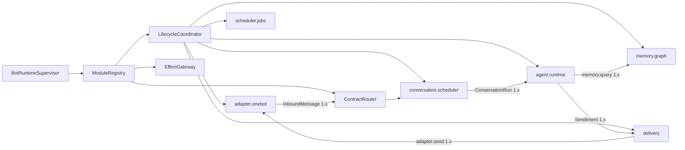

# 微内核运行时与控制面重构详细设计

> **权威性：当前最高。** 后续代码、测试和 P0–P5 实现记录若与本文冲突，应删除或重写冲突实现；不得为 Forest 未发布期间的错误对象模型增加兼容层。本文所称 Agent 始终是可替换的单执行链模块，不是内核调度主体，也不存在产品子 Agent。

## 1. 修正的问题

此前实现曾把 `BindingRuntime` 写成 OneBot、消息存储、Agent、Memory、Shell、Job、Delivery 和策略存储的组合根，WebUI 又为 Agent、Memory、定时任务和 Bot 管理分别硬编码大块页面。本轮重构已经拆出部分官方运行时模块、Contract Router 及其资源所有权；本文继续作为清除旧管理入口、拆分模块存储和收口通用监督器的权威设计，不再把旧组合根描述成当前事实。

本设计立即取代以下语义：

- Bot 不是产品导航中心，而是运行实例和数据/权限作用域。
- Agent 不是框架主循环，也不创建“子 Agent”；它是一个可安装组件，消费调度器交付的 `ConversationRun`，按 QiYu Agentlib 的模型循环推进下一次模型调用、工具闭合和 checkpoint。
- Memory 不是 Agent 的内部辅助类；它是独立模块，向消息归档、Agent、管理查询提供版本化服务。
- “业务命令策略”是路由入口的组件命令授权，“执行链”是一次消息在注册路由中的 dispatch trace。两者分别属于安全/路由和可观测性，不是两套独立业务后台。
- WebUI 不知道 Agent、Memory 或 OneBot 的具体配置字段。模块注册表决定当前实例可配置的能力，模块包决定是否使用自带 UI。

## 2. 本阶段重构策略

Forest 尚未上线，本阶段采用直接重构：允许删除错误抽象、端点、表和测试，允许重建开发数据库，不增加旧 DTO、旧表或旧页面的兼容层。只有真实外部边界保留稳定性，包括 OneBot 协议、包工件校验、群消息身份/顺序、外部副作用账本和已经验证的安全不变量。

每次重构以最终模型建立测试数据；数据库 schema 从干净实例创建。Bot 事实库由两个层次组成：

1. **最小内核基线**只创建 Bot 身份、已安装 schema bundle 账本、RuntimeGraph/Generation、契约路由、能力授予、调用/效果/操作账本和内核必要的 fencing。它不能创建 Agent、Memory、OneBot、Shell、Scheduler 或 Delivery 的业务表。
2. **模块 schema bundle**随不可变模块包发布，由 manifest 声明 `schema_id`、内容摘要、所有者组件、目标数据库作用域及创建脚本。Lifecycle Coordinator 在 PREPARED 阶段把 bundle 安装到模块独占命名空间，校验空命名空间、摘要和数据库能力，完成后才允许该 Generation 进入路由图。模块只能通过自身 Repository 访问所属表；跨模块引用使用稳定 ID 和契约，不以跨所有者 SQL、外键或共享 ORM 对象形成隐藏依赖。

当前版本尚未发布，因此内核和每个模块都只有一份“从空命名空间创建”的内容寻址基线。已经存在旧迁移账本、旧 Forest 表或未知业务表的数据库一律拒绝，开发和测试环境直接重建。不得保留按 001…087 顺序回放的未发布迁移链、旧数据搬运器、writer-generation 过渡门或非空旧库升级测试；也不得把这些迁移压成一个包含全部官方业务模块的巨型内核 SQL 后称为微内核。首次正式发布以后，内核与各模块才可分别从其首发基线增加有明确版本边界的升级图。

## 3. 运行时组合



`BotRuntimeSupervisor` 只负责读取已冻结部署计划、按依赖图建立组件实例、授予能力、监督代际和汇总健康。它不能 `import AgentRuntime`、`MemoryRuntime` 或具体 Adapter。官方组件和第三方组件都通过同一 `ModuleDescriptor`/`ModuleFactory` 注册，只在信任级别、发行来源和允许的能力上不同。

运行时代码只能按稳定 `component_id` 从 `ModuleRegistry` 解析能力，禁止在 Bot/Binding 对象上重新暴露 `agent`、`memory`、`scheduler`、`shell`、`jobs` 等便利属性。模块拥有自己的内部资源，例如 `scheduler.jobs` 拥有 JobStore；调用者不得越过模块边界持有该资源。这样删除或替换模块时，内核与业务模块之间不会留下隐式对象图，依赖关系也能由注册表完整描述和校验。

官方受信模块可在描述符中声明一个或多个 `management_contributions`，每项包含稳定 contribution ID、适用作用域、排序组、显示名、协议版本、HTML 模板、CSS 和 ES module 控制器资产。控制台壳只能从运行时注册表枚举并装载这些声明，不能按模块 ID 建立页面映射。受信资产必须随 Forest 发行并限制在 `/static/`；可安装包不获得这一执行级别，仍使用下节的摘要绑定沙箱 iframe。

通用 action 在验证类型化输入后先派生稳定幂等操作 ID。若模块需要处理凭据或跨库目录预留，可在签发权威票据前执行模块声明的 authorization preparation：它只能返回进入票据的安全载荷和不出模块进程的私有暂存状态。以 OneBot 为例，access token 与 webhook secret 先由 Adapter 加密暂存，票据只包含 `secret_digest`；Binding 目录预留返回冻结的登记载荷。随后通用网关签发票据并调用同一代际的模块 handler。这个阶段不是第二套授权，也不能产生外部副作用；其失败由相同 operation ID 重放或恢复。

模块描述包含：

- `component_id`、包摘要、作用域、代际和运行驱动；
- 提供/依赖的契约及启动依赖边；
- 生命周期超时、资源预算、能力请求；
- 命令、消息处理器、事件和持久任务声明；
- 配置 schema 及可选的 `management_ui` 描述。

依赖图必须无环。生命周期协调器拓扑准备和启动，反向排空和停止。Contract Router 只向 ACTIVE 代际发布路由；候选代际完成 schema、依赖、能力、状态迁移和健康检查后一次切换。任何组件失败都按依赖边影响实例，不以“平台子任务失败”笼统拖停无关模块。

当前 `RuntimeModuleRegistry` 已由内核持有 `DISCOVERED → VALIDATED → PREPARED → ACTIVE → QUIESCING → QUIESCENT → STOPPED/FAILED` 状态，描述符不能用模块自报字段伪造生命周期。每次 Registry 激活分配独立 activation UUID，为完整官方描述符集建立一个不可变 RuntimeGraph，并为每个官方模块建立 Generation；即使宿主 lease incarnation 未变化，关闭后再次启动也必须创建新图和新代际，绝不重新激活已经 `STOPPED` 的记录。描述符摘要覆盖依赖、factory 身份、管理契约、UI 工件和明确的 `package_id/version/digest/scope/driver/trust_level`。当前官方模块仍同属一个 Forest Python distribution，所以共享由该 distribution 全部 Python、SQL、HTML、CSS、JavaScript、JSON 和 TOML 资源派生的内容摘要；这比伪造独立包身份更准确，待物理拆包后再自然变为各包摘要。存储 bundle 的 `package_digest` 必须等于描述符工件摘要。所有模块启动成功后，数据库在一个事务中追加 ACTIVE 生命周期事实并切换 runtime graph head；任一启动失败只记录 FAILED/STOPPED，不能发布部分图。关闭先原子撤下 head，再按逆依赖序排空并追加终态；消息冻结的旧图仍保留旧代际。旧宿主已经失租时只能回收本地资源，不能冒用过期 lease 修改持久事实；新宿主发布新图的事务负责把旧图终结为 STOPPED。官方模块与可安装 Worker 仍使用不同的运行驱动和代际事实表，后续需统一健康检查、恢复和按依赖边隔离的故障策略，不能把二者误称为已经共用同一 Worker 生命周期实现。

官方 `adapter.onebot` 模块拥有 BindingStore、MessageStore、ShellIngressGuard、DeliveryStore、发送 Worker、连接集合、候选发布/恢复、网络接纳和连接监督任务，并向依赖模块提供明确端口；`memory.graph` 拥有来源账本与回填任务。`routing.graph` 拥有 RouteGraph 查询、组件 Event 和 ComponentJob 的持久存储及管理视图；事件/任务的查询、失败重放和 Handler 退役均通过该模块的类型化管理契约完成。`kernel.audit` 拥有 Bot 级不可变审计流的写入端口、脱敏元数据查询契约和管理 UI；它只保存并投影其他模块提交的审计事实，不接管这些事实所描述的业务资源，生产者仍负责动作语义和载荷 schema。审计查询不得直接穿过壳层访问共享表，Shell 也必须依赖该模块端口。`command.router` 与 `message.router` 都依赖 `adapter.onebot` 的 Binding/Message 端口和 `routing.graph`，分别拥有业务命令与普通消息 Handler 的策略、容量、脱敏诊断、恢复操作和管理 UI。`component.worker-host` 独占可安装包 Worker 的启动锁、错误状态和 Kernel install 调用，OneBot 通过依赖端口请求 codec。`contract.router` 独占冻结消息分派、命令/Handler 调用、Agent 选择和模板 responder，Conversation Scheduler 只持有它的 `execute` 端口。`scheduler.jobs` 自己构造授权端口并把冻结委派翻译为部署 authority 请求。

`BindingRuntime` 是已废弃的错误抽象，目标代码中不得保留该类型或兼容别名。Bot 作用域的宿主由 `BotRuntimeSupervisor` 表达；它只监督冻结模块图、内核任务、宿主 lease、统一唤醒和故障传播。模块唤醒通过通用生命周期/工作通知端口汇总，健康状态从各 Generation 的监督结果归约。Supervisor 不得知道某次唤醒属于 Agent、Memory、OneBot 或 Job，也不得持有这些模块的 Store、客户端或业务回调。

## 4. 控制台是模块工作台，不是固定产品后台

控制台壳只保留三个不能由业务模块取代的结构：当前管理主体、当前作用域以及工作区容器。作用域由内核注册表给出，可以是 deployment、host、Bot、Binding 或某个组件实例；Bot 只是其中最常用的一种作用域，不是整个后台的产品首页，也没有固定的“Bot 管理”CRUD 流程。

工作区入口来自当前作用域内已发布的 `ManagementContribution`。每个贡献必须绑定准确的 package digest、component generation 和 management protocol，声明：

- 导航标识、标题、排序组和适用作用域；
- 配置 schema、desired/effective 状态查询和生效策略；
- 可分页 query、类型化 action 和所需能力；
- 可选的 UI 工件入口及其摘要。

内核自身也通过同一贡献协议发布最小工作区，用于模块图、代际、契约路由、能力授予、生命周期操作和宿主恢复。壳层不得另外硬编码“部署、运行实例、Agent、Memory、安全、存储”等固定产品栏目；安装的模块组合不同，实际导航就应不同。通用模块目录和作用域切换器可以始终存在，但它们只枚举注册事实，不能解释模块业务字段。

Agent、Memory、OneBot、Shell、Scheduler、Delivery、Event、ComponentJob 和 Bot 审计若需要页面，都必须由其 Bot 模块贡献。进入 Memory 页面时看到的主干、筛选和关系图来自 Memory Generation 的 query/action/UI；进入 Routing 页面时看到的 Event 与 ComponentJob 来自 `routing.graph` 的 query/action/UI；审计列表来自 `kernel.audit` 的脱敏查询而不是壳层专用 API；卸载对应模块后，入口自然消失。账号、部署审计、备份/恢复、Bot 目录和存储供应属于 deployment 或 host 控制面服务，不得伪装成某个 Bot 模块；它们由对应作用域注册表发布贡献，并使用同一发现、契约和 UI 承载协议。控制台不得根据 `component_id` 分支导入业务 JavaScript、拼专用 URL、制造固定页签或直接查询模块表。官方模块与第三方模块走相同发现路径，差别只来自包信任等级和获准的 UI 执行模式。

所谓“执行链”只是在通用 trace 工作区中对已提交路由事实的只读投影：消息经过哪个入口、冻结了哪个 RouteGraph、调用了哪个 Generation、产生了哪些 Event/Job/Effect。它不是可编辑的工作流编排器。所谓“业务命令策略”属于发布命令的模块以及授权模块，通过类型化管理贡献配置，不应成为壳层中的独立电商式策略页面。

## 5. 模块携带管理 UI

组件 manifest 可声明：

```toml
[components.management_ui]
entrypoint = "ui/index.html"
protocol = "forest.management-ui/1"
```

UI 目录属于包内容摘要，和 Python、schema 一起完成静态捕获、尺寸限制、路径规范化及校验。服务端只按已注册的准确包摘要读取工件；运行代际切换后，配置 UI、schema 和包摘要同步切换，不允许“新版表单编辑旧版组件”。

宿主通过认证 API 读取工件字节，在带严格 CSP 的 sandbox iframe 中运行。iframe 不含 `allow-same-origin`，没有 Cookie、LocalStorage、父页面 DOM、网络和导航权限。首版 UI 必须是单个自包含 HTML；后续多资源 bundle 仍由宿主转成受控 Blob 映射，不给模块源站权限。

通信使用一次性的 `MessageChannel`，双方先交换协议版本和 nonce。宿主只发送：

- component/package/generation 标识；
- JSON Schema 与 UI hint；
- 当前非敏感值、字段级继承来源及读权限；
- desired/effective/observed 状态和最近操作的脱敏摘要。

模块 UI 只能发送 `ready`、`resize`、`set-draft`、`validate`、`request-plan` 和 `discard-draft`。所有消息有 schema、大小、频率和字段路径限制。宿主执行服务端校验、CAS 计划和最终提交；iframe 永远不能提供 URL、HTTP 方法、权限名或任意控制调用。密钥字段由宿主原生控件覆盖，模块 UI 只看 `secret_ref` 是否已设置。

未声明 UI、UI 协议不兼容、资源校验失败或脚本崩溃时，控制台使用通用 schema 表单。自定义 UI 是呈现插件，不是配置权威，也不能成为模块可运行的必要条件。

## 6. 路由、授权和 dispatch trace

注册表把命令、消息处理器、服务、事件和任务统一编译为 RouteGraph。路由节点包含契约、提供组件、代际、优先级、并发预算和所需能力；边表示所有权、同步依赖解析和事件投递。

当前实现不再从 Worker 内存拼 service 图。每个 Generation 在注册时固化 `provides` 的精确契约与输入/输出 schema 摘要，以及 `requires` 的版本范围、必需性和启动依赖标记；发布事务同时切换组件 route、service head、command head、message-handler head、event subscription head 和 job head。普通 service 调用在交给 Worker 前核对持久 service head、目标 Generation 和 `route_epoch`，随后由既有调用准入事务决定新根调用或已保留父调用是否可继续。冻结阶段不会因为只读解析提前拒绝已经入场的调用树。

`routing.graph` 的交互查询在 PostgreSQL `REPEATABLE READ` 快照中读取这些权威 head，输出确定排序的节点、边、各注册表 revision 和 `graph_digest`。消息接纳路径已经持有 Bot runtime fence，并按发布顺序锁定 command、message-handler、service、runtime graph clock；它用四类 revision 与 component route 摘要查找内容寻址快照，稳定路由直接复用，只有键变化才扫描其余 head 并重建完整图，随后在 Inbox 固化不可变 `graph_digest`。这样既避免每条流式群消息重扫全图，也避免把整条高并发接纳事务提升为会产生 serialization failure 的隔离级别，同时阻止路由发布或策略 revision 在图读取中途穿过。缺失、不兼容或歧义依赖作为边的解析状态出现，官方 runtime module 及其依赖边也从持久 head 投影；WebUI 只读呈现当前或指定摘要快照，不能产生另一套可编辑路由。

组件命令授权绑定 `(bot_id, binding_id/group_scope, command_id, component_generation, principal_class)`。ShellGate 的保留管理命令先行，但不会使普通组件命令获得管理权限。路由快照在一条消息入场时固定，热重载只影响之后接纳的工作；兼容接管必须显式声明并经过旧/新代际协议验证。

dispatch trace 是观测记录，不是可编辑“执行链”。`routing.graph` 从 Inbox、Shell 请求、业务命令、消息 Handler chain/item/attempt/result/failure 和 Agent trigger/run 的权威事实投影统一记录，不维护第二份可变状态。它再沿不可变身份扩展 Kernel call 的 parent/root 树、调用发布的 component event、每个 subscriber delivery、调用创建的 component job、Job/Event 实际生成的后续 call，以及外部 SendIntent/SendPart/transport attempt/resolution。每条扩展记录必须携带类型化 `caused_by={kind,id}`；发送意图必须在创建事务中保存 `cause_kind/cause_id`，禁止用 operation 字符串前缀、正文或时间邻近猜测来源。

控制台可按 Bot、会话、Binding、群/频道、消息、组件、代际、结果和时间筛选，并按消息的 `graph_digest` 打开当时冻结的路由图。Adapter、Shell 和 Agent 条目从该消息的冻结图解析 `runtime:*` 节点与 Generation；实际 Kernel call 使用其冻结 Generation；尚未执行的 Event/Job/Delivery 不借用当前 head 伪造代际。外部发送逐 part 显示 `PENDING/CLAIMED/DISPATCHING/SENT/FAILED/UNKNOWN/CANCELLED/SKIPPED`，`UNKNOWN` 只能由显式 resolution 收敛。Trace 只返回身份、状态、摘要、时间和因果引用，不返回消息正文、事件/任务载荷、wire body 或平台 receipt 正文。

每个 Kernel 根调用在准入时固化 `causal_root_kind/causal_root_id`，嵌套调用继承同一根；允许的根是 Kernel operation、业务命令请求、消息 Handler chain 和 Conversation Run。Event 与 Job 的后继调用继承发布/调度调用的根，Agent 工具调用由 Agent 准入证明强制绑定 Conversation Run，调用者不能自行换根。`bot_calls_causal_root_idx` 和各权威事实表上的关联键让组件、代际与结果筛选先在数据库中精确选出消息根，不再扫描最近若干消息后做进程内猜测，也不再返回 `candidate_scan_truncated`。

单次因果展开仍必须同时限制深度和节点数，并在截断时显式返回 `causal_truncated`；循环通过稳定对象身份去重。数十万消息查询不能依赖无界递归或把大量消息载入浏览器过滤。当前查询按 `(received_at,event_id)` 倒序读取精确命中的消息根，并返回绑定其余筛选条件的 `next_before` 游标；游标不能换筛选条件后复用，WebUI 逐页追加而不要求浏览器先取得全部历史。剩余容量工作是验证十万级数据上的索引计划、延迟和单页因果展开上限。控制台始终只读，不能拖拽 trace 改变生产路由。

## 7. 可扩展管理视图

模块除配置 UI 外可声明只读管理视图和类型化管理动作。视图查询不是任意 SQL，而是组件注册的 management query contract；返回 DTO 经宿主字段授权、分页上限和脱敏后传给 iframe。动作必须映射到已注册 operation type，并走计划、授权、幂等、审计和生命周期执行器。

Memory 模块至少提供可扩展的 source/graph/retrieval 视图；Agent 模块提供 session/run/model-turn/tool-call 视图；Adapter 提供连接和协议事件；Scheduler 提供作业与 lease。控制台壳仅呈现模块给出的视图目录和通用状态，不为这些类型写专用顶层页面。

运行时模块使用 `forest.module-management/1` 声明管理契约。每个 operation 必须由模块固定声明 `operation_id`、`query | action`、权限名、输入模型和 handler；需要签发不同于执行正文的权限证明时，还要声明确定性的 `authorization_payload` 投影。模块描述符只向控制台投影 operation 目录，不把 Python handler 或密钥正文暴露到浏览器。

宿主只提供两条通用传输路由：

```text
GET  /management/v1/scopes/{scope_kind}/{scope_id}/modules/{component_id}/queries/{operation_id}
POST /management/v1/scopes/{scope_kind}/{scope_id}/modules/{component_id}/actions/{operation_id}
```

通用路由负责会话、CSRF、经 provider 解析作用域、从 `RuntimeModuleRegistry` 解析模块、输入规范化、权限适配和 action 幂等键；业务字段、权限名和执行函数都归模块契约所有。query 拒绝重复查询字段，输入先经模块模型转成规范类型再参与签名。action 必须提供稳定幂等键。浏览器控制器只能使用模块预先声明的 operation，不能提交 URL、HTTP 方法或权限名来扩大能力。

这里的“作用域”不能继续实现为 `scope_kind == "bot"` 的字符串检查。控制面必须注册
`ManagementScopeProvider`：每个 provider 负责规范化稳定 scope ID、校验主体可见性、返回该作用域
当前 ACTIVE 的管理模块注册表，并提供与该 authority 相匹配的授权适配器。Bot provider 解析目录并
挂载 `BotRuntimeSupervisor`，使用最长 30 秒的 Bot ticket；deployment provider 只接受 Bootstrap
冻结的 `deployment_id`，使用部署会话、角色和部署事务复核；host provider 绑定稳定 host
incarnation 与本地恢复 authority。通用传输不得假设所有 target 都有 `bot.store`、Bot policy
revision 或 `WebAuthority.issue(bot_id=...)`。

deployment/host 管理服务也有描述符、工件身份和
`DISCOVERED → VALIDATED → PREPARED → ACTIVE → QUIESCING → QUIESCENT → STOPPED/FAILED`
生命周期；注册表必须整体准备成功后再发布给 scope provider，恢复数据库、替换部署 authority 或
关闭宿主时先撤下目录再反向排空。首个 deployment 切片 `deployment.audit` 已落地：它只拥有部署审计
脱敏查询与 UI，继续由部署数据库事务在查询前后复核管理员会话。`deployment.accounts` 也已接管账号目录、创建、变更计划/提交和 UI，并保留自我降权后的幂等回执恢复。部署显示名称和会话 TTL 必须由 `deployment.configuration` 声明 schema、读取、计划、提交与 UI，登录/会话壳层只消费其生效投影。备份、Bot 目录和存储供应
随后各自成为 deployment/host 服务；不能把已有 `ManagementRuntime` 字段列表当作最终注册表，
也不能为了共用 transport 给 deployment 操作伪造 Bot ID 或 Bot ticket。

密钥输入在权限签名前投影为“是否变化 + 不可逆摘要”，原始密钥只交给经过校验的模块 handler，并立即进入凭据库加密路径；权限载荷、operation digest、审计参数和错误详情都不能携带密钥正文。输入错误返回稳定 `MODULE_MANAGEMENT_INPUT_INVALID`，未知或 query/action 类型不符返回 `MODULE_MANAGEMENT_OPERATION_NOT_FOUND`，校验详情必须可安全 JSON 序列化。

当前 Agent 模块已注册配置读取/计划/应用、Run 查询/取消、审批和未知工具结果核对；Memory 模块已注册配置读取/计划/应用、状态、来源、联想、遗忘计划/应用和联想计划/应用；Routing 模块已注册 Event 与 ComponentJob 的查询、失败重放和 Handler 退役计划/应用；Command Router 与 Message Router 均已注册 Binding 目录、策略、容量、脱敏诊断和有界恢复。`kernel.audit` 已注册 Bot 审计元数据查询并携带自己的 UI，Web 与 Shell 均经其端口读取；旧 `/bots/{bot_id}/audit` 和壳层面板已删除。需要当前密码的策略/容量动作由通用管理网关在签票前重新鉴权，票据和 payload provenance 只携带去除密码后的规范载荷。旧 `/agent/*`、`/memory/*`、`/bots/{bot_id}/events/*`、`/bots/{bot_id}/component-jobs/*` 和命令/消息路由专用管理端点直接删除，不保留兼容别名。对应 HTML、CSS、ES module 控制器由模块描述符声明，`index.html`、`app.js` 和通用路由均不按这些组件 ID 分支。审计生产者目前仍经 Kernel 事实写入路径落表；把该路径收口为 `kernel.audit` 的显式写入端口属于 schema bundle 拆分的一部分，不能把查询面迁移误称为存储所有权已经彻底完成。

管理调用的所有权和传输已经收口。Bot 与 deployment provider 由注册表选择，Bot provider 签发真实 Bot ticket，deployment provider 保持部署会话事务边界；`deployment.audit` 使用与 Bot 模块相同的发现、生命周期、契约和 UI 挂载协议。Memory 模块现已声明群主干目录、来源组合筛选、绑定筛选条件的 `(occurred_at, source_unit_id)` 稳定键集分页、人工关系筛选，以及实际发布图的 scope/节点/边遍历；返回关系会说明审核来源、贡献、投影版本和跨主干状态。相关索引直接进入最终数据库基线，控制台只通过模块 operation 使用这些能力。全文/图片查询式召回入口、关系图可视化和十万至百万来源容量压测仍未完成，不能用现有列表与 JSON 图遍历冒充。

Bot 目录迁移必须保持两层 authority，不能把整个“Bot 页面”包装成 deployment 模块。`deployment.bot-catalog` 只拥有目录列表、创建、重命名、供应重试和供应 Job 投影；点击目录项只把规范 `bot_id` 交给壳层的通用 scope opener。壳层随后通过 Bot provider 挂载目标 Bot 的模块注册表。维护开关、组件配置/启停/调用、OneBot、Agent、Memory、Routing 和 Scheduler 始终由目标 Bot authority 与对应模块契约处理，不能经过目录模块代签。包工件目录也不能顺便塞入 Bot 目录：全部署包仓库归 deployment/host 服务，某个 Bot 对包代际的选择才归 Bot scope。目录贡献卸载后，已有 Bot runtime 不被伪装成删除；只是控制面不再提供目录发现入口。

UI 生命周期同样分层。目录贡献可以调用壳层提供的通用 `openScope({kind,id})` 能力，但不能取得 `app.js` 内部函数、直接操作 Bot 工作区 DOM 或拼接 Bot 专用管理 URL。Scope opener 只负责选择目标、读取该 scope 的 ACTIVE 模块描述符并建立工作区；目录模块自行处理列表分页、供应进度、创建/重命名/重试表单和晚到响应。这样 Bot 数量增长后可以给目录增加服务端筛选与键集分页，而不会让每个 Bot 的业务面板重新成为 deployment 页面的一部分。

## 8. 完成判据

- 目标代码中不存在 `BindingRuntime` 类型或兼容别名；`BotRuntimeSupervisor` 不直接构造或保存 Agent、Memory、Shell、Job、Delivery 或具体平台客户端。
- 删除顶层硬编码 Agent、Memory、Event、ComponentJob、Command Router 和 Message Router 页面；模块列表来自服务端注册投影。
- 至少一个真实官方模块随包携带 UI，并通过沙箱协议完成读取草稿、产生补丁、预览与应用。
- 不带 UI 的模块仍可用通用 schema 表单配置。
- 配置 UI 的包摘要、schema、当前运行代际一致性有自动测试；篡改、路径逃逸、超大资源、协议不兼容和越权消息被拒绝。
- 命令授权在 RouteGraph 中可解释，一次消息的 dispatch trace 可按组件和代际查询。
- Agent 和 Memory 移出宿主组合根后，现有同群串行/跨群并发、多主干多模态记忆和群 Shell 不变量继续通过集成测试。

## 9. 实现前拒绝清单

出现下列任一方案时应先停止编码并修正文档/任务：

- 保留 `BindingRuntime` 兼容层，或在 `BotRuntimeSupervisor`、Fleet、Web 应用入口直接构造/保存 Agent、Memory、Adapter、Shell、Scheduler、Delivery 的具体对象；
- 为 Agent、Memory、LLM、Embedding 或 OneBot 新增控制台顶层页面、专用宿主表单或绕过通用模块路由的 HTTP 端点；
- 把 Agent 的下一次模型调用实现成另一个 Agent、私有分支调度器或独立 Prompt/预算树；
- 为已删除的 Child 表、旧页面、旧 DTO、旧 handler 或未发布数据库增加兼容迁移、fallback 读取或双写；
- 让模块 UI 直接取得管理员会话、任意管理 API、数据库连接或父页面 DOM；
- 仅记录进程内 ACTIVE 状态，却把模块展示为已经发布到持久 Generation/RouteGraph；
- 用当前模块 head 解释历史消息，而不使用该消息接纳时冻结的 `graph_digest`；
- 为降低实现成本而弱化同群唯一 Agent、消息切口、作者来源、多主干/多模态记忆或异步写合流不变量。
