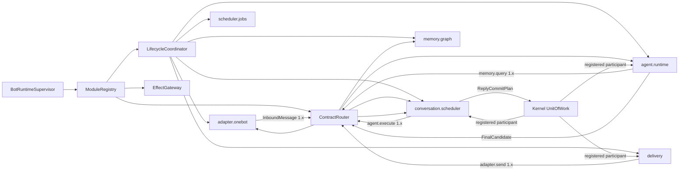

# 微内核运行时与控制面重构详细设计

> **权威性：运行时与控制面详细设计。** 本文展开[00 架构总契约](00-architecture-contract.md)。后续代码、测试和历史 Git 记录若与本文冲突，应删除或重写冲突实现；已删除的 P0–P5 纵向切片不得恢复为规格。不得为 Forest 未发布期间的错误对象模型增加兼容层。本文所称 Agent 始终是可替换的单执行链模块，不是内核调度主体，也不存在产品子 Agent。

## 1. 修正的问题

错误设计曾把 `BindingRuntime` 写成 OneBot、消息存储、Agent、Memory、Shell、Job、Delivery 和策略存储的组合根，WebUI 又为 Agent、Memory、定时任务和 Bot 管理分别硬编码大块页面。本文彻底废弃该语义，规定最终模块边界、控制协议和删除门槛；任何尚存代码都只是待删除对象，不能据此修改目标设计。

本设计立即取代以下语义：

- Bot 不是产品导航中心或运行时对象聚合，而是身份、资源、授权、预算和数据作用域事实。
- Agent 不是框架主循环，也不创建“子 Agent”；它是一个可安装组件，消费调度器交付的 `ConversationRun`，按 QiYu Agentlib 的模型循环推进下一次模型调用、工具闭合和 checkpoint。
- Memory 不是 Agent 的内部辅助类；它是独立模块，向消息归档、Agent、管理查询提供版本化服务。
- “业务命令策略”是路由入口的组件命令授权，“执行链”是一次消息在注册路由中的 dispatch trace。两者分别属于安全/路由和可观测性，不是两套独立业务后台。
- WebUI 不知道 Agent、Memory 或 OneBot 的具体配置字段。模块注册表决定当前实例可配置的能力，模块包决定是否使用自带 UI。

## 2. 本阶段重构策略

Forest 尚未上线，本阶段采用直接重构：允许删除错误抽象、端点、表和测试，允许重建开发数据库，不增加旧 DTO、旧表或旧页面的兼容层。只有真实外部边界保留稳定性，包括 OneBot 协议、包工件校验、群消息身份/顺序、外部副作用账本和已经验证的安全不变量。

每次重构以最终模型建立测试数据；数据库 schema 从干净实例创建。Bot 事实库由两个层次组成：

1. **不可绕过的 bootstrap 基线**只创建 `forest_kernel.bot_identity` 与 `forest_kernel.schema_bundles`，用于确认目标 Bot 和原子安装内容寻址 bundle。它不创建 RuntimeGraph、Payload、授权、效果、审计或任何业务表。
2. **模块 schema bundle**随不可变模块包发布，由 manifest 声明 `schema_id`、内容摘要、所有者组件、目标数据库作用域及创建脚本。`kernel.runtime`、`kernel.payload`、`kernel.authorization`、`kernel.effect` 与 `kernel.audit` 是不可卸载的首发 kernel 模块，但与其他模块一样拥有独立 bundle、Repository、Generation 和管理贡献。Lifecycle Coordinator 在 PREPARED 阶段把 bundle 安装到模块独占命名空间，校验空命名空间、摘要和数据库能力，完成后才允许该 Generation 进入路由图。模块只能通过自身 Repository 访问所属表；跨模块引用使用稳定 ID 和契约，不以跨所有者 SQL、外键或共享 ORM 对象形成隐藏依赖。

首发 bootstrap 的固定顺序是：只安装最小 `forest_kernel`；安装上述五个 kernel bundle；由 `kernel.payload` 为各模块建立模块私有的初始配置载荷；由 `kernel.authorization` 在当前 policy revision 下为稳定 component 主体建立真实 grant set；随后 `kernel.runtime` 才能签发 Host lease，并把五个模块作为普通 Generation 组成第一张 RuntimeGraph。bootstrap 身份允许没有 audience Generation，因为此时 Generation 尚不存在；运行期票据仍必须绑定准确 audience Generation。不得用空摘要、内存常量或“内核天然可信”绕过配置与授权事实。

当前版本尚未发布，因此内核和每个模块都只有一份“从空命名空间创建”的内容寻址基线。已经存在旧迁移账本、旧 Forest 表或未知业务表的数据库一律拒绝，开发和测试环境直接重建。不得保留按 001…087 顺序回放的未发布迁移链、旧数据搬运器、writer-generation 过渡门或非空旧库升级测试；也不得把这些迁移压成一个包含全部官方业务模块的巨型内核 SQL 后称为微内核。首次正式发布以后，内核与各模块才可分别从其首发基线增加有明确版本边界的升级图。

## 3. 运行时组合



`BotRuntimeSupervisor` 只负责读取已冻结部署计划、解析内容寻址包、建立 Worker/Generation 句柄、监督代际和汇总健康。它不能 `import AgentRuntime`、`MemoryRuntime` 或具体 Adapter，也不能调用 `bootstrap_*` 工厂构造业务对象。官方组件和第三方组件都由同一个 `PackageDescriptorCompiler` 从已校验 `PackageSnapshot` 生成运行描述符，只在签名、信任级别、发行来源和允许的能力上不同。

只有内核路由与生命周期设施可以从 `ModuleRegistry` 解析实例。业务运行时代码必须消费绑定准确图、代际、契约版本、deadline 与 admission epoch 的调用句柄，不能按 `component_id` 取出另一个模块的 Python 对象。禁止在 Bot/Binding 对象上重新暴露 `agent`、`memory`、`scheduler`、`shell`、`jobs` 等便利属性，也禁止给工厂传入可变的全局 `modules` 字典后由模块自行抓取依赖。模块拥有自己的内部资源，例如 `scheduler.jobs` 拥有 JobStore；调用者不得越过模块边界持有该资源。这样删除或替换模块时，内核与业务模块之间不会留下隐式对象图，依赖和实际调用都能由注册表与 dispatch trace 完整解释。

启动依赖图与运行调用图是两种契约。启动依赖只描述 PREPARE、prewarm 和 activation 的先后关系，必须无环；运行服务可以出现 `conversation.scheduler → agent.runtime → memory.graph` 及 Delivery 回到 Adapter 的调用路径，但每一跳都经过 Contract Router，不能通过添加生命周期依赖或 `graph_activated()` 后门取得实例来规避循环。模块在 `start` 前取得的只是未开放 admission 的冻结调用句柄；完整 RuntimeGraph 发布后，内核统一开放这些句柄和模块本地 gate。

官方受信模块可在描述符中声明一个或多个 `management_contributions`，每项包含稳定 contribution ID、适用作用域、排序组、显示名、协议版本、HTML 模板、CSS 和 ES module 控制器资产。控制台壳只能从运行时注册表枚举并装载这些声明，不能按模块 ID 建立页面映射。受信资产必须随 Forest 发行并限制在 `/static/`；可安装包不获得这一执行级别，仍使用下节的摘要绑定沙箱 iframe。

通用 action 在验证类型化输入后先派生稳定幂等操作 ID。若模块需要处理凭据或跨库目录预留，可在签发权威票据前执行模块声明的 authorization preparation：它只能返回进入票据的安全载荷和不出模块进程的私有暂存状态。以 OneBot 为例，access token 与 webhook secret 先由 Adapter 加密暂存，票据只包含 `secret_digest`；Binding 目录预留返回冻结的登记载荷。随后通用网关签发票据并调用同一代际的模块 handler。这个阶段不是第二套授权，也不能产生外部副作用；其失败由相同 operation ID 重放或恢复。

模块描述只能从不可变包声明、部署配置引用和内核签发事实编译，包含：

- `component_id`、包摘要、作用域、代际和运行驱动；
- 提供/依赖的契约及启动依赖边；
- 生命周期超时、资源预算、能力请求；
- 命令、消息处理器、事件和持久任务声明；
- 配置 schema 及可选的 `management_ui` 描述。

依赖图必须无环。生命周期协调器拓扑准备和启动，反向排空和停止。Contract Router 只向 ACTIVE 代际发布路由；候选代际完成 schema、依赖、能力、状态迁移和健康检查后一次切换。任何组件失败都按依赖边影响实例，不以“平台子任务失败”笼统拖停无关模块。

`RuntimeModuleRegistry` 必须由内核持有 `DISCOVERED → VALIDATED → PREPARED → ACTIVE → QUIESCING → QUIESCENT → STOPPED/FAILED` 状态，描述符不能用模块自报字段伪造生命周期。每次 Registry 激活分配独立 activation UUID，为完整描述符集建立一个不可变 RuntimeGraph，并为每个模块建立 Generation；即使宿主 lease incarnation 未变化，关闭后再次启动也必须创建新图和新代际，绝不重新激活已经 `STOPPED` 的记录。业务模块描述符摘要覆盖准确包摘要、依赖、契约、管理贡献、UI 工件和明确的 `package_id/version/digest/scope/driver/trust_level`，不得包含宿主 Python factory 身份。每个 builtin 从第一天就是物理独立包；把多个业务模块视作 `forest` distribution 内对象只适用于待删除旧实现。存储 bundle 的 `package_digest` 必须等于所属插件包摘要。

干净代际的顺序固定为 `prepare_generation → 持久化候选图并分配 generation_id → bind_generation → start/prewarm → publish participants + RuntimeGraph commit → activate_generation`。`start` 只能建立待命资源，不能领取生产工作；需要随路由一起生效的模块事实必须实现事务型 publication participant，在同一个 Bot 数据库事务中与配置 effective、Generation ACTIVE、Route epoch 和 graph head 一起提交。提交后的 `activate_generation` 只能打开已经预热完成的本地 admission gate，不得访问网络、数据库或执行可能失败的业务发布。若本地不变量仍意外抛错，Registry 立即撤下刚发布的路由并把图记为失败，不能把该动作包装成跨事务“补发布”。关闭先在持久路由上原子关闭 DATA/CONTROL admission 并递增 route epoch，RuntimeGraph head 暂时保持当前，使已经持有 actor/run/call lease 的工作可用精确 member fence 完成或 checkpoint；随后按逆依赖序排空。达到 QUIESCENT 后才撤下 head、退休图并追加终态。member fence 不能领取新顶层工作，最终事务还必须校验对应业务 lease/epoch。旧宿主已经失租时只能回收本地资源，不能冒用过期 lease 修改持久事实；新宿主发布新图的事务负责把旧图终结为 STOPPED。官方模块与可安装 Worker 可以使用不同运行驱动，但必须遵守同一 Generation、健康、恢复、依赖隔离和终止契约；运行驱动差异不能产生第二套生命周期事实。

这里的“建立 Generation”必须经过显式的 `PreparedGenerationBinding`，不能由 Registry 根据模块描述符补空值或猜测配置。模块的 PREPARE 端口在外部资源尚不可路由时返回不可变候选，至少包含 `component_id`、package digest、全部 storage bundle identity、实际采用的 `config_revision + config_payload_id + config_payload_digest`、`state_schema + state_contract_digest`、`capability_grants_digest`、`instance_id + worker_incarnation`、管理契约摘要和 UI 工件摘要。配置身份由拥有配置的模块 Repository 产生，授权摘要由 `kernel.authorization` 产生，状态契约和实例身份由候选运行驱动产生；Registry 只核验这些事实与描述符、已安装 bundle、Host lease 和准备操作一致，禁止生成哨兵摘要、复用当前 head 的配置身份或把 desired revision 当成 effective revision。

核验成功后 `kernel.runtime` 才分配 `generation_id` 并持久化候选 Generation。RuntimeGraph 的每个模块成员必须直接引用这个准确的 `generation_id`，图摘要覆盖按组件稳定排序的 Generation membership、依赖边和路由契约摘要；仅保存 `component_id/package_digest` 不能证明图实际采用了哪个配置、授权、状态契约或工作实例。发布事务只能把全部 `READY` Generation 组成的完整图切成 head，且同时推进对应 Route；任何候选缺少上述绑定、引用非 READY Generation、组件身份不一致或 Host fence 失效，整张图都不得发布。相同 prepare operation 的精确重放返回原候选，输入摘要不同则冲突；关闭后重新启动、配置生效、包替换或授权集改变都创建新 Generation，不能原地改写绑定。

官方 `adapter.onebot` 模块只拥有 Binding 配置与账号身份、连接代际、候选发布/恢复、平台入站观察、网络客户端和连接监督任务，并向其他模块提供 Binding 目录、已认证入站和 OneBot action 传输端口。Binding 配置只引用凭据与其他模块的策略身份；管理员名单、Shell 规则和命令权限属于 `shell.command`，不能因为它们按 Binding 生效就写进 Adapter。`conversation.scheduler` 拥有 Inbox、触发、输入切口和 Context；`shell.command` 拥有控制消息接纳、管理员策略、命令请求与执行；`delivery` 拥有 SendIntent、发送分片、attempt、平台回执引用、UNKNOWN 与对账。Adapter 只执行 Delivery 已许可的一个 transport attempt 并返回类型化观察，不能持有 `MessageStore`、`DeliveryStore`、Shell guard、发送队列或回复顺序。

`codec.onebot` 是独立、无状态、可热替换的 builtin 插件，只提供事件规范化和发送载荷编码契约。它不能持有 Binding、凭据、Socket、Repository、Conversation 或发送队列；`adapter.onebot` 通过冻结到准确 Generation 的 Contract Router 句柄调用它，并在外部效果前再次验证 action、wire 摘要和允许的 segment。插件 Worker 发送 IPC 前的最终围栏不得读取线程局部变量或进程级调用上下文：Contract Router 必须把不可变 route 凭据显式交给路由感知 endpoint；endpoint 只按凭据声明的 lane 与 owned-work 位选择新准入围栏或当前图成员围栏。

### 3.1 Package Generation Adapter

Python 插件接入 RuntimeGraph 的唯一桥梁是内核拥有的 `PackageGenerationAdapter`。它不是业务模块基类，也不理解 Agent、Memory、OneBot 或 Provider 字段。它只完成以下机械映射：

1. 从 `PackageSnapshot` 读取单一组件、provides/requires、状态 schema、资源上限、生命周期期限、配置 schema、storage bundle 与管理 UI；
2. 把服务契约和依赖解析结果编译成 Registry 可验证的描述符，不导入插件代码；
3. 读取准确 desired 配置修订与 grant set，形成 `PreparedGenerationBinding`，等待 `kernel.runtime` 分配 Generation 身份；
4. 使用 `(instance_id, generation_id, worker_incarnation, bot_id)` 启动对应 RuntimeDriver，把不可变包根和有限能力句柄交给 Worker；
5. 将 Worker 暴露的 service/command/event/job handler 包装成 Contract Router 句柄，并在每次发送 IPC 前复核本地 gate、持久 route、Generation 与 call fence；
6. 监督 Worker 进程、调用、后台任务、连接、临时环境和退出状态，并把失败归约到该 Generation；
7. 在 quiesce/stop 时拒绝新调用、等待已接纳调用、关闭能力句柄并确保进程退出。

Adapter 不得把插件类、方法、Repository 或客户端返回给 Registry。Registry 看到的实例永远是通用 Driver 句柄；Worker 才能 import `entrypoint`。插件代码若需要调用另一服务，只能经 `ctx.services.call` 发 IPC 回宿主，由宿主 Contract Router 在调用者 Generation 下解析；插件不能读取 Registry，也不能请求按组件 ID取得对象。

每次跨 Worker 调用必须同时携带两种不可混用的身份：`operation_id` 稳定标识业务操作并承担幂等语义，`call_id` 唯一标识一次执行尝试并承担运行中占用、取消和父子调用关系。调用还必须携带不可变 `causal_root_kind/causal_root_id`；顶层入口从平台事件、Delivery attempt、Job 或管理请求产生，嵌套调用只能继承父根。重试和重复投递复用 `operation_id` 与因果根，但每次尝试创建新的 `call_id`；不得根据业务幂等键派生可重复的执行调用号。Contract Router 把冻结 route 与不可变 invocation 显式交给路由感知 endpoint，不使用线程局部或隐式进程上下文。Worker 发起嵌套服务调用时必须声明自己的稳定 `operation_id`，宿主记录当前 `call_id` 为父调用，并把子调用期限限制在父调用剩余期限内；插件不能延长调用树的 deadline、改写因果根，也不能绕过 Router 自行取得服务对象。缺少这些事实的插件调用在边界直接拒绝，不由 Provider、业务模块或兼容分支猜测补齐。

Worker 的宿主能力不能汇入一个同时暴露查询、命令和外部副作用的总 Gateway。`PackageGenerationAdapter` 只接受按语义拆开的显式端口；每个端口都可单独缺席，包请求了未安装的端口时在描述符编译阶段失败。Adapter 负责核对不可变包声明、准确 grant、Worker 身份和活动调用作用域，再把请求送往唯一的所属权威。`PackageStateQueries` 与 `PackageStateCommands` 是两个对象：Query 只读取现有 head 与受管 Payload，缺失时返回 revision 0，不能顺便初始化；Command 在一个 Bot 数据库事务中复核准确 Generation 成员、按 `(component_id,state_key)` 串行、检查 expected revision、保存 Payload、追加以 `(component_id,operation_id)` 唯一的不可变 step 并推进 head。同一操作同一输入跨 `call_id` 返回原回执，输入不同则冲突；并发写同一 revision 只能一个提交。事件发布和任务调度也不进入 State 端口，而是经冻结的 Contract Router 句柄进入各自持久 authority；对应 authority 未进入 RuntimeGraph 时，声明该能力的包在构图前失败，不能用空实现、进程内队列或组合根回调降级。

只读纯服务直接执行，不为每条 Codec/分类调用制造数据库写放大。获得 `state.write`、Event/Job 发布或下游服务调用能力的组件，其服务先进入 `kernel.runtime` 的持久操作账本：`service_operations` 以 `(component_id,operation_id)` 固定服务、输入摘要和因果根，`service_call_attempts` 保存唯一 call、准确 Generation/Worker/RuntimeGraph、父调用和 deadline。同一操作最多派发一次；成功结果和类型化失败均保存为受管 Payload，重复请求只追加 replay attempt 并返回原终态。原 attempt 超过 deadline 而没有终态时只收敛为 `UNKNOWN`，不得重新执行来猜测。Adapter 的在途计数覆盖账本准入、Worker 执行和终态提交，Generation 排空必须等到三段全部结束后才能发布新图。

配置读取是 Query；配置计划/提交是 Command；Worker 调用、状态提交和外部效果各有独立端口。`prepare_generation` 只能读取冻结配置、声明和授权事实，不得写业务状态或执行网络副作用。Worker 的 `prepare/start/health` 只建立候选资源；即使 Worker 内部已进入可接受 IPC 的待命态，Adapter 的本地 admission gate 与持久 route 在 publication 前保持关闭。`activate_generation` 只同步翻转本地 gate，不做 IPC、网络或数据库操作。

Python 只用于降低模块实现与部署成本，不降低内核正确性要求。正确性必须由封闭状态机、构造时完整的身份类型、单一事实所有者、能力端口和最终事务围栏建立；不得依赖调用方约定、运行时猜测或测试样例补足协议。Query 只能读取既有事实，缺省值也不能在查询路径中落库；Command 只能通过所属 authority 修改状态，并在一个事务中完成其声明的原子事实。外部副作用、持久状态写入和跨模块调用必须分别进入类型化端口，禁止把可选回调、共享可变对象或隐藏 I/O 注入领域逻辑。测试只验证跨进程、并发、故障和协议边界是否兑现这些不变量，不能作为引入读写合一、散落副作用或非法状态补偿分支的理由。

### 3.2 内核机制、模块与效果执行器

代码位于宿主进程不等于它属于内核。只有 RuntimeGraph/Generation、Payload、授权、Effect 账本和审计这五类不可替代机制属于 bootstrap 内核；它们没有普通热重载语义，只能随受控宿主重启。`routing.graph`、Conversation、Agent、Memory、Shell、Job、Delivery、Adapter、Provider、Embedding、Vector Index、Media 与 Process Executor 都是模块，必须来自不可变包并获得独立 Generation。官方身份只改变签名、信任等级和可授予能力，不允许宿主用 `bootstrap_clean_*` 直接构造其业务对象。

模块包与执行副作用的宿主驱动是两个生命周期对象。模块 Worker 只能提交内容寻址、类型化且已授权的效果计划；Effect authority 固化 operation、输入、目标、调用 Generation、执行器 Generation、deadline 与 fence 后，准确的执行器驱动才可解析 Secret 并发生网络、文件或进程交接。Secret 明文不进入 Worker、配置 Payload、Event、Job、trace 或结果；Worker 也不获得通用 HTTP、文件系统、子进程或任意 Secret 读取能力。Provider、Embedding、Vector Index、OneBot transport、Media fetch 与 Process Executor 各自使用受限 effect kind 和目标 schema，不能共享一个“万能网络请求”接口。

带复杂持久状态的模块仍然是插件，不能因此退回宿主 import。它们的包声明 domain Query、domain Command、storage bundle 和可选 UnitOfWork participant；宿主只加载通用 authority driver，按包摘要安装独占 namespace，并把每次命令固定到准确 Generation、schema 与事务。Worker 不能取得数据库连接、Repository 或 SQL 字符串执行能力。查询与命令使用不同契约；跨模块原子提交只接受各模块返回的不可变 plan，由内核协调已注册 participant，不能把别的模块 Repository 注入当前模块。

因此迁移顺序由缺失机制决定：纯计算/策略服务直接进入 `python-worker`；有领域状态的模块先补齐 package domain authority/participant 协议；有外部 I/O 的模块再补齐 Secret lease 与类型化 Effect executor 协议。不得为了提前移动目录而把宿主回调、客户端或 Repository 塞进 Adapter。

### 3.3 完整热重载与回滚

包源码 watch 只产生“构建候选包”事件。每次变化都重新稳定捕获全部文件并产生新摘要；同一版本不同摘要不得覆盖目录或静默替换 catalog 绑定。重载按以下不可跳步的状态机执行：

```text
CAPTURED -> VALIDATED -> CANDIDATE_WORKER_READY -> OLD_ADMISSION_FROZEN
         -> OLD_QUIESCENT -> ROUTES_COMMITTED -> NEW_ADMITTED
         -> OLD_DISPOSED
```

- `CANDIDATE_WORKER_READY` 前失败：终止候选进程并删除临时环境，旧代完全不动。
- 冻结后、提交前失败：候选销毁；旧 Worker 先执行显式 `resume`，健康检查通过后才恢复旧 route admission。同步 `activate_generation` 不能代替 Worker resume。
- `ROUTES_COMMITTED` 后：旧代永不重新成为当前路由。新代故障通过另一笔替换操作回退到旧包摘要并创建全新 Generation。
- `OLD_DISPOSED` 只有在旧调用、调用派生的能力请求、后台任务和资源全部收敛且进程已退出后成立；超时必须强制终止并记录 cleanup failure，不能遗留孤儿 Worker。

首版允许为了简化原子性替换整张 Bot RuntimeGraph，但影响集合内的每个 Worker 都必须真实经历上述协议。未受影响组件也会获得新 Generation；后续可缩小影响集合，不能用共享进程内对象绕过代际。Adapter/Ingress 若需在切换期间缓冲平台事件，缓冲所有权和上限必须由其插件契约声明，不能靠 Host 的组件 ID 特判。

Agent 的最终候选不能直接创建 Delivery 记录。`agent.runtime` 先把带 checkpoint 和所答 trigger 集合的 `FinalCandidate` 交给 `conversation.scheduler`；Scheduler 只构造带稳定引用、预期版本和幂等 ID 的 `ReplyCommitPlan`，再调用内核 UnitOfWork 契约。内核按冻结 RuntimeGraph 解析 Agent、Conversation 与 Delivery 的准确 participant，在同一 Bot 事务中提交正式 `REPLY` Context、trigger `ANSWERED`、Agent Run `COMPLETED` 和 Delivery `SendIntent`。任一 participant 失败则整体回滚。业务模块不能持有另两个运行实例或 participant bound method，也不能自己拼接跨模块 UnitOfWork；每个 participant 只写自己的 schema，原子性不靠跨模块直写或跨 schema 外键。

`memory.graph` 拥有来源账本与回填任务。`routing.graph` 拥有 RouteGraph 查询、组件 Event 和 ComponentJob 的持久存储及管理视图；事件/任务的查询、失败重放和 Handler 退役均通过该模块的类型化管理契约完成。`kernel.audit` 拥有 Bot 级不可变审计流的写入端口、脱敏元数据查询契约和管理 UI；它只保存并投影其他模块提交的审计事实，不接管这些事实所描述的业务资源，生产者仍负责动作语义和载荷 schema。审计查询不得直接穿过壳层访问共享表，Shell 也必须依赖该模块端口。`command.router` 与 `message.router` 依赖 `adapter.onebot` 的 Binding 目录、`conversation.scheduler` 的消息端口和 `routing.graph`，分别拥有业务命令与普通消息 Handler 的策略、容量、脱敏诊断、恢复操作和管理 UI。`component.worker-host` 独占可安装包 Worker 的准备、启动与停止资源，OneBot 通过依赖端口请求 codec。内核 Contract Router 只按冻结 RuntimeGraph 解析并调用版本化 contract，不拥有消息分派策略、Agent 选择、模板 responder 或聊天执行循环，也不理解聊天内容。`conversation.scheduler` 在其生命周期任务中领取群 actor，并通过内核路由句柄调用冻结的 `agent.execute/1`；正式回复与 Session 交接通过内核 UnitOfWork 契约提交计划，由内核解析 participant。`scheduler.jobs` 通过内核授权契约请求冻结委派，不能自行构造另一套 authority port。

`BindingRuntime` 是已废弃的错误抽象，目标代码中不得保留该类型或兼容别名。Bot 作用域的宿主由 `BotRuntimeSupervisor` 表达；它只监督冻结模块图、内核任务、宿主 lease、统一唤醒和故障传播。模块唤醒通过通用生命周期/工作通知端口汇总，健康状态从各 Generation 的监督结果归约。Supervisor 不得知道某次唤醒属于 Agent、Memory、OneBot 或 Job，也不得持有这些模块的 Store、客户端或业务回调。

## 4. 控制台是模块工作台，不是固定产品后台

控制台壳只保留三个不能由业务模块取代的结构：当前管理主体、当前作用域以及工作区容器。作用域由内核注册表给出，可以是 deployment、host、Bot、Binding 或某个组件实例；Bot 只是其中最常用的一种作用域，不是整个后台的产品首页，也没有固定的“Bot 管理”CRUD 流程。

工作区入口来自当前作用域内已发布的 `ManagementContribution`。每个贡献必须绑定准确的 package digest、component generation 和 management protocol，声明：

- 导航标识、标题、排序组和适用作用域；
- 配置 schema、desired/effective 状态查询和生效策略；
- 可分页 query、类型化 action 和所需能力；
- 可选的 UI 工件入口及其摘要。

内核自身也通过同一贡献协议发布最小工作区，用于模块图、代际、契约路由、能力授予、生命周期操作和宿主恢复。壳层不得另外硬编码“部署、运行实例、Agent、Memory、安全、存储”等固定产品栏目；安装的模块组合不同，实际导航就应不同。通用模块目录和作用域切换器可以始终存在，但它们只枚举注册事实，不能解释模块业务字段。

Agent、Memory、OneBot、Shell、Scheduler、Delivery、Event、ComponentJob 和 Bot 审计若需要页面，都必须由其 Bot 模块贡献。进入 Memory 页面时看到的主干、筛选和关系图来自 Memory Generation 的 query/action/UI；进入 Routing 页面时看到的 Event 与 ComponentJob 来自 `routing.graph` 的 query/action/UI；审计列表来自 `kernel.audit` 的脱敏查询而不是壳层专用 API；卸载对应模块后，入口自然消失。账号、部署审计、备份/恢复、Bot 目录和存储供应属于 deployment 或 host 控制面服务，不得伪装成某个 Bot 模块；它们由对应作用域注册表发布贡献，并使用同一发现、契约和 UI 承载协议。控制台不得根据 `component_id` 分支导入业务 JavaScript、拼专用 URL、制造固定页签或直接查询模块表。官方模块与第三方模块走相同发现路径，差别只来自包信任等级和获准的 UI 执行模式。

所谓“执行链”只是在通用 trace 工作区中对已提交路由事实的只读投影：消息经过哪个入口、冻结了哪个 RouteGraph、调用了哪个 Generation、产生了哪些 Event/Job/Effect。它不是可编辑的工作流编排器。所谓“业务命令策略”属于发布命令的模块以及授权模块，通过类型化管理贡献配置，不应成为壳层中的独立电商式策略页面。

## 5. 模块携带管理 UI

Bot 尚未创建时也不能退回中央大表单。可安装模块通过 `BootstrapConfigurationContribution`
发布稳定 component ID、配置 schema 及摘要、无敏感初值、纯校验器和 setup UI surface；deployment
组合根把贡献集合注入 `BootstrapConfigurationRegistry`。`deployment.provisioning` 只负责发现目录、
按注册 schema 和模块校验器检查各组件结果、使用服务端持有的 schema digest 冻结 profile，再创建供应
Job。浏览器不得提交 `schema_digests`，也不得用一个六组件 JSON 文本框代替模块设置界面。贡献目录按
`(order, component_id)` 确定排序并拒绝重复 component/surface 身份；profile 必须准确覆盖本次注册的
组件集合，缺项、多项或失配都在入队前拒绝。

创建期 UI 使用与运行期管理贡献相同的受控 surface 身份。内置模块可以共享宿主提供的 schema 表单
renderer，模块也可以发布自己的 template/module/style；两者都只能返回该组件的配置值，不能选择
其他组件、伪造摘要、直接建库或启动 RuntimeGraph。Bot 建成后，配置所有权转交各模块自己的
configuration authority，bootstrap profile 保持不可变来源事实，不成为长期全局配置对象。

组件 manifest 可声明：

```toml
[components.management_ui]
entrypoint = "ui/index.html"
protocol = "forest.management-ui/1"
```

UI 目录属于包内容摘要，和 Python、schema 一起完成静态捕获、尺寸限制、路径规范化及校验。服务端只按已注册的准确包摘要读取工件；运行代际切换后，配置 UI、schema 和包摘要同步切换，不允许“新版表单编辑旧版组件”。

宿主通过认证 API 读取工件字节，在带严格 CSP 的 sandbox iframe 中运行。iframe 不含 `allow-same-origin`，没有 Cookie、LocalStorage、父页面 DOM、网络和导航权限。首版 UI 必须是单个自包含 HTML；后续多资源 bundle 仍由宿主转成受控 Blob 映射，不给模块源站权限。

通信使用一次性的 `MessageChannel`，双方先交换协议版本和 nonce。宿主只发送：

- component/package/generation 标识；
- JSON Schema 与 UI hint；
- 当前非敏感值、字段级继承来源及读权限；
- desired/effective/observed 状态和最近操作的脱敏摘要。

模块 UI 只能发送 `ready`、`resize`、`set-draft`、`validate`、`request-plan` 和 `discard-draft`。所有消息有 schema、大小、频率和字段路径限制。宿主执行服务端校验、CAS 计划和最终提交；iframe 永远不能提供 URL、HTTP 方法、权限名或任意控制调用。密钥字段由宿主原生控件覆盖，模块 UI 只看 `secret_ref` 是否已设置。

未声明 UI、UI 协议不兼容、资源校验失败或脚本崩溃时，控制台使用通用 schema 表单。自定义 UI 是呈现插件，不是配置权威，也不能成为模块可运行的必要条件。

## 6. 路由、授权和 dispatch trace

注册表把命令、消息处理器、服务、事件和任务统一编译为 RouteGraph。路由节点包含契约、提供组件、代际、优先级、并发预算和所需能力；边表示所有权、同步依赖解析和事件投递。

系统不得从 Worker 内存临时拼 service 图。每个 Generation 在注册时固化 `provides` 的精确契约与输入/输出 schema 摘要，以及 `requires` 的版本范围、必需性和启动依赖标记；发布事务同时切换组件 route、service head、command head、message-handler head、event subscription head 和 job head。普通 service 调用在交给 Worker 前核对持久 service head、目标 Generation 和 `route_epoch`，随后由调用准入事务决定新根调用或已保留父调用是否可继续。冻结阶段不会因为只读解析提前拒绝已经入场的调用树。

`routing.graph` 的交互查询在 PostgreSQL `REPEATABLE READ` 快照中读取这些权威 head，输出确定排序的节点、边、各注册表 revision 和 `graph_digest`。消息接纳路径必须持有 Bot runtime fence，并按发布顺序锁定 command、message-handler、service、runtime graph clock；它用四类 revision 与 component route 摘要查找内容寻址快照，稳定路由直接复用，只有键变化才扫描其余 head 并重建完整图，随后在 Inbox 固化不可变 `graph_digest`。这样既避免每条流式群消息重扫全图，也避免把整条高并发接纳事务提升为会产生 serialization failure 的隔离级别，同时阻止路由发布或策略 revision 在图读取中途穿过。缺失、不兼容或歧义依赖作为边的解析状态出现，runtime module 及其依赖边也从持久 head 投影；WebUI 只读呈现当前或指定摘要快照，不能产生另一套可编辑路由。

组件命令授权绑定 `(bot_id, binding_id/group_scope, command_id, component_generation, principal_class)`。ShellGate 的保留管理命令先行，但不会使普通组件命令获得管理权限。路由快照在一条消息入场时固定，热重载只影响之后接纳的工作；兼容接管必须显式声明并经过旧/新代际协议验证。

dispatch trace 是观测记录，不是可编辑“执行链”。`routing.graph` 从 Inbox、Shell 请求、业务命令、消息 Handler chain/item/attempt/result/failure 和 Agent trigger/run 的权威事实投影统一记录，不维护第二份可变状态。它再沿不可变身份扩展 Kernel call 的 parent/root 树、调用发布的 component event、每个 subscriber delivery、调用创建的 component job、Job/Event 实际生成的后续 call，以及外部 SendIntent/SendPart/transport attempt/resolution。每条扩展记录必须携带类型化 `caused_by={kind,id}`；发送意图必须在创建事务中保存 `cause_kind/cause_id`，禁止用 operation 字符串前缀、正文或时间邻近猜测来源。

控制台可按 Bot、会话、Binding、群/频道、消息、组件、代际、结果和时间筛选，并按消息的 `graph_digest` 打开当时冻结的路由图。Adapter、Shell 和 Agent 条目从该消息的冻结图解析 `runtime:*` 节点与 Generation；实际 Kernel call 使用其冻结 Generation；尚未执行的 Event/Job/Delivery 不借用当前 head 伪造代际。外部发送逐 part 显示 `PENDING/CLAIMED/PREPARED/DISPATCHING/SENT/FAILED/UNKNOWN/CANCELLED`；`CANCELLED` 只适用于未交接 attempt，`UNKNOWN` 只能由带 evidence 的显式 resolution 收敛，不提供跳过 lane 的状态。Trace 只返回身份、状态、摘要、时间和因果引用，不返回消息正文、事件/任务载荷、wire body 或平台 receipt 正文。

每个 Kernel 根调用在准入时固化 `causal_root_kind/causal_root_id`，嵌套调用继承同一根；允许的根是 Kernel operation、业务命令请求、消息 Handler chain 和 Conversation Run。Event 与 Job 的后继调用继承发布/调度调用的根，Agent 工具调用由 Agent 准入证明强制绑定 Conversation Run，调用者不能自行换根。`service_call_attempts_causal_root` 和各权威事实表上的关联键让组件、代际与结果筛选先在数据库中精确选出消息根，不再扫描最近若干消息后做进程内猜测，也不再返回 `candidate_scan_truncated`。

单次因果展开必须同时限制深度和节点数，并在截断时显式返回 `causal_truncated`；循环通过稳定对象身份去重。数十万消息查询不能依赖无界递归或把大量消息载入浏览器过滤。查询按 `(received_at,event_id)` 倒序读取精确命中的消息根，并返回绑定其余筛选条件的 `next_before` 游标；游标不能换筛选条件后复用，WebUI 逐页追加而不要求浏览器先取得全部历史。验收必须覆盖十万级数据上的索引计划、延迟和单页因果展开上限。控制台始终只读，不能拖拽 trace 改变生产路由。

### 6.1 `routing.graph` 的 Event 与 ComponentJob 权威

包声明的 `publishes/subscribes/jobs` 是 `routing.graph` 的路由贡献，不得编译成 `kernel.runtime` 回调，也不得把 `@job` 偷换为通用 `job.scheduler` 的 Job 类型。`job.scheduler` 执行由模块目录贡献、可被管理面和 Shell 显式创建的 Bot 级任务；ComponentJob 只能由其所属组件在一次获准调用中创建，目标固定为同一组件声明的 handler。两者可以共用调度算法，不能共用事实所有者、表、重试身份或管理动作。

RuntimeGraph 发布事务把下列 head 与组件 Generation 一起原子切换：

- Event publication：`topic + exact major.minor + payload schema digest + publisher component/generation`；
- durable subscription：稳定 `subscriber_id + contract major`、接受的 exact contract、schema digest、最大尝试和 handler service；
- ComponentJob handler：稳定 `handler_id`、输入 schema digest、最大尝试、deadline、并发上限和 handler service。

描述符只贡献不可变声明；`routing.graph` 通过 Contract Router 获得冻结 handler 句柄。发布能力则由 PackageAdapter 在图构建时取得 `routing.graph` 的类型化服务句柄；Adapter 不持有其 Repository，`routing.graph` 也不持有 Adapter 或包实例。这里不能把双向运行关系伪装成启动 DAG：同一组件可以既发布又订阅，若令 `routing.graph` 与 handler 互相成为生命周期依赖会形成环，任取一个单阶段关闭顺序也会过早切断另一侧。

替换和关闭采用两阶段排空。拥有持久后台工作的模块必须在不可变描述符中声明 `FREEZE_DRAIN`；声明者必须完整提供同步 `freeze_owned_admission`、异步 `drain_owned_work` 与同步 `open_owned_admission`，未声明者携带任一钩子或声明者缺少钩子都会在构图阶段失败。局部 `activate_generation` 不得自行开始领取；只有整张图全部 ACTIVE 且 Contract Router 已开放后，Registry 才统一调用 `open_owned_admission`。全图持久 admission freeze 后，Registry 同步关闭所有声明者的领取门，确保过程尚未让出事件循环时已经没有新 owned work 能进入；随后等待已领取工作到达可结算边界，最后才按反向启动依赖调用 `quiesce`。`routing.graph` 在第一阶段停止领取新 delivery/job，但仍保留 authority 服务端口；包 Worker 排空已经进入的调用树时仍可提交 Event/Job Command。所有包完成后，`routing.graph` 最后排空 authority 调用并关闭。

Registry 持有准确 replacement operation、已冻结模块集合和已进入 QUIESCENT 的模块集合，不从 Task 数量猜测两阶段排空状态。失败恢复先按正向依赖激活准确的 QUIESCENT 集合，再恢复 Contract Router 和准确的 owned-work gate，最后才开放持久 graph admission；任何模块已进入 FAILED/STOPPED 都拒绝重开入口。每完成一个本地恢复步骤即从集合删除该项，因此中途失败可以沿同一 operation 继续，不能把半恢复图冒充 ACTIVE 图。`freeze_owned_admission` 不改变 Generation ACTIVE/member 事实；dispatcher→handler 是持久 claim 与冻结 Contract Route 的所有权关系，不进入启动依赖图。

Event 发布是一个 Command。它在单个短事务中复核调用方准确 Generation、声明的 topic/contract/schema、稳定 `operation_id` 与继承的 causal root，写入受管 Payload、不可变 publication 和当时订阅 head 的逐订阅 delivery。`event_id` 由 Bot、发布组件和 operation 派生；相同 operation 与相同摘要返回原 publication，异载荷明确冲突。Query 不创建缺省 publication、delivery 或 checkpoint。

稳定 operation 的输入摘要只包含发布者稳定组件身份、topic/contract、业务 Payload、延迟和 causal root 等业务事实，不包含 RuntimeGraph、调用方 Generation 或目标 Route。首次 Command 在同一事务内从当前冻结目录选择准确图和订阅/handler 集合，并把这些执行事实不可变保存；换代后的同组件以相同业务输入恢复同一 operation 时返回首次 Event/ComponentJob，不按新图重复创建，也不因 Generation 改变制造伪冲突。

存储边界按命令域拆分：`RoutingDirectoryCommands` 只发布不可变目录，`ComponentEventCommands` 只负责 Event 创建、delivery claim 与结算，`ComponentJobCommands` 只负责 ComponentJob 创建、claim 与结算；共享文件只含不可变 Route/Claim 值。Runtime 仅编排这些端口和冻结的 Contract Handle。每个 claim 同时固化领取者 `routing_generation_id`、目标插件 Generation、token、attempt 和 lease；结算必须同时匹配全部所有权事实。成功与失败使用不同的公共 Command，调用方不能通过一组互斥可选参数拼出含糊结果。

每个 delivery 以 `(event_id, subscriber_id, contract_major)` 唯一，状态机为：

```text
QUEUED -> CLAIMED -> SUCCEEDED
                   -> RETRY_WAIT -> CLAIMED
                   -> DEAD_LETTER
                   -> UNKNOWN
```

领取事务固定 `attempt_id/claim_token/lease_until/target_generation_id/handler_service`。同一 subscription 同时最多一个 delivery 运行，不同 subscription 可在声明的 Bot 预算内并行。handler 调用使用稳定 delivery operation，继承 publication 的 causal root；Worker 成功结果先写调用结果账本，再由 `routing.graph` 以 claim token 结算 delivery。若 dispatcher 在两次提交之间崩溃，恢复必须先查询原调用结果：有终态就结算原 attempt，仍 ACTIVE 就等待，超过 deadline 且无法证明结果则落 `UNKNOWN`，禁止再派发。不能把租约超时直接解释成“handler 未执行”。

`subscriber_id + contract_major` 是跨 Generation 的逻辑消费身份，checkpoint 不含进程或 Generation。新旧声明的 exact contract、schema digest 和 handler protocol 完全相同时，发布新图后未领取 delivery 可由新 Generation 领取；旧 Generation 已领取的 delivery 只允许在 member fence 下完成或保存安全终态。声明变化不得隐式接管旧输入：替换计划必须先排空，或通过显式 replay/retire operation 把剩余项终结为 `DEAD_LETTER/HANDLER_RETIRED`。删除订阅不会删除 publication、delivery、attempt 或 Payload 依据。

ComponentJob 调度也是一个 Command。它复核调用方就是 handler 所属组件，固定 `job_id`、handler/schema、输入 Payload、`available_at`、deadline、重试预算和继承的 causal root；同 operation 同输入重放，异输入冲突。状态机为：

```text
WAITING -> CLAIMED -> SUCCEEDED
                  -> RETRY_WAIT -> CLAIMED
                  -> FAILED
                  -> CANCELLED
                  -> UNKNOWN
```

每次领取创建不可变 attempt，handler 调用 operation 固定为 `job_id + attempt_no`。租约失效时不能直接增加 attempt：dispatcher 先查询该 operation 的持久结果；已成功则提交 Job 成功，已明确失败才按策略进入下一 attempt，仍 ACTIVE 则等待，无法证明结果则把 Job 置为 `UNKNOWN`。因此重试只针对已知失败，不以进程丢失制造第二次副作用。取消只在线性化事务中终结尚未交接的 Job；已交接 handler 或其下游效果遵守原 operation 的结果/UNKNOWN 对账，不能伪装成未执行。

ComponentJob 的兼容接管要求相同 `handler_id`、输入 schema digest 和 handler protocol；未领取项可在图切换后绑定新 Generation，已领取项沿原 member fence 收敛。改变 schema、移除 handler 或降低无法满足的执行预算时，替换计划必须给出排空或显式退役结果，不能让新代码解释旧 Payload。Event 与 ComponentJob 的失败重放、退役、查询和有界分页都属于 `routing.graph` 管理契约；WebUI、Shell 与 CLI 只能调用这些类型化 operation。

## 7. 可扩展管理视图

模块除配置 UI 外可声明只读管理视图和类型化管理动作。视图查询不是任意 SQL，而是组件注册的 management query contract；返回 DTO 经宿主字段授权、分页上限和脱敏后传给 iframe。动作必须映射到已注册 operation type，并走计划、授权、幂等、审计和生命周期执行器。

Memory 模块至少提供可扩展的 source/graph/retrieval 视图；Agent 模块提供 session/run/model-turn/tool-call 视图；Adapter 提供连接和协议事件；Scheduler 提供作业与 lease。控制台壳仅呈现模块给出的视图目录和通用状态，不为这些类型写专用顶层页面。

运行时模块使用 `forest.module-management/1` 声明管理契约。每个 operation 必须由模块固定声明 `operation_id`、`query | action`、权限名、输入模型和 handler；需要签发不同于执行正文的权限证明时，还要声明确定性的 `authorization_payload` 投影。模块描述符只向控制台投影 operation 目录，不把 Python handler 或密钥正文暴露到浏览器。

宿主只提供通用作用域发现与模块传输路由：

```text
GET  /management/v1/scopes/{scope_kind}/{scope_id}/runtime
GET  /management/v1/scopes/{scope_kind}/{scope_id}/modules/{component_id}/configuration
POST /management/v1/scopes/{scope_kind}/{scope_id}/modules/{component_id}/queries/{operation_id}
POST /management/v1/scopes/{scope_kind}/{scope_id}/modules/{component_id}/actions/{operation_id}
```

通用路由负责会话、CSRF、经 provider 解析作用域、从 `RuntimeModuleRegistry` 解析模块、输入规范化、权限适配和 action 幂等键；业务字段、权限名和执行函数都归模块契约所有。query 拒绝重复查询字段，输入先经模块模型转成规范类型再参与签名。action 必须提供稳定幂等键。浏览器控制器只能使用模块预先声明的 operation，不能提交 URL、HTTP 方法或权限名来扩大能力。

这里的“作用域”不能继续实现为 `scope_kind == "bot"` 的字符串检查。控制面必须注册
`ManagementScopeProvider`：每个 provider 负责规范化稳定 scope ID、校验主体可见性、返回该作用域
当前 ACTIVE 的管理模块注册表，并提供与该 authority 相匹配的授权适配器。Bot provider 解析目录并
挂载 `BotRuntimeSupervisor`，使用最长 30 秒的 Bot ticket；deployment provider 只接受 Bootstrap
冻结的 `deployment_id`，使用部署会话、角色和部署事务复核；host provider 绑定稳定 host
incarnation 与本地恢复 authority。通用传输不得假设所有 target 都有 `bot.store`、Bot policy
revision 或 `WebAuthority.issue(bot_id=...)`。

deployment/host 管理服务也有描述符、工件身份和
`DISCOVERED → VALIDATED → PREPARED → ACTIVE → QUIESCING → QUIESCENT → STOPPED/FAILED`
生命周期；注册表必须整体准备成功后再发布给 scope provider，恢复数据库、替换部署 authority 或
关闭宿主时先撤下目录再反向排空。`deployment.audit` 只拥有部署审计脱敏查询与 UI，由部署数据库事务在查询前后复核管理员会话。`deployment.accounts` 拥有账号目录、创建、变更计划/提交和 UI，并保留自我降权后的幂等回执恢复。部署显示名称和会话 TTL 由 `deployment.configuration` 声明 schema、读取、计划、提交与 UI，登录/会话壳层只消费其生效投影。备份、Bot 目录和存储供应分别属于 deployment/host 服务；不能把某个临时 `ManagementRuntime` 字段列表当作最终注册表，
也不能为了共用 transport 给 deployment 操作伪造 Bot ID 或 Bot ticket。

密钥输入在权限签名前投影为“是否变化 + 不可逆摘要”，原始密钥只交给经过校验的模块 handler，并立即进入凭据库加密路径；权限载荷、operation digest、审计参数和错误详情都不能携带密钥正文。输入错误返回稳定 `MODULE_MANAGEMENT_INPUT_INVALID`，未知或 query/action 类型不符返回 `MODULE_MANAGEMENT_OPERATION_NOT_FOUND`，校验详情必须可安全 JSON 序列化。

官方模块的首版管理贡献必须覆盖以下能力：Agent 的配置、Run/ModelTurn/ToolStep 查询、取消和 UNKNOWN 对账；Memory 的配置、状态、来源组合筛选、关系遍历、真实召回试验、遗忘和人工关联；Routing 的已提交 Event/Job/dispatch trace 查询与受控重放；Command/Message Router 的 Binding 范围策略、容量、脱敏诊断和有界恢复；`kernel.audit` 的 Bot 审计元数据查询。这里定义的是模块必须发布的契约，不是当前完成度声明；实际落地情况只看[实现状态](implementation-status.md)。需要当前密码的策略/容量动作由通用管理网关在签票前重新鉴权，票据和 payload provenance 只携带去除密码后的规范载荷。旧 `/agent/*`、`/memory/*`、`/bots/{bot_id}/events/*`、`/bots/{bot_id}/component-jobs/*` 和命令/消息路由专用管理端点必须直接删除，不保留兼容别名。对应 HTML、CSS、ES module 控制器由模块描述符声明，`index.html`、`app.js` 和通用路由均不按这些组件 ID 分支。审计生产者也必须通过 `kernel.audit` 的显式写入端口提交，不能因为已有查询贡献就宣称存储所有权已经拆分完成。

管理调用必须按 scope provider 收口所有权和传输。Bot 与 deployment provider 由注册表选择，Bot provider 签发真实 Bot ticket，deployment provider 保持部署会话事务边界；deployment 模块与 Bot 模块使用同一发现、生命周期、契约和 UI 挂载协议。Memory 模块必须声明群主干目录、来源组合筛选、绑定筛选条件的稳定键集分页、人工关系筛选、实际发布图的 scope/节点/边遍历，以及 text/image/mixed 真实召回试验；每条返回关系必须说明方向、审核来源、贡献、证据、投影版本和跨主干状态。相关索引直接进入最终数据库基线，控制台只通过模块 operation 使用这些能力。简单列表、浏览器内筛选或 JSON 图遍历不能冒充大规模记忆管理完成。

Bot 目录拆分必须保持两层 authority，不能把整个“Bot 页面”包装成 deployment 模块。`deployment.bot-catalog` 只拥有目录列表、创建、重命名、供应重试和供应 Job 投影；点击目录项只把规范 `bot_id` 交给壳层的通用 scope opener。壳层随后通过 Bot provider 挂载目标 Bot 的模块注册表。维护开关、组件配置/启停/调用、OneBot、Agent、Memory、Routing 和 Scheduler 始终由目标 Bot authority 与对应模块契约处理，不能经过目录模块代签。包工件目录也不能顺便塞入 Bot 目录：全部署包仓库归 deployment/host 服务，某个 Bot 对包代际的选择才归 Bot scope。目录贡献卸载后，已有 Bot runtime 不被伪装成删除；只是控制面不再提供目录发现入口。

UI 生命周期同样分层。目录贡献可以调用壳层提供的通用 `openScope({kind,id})` 能力，但不能取得 `app.js` 内部函数、直接操作 Bot 工作区 DOM 或拼接 Bot 专用管理 URL。目录可附带名称等显示提示，但它们不是作用域权威。Scope opener 必须通过通用 `/scopes/{kind}/{id}/modules` 和对应 provider 重新解析目标、读取该 scope 的 ACTIVE 模块描述符并建立工作区；目录模块自行处理列表分页、供应进度、创建/重命名/重试表单和晚到响应。未 READY 的 Bot 仅在目录内展示供应状态，不伪装成已可挂载的运行作用域。这样 Bot 数量增长后可以给目录增加服务端筛选与键集分页，而不会让每个 Bot 的业务面板重新成为 deployment 页面的一部分。

包工件和备份还暴露了通用传输的一个缺口：它们需要有界的二进制上传与下载，不能被塞进 JSON action，也不能因此回到壳层专用路由。`ModuleOperation` 需要增加受限的 artifact 操作种类：描述符声明方向、媒体类型、最大字节数、所需主体和是否要求幂等 key；通用网关在读取正文前先解析 scope/module/operation 并做会话、CSRF、角色和 `Content-Length` 门禁，再把有界流交给同一 ACTIVE Generation。模块负责内容校验、不可变工件发布、存储预留和审计；下载 handler 只能返回受控的工件句柄、长度、媒体类型与建议文件名，由网关流式输出并固定 `nosniff`/`Content-Disposition`/缓存策略。不允许模块返回任意 ASGI `Response`、自定义响应头或无上限缓冲。

`deployment.package-registry` 拥有全部署的包列表、ZIP 导入、原工件导出、校验结果和导入错误投影，并通过上述 artifact 操作传输 ZIP 与包内管理 UI。它不决定某个 Bot 的组件代际；该选择与配置属于 Bot scope 的 `component.worker-host`。类似地，备份容器的导入/下载使用 artifact 传输，但备份 Job、恢复、激活和存储回收必须由各自 deployment/host 模块声明独立操作与生命周期，不得建成一个再次集中所有资源的“存储后台”。

备份与恢复的目标模块边界固定如下。`deployment.backup` 拥有跨 deployment 与多个 Bot cut 的备份集合、创建 Job、列表/详情、只读验证、外部容器导入及备份容器下载；它通过受限端口调用各 Bot 的一致性切口和宿主 artifact store，不取得 Bot 业务写权限。`deployment.restore` 拥有从已验证备份创建 SEALED 候选、候选校验、激活计划、storage head 切换与激活 Job；它只能消费 `deployment.backup` 发布的不可变备份引用，不能自行读取任意文件路径。二者是独立模块、独立 Generation 和独立操作命名空间，恢复失败不能阻断新备份，备份模块也不能绕过恢复计划直接替换活动 Bot。

`host.storage` 拥有本宿主持有的 artifact、隔离数据库和历史 storage generation 的物理清单、容量、回收计划、回收 Job 与重试；它不拥有备份的逻辑可恢复性或 Bot storage head。deployment 模块只向它提交内容寻址资源引用和预期 owner marker，host 模块在删除前复核稳定 `host_id`、当前 incarnation、资源 fence、名称/所有者标记和“未被 storage head/活动 Job 引用”。这些操作只有在持久 host identity、host provider 和 host module registry 都成立后才能启用；不得为了尽快删除页面而临时创建语义错误的 `deployment.storage`，也不得把进程重启产生的 incarnation 当成稳定 scope ID。

稳定操作名也在此固定。`deployment.backup` 使用 `backups`、`backup`、`backup.create`、`backup.archive`、`imports`、`import`、`import.reserve`、`import.artifact`、`import.finalize`、`verifications`、`verification`、`verification.create`；`deployment.restore` 使用 `stages`、`stage`、`stage.create`、`activation.plan`、`activations`、`activation`、`activation.apply`、`activation.retry`；`host.storage` 使用 `generations`、`cleanup.plan`、`cleanups`、`cleanup`、`cleanup.apply`、`cleanup.retry`。大文件只经 upload/download artifact 传输。计划、应用、重试分别保留独立 action，不能由一个带 `mode` 的总 action 动态选择 authority。

Bot 运行工作区的剩余固定页面必须拆成两个 authority，不能整体改名为一个“Bot 模块”。不可卸载的 `kernel.runtime` 只拥有 Bot runtime/admission 投影、维护修订和暂停/恢复业务接纳；它不读取包配置，不启停可安装组件，也不代理 Agent/Memory/Adapter 动作。`component.worker-host` 拥有可选包投影、某个 component 的 desired/effective 配置、历史、验证、显式启用/停用、Generation 重建请求和服务调用。它只能经 Contract Router 解析受限的包目录、Bot control 和存储契约，不能持有 `BotRuntimeSupervisor`、deployment Web 会话或跨模块读取 `web_packages`。

`component.worker-host` 的管理契约使用稳定操作名：`packages`、`configuration`、`configuration-history`、`module`、`module.validate`、`configuration.plan`、`configuration.apply`、`module.enable`、`module.disable` 和 `service.invoke`，并用只读 download artifact `package.management-ui` 传输选中包的自带配置界面。启用与停用必须是两个声明不同 authority 的 action，不能由 handler 根据布尔字段在签票后动态换权限。配置预览先根据当前包工件快照校验 schema/能力/接管声明，apply 仍由 Bot 库的 revision、plan digest 和内容来源围栏裁决。`module.validate` 是无持久效果的类型化 query；`service.invoke` 是可能产生组件效果的幂等 action。页面、schema 表单、包内 UI iframe 和历史列表全部随 `component.worker-host` Generation 发布；卸载贡献时壳层不得留下一套可绕过的旧表单。

这两个 authority 也规定了群聊 Shell 的归属：Bot 整体的 pause/resume 只能调用 `kernel.runtime`；某个可安装组件的 validate/enable/disable/reload 只能调用 `component.worker-host`。Shell、WebUI 和 CLI 只是同一类型化 operation 的入口，不各自实现维护或组件生命周期。历史文档中的 `kernel.lifecycle`、`kernel.events`、`kernel.jobs` 和 `audit.bot` 不是目标模块 ID；相应资源分别归 `component.worker-host`、`routing.graph` 与 `kernel.audit`，后续代码不得据这些旧名称建立新模块或兼容路由。

### 部署 Secret 主密钥生命周期

Secret 密文版本固化创建时的 `key_id`，Supervisor 从受保护的
`forest.deployment-master-keyring/1` 文件一次性加载有界 keyring。keyring 明确指定 active key；新写入
只使用 active key，读取严格按密文版本的 key ID 解析。轮换必须先原子安装同时包含所有仍被引用旧 key
和新 active key 的完整 keyring，再重启进程；缺少历史 key 时返回 unavailable，绝不拿 active key
试解或静默重加密。文件拒绝重复 JSON key、未知字段、非规范 Base64、非 32 字节 key、重复 key
material、缺失 active 引用和超过上限的 key 数，且 key material 不进入环境变量、repr、API 或日志。

## 8. 完成判据

- 目标代码中不存在 `BindingRuntime` 类型或兼容别名；`BotRuntimeSupervisor` 不直接构造或保存 Agent、Memory、Shell、Job、Delivery 或具体平台客户端。
- 删除顶层硬编码 Agent、Memory、Event、ComponentJob、Command Router 和 Message Router 页面；模块列表来自服务端注册投影。
- 至少一个真实官方模块随包携带 UI，并通过沙箱协议完成读取草稿、产生补丁、预览与应用。
- 不带 UI 的模块仍可用通用 schema 表单配置。
- 配置 UI 的包摘要、schema、当前运行代际一致性有自动测试；篡改、路径逃逸、超大资源、协议不兼容和越权消息被拒绝。
- 命令授权在 RouteGraph 中可解释，一次消息的 dispatch trace 可按组件和代际查询。
- Agent 和 Memory 移出宿主组合根后，现有同群串行/跨群并发、多主干多模态记忆和群 Shell 不变量继续通过集成测试。

## 9. 实现前拒绝清单

出现下列任一方案时应先停止编码并修正文档/任务：

- 保留 `BindingRuntime` 兼容层，或在 `BotRuntimeSupervisor`、Fleet、Web 应用入口直接构造/保存 Agent、Memory、Adapter、Shell、Scheduler、Delivery 的具体对象；
- 为 Agent、Memory、LLM、Embedding 或 OneBot 新增控制台顶层页面、专用宿主表单或绕过通用模块路由的 HTTP 端点；
- 把 Agent 的下一次模型调用实现成另一个 Agent、私有分支调度器或独立 Prompt/预算树；
- 为已删除的 Child 表、旧页面、旧 DTO、旧 handler 或未发布数据库增加兼容迁移、fallback 读取或双写；
- 让模块 UI 直接取得管理员会话、任意管理 API、数据库连接或父页面 DOM；
- 仅记录进程内 ACTIVE 状态，却把模块展示为已经发布到持久 Generation/RouteGraph；
- 用当前模块 head 解释历史消息，而不使用该消息接纳时冻结的 `graph_digest`；
- 为降低实现成本而弱化同群唯一 Agent、消息切口、作者来源、多主干/多模态记忆或异步写合流不变量。

每个新模块开始编码前还必须先在设计中填全 `owner / namespace / repository contract / provides / requires / UnitOfWork participants / management contribution / concurrency fence / deletion behavior`。其中任何一项只能通过读取其他模块内部表或调用具体 Python 对象才能表达时，说明模块边界仍然错误，应先重画依赖和提交协议。
