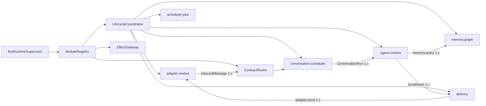

# 微内核运行时与控制面重构详细设计

> **权威性：当前最高。** 后续代码、测试和 P0–P5 实现记录若与本文冲突，应删除或重写冲突实现；不得为 Forest 未发布期间的错误对象模型增加兼容层。本文所称 Agent 始终是可替换的单执行链模块，不是内核调度主体，也不存在产品子 Agent。

## 1. 修正的问题

此前实现曾把 `BindingRuntime` 写成 OneBot、消息存储、Agent、Memory、Shell、Job、Delivery 和策略存储的组合根，WebUI 又为 Agent、Memory、定时任务和 Bot 管理分别硬编码大块页面。本轮重构已经拆出官方运行时模块及其资源所有权；本文继续作为剩余 Contract Router、持久代际和通用监督重构的权威设计，不再把旧组合根描述成当前事实。

本设计立即取代以下语义：

- Bot 不是产品导航中心，而是运行实例和数据/权限作用域。
- Agent 不是框架主循环，也不创建“子 Agent”；它是一个可安装组件，消费调度器交付的 `ConversationRun`，按 QiYu Agentlib 的模型循环推进下一次模型调用、工具闭合和 checkpoint。
- Memory 不是 Agent 的内部辅助类；它是独立模块，向消息归档、Agent、管理查询提供版本化服务。
- “业务命令策略”是路由入口的组件命令授权，“执行链”是一次消息在注册路由中的 dispatch trace。两者分别属于安全/路由和可观测性，不是两套独立业务后台。
- WebUI 不知道 Agent、Memory 或 OneBot 的具体配置字段。模块注册表决定当前实例可配置的能力，模块包决定是否使用自带 UI。

## 2. 本阶段重构策略

Forest 尚未上线，本阶段采用直接重构：允许删除错误抽象、端点、表和测试，允许合并或重建开发数据库，不增加旧 DTO、旧表或旧页面的兼容层。只有真实外部边界保留稳定性，包括 OneBot 协议、包工件校验、群消息身份/顺序、外部副作用账本和已经验证的安全不变量。

每次重构以最终模型建立测试数据；数据库 schema 从干净实例创建。迁移脚本只表达最终数据库从一个已发布版本升级的需要。当前未发布的中间表无需通过一串兼容迁移保留，可压平基线并重建本地/测试库。

## 3. 运行时组合



`BotRuntimeSupervisor` 只负责读取已冻结部署计划、按依赖图建立组件实例、授予能力、监督代际和汇总健康。它不能 `import AgentRuntime`、`MemoryRuntime` 或具体 Adapter。官方组件和第三方组件都通过同一 `ModuleDescriptor`/`ModuleFactory` 注册，只在信任级别、发行来源和允许的能力上不同。

运行时代码只能按稳定 `component_id` 从 `ModuleRegistry` 解析能力，禁止在 Bot/Binding 对象上重新暴露 `agent`、`memory`、`scheduler`、`shell`、`jobs` 等便利属性。模块拥有自己的内部资源，例如 `scheduler.jobs` 拥有 JobStore；调用者不得越过模块边界持有该资源。这样删除或替换模块时，内核与业务模块之间不会留下隐式对象图，依赖关系也能由注册表完整描述和校验。

官方受信模块可在描述符中声明 `management_view`，包含显示名、协议版本、HTML 模板、CSS 和 ES module 控制器资产。控制台壳只能从运行时注册表枚举并装载这些声明，不能按模块 ID 建立页面映射。受信资产必须随 Forest 发行并限制在 `/static/`；可安装包不获得这一执行级别，仍使用下节的摘要绑定沙箱 iframe。

模块描述包含：

- `component_id`、包摘要、作用域、代际和运行驱动；
- 提供/依赖的契约及启动依赖边；
- 生命周期超时、资源预算、能力请求；
- 命令、消息处理器、事件和持久任务声明；
- 配置 schema 及可选的 `management_ui` 描述。

依赖图必须无环。生命周期协调器拓扑准备和启动，反向排空和停止。Contract Router 只向 ACTIVE 代际发布路由；候选代际完成 schema、依赖、能力、状态迁移和健康检查后一次切换。任何组件失败都按依赖边影响实例，不以“平台子任务失败”笼统拖停无关模块。

当前 `BotModuleRegistry` 已由内核持有 `DISCOVERED → VALIDATED → PREPARED → ACTIVE → QUIESCING → QUIESCENT → STOPPED/FAILED` 状态，描述符不能用模块自报字段伪造生命周期。每次宿主 incarnation 为完整官方描述符集建立一个不可变 RuntimeGraph，并为每个官方模块建立 Generation；描述符摘要覆盖依赖、factory 身份、管理契约和 UI 工件。所有模块启动成功后，数据库在一个事务中追加 ACTIVE 生命周期事实并切换 runtime graph head；任一启动失败只记录 FAILED/STOPPED，不能发布部分图。关闭先原子撤下 head，再按逆依赖序排空并追加终态；消息冻结的旧图仍保留旧代际。旧宿主已经失租时只能回收本地资源，不能冒用过期 lease 修改持久事实；新宿主发布新图的事务负责把旧图终结为 STOPPED。官方模块与可安装 Worker 仍使用不同的运行驱动和代际事实表，后续需统一健康检查、恢复和按依赖边隔离的故障策略，不能把二者误称为已经共用同一 Worker 生命周期实现。

官方 `adapter.onebot` 模块现拥有 BindingStore、MessageStore、ShellIngressGuard、DeliveryStore、发送 Worker、连接集合、候选发布/恢复、网络接纳和连接监督任务，并向依赖模块提供明确端口；`memory.graph` 同时拥有来源账本与回填任务。`routing.graph` 拥有 RouteGraph 查询契约和管理视图；`command.router`、`message.router` 依赖它并分别拥有业务命令和普通消息 Handler 的策略/容量存储。Agent、Memory、Conversation Scheduler、Shell 和 Job 只从依赖图取得这些对象，`BindingRuntime` 不再暴露 OneBot 状态、消息/发送端口、记忆来源或策略存储便利属性。`BindingRuntime` 当前只保留跨模块会话执行、组件 Worker 确保与模块健康汇总；这些能力仍需继续收口到 Contract Router 和通用 supervisor。

## 4. 控制台信息架构

顶层导航固定为内核概念：

1. **部署**：内核版本、容量、全局操作、管理账号和备份。
2. **运行实例**：选择 Bot 作用域，查看状态、模块、RouteGraph、任务和观测。
3. **模块注册表**：包、摘要、契约、依赖、能力请求、UI 工件和版本。
4. **操作与追踪**：生命周期操作、dispatch trace、outbox/effect 对账、失败恢复。
5. **安全**：主体、作用域、能力授予、组件命令授权和审计。
6. **存储**：部署存储、各实例事实库、媒体、索引、备份与恢复。

选中 Bot 后只改变作用域，不改变产品分类。实例页签固定为“状态、模块、RouteGraph、任务、观测”。Agent、Memory、OneBot 在“模块”列表中并列；进入某模块后才显示其配置、业务诊断和自带 UI。记忆浏览器属于 Memory 模块的管理视图，Agent 对话/Run 浏览器属于 Agent 模块的管理视图。控制台不得根据 `component_id` 分支导入业务 JavaScript、拼专用 URL 或生成固定导航；官方模块也必须走描述符、query/action contract 与 UI 工件装载路径。

## 5. 模块携带管理 UI

组件 manifest 可声明：

```toml
[components.management_ui]
entrypoint = "ui/index.html"
protocol = "forest.management-ui/1"
```

UI 目录属于包内容摘要，和 Python、schema 一起完成静态捕获、尺寸限制、路径规范化及校验。服务端只按已注册的准确包摘要读取工件；运行代际切换后，配置 UI、schema 和包摘要同步切换，不允许“新版表单编辑旧版组件”。

宿主通过认证 API 读取工件字节，在带严格 CSP 的 sandbox iframe 中运行。iframe 不含 `allow-same-origin`，没有 Cookie、LocalStorage、父页面 DOM、网络和导航权限。首版 UI 必须是单个自包含 HTML；后续多资源 bundle 仍由宿主转成受控 Blob 映射，不给模块源站权限。

通信使用一次性的 `MessageChannel`，双方先交换协议版本和 nonce。宿主只发送：

- component/package/generation 标识；
- JSON Schema 与 UI hint；
- 当前非敏感值、字段级继承来源及读权限；
- desired/effective/observed 状态和最近操作的脱敏摘要。

模块 UI 只能发送 `ready`、`resize`、`set-draft`、`validate`、`request-plan` 和 `discard-draft`。所有消息有 schema、大小、频率和字段路径限制。宿主执行服务端校验、CAS 计划和最终提交；iframe 永远不能提供 URL、HTTP 方法、权限名或任意控制调用。密钥字段由宿主原生控件覆盖，模块 UI 只看 `secret_ref` 是否已设置。

未声明 UI、UI 协议不兼容、资源校验失败或脚本崩溃时，控制台使用通用 schema 表单。自定义 UI 是呈现插件，不是配置权威，也不能成为模块可运行的必要条件。

## 6. 路由、授权和 dispatch trace

注册表把命令、消息处理器、服务、事件和任务统一编译为 RouteGraph。路由节点包含契约、提供组件、代际、优先级、并发预算和所需能力；边表示所有权、同步依赖解析和事件投递。

当前实现不再从 Worker 内存拼 service 图。每个 Generation 在注册时固化 `provides` 的精确契约与输入/输出 schema 摘要，以及 `requires` 的版本范围、必需性和启动依赖标记；发布事务同时切换组件 route、service head、command head、message-handler head、event subscription head 和 job head。普通 service 调用在交给 Worker 前核对持久 service head、目标 Generation 和 `route_epoch`，随后由既有调用准入事务决定新根调用或已保留父调用是否可继续。冻结阶段不会因为只读解析提前拒绝已经入场的调用树。

`routing.graph` 的交互查询在 PostgreSQL `REPEATABLE READ` 快照中读取这些权威 head，输出确定排序的节点、边、各注册表 revision 和 `graph_digest`。消息接纳路径已经持有 Bot runtime fence，并按发布顺序锁定 command、message-handler、service、runtime graph clock；它用四类 revision 与 component route 摘要查找内容寻址快照，稳定路由直接复用，只有键变化才扫描其余 head 并重建完整图，随后在 Inbox 固化不可变 `graph_digest`。这样既避免每条流式群消息重扫全图，也避免把整条高并发接纳事务提升为会产生 serialization failure 的隔离级别，同时阻止路由发布或策略 revision 在图读取中途穿过。缺失、不兼容或歧义依赖作为边的解析状态出现，官方 runtime module 及其依赖边也从持久 head 投影；WebUI 只读呈现当前或指定摘要快照，不能产生另一套可编辑路由。

组件命令授权绑定 `(bot_id, binding_id/group_scope, command_id, component_generation, principal_class)`。ShellGate 的保留管理命令先行，但不会使普通组件命令获得管理权限。路由快照在一条消息入场时固定，热重载只影响之后接纳的工作；兼容接管必须显式声明并经过旧/新代际协议验证。

dispatch trace 是观测记录，不是可编辑“执行链”。`routing.graph` 从 Inbox、Shell 请求、业务命令、消息 Handler chain/item/attempt/result/failure 和 Agent trigger/run 的权威事实投影统一记录，不维护第二份可变状态。它再沿不可变身份扩展 Kernel call 的 parent/root 树、调用发布的 component event、每个 subscriber delivery、调用创建的 component job、Job/Event 实际生成的后续 call，以及外部 SendIntent/SendPart/transport attempt/resolution。每条扩展记录必须携带类型化 `caused_by={kind,id}`；发送意图必须在创建事务中保存 `cause_kind/cause_id`，禁止用 operation 字符串前缀、正文或时间邻近猜测来源。

控制台可按 Bot、会话、Binding、群/频道、消息、组件、代际、结果和时间筛选，并按消息的 `graph_digest` 打开当时冻结的路由图。Adapter、Shell 和 Agent 条目从该消息的冻结图解析 `runtime:*` 节点与 Generation；实际 Kernel call 使用其冻结 Generation；尚未执行的 Event/Job/Delivery 不借用当前 head 伪造代际。外部发送逐 part 显示 `PENDING/CLAIMED/DISPATCHING/SENT/FAILED/UNKNOWN/CANCELLED/SKIPPED`，`UNKNOWN` 只能由显式 resolution 收敛。Trace 只返回身份、状态、摘要、时间和因果引用，不返回消息正文、事件/任务载荷、wire body 或平台 receipt 正文。

单次因果展开必须同时限制深度和节点数，并在截断时显式返回 `causal_truncated`；循环通过稳定对象身份去重。数十万消息查询的最终实现必须使用以消息根和稳定游标索引的不可变 lineage 事实，不能依赖无界递归或先载入大量消息再在浏览器过滤。当前进程内的有界候选扫描只是重构期投影，命中扫描上限会返回 `candidate_scan_truncated`，不能被文档或 UI 宣称为完整历史结果。控制台始终只读，不能拖拽 trace 改变生产路由。

## 7. 可扩展管理视图

模块除配置 UI 外可声明只读管理视图和类型化管理动作。视图查询不是任意 SQL，而是组件注册的 management query contract；返回 DTO 经宿主字段授权、分页上限和脱敏后传给 iframe。动作必须映射到已注册 operation type，并走计划、授权、幂等、审计和生命周期执行器。

Memory 模块至少提供可扩展的 source/graph/retrieval 视图；Agent 模块提供 session/run/model-turn/tool-call 视图；Adapter 提供连接和协议事件；Scheduler 提供作业与 lease。控制台壳仅呈现模块给出的视图目录和通用状态，不为这些类型写专用顶层页面。

运行时模块使用 `forest.module-management/1` 声明管理契约。每个 operation 必须由模块固定声明 `operation_id`、`query | action`、权限名、输入模型和 handler；需要签发不同于执行正文的权限证明时，还要声明确定性的 `authorization_payload` 投影。模块描述符只向控制台投影 operation 目录，不把 Python handler 或密钥正文暴露到浏览器。

宿主只提供两条通用传输路由：

```text
GET  /management/v1/bots/{bot_id}/runtime-modules/{component_id}/queries/{operation_id}
POST /management/v1/bots/{bot_id}/runtime-modules/{component_id}/actions/{operation_id}
```

通用路由负责会话、CSRF、Bot 作用域、从 `ModuleRegistry` 解析模块、输入规范化、权限票据和 action 幂等键；业务字段、权限名和执行函数都归模块契约所有。query 拒绝重复查询字段，输入先经模块模型转成规范类型再参与签名。action 必须提供稳定幂等键。浏览器控制器只能使用模块预先声明的 operation，不能提交 URL、HTTP 方法或权限名来扩大能力。

密钥输入在权限签名前投影为“是否变化 + 不可逆摘要”，原始密钥只交给经过校验的模块 handler，并立即进入凭据库加密路径；权限载荷、operation digest、审计参数和错误详情都不能携带密钥正文。输入错误返回稳定 `MODULE_MANAGEMENT_INPUT_INVALID`，未知或 query/action 类型不符返回 `MODULE_MANAGEMENT_OPERATION_NOT_FOUND`，校验详情必须可安全 JSON 序列化。

当前 Agent 模块已注册配置读取/计划/应用、Run 查询/取消、审批和未知工具结果核对；Memory 模块已注册配置读取/计划/应用、状态、来源、联想、遗忘计划/应用和联想计划/应用。旧 `/agent/*`、`/memory/*` 管理端点直接删除，不保留兼容别名。Agent/Memory 的 HTML、CSS、ES module 控制器同样由模块描述符声明，`index.html`、`app.js` 和通用路由均不按这两个组件 ID 分支。

管理调用的所有权和传输已经收口。Memory 模块现已声明群主干目录、来源组合筛选、绑定筛选条件的 `(occurred_at, source_unit_id)` 稳定键集分页、人工关系筛选，以及实际发布图的 scope/节点/边遍历；返回关系会说明审核来源、贡献、投影版本和跨主干状态。相关索引直接进入最终数据库基线，控制台只通过模块 operation 使用这些能力。全文/图片查询式召回入口、关系图可视化和十万至百万来源容量压测仍未完成，不能用现有列表与 JSON 图遍历冒充。

## 8. 完成判据

- `BindingRuntime` 不再直接构造 Agent、Memory、Shell、Job 或具体平台客户端；这些组件由注册表和依赖图装配。
- 删除顶层硬编码 Agent/Memory 页面；模块列表来自服务端注册投影。
- 至少一个真实官方模块随包携带 UI，并通过沙箱协议完成读取草稿、产生补丁、预览与应用。
- 不带 UI 的模块仍可用通用 schema 表单配置。
- 配置 UI 的包摘要、schema、当前运行代际一致性有自动测试；篡改、路径逃逸、超大资源、协议不兼容和越权消息被拒绝。
- 命令授权在 RouteGraph 中可解释，一次消息的 dispatch trace 可按组件和代际查询。
- Agent 和 Memory 移出宿主组合根后，现有同群串行/跨群并发、多主干多模态记忆和群 Shell 不变量继续通过集成测试。

## 9. 实现前拒绝清单

出现下列任一方案时应先停止编码并修正文档/任务：

- 在 `BindingRuntime`、`BotRuntimeSupervisor` 或 Web 应用入口直接构造/保存 Agent、Memory、Adapter、Shell、Scheduler、Delivery 的具体对象；
- 为 Agent、Memory、LLM、Embedding 或 OneBot 新增控制台顶层页面、专用宿主表单或绕过通用模块路由的 HTTP 端点；
- 把 Agent 的下一次模型调用实现成另一个 Agent、私有分支调度器或独立 Prompt/预算树；
- 为已删除的 Child 表、旧页面、旧 DTO、旧 handler 或未发布数据库增加兼容迁移、fallback 读取或双写；
- 让模块 UI 直接取得管理员会话、任意管理 API、数据库连接或父页面 DOM；
- 仅记录进程内 ACTIVE 状态，却把模块展示为已经发布到持久 Generation/RouteGraph；
- 用当前模块 head 解释历史消息，而不使用该消息接纳时冻结的 `graph_digest`；
- 为降低实现成本而弱化同群唯一 Agent、消息切口、作者来源、多主干/多模态记忆或异步写合流不变量。
