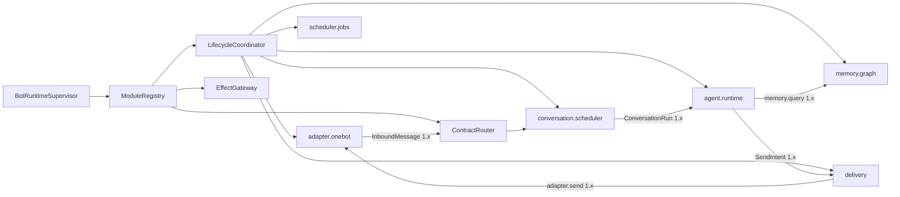

# 微内核运行时与控制面重构详细设计

## 1. 修正的问题

当前实现把 `BindingRuntime` 写成了 OneBot、消息存储、Agent、Memory、Shell、Job、Delivery 和策略存储的组合根，WebUI 又为 Agent、Memory、定时任务和 Bot 管理分别硬编码大块页面。这样的代码虽然具备一些模块 API，却仍由一个业务对象决定系统有哪些能力；它不是本文其余设计所要求的松耦合微内核。

本设计立即取代以下语义：

- Bot 不是产品导航中心，而是运行实例和数据/权限作用域。
- Agent 不是框架主循环，也不创建“子 Agent”；它是一个可安装组件，消费调度器交付的 `ConversationRun`，按 QiYu Agentlib 的模型循环推进下一次模型调用、工具闭合和 checkpoint。
- Memory 不是 Agent 的内部辅助类；它是独立模块，向消息归档、Agent、管理查询提供版本化服务。
- “业务命令策略”是路由入口的组件命令授权，“执行链”是一次消息在注册路由中的 dispatch trace。两者分别属于安全/路由和可观测性，不是两套独立业务后台。
- WebUI 不知道 Agent、Memory 或 OneBot 的具体配置字段。模块注册表决定当前实例可配置的能力，模块包决定是否使用自带 UI。

## 2. 本阶段重构策略

Forest 尚未上线，本阶段采用直接重构：允许删除错误抽象、端点、表和测试，允许合并或重建开发数据库，不增加旧 DTO、旧表或旧页面的兼容层。只有真实外部边界保留稳定性，包括 OneBot 协议、包工件校验、群消息身份/顺序、外部副作用账本和已经验证的安全不变量。

每次重构以最终模型建立测试数据；数据库 schema 从干净实例创建。迁移脚本只表达最终数据库从一个已发布版本升级的需要。当前未发布的中间表无需通过一串兼容迁移保留，可压平基线并重建本地/测试库。

## 3. 运行时组合



`BotRuntimeSupervisor` 只负责读取已冻结部署计划、按依赖图建立组件实例、授予能力、监督代际和汇总健康。它不能 `import AgentRuntime`、`MemoryRuntime` 或具体 Adapter。官方组件和第三方组件都通过同一 `ModuleDescriptor`/`ModuleFactory` 注册，只在信任级别、发行来源和允许的能力上不同。

运行时代码只能按稳定 `component_id` 从 `ModuleRegistry` 解析能力，禁止在 Bot/Binding 对象上重新暴露 `agent`、`memory`、`scheduler`、`shell`、`jobs` 等便利属性。模块拥有自己的内部资源，例如 `scheduler.jobs` 拥有 JobStore；调用者不得越过模块边界持有该资源。这样删除或替换模块时，内核与业务模块之间不会留下隐式对象图，依赖关系也能由注册表完整描述和校验。

模块描述包含：

- `component_id`、包摘要、作用域、代际和运行驱动；
- 提供/依赖的契约及启动依赖边；
- 生命周期超时、资源预算、能力请求；
- 命令、消息处理器、事件和持久任务声明；
- 配置 schema 及可选的 `management_ui` 描述。

依赖图必须无环。生命周期协调器拓扑准备和启动，反向排空和停止。Contract Router 只向 ACTIVE 代际发布路由；候选代际完成 schema、依赖、能力、状态迁移和健康检查后一次切换。任何组件失败都按依赖边影响实例，不以“平台子任务失败”笼统拖停无关模块。

## 4. 控制台信息架构

顶层导航固定为内核概念：

1. **部署**：内核版本、容量、全局操作、管理账号和备份。
2. **运行实例**：选择 Bot 作用域，查看状态、模块、Adapter/路由、任务和观测。
3. **模块注册表**：包、摘要、契约、依赖、能力请求、UI 工件和版本。
4. **操作与追踪**：生命周期操作、dispatch trace、outbox/effect 对账、失败恢复。
5. **安全**：主体、作用域、能力授予、组件命令授权和审计。
6. **存储**：部署存储、各实例事实库、媒体、索引、备份与恢复。

选中 Bot 后只改变作用域，不改变产品分类。实例页签固定为“状态、模块、Adapter 与路由、任务、观测”。Agent、Memory、OneBot 在“模块”列表中并列；进入某模块后才显示其配置、业务诊断和自带 UI。记忆浏览器属于 Memory 模块的管理视图，Agent 对话/Run 浏览器属于 Agent 模块的管理视图。

## 5. 模块携带管理 UI

组件 manifest 可声明：

```toml
[components.management_ui]
entrypoint = "ui/index.html"
protocol = "forest.management-ui/1"
```

UI 目录属于包内容摘要，和 Python、schema 一起完成静态捕获、尺寸限制、路径规范化及校验。服务端只按已注册的准确包摘要读取工件；运行代际切换后，配置 UI、schema 和包摘要同步切换，不允许“新版表单编辑旧版组件”。

宿主通过认证 API 读取工件字节，在带严格 CSP 的 sandbox iframe 中运行。iframe 不含 `allow-same-origin`，没有 Cookie、LocalStorage、父页面 DOM、网络和导航权限。首版 UI 必须是单个自包含 HTML；后续多资源 bundle 仍由宿主转成受控 Blob 映射，不给模块源站权限。

通信使用一次性的 `MessageChannel`，双方先交换协议版本和 nonce。宿主只发送：

- component/package/generation 标识；
- JSON Schema 与 UI hint；
- 当前非敏感值、字段级继承来源及读权限；
- desired/effective/observed 状态和最近操作的脱敏摘要。

模块 UI 只能发送 `ready`、`resize`、`set-draft`、`validate`、`request-plan` 和 `discard-draft`。所有消息有 schema、大小、频率和字段路径限制。宿主执行服务端校验、CAS 计划和最终提交；iframe 永远不能提供 URL、HTTP 方法、权限名或任意控制调用。密钥字段由宿主原生控件覆盖，模块 UI 只看 `secret_ref` 是否已设置。

未声明 UI、UI 协议不兼容、资源校验失败或脚本崩溃时，控制台使用通用 schema 表单。自定义 UI 是呈现插件，不是配置权威，也不能成为模块可运行的必要条件。

## 6. 路由、授权和 dispatch trace

注册表把命令、消息处理器、服务、事件和任务统一编译为 RouteGraph。路由节点包含契约、提供组件、代际、优先级、并发预算和所需能力；边表示匹配、调用、事件订阅或副作用出口。

组件命令授权绑定 `(bot_id, binding_id/group_scope, command_id, component_generation, principal_class)`。ShellGate 的保留管理命令先行，但不会使普通组件命令获得管理权限。路由快照在一条消息入场时固定，热重载只影响之后接纳的工作；兼容接管必须显式声明并经过旧/新代际协议验证。

dispatch trace 是观测记录，不是可编辑“执行链”。每次消息记录：输入序号、固定路由快照、匹配节点、跳过/拒绝原因、开始结束时间、结果摘要、产生的 operation/effect/outbox 引用。控制台可按 Bot、群、消息、组件、代际、结果和时间筛选，并从路由图定位一次执行；不能拖拽 trace 改变生产路由。

## 7. 可扩展管理视图

模块除配置 UI 外可声明只读管理视图和类型化管理动作。视图查询不是任意 SQL，而是组件注册的 management query contract；返回 DTO 经宿主字段授权、分页上限和脱敏后传给 iframe。动作必须映射到已注册 operation type，并走计划、授权、幂等、审计和生命周期执行器。

Memory 模块至少提供可扩展的 source/graph/retrieval 视图；Agent 模块提供 session/run/model-turn/tool-call 视图；Adapter 提供连接和协议事件；Scheduler 提供作业与 lease。控制台壳仅呈现模块给出的视图目录和通用状态，不为这些类型写专用顶层页面。

## 8. 完成判据

- `BindingRuntime` 不再直接构造 Agent、Memory、Shell、Job 或具体平台客户端；这些组件由注册表和依赖图装配。
- 删除顶层硬编码 Agent/Memory 页面；模块列表来自服务端注册投影。
- 至少一个真实官方模块随包携带 UI，并通过沙箱协议完成读取草稿、产生补丁、预览与应用。
- 不带 UI 的模块仍可用通用 schema 表单配置。
- 配置 UI 的包摘要、schema、当前运行代际一致性有自动测试；篡改、路径逃逸、超大资源、协议不兼容和越权消息被拒绝。
- 命令授权在 RouteGraph 中可解释，一次消息的 dispatch trace 可按组件和代际查询。
- Agent 和 Memory 移出宿主组合根后，现有同群串行/跨群并发、多主干多模态记忆和群 Shell 不变量继续通过集成测试。
