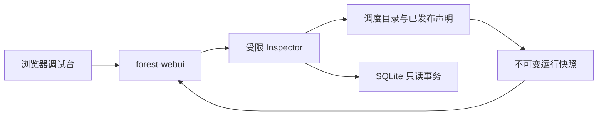
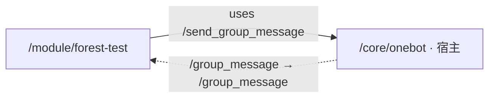

# 宿主调试台与模块管理

状态：第一版已实现。控制台供受信管理员使用，可以查看完整配置，包括仅允许 SelfModule 读取的项；普通模块与用户的 ACL 语义保持不变。

调试台展示模块实时状态、声明依赖关系、配置表内容，并提供本地包加载、重载和卸载入口。运行时仍是状态权威，WebUI 是可选的宿主适配层。

## 1. 边界

采用独立 `forest-webui` crate，由 CLI 显式启用，与调度器运行在同一宿主进程。该 crate 提供静态页面、认证、HTTP 与 SSE；运行时只增加只读观测接口，不依赖前端、Mermaid 或 HTTP 服务端。



Web 层持有两个独立能力：Inspector 只读观测，ModuleManager 执行包读取、依赖规划及装卸；两者由宿主显式授予。Web 层不持有完整 Scheduler、模块调用能力或可写 ConfigStore。模块 SDK 不提供这两个管理能力，模块 send/call 不能寻址它们。

观测不执行来宾代码、不遍历来宾内存、不恢复任务。控制台连接、读取和关闭不改变模块生命周期。只有显式装卸请求可以执行生命周期代码。配置编辑、日志平台、模块自带 UI 和 Agent 页面另行设计。

## 2. 权限

宿主明确启用全配置调试能力，管理员通过独立控制台认证后才能访问数据。此能力不由 Token 路径名授予，不修改 AclTable::check，也不将管理员映射成每个模块的 SelfModule。

| 入口 | 权限语义 |
|---|---|
| Wasm 配置 get/set/reset | 原有真实来源、静态 ACL 与阶段限制 |
| 普通代用户配置入口 | 原有用户来源与逐项 ACL |
| 宿主调试台 | 明确授予的完整配置只读观测能力 |

第一版采用单个宿主管理口令和会话，不建用户数据库或角色系统。口令由宿主启动配置提供；认证后用同源 HttpOnly 会话 Cookie 访问 HTTP/SSE，不把口令放入 URL。默认回环监听，远程访问可由用户配置受保护的入口。

运行状态、配置读取、本地包列表和模块管理均置于认证边界内。静态资源不嵌入运行数据；数据响应不缓存。模块管理请求与登录一样检查同源。管理端口不提供配置写入、重置或任意模块调用。

## 3. 页面

按 PC 视口设计：固定顶栏，左侧模块列表，右侧主工作区。内容区各自滚动，不把全部详情和表单纵向堆在首页。

```text
┌ Forest · 宿主调试台     连接状态 / 最近采样时间 / 模块数量 ┐
├──────────────────┬─────────────────────────────────────┤
│ 搜索模块         │ 运行状态  |  依赖图  |  配置表         │
│ 名称 / Token     │                                     │
│ 生命周期阶段     │          当前选中的视图               │
│                  │                                     │
│ 宿主对象（可展开）│      模块详情或配置值按选择展开         │
└──────────────────┴─────────────────────────────────────┘
```

模块列表以稳定对象 Token 标识对象，名称只是辅助。可按 Token/名称和阶段筛选。原生宿主对象单独标注，不伪装成有 create/destroy 的 Wasm 模块。

### 3.1 运行状态

| 内容 | 来源及含义 |
|---|---|
| 对象 Token、名称、发布标记 | 已发布 Manifest |
| 生命周期 | 当前 State 的只读投影 |
| 执行实例标识、实例工件标记 | 当前实例；重载时与已发布声明分别显示 |
| 旧集合排队数 | 当前 Live 的各接口 FIFO |
| 下一实例排队数 | Reload/Creating 的交接队列 |
| 已占用请求名额、输入字节及上限 | 当前对象 Budget 的观测 |
| 接口与依赖 | provides、uses 和 subscriptions |
| 失败原因 | Failed 保留的诊断 |

Serving 表示对象可以接纳工作，不表示它此刻正在执行 CPU 指令。占用名额包括必要收尾，不冒充“正在运行的任务数”。原生对象的登记也不代表外部网络连接健康。

第一版不显示尚无权威采集来源的 CPU 百分比、Wasm 实际内存、精确执行耗时或任务运行中/等待中分类；不为填满仪表盘增加调度状态副本。

### 3.2 依赖图

图由已发布声明生成，明确标为“声明依赖”，不声称是实际调用轨迹：

- 模块 uses 指向目标对象：实线，标签是目标接口路径。
- 宿主事件源指向接收模块：虚线，标签是 event → 接收接口。
- Wasm 对象、原生接口对象和纯宿主事件源采用不同样式；同一宿主对象兼具两种职责时合并节点。
- ACL 主体模式不画成依赖；配置访问权限不产生装载依赖。

当前示例包应呈现：



重载期间保留已发布图，详情同时显示当前实例与候选标记；新声明发布后再切换图。不能把候选边静默混入已发布依赖。

后端返回类型化节点和边，浏览器生成 Mermaid 描述。内部节点 ID 使用生成的 `n0` 等标识，不直接用 Token 拼 Mermaid 语法；标签统一转义。使用 strict 模式和纯文本标签，不允许插件注入图语句或 HTML。Mermaid 的 strict 模式会禁用其声明式点击功能，因此节点选择首版由模块列表完成，不为点击放宽模式。[渲染接口](https://mermaid.js.org/config/usage)、[安全模式](https://mermaid.js.org/config/schema-docs/config-properties-securitylevel.html)。

只在节点、边或显示状态改变时更新图，不随每次计数刷新重新布局。前端资源本地打包并锁定依赖，不要求运行机器联网访问 CDN。

### 3.3 配置表

按实体 Token 选择配置表，按配置键路径筛选。列表显示路径和类型，选择某项后展示完整 Schema、默认值、当前值，以及当前值是否等于默认值。

配置是 Forest Value，不将 Map、Variant、Tuple、Bytes 等强行压成普通 JSON 表单。使用结构树和现有规范文本展示；Bytes 首屏显示长度和短预览，完整内容按需读取。当前值、默认值与 Schema 从同一个 Entry 读取，不把部分字段缺失包装成 Option<Entry>。

初次加载和模块切换不读取全库的所有值。配置值不进入持续状态流；默认按需读取，可显式启用当前选中项的自动刷新。较大值采用折叠和独立滚动区域，列表不携带完整值。

SQLite 中已保存但当前没有加载模块的实体仍可查看，标注为“仅持久化数据”。不因查看而加载模块、注册配置、补默认值或删除数据。Creating 尚未注册完成、实体不存在与空配置表分别表达，不将三者都显示为空表。

## 4. 观测接口

以下为已实现的宿主 API，不进入 Wasm ABI：

| 接口 | 返回 |
|---|---|
| GET /api/inspect/snapshot | 一次完整的运行元数据快照 |
| GET /api/inspect/events | SSE，持续传输最新运行快照 |
| GET /api/inspect/config-entities | SQLite 中的配置实体目录 |
| GET /api/inspect/config-keys?object=… | 指定表的键与类型信息，不加载完整值 |
| GET /api/inspect/config-entry?object=…&key=… | 指定完整 Entry |
| GET /api/inspect/config-value?object=…&key=…&value=current 或 default | 下载完整值的 Forest 文本 |

完整 Entry 以 Schema、当前值、默认值和是否等于默认值呈现；树为有界展示投影，最多 256 个节点、24 层深度，字符串预览 2048 字符，Bytes 预览 32 字节。需要更多内容时下载完整原值，预览限制不修改或拒绝存储数据。

对象与配置键使用查询参数并按 Token 解析，避免把任意路径形状的 Token 与 HTTP 路由层级混用。响应采用明确的 Rust 结构和枚举，不设接受任意方法名的反射入口。

实现采用 Axum 的静态资源服务和 [SSE 响应类型](https://docs.rs/axum/latest/axum/response/sse/)。浏览器的状态流与调度器 notifier 没有关系：前者观察宿主，后者向 Wasm 接纳新请求。

## 5. 快照、并发与负载

运行快照在目录短临界区中取得状态与声明引用，离开锁后进行图构建和 JSON 编码。读取过程中不持有目录锁等待 SQLite、I/O 或执行 Wasm。

目录结构与生命周期取自同一次目录读取；信号量等资源计数是同轮采样的观测，不承诺所有字段构成跨线程的全局事务快照，也不用于调度决定。

配置通过现有 ConfigStore 只读事务查询。运行目录和 SQLite 是两种权威，不建立横跨二者的伪原子快照；页面分别显示采样/读取时间。模块重载不要求暂停调度以供浏览器读取。

宿主适配层约每秒采样一次运行元数据，使用仅保留最新值的 watch 通道。慢客户端可以跳过中间样本，不积压历史，不反向阻塞调度。断线重连取得新快照，不重放所有采样记录。没有浏览器订阅时可以暂停周期采样。

配置默认只在用户选择或刷新时读取。自动刷新只作用于当前选中项，并限制为上一请求结束后再发下一请求；不将整个配置库按采样频率扫描。

## 6. 实施范围

1. 在 forest-runtime 增加 Inspector 与只读快照 DTO；复用现有 State、Manifest、Budget 和 ConfigStore，不引入调度控制副本。
2. 增加可选 forest-webui，承载认证、固定查询、受限模块管理和 SSE，CLI 显式挂载。
3. 实现 PC 页面与 Mermaid 依赖图，资源随程序分发。
4. 验证读取不执行模块、不初始化数据；热重载时发布信息正确切换；慢客户端不积压；普通 Wasm 仍不能读取未授权配置。

这一阶段不改变现有模块 ABI，不为 UI 注册新的 Wasm 接口，不停止正在正常服务的初号机。

### 6.1 本地包与装卸入口

宿主通过 `--packages-directory` 指定包根目录，默认 `packages`。控制台枚举其直接子目录中的 Manifest，不执行 Wasm、不缓存编译结果或维护第二份已加载目录。列表保留无效 Manifest 的具体错误；一个无关坏包不妨碍其他包加载。同一对象出现多个候选时拒绝有歧义的装载规划。

包以根目录下的目录名选择，模块身份始终来自 Manifest 的 package.id。服务器限制路径在指定根目录内；接口不接受任意宿主文件路径。查看 Manifest 和依赖预览只读取声明；执行时才编译所需 Wasm。依赖顺序复用调度器的纯规划算法，执行时重新检查实际编译包和当前目录，不把预览视为预留。

| 接口 | 行为 |
|---|---|
| GET /api/modules/packages | 列出本地包及完整 Manifest，坏包显示错误 |
| POST /api/modules/plan | 按目录选择根包，返回依赖优先的装载顺序 |
| POST /api/modules/load | 编译根包所需闭包，交给现有 load_roots |
| POST /api/modules/reload | 指定目标对象、候选目录及 StopMode，执行现有 reload |
| POST /api/modules/unload | 指定对象及 StopMode，执行现有 unload |
| POST /api/modules/force | 显式中断初始化或升级已有停止过程 |

加载不自动重载已有模块；恢复 Failed 对象使用 load。重载必须保持目标对象身份，契约、ACL 发布和配置恢复继续使用现有调度规则。卸载仍由调度器拒绝存在静态使用者的对象，不自动级联卸载。

长操作的 HTTP 请求等待实际结算，浏览器同时通过原有 SSE 查看 Creating、Stopping、Destroying、Releasing 与 Serving。请求开始后由宿主持有执行 Future，浏览器断开不取消已提交的操作。不引入任务数据库、操作轮询或自动超时；Force 始终由管理员明确选择。各对象能否转换由原状态机决定，Web 层不复制可变生命周期。

页面增加本地包抽屉：选择包、查看 Manifest、预览依赖顺序并加载。模块标题区提供重载与卸载入口，操作面板明确展示目标对象、候选版本和三种停止方式。界面只保留实际状态、错误和操作标签。

## 7. 构建和使用

前端位于 `webui`，采用 Vue 3 单文件组件、TypeScript、Vite 和按需加载的 Mermaid；没有外部 CDN 或运行时 Node 服务。需要 Node 22.12+ 和 pnpm。依赖由 `pnpm-lock.yaml` 固定。

```sh
pnpm --dir webui install --frozen-lockfile
pnpm --dir webui build
```

在启动环境中设置非空的 `FOREST_WEB_PASSWORD`。例如 PowerShell：

```powershell
$env:FOREST_WEB_PASSWORD = 'your-local-console-password'
cargo run -p forest-cli --locked -- --events-ws ws://127.0.0.1:8080 --allow-group 123456789 --webui 127.0.0.1:3210
```

地址和群号均为示例，网关访问令牌仍用 `FOREST_ONEBOT_TOKEN`。在浏览器打开 `http://127.0.0.1:3210`，仅需输入管理口令，没有用户名。WebUI 不提供默认口令；启动者必须明确设置。口令不通过命令行参数传递。`.env` 不由 CLI 自动加载，需要启动脚本或当前终端将其设置为环境变量。

| 参数 | 默认值和用途 |
|---|---|
| --webui | 不提供时不启动 HTTP 服务；提供时指定监听地址 |
| --web-password-env | FOREST_WEB_PASSWORD，读取管理口令的环境变量名 |
| --webui-assets | webui/dist，前端构建目录，分发时与程序一起携带 |
| --packages-directory | packages，WebUI 可管理的本地包根目录 |

`forest-cli` 默认编译 webui feature，但仅显式传入 `--webui` 才启用。`cargo build -p forest-cli --no-default-features` 可完全不引入 Web 服务端依赖。Rust 编译本身不要求安装 Node；启用控制台时检查前端目录并给出缺少产物的提示。

开发时先启动带 WebUI 的 Rust 宿主，再执行 `pnpm --dir webui dev`。Vite 将同源 `/api` 代理至 `127.0.0.1:3210`，不增加跨域认证协议。修改代理目标时同步修改 vite.config.ts。

## 8. 验证

`forest-webui/tests/console.rs` 通过实际 HTTP 验证匿名拒绝、口令、会话、同源限制、私有配置读取、完整值下载、拒绝写方法、无来宾执行及 SSE 关闭收尾。运行时的真实 Wasm 测试核对 Inspector 在初始化和重载后的投影。

`forest-webui/tests/management.rs` 使用真实的两份 Wasm 工件，验证仅声明预览、依赖优先装载、无关坏包隔离、身份检查、存在使用者时拒绝卸载，以及三种重载方式。Drain 等待期间断开 HTTP 请求后，再由 Force 完成替换；新代码返回不同实现标识，持久计数继续累加。

```sh
cargo test -p forest-config -p forest-runtime -p forest-cli -p forest-webui --tests --locked
pnpm --dir webui build
```

浏览器验证连接一个已运行的测试宿主，默认 `http://127.0.0.1:3210`，可用 `FOREST_CONSOLE_URL` 修改。设置 `FOREST_TEST_WEB_PASSWORD` 为该实例的管理口令后执行 `pnpm --dir webui test:e2e`；使用已安装的 Edge、一个工作进程，不发送群消息。覆盖登录、实时采样、SVG 标签、配置查看、下载、登出及 1280×720 桌面布局；模块管理用例会对 forest-test 执行重载、卸载和重新加载，并核对实例替换及计数保留。截图输出到已忽略的 `webui/test-results`。
