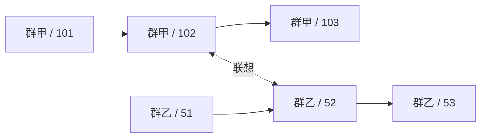

# 多主干多模态记忆模型

本文整理 Rust 主线记忆模块的数据模型与读写语义，设施选择见[Qwen VL 与存储选型](16-memory-infrastructure.md)。这是待实现的设计，不代表当前运行实例已有 Agent 或记忆功能。

## 1. 范围与所有权

当前一个 Forest 实例服务一个 Bot 账号。记忆在该账号范围内全局共享，每个群聊拥有一条独立主干，联想关系可以跨主干连接。群身份决定来源，不作为默认召回分区。

Memory 是普通 Wasm 模块，拥有自己的记录、关系与索引配置。Agent 通过类型化接口使用 Memory；调度器负责执行和资源访问，不解释记忆字段，也不替模块维护图、检索或归档流程。

核心由三类事实构成：不可变的记忆单元、已归档单元集合、联想形成记录。向量和召回区域分别是派生索引与读取结果。

## 2. 记忆单元

以下代码表达类型关系，不提前固定尚未设计的 Agent 协议字段或实际 ABI：

```rust
struct MemoryId {
    group: GroupId,
    sequence: Sequence,
}

struct MemoryUnit {
    id: MemoryId,
    content: MemoryContent,
}

enum MemoryContent {
    GroupMessage(forest_onebot::forest::GroupMessage),
    ModelTurn(ModelTurn),
    ToolResult(ToolResult),
}
```

群消息直接复用现有 OneBot 强类型结构。`group_id`、`message_id`、`user_id`、`time`、`sender` 和 `message` 保留原字段，不再另造一套作者及消息段对象。昵称和群名片保留消息到达时的值；账号身份不能由昵称推断。匿名消息按其实际匿名来源展示，不通过昵称合并为真实账号。

`MemoryId.group` 与群消息的 `group_id` 由接纳操作从同一个值构造，调用方不分别指定两份群身份。ModelTurn 和 ToolResult 的所属群来自其处理的群会话，不能在召回时改成查询所在群。

ModelTurn 保存闭合模型回合；ToolResult 保存明确关联到调用的结果。具体字段由后续 Agent 协议设计确定，不能先用任意字典代替。它们在归档和召回中保持类型，不能被呈现为群友发言。模型生成正文与平台实际送达的消息也不等同；实际发送记录应关联到生成它的回合，平台自回显不能再制造一份独立生成记录。

### 2.1 身份与顺序

Memory 的接纳入口是每个单元身份与位置的唯一分配者。在一次短本地事务中完成重复接纳识别、分配群内序号和保存单元；完成后返回稳定 MemoryId。重放已接纳输入只取得原 ID，不覆盖内容或重新分配位置。

平台群消息身份使用接入契约定义的消息键，平台 message_id 不直接承担群内排序。ModelTurn、ToolResult 使用 Agent 提供的稳定回合/调用身份。具体外部去重键属于相应接入协议，不能按正文相同、昵称相同或媒体字节相同合并发言。

序号表示 Bot 对该群单元的接纳顺序，不表示平台绝对发生顺序，也不表示模型看过哪些消息。平台时间继续保存在 OneBot 结构中。并发接纳需要在此处仲裁；位置一旦确定，后续归档、媒体获取和嵌入的完成顺序均不影响主干。

同一群的序号不因重启、热重载、归档或删除而重编号。不同群不需要共同的全局序号、全局提交版本或主干根节点。

### 2.2 消息段、CQ 与媒体

持久化复用 OneBot 结构。接纳路径先作不等待网络的确定性规范化，并固定媒体引用：

1. 将 OneBot 的 CQ 字符串、单消息段或消息段数组统一为有序消息段数组。
2. 按消息段解析 @、回复、表情及媒体，文本中的转义内容保持文本语义。
3. 为媒体取得稳定受管引用，相应 file/url 等资源字段换成该引用或移除冗余临时地址。内联字节交给媒体存储；远端媒体登记获取来源，随后异步下载。临时远端地址不能作为长期内容的唯一副本。
4. `raw_message` 从规范消息段生成一致的 CQ 文本，不保留第二份可能含 base64 或与消息段矛盾的正文。

普通消息段沿用现有 OneBot 类型；规范化只处理表示与资源引用，不重写作者发言。单元接纳事务保存固定媒体引用及获取所需的持久记录，再启动网络获取；不能等待图片下载后才分配主干位置。完整单元在此表示结构和引用已经可靠保存，不表示所有远端字节均已取得。

媒体资源有待获取、可读取、获取失败的明确状态，归属 Memory 的资源管理；完成下载只改变资源可用性，不改写 MemoryUnit 或重新分配位置。嵌入图片和向模型提供图片需要实际资源可读，未完成项继续等待资源，不以文字占位替代图片向量。确定无法取得图片时保留失败事实及原图片段身份，不能声称已保存或已索引原图。

原始图片按受管引用读取。相同字节可以共享一个文件，但不同群、不同用户的投稿始终保留独立 MemoryId 和消息段位置。

群消息的 CQ 文本是嵌入与模型输入的确定性文本投影。它来自结构化消息，不能直接把网关上报的任意 raw_message 当作权威编码。嵌入正文保留 CQ 的 @、回复、表情和图片位置；群号、作者、时间作为明确来源字段保存，不能要求嵌入模型从一大段协议 JSON 中猜出正文。

## 3. 主干与归档资格

主干是同群单元按 sequence 排列的序列，不额外复制节点和可变 next 指针：



时序关系由群身份和位置推导，跨群时序边不存在。主干根只是一种 UI 展示方式，不加入每次扩散，避免群根成为连接整个群历史的高连接节点。

已经可靠保存不等于允许长期召回。另存一个归档集合：

```text
Archived ⊆ MemoryId
```

长期向量检索、精确记忆读取和图扩散均只读取 Archived 内的单元。活动窗口和排队尾部即使已经保存，也不能因此成为长期 RAG 来源。归档集合可能有缺口，不能简单地用最大归档序号表示全部资格。

Context 决定何时释放单元。一次归档在本地事务中加入 ID 和相应向量索引待办；成功后 Context 才能释放活动内容。归档不调用 LLM，不生成记忆摘要，也不等待远端嵌入或向量数据库完成。

静默群聊同样推进接纳、归档与裁剪，不能等到下一次 @ 才释放活动窗口。当前群只有一个 Agent 工作循环，队列按已讨论的触发边界在下一次模型调用前接入；这些规则由会话与 Context 持有，不能从主干上“存在下一条”推断它已进入本次模型输入。

## 4. 联想形成记录

```rust
struct RecallLink {
    trigger: MemoryId,
    recalled: MemoryId,
}
```

该记录表示：处理 trigger 的已提交回合，实际向模型提供过 recalled 这条直接召回种子。trigger 与 recalled 均指向已保存的不可变单元，关系可在 trigger 尚未归档时登记。

形成记录保留方向，检索时将端点对视为双向联想。正反方向的形成记录不能产生两条叠加的遍历边。重复登记不提高边权；联想不表示语义相同、事实成立或来源改变。

登记范围严格限于实际进入该次模型输入的直接种子。向量候选、被预算移除的种子，以及仅经图扩散取得的邻居，不因出现在检索中就自动形成联想。登记发生在 Agent 成功提交对应回合之后，读取接口本身不修改关系。

关系只有两端均属于 Archived 时才能参与扩散。归档资格直接决定可遍历性，不再维护持久缓冲、提升、确认删除三套副本。跨群关系不把任一端复制到另一条主干。

首轮采用这类有明确形成原因的经验联想。由相似向量自动产生语义边、实体提取、断言合并不是基础模型的隐含步骤，也不随每条普通消息调用模型。

## 5. 向量与记忆引用

向量点引用记忆内容，不拥有来源正文：

```text
VectorEntry
  point_id
  memory_id
  representation     文本跨度或图片消息段路径
  publication        待发布 / 已发布
```

point_id 在本地登记时固定。同一条消息可以有文本点和多个图片点，它们都回到相同 MemoryId；嵌套转发消息的图片用结构化消息段路径定位。超长文本按确定性的消息段及文本跨度边界分块，不截断 CQ 控制段和转义，每块保留原单元和跨度，不制造新的主干发言。

同一嵌入空间的模型、输出维度、归一化及编码配方在记忆库创建时固定。endpoint 和凭据可更换，但它们须继续提供同一模型契约。模型种类不能在已有 Bot 的运行期随意更换；开发阶段需要变更时显式新建记忆库/索引，不实现透明迁移。

内容来源、归档资格、图关系不依赖向量是否发布成功。索引待办与归档集合在同一本地事务提交；持久待办由 Memory 持有，不向调度器新增记忆任务状态机。

## 6. 召回区域

召回流程为：

```text
结构化文本/图片查询
  → 按固定编码配方生成查询向量
  → 向量库过滤、搜索、按 MemoryId 合并表示
  → 回读原文并确认归档资格，筛选直接种子
  → 从种子展开时序与联想关系
  → 回读有界局部区域
  → 返回单元、来源与区域内关系
```

相似度负责种子筛选。每个有效种子以激活值 1 开始图扩散，图激活不与余弦相似度直接相加。低于种子阈值的命中不能仅因图边权较高而成为合法入口。

首轮沿用 QiYu 当前的最强路径乘积语义：

```text
R(v) = max(从任一种子到 v 的已探索路径上的边权乘积)
```

时序权重 λ 与联想权重 α 分开配置，初始对照值可采用 QiYu 的 0.55 与 0.90。单纯同群时序距离为 d 时，强度为 λ^d；未归档或删除造成的位置缺口不压成一步。遍历只读取符合资格的单元，沿最近的可读前后位置计算实际序号距离。

关联节点超过配置的最大展开边数时，随机选择最多该数量的有效联想邻居，再推进扩散。同一次查询固定该节点的抽样结果，不通过重复访问不断换一批边。邻接读取需要提供有界抽样，不能先把全部关系加载进 Wasm 再截断。

总访问节点、展开边及返回区域大小在遍历过程中受限，不先遍历完整图再切最终列表。抽样和访问上限意味着结果是已探索子图上的最强路径，不承诺完整图上的精确最优解。时序前后邻居各自有界，不占用联想边抽样名额。

结果包含：完整类型的记忆单元或合法文本跨度、真实群身份、原作者和时间、直接种子标记、扩散激活，以及保留端点之间的时序/联想关系。跨群命中始终标为原群；群名称仅为可选展示信息，不能替代稳定群身份。

区域是一次读取的结果，不再次归档、嵌入或成为主干节点。召回不能反复复制已有记忆。

### 6.1 模型输入投影

历史群消息以安全转义的来源头和 CQ 正文编排。来源头与其正文作为一项保留或舍弃，不能为了放下正文而去掉作者和原群。模型回合与工具结果使用自己的协议角色，不能包装成用户发言；归档保存与模型可见投影分别处理。

对话模型支持图片时，投影按消息段顺序解析受管引用，提供合法图片内容块。对话模型不支持图片时，去掉其 API 输入中的图片块，保留文字、来源及图片存在的文本标记；不虚构图像描述，不改写持久记录和图片向量。相似图片命中也不等于模型亲眼见过图片。

Memory 按调用者给定的区域限制返回有界证据；当前上下文的裁剪仍由 Context 管理，Provider 不参与上下文预算判断。

## 7. 并发与热重载

| 操作 | 原子范围 | 合并语义 |
|---|---|---|
| 接纳 | 去重身份、群内位置、完整单元 | 同一身份取回原记录；新消息顺序在此仲裁 |
| 归档 | 已归档 ID 与对应索引待办 | 集合加入，重复无效果 |
| 记录联想 | trigger/recalled 端点对 | 集合加入，重复不强化 |
| 发布向量 | 稳定 point_id 的外部 upsert | 重复发布同一表示不制造新点 |

同一源集合在身份和位置确定后，归档排列与联想提交排列不会改变主干和关系。不同消息的接纳顺序本来就需要仲裁，不能宣称在仲裁前也天然交换等价。

SQLite 事务只覆盖本地事实，不横跨 HTTP 请求。嵌入和向量 upsert 在事务外执行；外部确认成功后再标记本地已发布。若确认后未落本地标记便退出，重启可按原 point_id 重发。外部返回已接受而尚未应用，不算发布完成。

已保存正文不等待图或向量重建，索引失败不回滚原文和归档。外部请求是否重复计费不能由本地点 ID 保证，不能把索引幂等误称为模型调用 exactly-once。

模块热重载重新打开自身数据，按既有生命周期排空或释放资源；不复制 Wasm 堆，也不生成新主干。采用强制卸载时，可重建索引允许暂时落后；原文与关系仍由本地提交事实决定。

删除先使原文及归档资格不可读取，联想端点随之失效，再清理外部向量。迟到或残留的向量引用必须回表，不能独立恢复已删内容。物理清理与检索更新可以异步，不改变原有 MemoryId。

## 8. 与 QiYu 的关系及实现边界

核对依据是 `../RAG/libs/agentlib/agentlib/` 中的 `core/units.py`、`memory/{graph,relations,retrieval,system,encoder}.py` 和 `runtime/agent.py`，相对路径从 Forest 仓库根目录计算。

保留的主要语义是不可变单元、仅归档内容参与 RAG、时序与固定联想边、种子与扩散分离、提交后登记实际直接种子、召回区域不递归入库。当前 Agentlib 使用最强路径乘积，不是 PPR。

Forest 明确变化为每群独立主干、接纳时固定位置、直接使用 OneBot 群消息、删除裁剪摘要、来源明确的全局召回，以及文本/图片独立表示。QiYu 的 VL 编码器会平均各模态向量；Forest 不把平均向量当作原生联合编码。

本设计尚未实现。后续 Agent 设计仍需具体定义 ModelTurn/ToolResult 的协议类型与可见投影，以及群消息发送回显和生成回合的关联。它们不能由记忆模块临时猜测。当前宿主也尚未提供模块私有 SQLite 数据库能力，不能拿配置表充当消息数据库。
