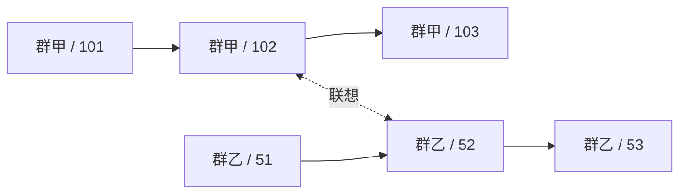

# 多主干多模态记忆模型

本文整理 Rust 主线记忆模块的数据模型与读写语义，设施选择见[Qwen VL 与存储选型](16-memory-infrastructure.md)。Context 中对应 Schema 的本地 Rust 类型映射位于 `plugins/context/src/memory.rs`。接纳、存储、归档及检索由独立的 `plugins/memory` 实现，它持有自己的类型映射、SQLite 表与 Qdrant 协议；宿主没有共享记忆库。部署与验证范围见[Agent 实现与启动](22-agent-implementation.md)。

## 1. 范围与所有权

当前一个 Forest 实例服务一个 Bot 账号。记忆在该账号范围内全局共享，每个群聊拥有一条独立主干，联想关系可以跨主干连接。群身份决定来源，不作为默认召回分区。

Memory 是普通 Wasm 模块，拥有自己的记录、关系与索引配置。Agent 通过类型化接口使用 Memory；调度器负责执行和资源访问，不解释记忆字段，也不替模块维护图、检索或归档流程。

核心由三类事实构成：不可变的记忆单元、已归档单元集合、联想形成记录。向量和召回区域分别是派生索引与读取结果。

## 2. 记忆单元

现有协议的核心类型如下；ModelTurn 和 ToolResult 保存模型原生输出及其时间，不携带 Agent 的工作状态：

```rust
struct MemoryId {
    group: i64,
    sequence: i64,
}

struct MemoryUnit {
    id: MemoryId,
    content: MemoryContent,
}

enum MemoryContent {
    GroupMessage(Box<forest_onebot::forest::GroupMessage>),
    ModelTurn(ModelTurn),
    ToolResult(ToolResult),
}
```

群消息直接复用现有 OneBot 强类型结构。`group_id`、`message_id`、`user_id`、`time`、`sender` 和 `message` 保留原字段，不再另造一套作者及消息段对象。昵称和群名片保留消息到达时的值；账号身份不能由昵称推断。匿名消息按其实际匿名来源展示，不通过昵称合并为真实账号。

事实库保存原始 MemoryContent 数据结构，不以投影后的 CQ 字符串替换 GroupMessage，也不把 Assistant、ToolResult 压成无类型正文。CQ、分块和向量都是从原始结构生成的派生表示；调整这些表示时回读原始结构与媒体重新生成。

`MemoryId.group` 与群消息的 `group_id` 由接纳操作从同一个值构造，调用方不分别指定两份群身份。ModelTurn 和 ToolResult 的所属群来自其处理的群会话，不能在召回时改成查询所在群。

ModelTurn 保存一次完整 Assistant 响应及 time，原生正文、tool_calls、refusal 和 reasoning_content 都保留；ToolResult 保存 time、tool_call_id 与结果正文。它们在归档和召回中保持类型，不能被呈现为群友发言。模型生成正文与平台实际送达的消息也不等同；实际发送记录关联到生成它的回合，平台自回显不再制造一份独立生成记录。稳定接纳身份及发送关联见[实现与启动](22-agent-implementation.md#2-实际会话流程)。

### 2.1 身份与顺序

Memory 的接纳入口是每个单元身份与位置的唯一分配者。在一次短本地事务中完成重复接纳识别、分配群内序号和保存单元；完成后返回稳定 MemoryId。重放已接纳输入只取得原 ID，不覆盖内容或重新分配位置。

平台群消息身份使用接入契约定义的消息键，平台 message_id 不直接承担群内排序。ModelTurn、ToolResult 使用 Agent 提供的稳定回合/调用身份。具体外部去重键属于相应接入协议，不能按正文相同、昵称相同或媒体字节相同合并发言。

序号表示 Bot 对该群单元的接纳顺序，不表示平台绝对发生顺序，也不表示模型看过哪些消息。平台时间继续保存在 OneBot 结构中。并发接纳需要在此处仲裁；位置一旦确定，后续归档、媒体获取和嵌入的完成顺序均不影响主干。

同一群的序号不因重启、热重载、归档或删除而重编号。不同群不需要共同的全局序号、全局提交版本或主干根节点。

### 2.2 消息段、CQ 与媒体

持久化保留 OneBot 消息的原始结构和字段；接纳路径登记可独立保存的媒体引用，不等待网络：

1. 读取 CQ 字符串、单消息段或消息段数组，取得有序段视图及各段在原消息中的位置；该视图不覆盖原结构。
2. 按消息段解释 @、回复、表情及媒体，保留字面文本与真实控制段的区别。
3. 按单元与消息段路径登记稳定受管媒体引用及原获取来源。内联字节可单独保存并无损引用；远端媒体随后异步下载。原始段、来源参数和正文不能被 CQ 投影不可逆覆盖。
4. 需要嵌入或格式化时，从上述视图和媒体映射生成规范 CQ 文本。可保存 CQ 以便查看，但它是可删除重建的派生值，原始 raw_message 不被这项缓存替换。

单元接纳事务保存原始结构、媒体映射及获取所需的持久记录，再启动网络获取；不能等待图片下载后才分配主干位置。向 Context 交付时可从原始结构生成带受管引用的临时输入，不把这个投影反写原文。完整单元在此表示结构和引用已经可靠保存，不表示所有远端字节均已取得。

媒体资源有待获取、可读取、获取失败的明确状态，归属 Memory 的资源管理；完成下载只改变资源可用性，不改写 MemoryUnit 或重新分配位置。嵌入图片和向模型提供图片需要实际资源可读，未完成项继续等待资源，不以文字占位替代图片向量。确定无法取得图片时保留失败事实及原图片段身份，不能声称已保存或已索引原图。

原始图片按受管引用读取。相同字节可以共享一个文件，但不同群、不同用户的投稿始终保留独立 MemoryId 和消息段位置。

群消息的 CQ 文本是嵌入与模型输入的确定性文本投影。它来自结构化消息，不能直接把网关上报的任意 raw_message 当作权威编码。嵌入正文保留 CQ 的 @、回复、表情和图片位置；群号、作者、时间作为明确来源字段保存，不能要求嵌入模型从一大段协议 JSON 中猜出正文。

## 3. 主干与归档资格

主干是同群单元按 sequence 排列的序列，不额外复制节点和可变 next 指针：



时序关系由群身份和位置推导，跨群时序边不存在。主干根只是一种 UI 展示方式，不加入每次扩散，避免群根成为连接整个群历史的高连接节点。

已经可靠保存不等于允许长期召回。另存一个归档集合：

```text
Archived ⊆ MemoryId
```

长期向量检索、精确记忆读取和图扩散均只读取 Archived 内的单元。活动窗口和排队尾部即使已经保存，也不能因此成为长期 RAG 来源。归档集合可能有缺口，不能简单地用最大归档序号表示全部资格。

活动窗口由 Agent 侧管理并协调裁剪与归档。一次归档在本地事务中加入 ID 和相应向量索引待办；成功后才能从活动窗口释放相应内容。Context 只把本次选定内容格式化为模型消息，不决定释放哪些记录。归档不调用 LLM，不生成记忆摘要，也不等待远端嵌入或向量数据库完成。

静默群聊同样推进接纳、归档与裁剪，不能等到下一次 @ 才释放活动窗口。当前群只有一个 Agent 工作循环，队列按已讨论的触发边界在下一次模型调用前接入；这些规则由 Agent 侧的会话管理持有，不能从主干上“存在下一条”推断它已进入本次模型输入。

具体状态与窗口策略见 [Agent 状态与裁剪](20-agent-state-and-window.md)：超过高水位才按完整前缀回落到低水位；首个模型输入冻结后，工作内只追加，直到静默再维护。该策略属于 Agent，不加入 Memory、Context 或 Provider。

## 4. 联想形成记录

```rust
struct RecallLink {
    trigger: MemoryId,
    recalled: MemoryId,
}
```

该记录表示：处理 trigger 的已提交回合，实际向模型提供过 recalled 这条直接召回种子。trigger 与 recalled 均指向已保存的不可变单元，关系可在 trigger 尚未归档时登记。

Agent 每条 @ 分别召回时，trigger 就是对应 @ 消息的 MemoryId。即使多个 @ 合并进入一次模型调用，也分别保留各自的召回锚点，不把全部种子都挂到最后一个持续点。用于模型输入的资料插在各自 @ 之前，具体顺序见[召回位置](20-agent-state-and-window.md#21-每条触发消息的召回位置)。

形成记录保留方向，检索时将端点对视为双向联想。正反方向的形成记录不能产生两条叠加的遍历边。重复登记不提高边权；联想不表示语义相同、事实成立或来源改变。

登记范围严格限于实际进入该次模型输入的直接种子。向量候选、被预算移除的种子，以及仅经图扩散取得的邻居，不因出现在检索中就自动形成联想。登记发生在 Agent 成功提交对应回合之后，读取接口本身不修改关系。

关系只有两端均属于 Archived 时才能参与扩散。归档资格直接决定可遍历性，不再维护持久缓冲、提升、确认删除三套副本。跨群关系不把任一端复制到另一条主干。

首轮采用这类有明确形成原因的经验联想。由相似向量自动产生语义边、实体提取、断言合并不是基础模型的隐含步骤，也不随每条普通消息调用模型。

## 5. 向量与记忆引用

向量点引用记忆内容，不拥有来源正文：

```text
VectorEntry
  point_id
  memory_id
  representation     文本跨度或图片消息段路径
  publication        待处理 / 已发布 / 处理失败
```

point_id 在本地登记时固定。同一条消息可以有文本点和多个图片点，它们都回到相同 MemoryId；嵌套转发消息的图片用结构化消息段路径定位。超长文本按确定性的消息段及文本跨度边界分块，不截断 CQ 控制段和转义，每块保留原单元和跨度，不制造新的主干发言。

同一向量索引空间的模型、输出维度、归一化及编码配方固定。endpoint 和凭据可更换，但须继续提供同一模型契约；不能将不同空间的向量混写。以后显式更换嵌入模型、CQ 投影或分块结构时，可从同一份原始 MemoryContent 与受管媒体重建新的索引空间，保留 MemoryId、主干、归档集合及联想记录，不要求重建或清空原始事实库。当前 Qwen 插件仍保持既有固定模型与维度，不在普通配置更新中偷偷切换模型或透明迁移。

内容来源、归档资格、图关系不依赖向量是否发布成功。索引待办与归档集合在同一本地事务提交；持久待办由 Memory 持有，不向调度器新增记忆任务状态机。

### 5.1 主干内容的向量化范围

进入主干的 MemoryContent 按下表生成索引表示；模型思考不参与向量化，排除思考后没有可嵌入内容的单元直接跳过：

| 单元 | 必须纳入处理的内容 |
|---|---|
| GroupMessage | 规范 CQ 文本、可嵌入的图片表示，包括未触发 Agent 的普通消息 |
| ModelTurn | 正文、工具调用名称和参数、refusal 等语义内容；排除 reasoning_content |
| ToolResult | 完整结果正文，包括返回给模型的工具错误结果 |

ModelTurn 中的思考继续完整保存，用于当前模型工具链所需的原生历史回传，但不生成思考向量，也不作为历史召回正文展示。该规则替代先前“思考也必须向量化”的约定。非空的超长内容按既定跨度规则拆分，不能只索引开头。索引编码与 Context 的模型输入投影分别处理，不能用对话模型不支持图片作为跳过图片嵌入的理由。

空内容按实际可嵌入内容判断，不把作者、时间、ID、来源包装等元数据算作正文。空白文本且没有有效消息段、图片、工具调用或拒绝内容时，不创建向量点、不调用嵌入模型。只有思考而无上述内容的回合也跳过；纯图片消息和正文为空但带工具调用的回合不是空节点。跳过向量化不删除原单元、工具结果或其因果关系。

对其余非空内容，“至少处理一次”指每项应有的表示必须实际进入处理流程，并留下成功或明确失败的结果；仅创建待办不算已经处理。有效的相同输入缓存可以复用计算，但每个 MemoryId 仍独立登记其表示和处理结果。媒体确实无法读取等失败保留原因，不制造替代图片向量。处理失败允许结束本次处理并跳过，不要求无限自动重试，也不回滚原文、归档或阻塞群聊工作。

未完成的持久待办在热重载或重启后继续处理；不能在发起外部请求前就把它标记为成功或失败。中断时无法确认的请求可以再次尝试，因此这是处理覆盖保证，不是远端 API 恰好调用一次的保证。已明确记录失败的项不必自动重试。

Recall 仍是原单元的引用，不因再次进入模型输入就复制到主干或重新向量化。System、工具定义和来源包装也不因参与请求而自动成为新的主干内容。

当前仍沿用“归档时登记待办”的设计：归档后的非空可嵌入内容均须处理，活动窗口中的内容可以尚未处理。本轮对原始结构、CQ 投影和召回点的确定不改变这一启动时机。查询某条 @ 的表示属于当次检索，不使它提前获得长期召回资格。

## 6. 召回区域

召回流程为：

```text
结构化文本/图片查询
  → 按固定编码配方生成查询向量
  → 向量库过滤、搜索、按 MemoryId 合并表示
  → 回读原文并确认归档资格，筛选直接种子
  → 从种子展开时序与联想关系
  → 回读有界局部区域
  → 返回单元、来源与区域内关系
```

相似度负责种子筛选。每个有效种子以激活值 1 开始图扩散，图激活不与余弦相似度直接相加。低于种子阈值的命中不能仅因图边权较高而成为合法入口。

首轮沿用 QiYu 当前的最强路径乘积语义：

```text
R(v) = max(从任一种子到 v 的已探索路径上的边权乘积)
```

时序权重 λ 与联想权重 α 分开配置，初始对照值可采用 QiYu 的 0.55 与 0.90。单纯同群时序距离为 d 时，强度为 λ^d；未归档或删除造成的位置缺口不压成一步。遍历只读取符合资格的单元，沿最近的可读前后位置计算实际序号距离。

关联节点超过配置的最大展开边数时，随机选择最多该数量的有效联想邻居，再推进扩散。同一次查询固定该节点的抽样结果，不通过重复访问不断换一批边。邻接读取需要提供有界抽样，不能先把全部关系加载进 Wasm 再截断。

总访问节点、展开边及返回区域大小在遍历过程中受限，不先遍历完整图再切最终列表。抽样和访问上限意味着结果是已探索子图上的最强路径，不承诺完整图上的精确最优解。时序前后邻居各自有界，不占用联想边抽样名额。

结果包含：完整类型的记忆单元或合法文本跨度、真实群身份、原作者和时间、直接种子标记、扩散激活，以及保留端点之间的时序/联想关系。跨群命中始终标为原群；群名称仅为可选展示信息，不能替代稳定群身份。

区域是一次读取的结果，不再次归档、嵌入或成为主干节点。召回不能反复复制已有记忆。

调用方保留种子用于联想登记，同时把一次检索作为 `ContextItem::Recall(RecallBatch)` 交给格式化模块。批次包含触发点引用、投影后的完整 MemoryUnit、种子和 graph_json，保持召回证据与所服务问题的对应关系。Context 复用原 MemoryContent 与来源引用，展示图信息但不执行检索算法；文本跨度用于定位命中，交付格式化前回读对应完整单元。

Agent 在每条 @ 的接入位置，以该条消息自身的规范 CQ 正文与图片表示查询，并将选定的 Recall 放在该条消息前面。不把前面的普通聊天拼进查询，也不为普通聊天或没有新 @ 的工具续调发起召回；普通聊天仍正常入窗、保存并按索引规则向量化。Memory 接收明确查询，不自行监听群消息决定召回时机。

### 6.1 模型输入投影

历史群消息以安全转义的来源头和 CQ 正文编排。来源头与其正文作为一项保留或舍弃，不能为了放下正文而去掉作者和原群。活动对话中的模型回合与工具结果使用原生 Assistant/Tool 角色，并以闭合工具步骤作为裁剪边界。

RAG 召回是历史证据，不是当前执行链。其 ModelTurn/ToolResult 在证据容器内显式标记 assistant/tool 来源和原群，不冒充群友发言，也不作为当前顶层 tool_calls 或 role=tool 回放。归档保存与模型可见投影分别处理，具体编排见[上下文模块](19-context-module.md)。

对话模型支持图片时，投影按消息段顺序解析受管引用，提供合法图片内容块。对话模型不支持图片时，去掉其 API 输入中的图片块，保留文字、来源及图片存在的文本标记；不虚构图像描述，不改写持久记录和图片向量。相似图片命中也不等于模型亲眼见过图片。

Memory 按调用者给定的区域限制返回有界证据；调用方决定本次要发送的内容，Context 负责格式化。裁剪与归档属于活动窗口管理，Provider 不参与上下文预算判断。

## 7. 并发与热重载

| 操作 | 原子范围 | 合并语义 |
|---|---|---|
| 接纳 | 去重身份、群内位置、完整单元 | 同一身份取回原记录；新消息顺序在此仲裁 |
| 归档 | 已归档 ID 与对应索引待办 | 集合加入，重复无效果 |
| 记录联想 | trigger/recalled 端点对 | 集合加入，重复不强化 |
| 发布向量 | 稳定 point_id 的外部 upsert | 重复发布同一表示不制造新点 |

同一源集合在身份和位置确定后，归档排列与联想提交排列不会改变主干和关系。不同消息的接纳顺序本来就需要仲裁，不能宣称在仲裁前也天然交换等价。

SQLite 事务只覆盖本地事实，不横跨 HTTP 请求。嵌入和向量 upsert 在事务外执行；外部确认成功后再标记本地已发布。若确认后未落本地标记便退出，重启可按原 point_id 重发。外部返回已接受而尚未应用，不算发布完成。

已保存正文不等待图或向量重建，索引失败不回滚原文和归档。外部请求是否重复计费不能由本地点 ID 保证，不能把索引幂等误称为模型调用 exactly-once。

模块热重载重新打开自身数据，按既有生命周期排空或释放资源；不复制 Wasm 堆，也不生成新主干。采用强制卸载时，可重建索引允许暂时落后；原文与关系仍由本地提交事实决定。

删除先使原文及归档资格不可读取，联想端点随之失效，再清理外部向量。迟到或残留的向量引用必须回表，不能独立恢复已删内容。物理清理与检索更新可以异步，不改变原有 MemoryId。

## 8. 与 QiYu 的关系及实现边界

核对依据是 `../RAG/libs/agentlib/agentlib/` 中的 `core/units.py`、`memory/{graph,relations,retrieval,system,encoder}.py` 和 `runtime/agent.py`，相对路径从 Forest 仓库根目录计算。

保留的主要语义是不可变单元、仅归档内容参与 RAG、时序与固定联想边、种子与扩散分离、提交后登记实际直接种子、召回区域不递归入库。当前 Agentlib 使用最强路径乘积，不是 PPR。

Forest 明确变化为每群独立主干、接纳时固定位置、直接使用 OneBot 群消息、删除裁剪摘要、来源明确的全局召回，以及文本/图片独立表示。QiYu 的 VL 编码器会平均各模态向量；Forest 不把平均向量当作原生联合编码。

内容的 Schema 映射和 Context 可见投影已实现，Rust 映射由模块各自持有，可复制源码，不要求其他模块依赖一份共享 crate。Memory 独立包现已实现记忆读写、媒体、归档及检索，使用通用宿主私有 SQLite。群消息以平台账号和消息 ID 去重，生成回合以工作锚点和回合位置去重，实际发送回执关联到生成回合。Agent 未归档窗口与排队消息作为配置表中的可恢复状态项保存，具体见[会话重载](20-agent-state-and-window.md#9-未归档会话的保存与重载)；长期记忆正文、关系和索引仍由 Memory 自己管理。
