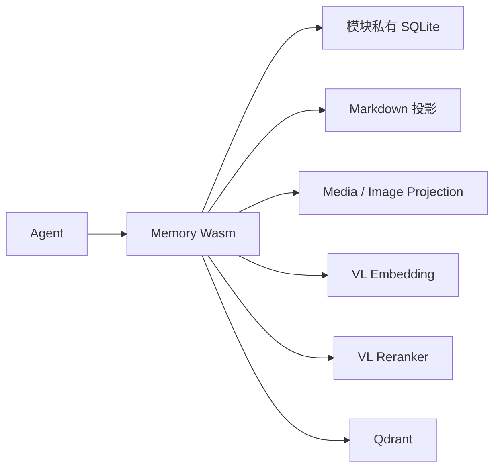

# 记忆存储与向量索引

本章说明[记忆模型](15-memory-model.md)的存储实现。原始记忆由模块私有 SQLite 保存，向量由 Qdrant 索引，模型推理由独立的嵌入与重排服务提供。Memory 是普通 Wasm 模块，宿主只提供通用数据库和 I/O 能力。

## 1. 数据归属

| 设施 | 保存内容 | 所有者 |
|---|---|---|
| 宿主配置 SQLite | 配置声明、默认值和当前值 | 配置服务 |
| Memory 私有 SQLite | 原始 MemoryContent、主干位置、归档状态、联想关系、向量发布记录 | `/module/memory` |
| Media 私有 SQLite | 受管媒体元数据与原始字节 | `/module/media` |
| Qdrant collection | 向量、原文引用与检索元数据 | `/module/memory` |

一个群对应一条时序主干，各群共享同一检索空间。主干划分不要求按群创建 collection。每条召回结果通过 MemoryId 回到 SQLite 读取正文，并保留来源群、作者与时间。



## 2. 嵌入空间与投影

嵌入模块固定使用 `Qwen/Qwen3-VL-Embedding-8B`，输出 2048 维、L2 归一化的向量，索引采用 Cosine 距离。文本与图片分别编码；混合批次表示多个独立输入，不把各模态向量平均为一个向量。接口详见[向量化模块](17-embedding-module.md)。

模型、维度与编码配方共同决定检索空间。endpoint 和凭据可以更换，但替代服务须提供相同的模型与输出契约。更换模型需要显式建立相应索引空间。

| 记忆内容 | 向量输入 |
|---|---|
| 群消息文本 | 由 Markdown 模块投影的文本，长文本按稳定跨度拆分 |
| 图片 | 每张图片独立编码；仅含媒体占位符时不额外制造文本点 |
| 图文消息 | 文本表示与各图片表示分别编码 |
| 模型回合 | 正文、工具名称及参数、拒绝内容；排除思考过程 |
| 工具结果 | 结果文本及工具来源，图片另建表示 |

原始结构不随投影方式改变。MemoryContent 中保留原生 OneBot 消息、Assistant 或工具结果，媒体通过受管引用关联；base64 只在模型请求边界临时生成，不写入向量 payload。

既有 CQ 投影向量保留，新内容采用 Markdown 投影。正常启动与升级不自动重算历史向量；显式重建时从原始结构和受管媒体重新生成输入。

## 3. SQLite 事实库

Memory 持有自己的数据库，表结构和 SQL 都在模块内。宿主按稳定模块令牌分配数据库，通过参数化语句和批量事务提供通用执行能力，详见[存储边界](21-agent-storage-boundary.md)。

事实库保存以下关系：

- 主干及接纳时分配的稳定序号；
- 不可变记忆单元及来源；
- 归档资格与归档分组；
- 持续点与直接召回种子的联想；
- 向量表示、point ID 和发布状态；
- 消息与受管媒体引用的映射。

主干邻居按 `(group, sequence)` 查询，距离采用实际序号差。联想按规范化端点对去重；高连接节点通过有界随机抽样取得邻接边。查询只读取本次需要的节点，不将整图装入 Wasm。

写入采用短事务。嵌入、重排、媒体下载及 Qdrant 请求均在事务外执行，不跨网络调用持有 SQLite 写锁。并发归档与发布依据稳定 MemoryId、位置和 point ID 合流，重复归档跳过已经归档的单元。

## 4. Qdrant 索引

每个向量表示使用独立 UUID point ID，SQLite 保存它与 MemoryId、文本跨度或消息段路径的映射。payload 只保存检索所需的小型字段，不复制正文、完整 OneBot 对象或图片字节。

发布流程如下：

1. 归档事务登记待发布的向量表示。
2. 在事务外生成向量，以稳定 point ID 执行 upsert。
3. 等待服务确认应用后，记录发布完成。

显式重试沿用原 point ID。索引失败保留原始记忆与失败记录，归档和上下文裁剪可以完成；召回不以全库向量扫描替代不可用的索引。

查询先按文本或图片表示检索候选，再分别重排、按 MemoryId 合并并选取直接种子。图扩散回到 SQLite，读取时序和联想关系。Qdrant 的 HNSW 图仅用于近邻检索，不承担记忆主干或联想关系。重排与扩散参数见[多模态重排](32-multimodal-reranking.md)。

## 5. 部署与容量

仓库的 `compose.yaml` 提供 Qdrant 服务及命名卷：

```sh
docker compose up -d qdrant
```

默认端口仅绑定本机。Memory 的 `/settings` 配置 Qdrant endpoint 与 collection；模型服务连接分别在嵌入和重排模块中配置。Compose 不运行宿主或模型推理服务。

2048 维 float32 原始向量容量为 `点数 × 2048 × 4`：十万点约 0.76 GiB，百万点约 7.63 GiB。这是字节量估算，不含 HNSW、payload、WAL、图片、原文和维护空间，也不等同于进程常驻内存。一条消息可能生成多个向量点。

容量规划应分别测量嵌入、重排、近邻查询、回表和图扩散的耗时，以及持续新增下的磁盘和内存占用。相似度门槛应依据实际相关样本校准，不能仅由向量维度推导召回质量。

## 6. 相关设施说明

- [Qdrant 向量与距离](https://qdrant.tech/documentation/manage-data/vectors/)
- [Qdrant point ID 与 payload](https://qdrant.tech/documentation/manage-data/points/)
- [Qdrant 安装与存储要求](https://qdrant.tech/documentation/installation/)
- [SQLite WAL](https://www.sqlite.org/wal.html)
- [Qwen3-VL-Embedding 模型](https://huggingface.co/Qwen/Qwen3-VL-Embedding-8B)
