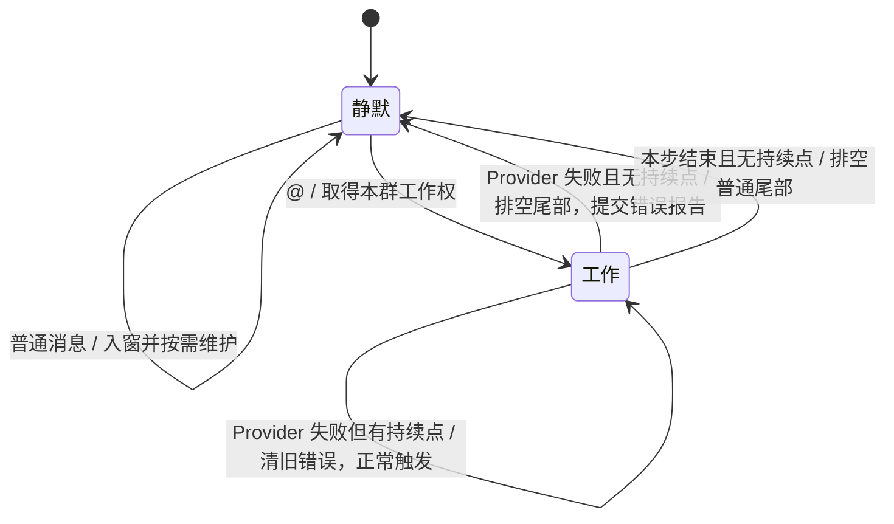

# Agent 群会话状态与窗口裁剪

本文制定 Agent 的正常工作状态机和短期窗口策略，尚未实现。Agent 将作为独立 Wasm 插件，通过 Schema/Value 调用 Memory、Context、Provider 与工具模块；本设计不向宿主加入 Agent 状态或模块专属 Rust 类型。

## 1. 两个状态

一个 Agent 模块处理多个群，每群独立维护一份会话。每群最多一个工作循环，不为每条 @ 创建新 Agent。不同群的工作可以异步交错。

- **静默**：没有模型与工具工作；继续接纳全部群消息，维护短期窗口、归档和裁剪。
- **工作**：同一个循环准备输入、等待模型、发送正文、调用工具并继续。网络等待也属于工作，不释放本群工作权。



准备、模型等待和工具等待是循环的执行位置，不再各设一个群会话状态。静默也不等于不处理消息。

## 2. 队列与持续点

每群只需区分三份内容：

| 内容 | 含义 |
|---|---|
| 短期窗口 | 已按实际接入顺序组织的上下文内容 |
| 待接入队列 | 已接纳、尚未加入当前模型上下文的群消息，保持群内接纳次序 |
| 持续点 | 待接入队列中最后一条触发 @ 的位置；没有则为空 |

持续点表示“下一次输入必须推进到这里”，不是待回复次数。多条 @ 可以合并到一次模型调用中，不能因有十条 @ 就机械地再调用十次模型。

所有消息先接纳。静默时，普通消息并入窗口；@ 取得本群工作权后开始工作。工作时，新消息进入待接入队列；普通消息不改变持续点，@ 将持续点推进到自身。

在下一次模型输入冻结前，以一次不包含 await 的群内操作取出“队首至持续点”的前缀，并清空这个已取出的持续点。冻结后到达的新 @ 建立下一次持续点，不能被旧请求完成后的清理抹掉。

例如队列为：

```text
普通 A → @ B → 普通 C → @ D → 普通 E
```

下一次模型输入接入 A 至 D；E 留在队列。不是只接入 B、D，也不要求提前接入 E。模型或工具正在执行时不修改其已冻结输入。

### 2.1 每条触发消息的召回位置

用户 @ 消息同时是召回点：静默时启动工作的首条 @，以及工作期间接入批次中的每条 @，都分别执行召回。最后持续点仅决定本次接入队列的截止位置，不覆盖前面各条消息的触发标记，也不把它们的召回合并成最后一次召回。

Agent 先取出并固定本次接入前缀，再为其中每条 @ 分别取得召回资料，将资料以 Recall 形式放在对应 @ 消息的紧前方。普通消息保持群内接纳次序，例如：

```text
普通 A → Recall(B) → @ B → 普通 C → Recall(D) → @ D
```

这仍只需要一次模型调用。召回锚点是各条 @ 的稳定消息身份；查询只采用该条消息自身的规范 CQ 正文和图片表示，不拼入此前普通聊天。某个点没有召回结果时不插入空资料；没有新 @ 的普通工具续调不额外发起召回，回到静默时排空的普通尾部也不触发召回。

每批的截止位置在取出前缀时固定。等待召回期间到达的新消息继续进入待接入队列，新 @ 留作下一批，不因召回耗时不断延长当前批次，也不能在旧批次完成时清掉新持续点。查询结果按原 @ 位置编排，不按远端查询完成先后排序；是否并行取得结果不改变输入顺序。

插入只发生在尚未交给模型的新批次内，不回写已发送的历史前缀。当前 Assistant 若带工具调用，仍先补齐对应全部工具结果，再追加新批次中的普通消息、Recall 和 @。Context 只保留 Agent 传入的次序，不识别 @ 或自行发起检索。

## 3. 工作循环与退出

首次模型调用前，选择本次历史和召回、完成允许的边界裁剪，再调用 Context 得到标准 messages。之后由同一个群内循环推进：

1. 接收并保留原生 Assistant；有效正文可正常发送，即使同时带有 tool_calls。
2. 若有工具调用，取得对应结果，先闭合 Assistant/Tool 步骤。
3. 下一次模型调用前，取出截至最新持续点的队列前缀；其中每条 @ 分别召回，并把结果放在各自 @ 之前，再按顺序接入。
4. 有工具结果需要续调，或有新持续点要求继续时，保持工作状态并调用模型。
5. 本步可以结束且没有持续点时，排空剩余普通消息到短期窗口，转为静默并进行窗口维护。

普通排队消息本身不延长模型工作。持续点已被本次输入接入，模型返回结束且没有更新的持续点时，就可以静默；队列里还剩普通消息并不要求再调用一次模型。

检查持续点、排空普通尾部、交还工作权必须属于同一个群内仲裁操作，中间没有 await。@ 若在此操作之前接纳，原循环继续；若在之后接纳，由静默启动新循环。旧循环交还工作权后不再调用模型或工具，因此不会同时产生两个响应循环。

群内窗口与状态的修改只有一个顺序协调者，不能拿旧窗口快照等完 I/O 后覆盖新消息；外部等待不锁住整个 Agent 模块。Wasm 接口可重入和“同群只有一个工作循环”是两层约束，不能用模块级不可重入把所有群串行阻塞。

Provider 失败按第 3.2 节处理，不增加长期 Failed 群会话状态。工具错误的具体契约仍随工具接口确定；内核的模块 Failed 生命周期也不混入这两个群会话状态。

### 3.1 工具等待期间接收群消息

消息接收接口声明 `reentrant: true`。处理器先在不含 await 的短操作中入队、更新持续点并检查本群状态；本群已工作时，本次接收调用结束，静默时由本次调用取得工作权并推进循环。不另行派生后台任务。工作循环等待 Provider、工具或其他宿主操作并主动返回 Pending 后，同一实例可以执行后续消息接收调用；不同群也可开始各自的工作。

工作循环不持有群状态的可变借用跨 await。时间片被动暂停仍保留实例执行权，不允许另一入口从一次状态修改中间插入。这依赖现有[调度机制](09-scheduling.md)，不增加 Agent 专用的宿主队列或调度接口。

例如 A 的 @ 触发网页抓取；等待期间依次收到 B 的普通消息、C 的普通消息和 B 的新 @。接收调用将这三条消息排队，并将持续点推进到 B 的新 @。抓取完成后，下一次模型请求的尾部按以下顺序追加，图中为消息顺序示意，不是完整 API JSON：

```text
user       A：@Bot 请查询……
assistant  原生 tool_calls，id=fetch_1
tool       tool_call_id=fetch_1，抓取结果
user       B：普通聊天……
user       C：普通聊天……
user       Recall(B)：带原群、作者和类型标记的历史资料
user       B：@Bot 请结合刚才的聊天……
           ↑ 在此冻结下一次模型输入并调用 Provider
```

B、C 的消息保留原作者、群、时间和消息内容；不能合成一段没有来源的“最新用户输入”。A 的初始 @ 前同样先插入属于 A 的召回资料，图中只展开 B 的新接入位置。模型可见的接入顺序不要求等于消息发生时间，原始时间仍由各消息携带。B 的新 @ 之后的普通尾部继续排队。

原生工具消息用 `tool_call_id` 对应 Assistant 的调用，见 [OpenAI Chat Completions 契约](https://developers.openai.com/api/reference/resources/chat/subresources/completions/methods/create)；[官方工具调用流程](https://developers.openai.com/api/docs/guides/function-calling)在补齐工具结果后继续请求。本设计将 Assistant 与对应的全部工具结果作为连续闭合块，排队 User 只追加在块后，不插入调用与结果之间，也不插回原 Assistant 之前。如果同一条 Assistant 发出多个工具调用，要补齐这一批的所有结果，不能仅因一个工具先返回便发起下一次模型调用。

这个 User 接入位置是根据上述消息契约与完整结果续调流程确定的；官方示例没有直接演示本节的三人群聊场景，本轮也未进行供应商线上验证。该设计保证已接纳到持续点的聊天进入下一次请求，不保证模型必然正确理解每条聊天，也不要求先对 A 完成最终回答才能接入 B。

保留原 Assistant 的 `content`、`tool_calls` 及供应商返回的推理字段。[DeepSeek 当前思考模式文档](https://api-docs.deepseek.com/guides/thinking_mode/)要求携带 tools 的后续请求完整回传 `reasoning_content`；不能因为补入了新的 User 就清除它。Provider 继续只做协议传输，不决定何时接入消息。

### 3.2 Provider 失败与延后报告

每群工作循环保存一项待报告的 Provider 错误。它属于请求对应的触发批次，不是第三种群会话状态：

1. Provider 调用失败时，记录类型化失败及其诊断，并把该错误留作待报告结果。不重试失败请求，不补造 Assistant 或工具结果。
2. 若存在尚未接入的新持续点，按普通规则接入截至该点的队列前缀，清除该触发批次之前的待报告错误，然后发起新的正常模型请求。它由新输入触发，不是对原失败请求的重试；当前工作仍保持只追加。
3. 新请求成功后继续原生模型/工具循环；若新请求也失败，保存新错误，按同一规则决定继续或结束。
4. 本轮最终结束且没有新持续点时，排空普通尾部；若仍有待报告错误，通过 `send` 向当前群提交错误信息。没有待报告错误则不发送错误报告。

清除的是 Agent 待向群报告的旧错误，不删除已记录的诊断。新持续点即使早于旧请求失败的返回时间到达，旧错误仍归属旧请求；接入这个新持续点时应清除它。不能只按错误的墙上时钟时间比较先后。

例如 A 触发的请求失败，但已有 B 的新 @ 排队：先记录 A 的失败，接入至 B 的持续点并清除 A 的待报告错误，再正常调用。如果 B 后续完成则不向群报告 A 的偶发失败；如果 B 也失败且没有新持续点，则报告 B 留下的错误。

决定静默、取走并清空待报告错误、交还工作权仍属于同一个不含 await 的群内仲裁操作。此后提交的是已经确定的报告；新 @ 可以启动下一次工作，旧循环不能再读取或清除新工作的错误。`send` 成功表示调度器已接纳发送请求，不等于平台已送达；提交失败记录为发送诊断，不递归产生新的群错误报告。

这些决定属于 Agent。Provider 本身继续只返回调用结果，不重试，也不持有群持续点或发送群消息。

## 4. 超过高水位，回落到低水位

第一版按**内容单元数量**度量，阈值属于 Agent 配置。无需为了预留将来需求先增加 token 计数服务或度量插件：

```text
schema WindowPolicy = {
    high_watermark: i64,
    low_watermark: i64
};
export WindowPolicy;
```

满足 `0 < low_watermark < high_watermark`。例如高水位 256、低水位 128，仅为数量配置示例，不代表模型 token 容量。

- 单元数量不超过高水位：窗口保持原样。
- 严格超过高水位：一次选择最旧的可移除前缀，保留最新的连续后缀，使数量回落到不超过低水位。
- 因为工具闭合边界不能精确取到低水位时，可以多移除一些旧单元；最新完整块或本次必须保留的输入自身超过低水位时，完整保留它们。

例如窗口从 256 增至 257 个普通单元时，归档并释放旧前缀，留下最新 128 个；随后继续追加，直到再次超过 256。不是每来一条新消息就删除一条旧消息。

System 和 tools 声明属于固定头，不纳入这项单元计数。GroupMessage、ModelTurn、ToolResult 和展示中的 Recall 各计一个内容单元；一条消息的多张图片仍属于同一个消息单元。这个计数不等于 API token 或进程字节上限。

## 5. 何时裁剪

按本轮已确认的约定：

| 时机 | 行为 |
|---|---|
| 静默接纳消息后 | 检查高水位，必要时归档并裁剪 |
| 新工作首个模型输入冻结前 | 检查一次，允许移除工作开始前的旧前缀 |
| 输入已冻结，正在工作 | 只追加；工具续调或新 @ 都不重新裁剪 |
| 工作转为静默、普通尾部并入后 | 再检查高水位，必要时回落到低水位 |

新工作的触发批次及已纳入本次工作的内容不参与首次旧历史裁剪。冻结后，即使持续被 @ 或工具链增长使窗口超过高水位，也保持当前因果链；一直工作就一直延后裁剪。此为选定策略的明确结果，不用估算超限异常、自动中止或暗中删消息来补偿。

静默维护可以合并一小批消息后执行，但不能拖到下一次触发 Agent 才开始。

## 6. 删除边界与归档

裁剪只删除窗口的完整前缀：

- 普通群消息连同作者、原群、CQ 和所属图片整体保留或移除。
- 发出工具调用的 Assistant 与对应全部 ToolResult 作为不可拆分的闭合块；不能留下孤立 Tool，或留下没有结果的旧调用。
- Recall 是已有历史的展示，移出窗口时只删除展示引用，不重新归档或嵌入。

归档只提交被选中事实的 MemoryId 集合；Memory 本地提交成功后，Agent 才释放相应内容，不等待嵌入或向量索引完成。没有裁剪摘要，也不因裁剪调用模型。

归档等待期间接纳的新消息不属于旧裁剪方案；完成时按已选 ID 移除，不覆盖整个窗口。首次模型输入冻结前完成所需的边界维护。静默归档失败则保留原内容，并报告该操作结果，不伪装成已经释放。

窗口的模型可见顺序与 Memory 主干接纳顺序是不同概念：排队期间到达的群消息可以在工具步骤闭合后才接入。归档因此不能用一个最大 sequence 表示“之前全部已归档”，继续使用记忆模型中的归档集合。

## 7. 保持请求前缀稳定

工作期间除了不裁剪，还应复用首次生成的 System 和已有 messages，不重新格式化旧内容、不刷新旧图片 URL、不在固定位置替换整块 RAG。新的消息、证据及工具结果只在尾部追加，原生调用 ID 与 reasoning_content 保持原值。

Context 仍只有 `/format`，不新增 Agent 会话或追加接口。Agent 可对新内容调用它，保留已有 System，取返回结果中的内容消息追加到自己的请求；后续返回的 System 不替换本次工作已采用的提示词。工具声明同样在本次工作内保持稳定。

回到静默后，按高低水位清理旧前缀。下一次工作使用当前设置重新构造首个请求，再开始新的追加过程。这里只确定请求结构的稳定性，不承诺任何供应商的具体缓存命中率。

## 8. 向量化与存储边界

主干中的非空群聊、模型正文、工具调用和工具结果须至少进入一次向量化处理流程，允许失败后记录并跳过。思考不向量化，空节点跳过；保存和工具续调所需的原生 reasoning 不受影响，历史 reasoning 也不加入召回正文。具体范围见[记忆模型](15-memory-model.md#51-主干内容的向量化范围)。向量化不是模型调用或裁剪的同步前置条件。

数据库保存原始 MemoryContent 数据结构；用于嵌入的 CQ 是按需生成的投影，不是事实正文的替代。普通聊天不发起召回查询，但仍属于保存及向量化范围。以后调整嵌入模型、投影或索引结构，可据原始结构与媒体重建向量库。

当前向量化待办仍按既有记忆设计在归档时登记，本轮不改成接纳时自动执行。稳定回合/调用身份和平台自回显的关联还需在详细实现设计中落实；它们不改变此处已经确定的触发、裁剪和重载行为。

## 9. 未归档会话的保存与重载

Agent 在自己的配置表中声明带 Schema、空集合默认值与 SelfModule 读写权限的会话状态项，序列化保存当前内存中尚未归档的内容。宿主不解释其中的群、消息和持续点。

保存范围覆盖各群短期窗口中的未归档群消息、模型回合和工具结果，以及尚未接入窗口的排队消息；保留稳定 MemoryId、原作者、原群、原时间和实际内容顺序。保存内容而不保存继续执行旧工作的意图：旧持续点、旧工作权与待报告错误不在新实例重新激活，已记录的错误仍属于诊断历史。召回资料若需保留其展示位置，保存原 MemoryId 引用，不复制为新的主干单元。

已选中、仍在等待召回或格式化的接入批次也属于这些未归档会话数据，直到正式并入窗口。其内容不能仅保存在会被任务销毁丢弃的 Future 局部变量中，导致重载时从窗口和队列两边都找不到。

正常重载遵循已有模块生命周期：

1. 宿主关闭旧实例的新请求入口；按选定停止方式结束旧任务并确定旧实例保留的会话内容。
2. 在允许配置写入的 destroy 中，序列化并保存上述状态；此时不使用 send/call。不会有旧消息接收处理器在保存期间继续修改队列。
3. 新 create 读取状态，按保存的顺序恢复未归档内容，并把旧排队消息纳入静默窗口。所有群恢复为静默，不重新分配已保存单元的身份；旧 @ 仅是历史消息，不重新触发工作或召回。
4. 交接期间宿主保留的新请求按原有有界队列机制交给新实例，不写入旧实例的保存内容。

重载不继续原工作，不恢复 Wasm 栈、Provider 请求或工具 Future，也不重放已提交的外部工具操作。create 仍禁止 send/call；只有新实例接纳的新 @ 才启动新的工作。交接期间由宿主保留的新 @ 属于新实例尚未处理的请求，仍按正常接纳规则触发，不与保存下来的旧 @ 混淆。

若旧工作被中断在未闭合工具块，原 Assistant 和已有结果继续作为原始记录保留，但该不完整块不作为下一次请求的顶层原生工具历史回放，也不补造成功结果。下一次新工作从可用历史和新输入构造请求，保留记录不意味着继续执行旧调用。

Force 和 trap 按现有规则跳过 destroy，因此只能恢复此前已成功保存的配置值；不能声称保存了强制中断前尚在内存中的全部消息。这里先采用正常重载的保存边界，不隐含增加逐消息配置写入或后台周期保存策略。
