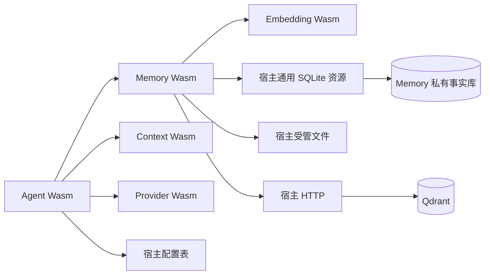

# Agent、Memory 与数据库的边界提案

本文给出下一步实现的推荐划分，尚未实现 Agent、Memory 或通用 SQLite 宿主接口。行为以[群会话设计](20-agent-state-and-window.md)和[记忆模型](15-memory-model.md)为准；数据库引擎与其数据模型分别归属。

## 1. 数据所有权

| 数据 | 逻辑所有者 | 保存位置 | 执行访问的位置 |
|---|---|---|---|
| 模块配置、提示词、连接设置 | 声明该配置的模块 | 现有宿主配置 SQLite | 现有配置宿主接口 |
| 未归档窗口、排队内容及顺序的恢复状态 | Agent Wasm | Agent 自身配置状态项 | Agent 序列化，宿主保存 Value |
| 原始 MemoryContent、主干位置、归档集合 | Memory Wasm | Memory 私有 SQLite | Wasm 编写 SQL，宿主执行 |
| 联想记录、媒体映射、索引待办与发布结果 | Memory Wasm | 同一个 Memory 私有 SQLite | Wasm 组织操作，宿主执行 |
| 图片等实际字节 | Memory Wasm | Memory 的受管文件目录 | 现有文件宿主接口 |
| 向量、MemoryId 引用与过滤元数据 | Memory Wasm | 外部 Qdrant | Wasm 经现有 HTTP 接口调用 |

各群共用这一个 Memory 事实库，以群身份和 sequence 表达多主干；不按群创建数据库或向量 collection。单个活动向量空间使用自己的 collection。

原始单元只由 Memory 的接纳入口分配身份并持久保存。Agent 保存的是自己的会话排列与恢复数据，不另行修改已保存单元。对于已经可靠保存的内容，恢复状态可以保存 MemoryId 和顺序；若保存完整结构，也只是相同不可变内容的恢复副本，不获得覆盖 Memory 原文的权力。

## 2. Wasm 模块各自负责什么

Agent 持有各群静默/工作状态、窗口、消息队列、持续点、错误记录及工具执行次序。它决定接纳哪些内容、何时归档，以及每条 @ 的召回和插入位置。Agent 通过 Memory 接口保存或读取记忆，不直接打开 Memory 数据库或查询 Qdrant。

Memory 持有原始内容、主干、联想和所有存储解释。表结构、SQL、CQ 投影、分块、图遍历、向量发布和重建流程全部位于 Memory 包中。它通过 Embedding 模块取得向量，调用 Qdrant，并按 MemoryId 回读原始事实。媒体也由它按引用读取和提供，不向其他模块暴露宿主绝对路径。

Context 只格式化传入内容；Provider 只完成模型协议调用；Embedding 只计算向量。这三个包均不需要单独的消息数据库，其自身设置继续使用现有配置项。

模块间契约使用 Manifest 的 Schema 与 Forest Value，调用方各自保存所需类型映射。宿主不链接 Memory、Agent 或 Context 的实现，不接收某个插件的 Rust 类型作为内部接口。

## 3. 宿主新增通用 SQLite 资源

推荐让 SQLite 引擎在宿主执行，让数据库的逻辑所有权和全部表结构留在 Wasm。SQLite 本身可以编译为 Wasm，但官方 Wasm 项目主要针对浏览器，并要求环境提供其导入；Forest 当前整文件读写接口没有直接提供 SQLite 所需的文件访问与持久化适配。[SQLite 官方说明](https://sqlite.org/wasm/doc/trunk/about.md)。此处选择宿主驱动，避免先为数据库引擎建立另一套文件系统适配。

宿主能力只需表达：

- 本模块私有数据库的参数化查询与写入。
- 一次提交、完整执行的本地原子事务。
- SQL 基础值、结果行及数据库错误的跨语言编码。

每个模块对象可以持有一个专用数据库，按稳定模块令牌分配。首版只为实际使用该能力的模块惰性建立资源，不在每个包装载时都创建文件或打开连接。模块自己创建表、索引和管理内容，不要求宿主预先知道它将存放什么。

宿主根据当前真实执行实例的模块令牌选择数据库，不使用消息来源 origin 选择，也不要求 SQL 操作参数再传一份目标模块令牌。对象身份自动附加，不由模块声明自己正在代表谁访问数据库。宿主可采用独立目录布局，例如 `data/databases/<模块令牌的规范编码>/data.sqlite3`；这是路径示意，实际编码沿用稳定令牌到目录名的确定性映射，不能直接把任意令牌文本当作原生文件路径。

| 身份或资源 | 生命周期 |
|---|---|
| 模块令牌对应的数据库文件 | 属于稳定模块对象，热重载和卸载均保留 |
| 数据库连接及正在执行的操作 | 属于具体执行实例，退出时收尾并释放 |
| 新实例使用相同模块令牌 | 打开原数据库，不重新建立空库 |
| 模块令牌改变 | 属于新的对象身份，取得自己的数据库 |

数据库删除是独立的显式操作，不作为普通卸载的副作用。模块的人类可读名称变化不影响数据库归属；真正改变身份令牌才改变资源归属。

普通模块不能直接指定其他模块的库或宿主任意数据库路径，SQL 也不能借附加数据库等操作绕过这个资源范围。访问其他模块的数据，仍通过对方声明的接口及 ACL。配置表继续提供声明式 Schema、默认值及 ACL；私有数据库用于模块自行组织的数据，二者各自保持已有职责。

这是一项类似配置和受管文件的基础宿主资源，可在许可的 create/destroy 阶段使用。具体操作导入与字节契约需要单独制定，不向内核增加 accept_memory、archive_group、recall 等接口，也不加入 Memory 的表名、字段、迁移程序或嵌入模型设置。

事务作为一次操作提交，宿主不回调 Wasm 计算，也不把一个打开的写事务留给模块跨 HTTP、模型请求或模块 call 持有。事务内语句与参数由使用该资源的模块提供。单次查询和写入的并发关系由模块选择的 SQL/事务语义决定，不把 get/await/set 包装成隐含原子更新。

数据库驱动异步提交实际 SQLite 工作；Wasm 返回 Pending 后可以处理后续消息。SQLite WAL 允许读写交错，但每个库同一时刻只有一个写者，因此事实修改使用短事务。[SQLite WAL 并发说明](https://sqlite.org/wal.html#concurrency)。不能通过阻塞调度线程等待磁盘完成。

## 4. 原子范围与索引推进

原始内容、主干位置、归档集合、联想和索引待办放在同一个 Memory 数据库，使下列操作保持本地原子性：

| 操作 | 同一次事务内保存的内容 |
|---|---|
| 接纳 | 去重身份、群内序号、原始单元及媒体引用登记 |
| 归档 | 归档 ID 集合与应有的向量表示待办 |
| 登记联想 | 实际进入已提交模型输入的 trigger/recalled 形成记录 |

当前仍在归档时创建向量待办。归档接口在本地提交后即可返回，Agent 据此释放窗口，不等待嵌入或 Qdrant。Memory 再通过普通 send 向自己的索引推进入口提交任务；现有加载与调用机制允许声明自身接口 uses，索引入口的 ACL 仍须允许 SelfModule。这不需要内核理解索引任务。

索引处理器读取持久待办，在事务外调用 Embedding 和 Qdrant，再记录发布成功或处理失败。数据库中的待办决定哪些工作尚未处理，send 成功只代表推进请求已经接纳。具体合并推进请求、显式处理未完成项的策略随 Memory 接口实现确定，不把它变成宿主定时器或通用任务数据库。

Qdrant 不保存原始正文，只保存向量、MemoryId 及必要过滤元数据。命中后由 Memory 回读原文并检查归档资格；图扩散也读取 Memory 数据库里的主干和联想，不使用 Qdrant 的 ANN 邻接关系代替记忆关系。

SQLite 提交与外部向量发布不组成分布式事务。原文先可靠保存，未发布索引由稳定 point_id 对应的持久待办表示；向量库可以删除重建，事实库与原始媒体保留。

## 5. 生命周期与恢复

数据库文件和受管媒体属于稳定模块对象，Wasm 内存、数据库连接及正在执行的操作属于具体实例。宿主释放旧实例前，等待它已经提交的本地 SQL 操作实际结束；之后新实例再打开同一个私有库。该规则接入现有 Releasing 资源收尾，不能让旧写入在新实例启动后继续提交。

Agent 正常重载时经配置表保存未归档会话内容，恢复后保持静默。它不恢复旧持续点、Provider 请求或工具 Future，不重放外部操作。Memory 重新打开事实库不改变原单元身份，也不把恢复数据当作新的发言。索引的持久待办与 Agent 执行恢复是不同对象。

当前已有配置、HTTP、受管文件及模块间调度；尚缺上述通用私有 SQLite 资源。下一步先确定它的最小操作契约，再实现 Memory 包，最后连接 Agent 的群会话循环。当前提案不要求先启动独立的记忆服务进程。
