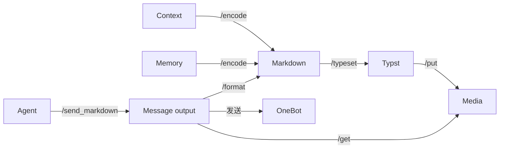

# Markdown 消息协议与富文本输出

## 边界

`/module/markdown` 是独立、可热重载的 Wasm 包。使用 pulldown-cmark 的 CommonMark/GFM 事件树及原始字节范围；不使用第二个解析器，不让模型修复输出。解析只产生计划，排版阶段才调用 Typst，发送阶段才调用 OneBot。

`/encode` 将受管的原生 OneBot 消息批量投影为文本/图片引用片段，供 Context 和 Memory 共用。SQLite 中的原始消息不变。CQ 只属于 OneBot 传输格式，不再是模型的输出协议。

`/format` 接受 Markdown 和可选的目标群，返回有序消息分片及原始文本计量。每个分片包含原生 OneBot 消息段，不包含 base64。Typst 的 `/typeset` 接受生成的 Typst 源码，返回受管 PNG 引用；编译器、字体和图片发布仍归 Typst 包。

## 链接协议

| Markdown | 语义 |
| --- | --- |
| `[昵称](forest:at/123)` | 提及账号 123 |
| `[全体成员](forest:at/all)` | 提及全体成员，最终权限由网关检查 |
| `[回复](forest:reply/456/-789)` | 回复群 456 的消息 -789；群必须等于发送目标 |
| `[微笑](forest:face/14)` | QQ 表情 14 |
| `` | 受管图片 |

仅真实 Link/Image 节点激活协议。代码块、行内代码、HTML、转义文本中的协议字符串保持字面内容。链接显示名不是身份凭证。普通网页链接保留原文；非受管图片保留 Markdown，不自动下载。完整但非法的 `forest:`/`media:` 链接返回协议错误，不猜测目标。普通不完整 Markdown 按解析器结果作为原文发送。

每条消息至多一个回复目标，回复段放在消息开头。回复标签不输出可见正文。私聊不允许群提及或群回复。图片只能使用现有受管引用。来源投影中的回复携带来源群，不允许复制跨群回复到当前群。

## 排版与原文保留

自动转图仅限三类可读性较差的内容：GFM 表格、独立成行的 `$$...$$` 公式、围栏/缩进代码块。标题、列表、引用、普通段落和所有行内格式均保留为原生文本，不因它们属于块级节点就送入 Typst，也不把一句话拆成文字与多个小图片。嵌在正文同一行的 `$$...$$` 同样保留原文。专用消息链接仍正常生成原生消息段。表格内部的公式、强调和代码随整个表格排版。

公式经 MiTeX 转为 Typst；代码、单元格文本使用字符串数据构造，不作为 Typst 源码执行。未支持的节点保留原始 Markdown。排版失败只回退该节点的原始字节片段，并记录日志；不重试、不调用模型、不删除节点。包含原生控制链接或分隔符的容器分解处理，不能把提及或发送边界画成图片。

表格内如果包含提及、回复、表情或受管图片链接，保留表格原文布局并单独输出原生控制段，避免把提及绘制成不能提醒的图片。包含普通网页链接的排版节点保留 Markdown 原文，不能把 URL 隐藏在不可点击的 PNG 中。代码中的分隔符不拆消息。只有解析器产生的 thematic-break 节点拆分消息；Setext 标题下划线不拆分。连续及首尾分隔符不产生空消息。每个片段分别应用群级长消息转发设置；判定使用排版前文本计量，不因转成图片而绕过转发。原生提及、回复、表情和图片链接不计入正文字符数。

## 发送与记忆

发送模块增加 `/send_markdown`，先完成整份消息的解析、排版和媒体解析，再顺序发送分片。返回 `DeliveryReport { sent, outcome }`，明确保留失败前已取得的回执；失败后停止发送，不重发成功片段，不自动降级成刷屏的普通消息。Agent 为每个成功回执建立同一 ModelTurn 的关联，再处理发送错误。原生 `/send` 继续用于框架命令和错误报告。

模型、绘画及文档工具中的可复制图片表示统一为 Markdown 图片链接。Context 保留原有来源、身份、时间、XML 包装和原生 assistant/tool 角色，只更换 body 的投影编码；人格初始化与 reasoning_content 不变。

Memory 的新归档文本、查询及重排文本通过同一 `/encode` 生成；图片仍独立向量化。文本切块不拆开协议链接。历史向量是可重建的派生数据：已有 CQ 投影向量保留，不自动重新向量化；同一嵌入空间的新记录采用 Markdown。重复归档不会重建表示或再次调用嵌入 API。原始记录、关联边、受管媒体不依赖投影格式。

## 验证

覆盖代码字面量、转义、负消息 ID、跨群回复拒绝、表格/公式/代码渲染、节点失败原文保留、分隔符与标题区别，以及多片段发送的部分成功回执。集成验证使用真实 Wasm 包和受控 OneBot 接口，不向群聊批量发测试消息。

解析依赖 [pulldown-cmark 的事件与源码范围](https://docs.rs/pulldown-cmark/latest/pulldown_cmark/struct.OffsetIter.html)，公式转换依赖 [MiTeX](https://docs.rs/mitex/latest/mitex/fn.convert_math.html)。所需 Typst scope 随 Markdown 包内嵌，来源、版本及许可证见 [assets/mitex](../plugins/markdown/assets/mitex/README.md)；运行时无需联网安装排版包。
