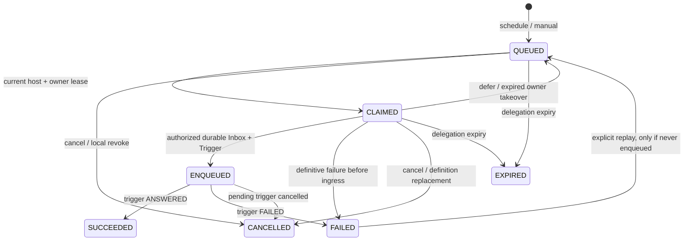

# P3：持久定时任务与内部会话触发

> **历史快照｜禁止作为当前实现规格。** 本文只记录旧纵向切片及其当时的局部验证。它服从 [00 架构总契约](00-architecture-contract.md) 与 01–14 号详细设计；冲突内容已经失效。不得据此新增或恢复旧表、编号迁移、兼容读取、固定业务页面、专用宿主 API、巨型 Store、业务组合根或产品子 Agent。需要复用算法时，必须先把 owner、namespace、Repository contract、Generation、UnitOfWork participant、并发 fence 和 management contribution 映射到当前设计。

本文落实 [04 的自主任务约束](04-bot-agent-memory.md)、[05 的存储与撤权边界](05-storage-security-operations.md) 和 [08 的交互验收](08-group-context-interaction.md)。本轮实现的 `JobKind` 是 `conversation.trigger`：计划到期后，宿主向指定 Conversation 的持久队列提交一个明确标记来源的任务触发；后续由现有群 Actor、Agent、ReplyCommit、Delivery 执行。Job 不直接调用模型，不新开第二个同群 Agent，也不拥有网络发送通道。

## 1. 可配置定义与日历语义

WebUI 选择已有会话并配置任务；持久化的规范结构为：

```json
{
  "name": "每日提醒",
  "enabled": true,
  "kind": "conversation.trigger",
  "conversation_id": "conversation:…",
  "prompt": "提醒大家查看今日待办",
  "schedule": {
    "kind": "cron",
    "timezone": "Asia/Shanghai",
    "start_at": "2026-09-13T00:00:00+00:00",
    "end_at": null,
    "interval_seconds": null,
    "cron": "0 9 * * 1-5",
    "dst_fold": "first"
  },
  "misfire": "coalesce",
  "misfire_grace_seconds": 60,
  "catch_up_limit": 3,
  "max_overlap": 1,
  "delegation_expires_at": "2026-12-31T00:00:00+00:00",
  "max_runs": 1000
}
```

`start_at`、`end_at`、委托截止时间必须带显式 UTC 偏移，存储前转换为 UTC。`start_at` 可命中，`end_at` 不可命中。创建计划时从当前数据库时间向后选择首个执行时间，不补跑创建之前的历史；恢复时才按照持久游标与 misfire 策略处理停机窗口。目标 Conversation 在首个已应用版本后固定，迁往其他群须新建 Job，避免群 Shell 通过一个后来改了目标的定义操作别群旧任务。

Interval 使用 UTC 经过秒数，不受夏令时跳时影响，范围为 1 秒到 365 天。Cron 使用指定 IANA 时区的五个数值字段：分、时、日、月、星期；星期日为 0，只接受 `*`、列表、范围和步长，不接受秒字段、名称、宏或可执行表达式。日与星期均受限时使用 OR；其中任一为星号字段时使用 AND。该规则参照 [Cronie 的 crontab 规范](https://github.com/cronie-crond/cronie/blob/master/man/crontab.5)。

Cron 的不存在本地时刻直接跳过；重复本地时刻按 `dst_fold=first|second|both` 选择首次、第二次或两次。`both` 的两个 UTC 时刻具有不同 occurrence 身份。解析使用 [Python zoneinfo 的 IANA 时区与 fold 语义](https://docs.python.org/3/library/zoneinfo.html)，Windows 通过运行依赖 `tzdata` 获得时区数据。单次日历搜索最多八年，可跨越 2096 年至 2104 年的公历跳闰间隔；无法命中时明确报 `SCHEDULE_HORIZON_EXCEEDED`，不把不合法日历静默解释成永久停用。

定义的委托记录保存 `schedule_algorithm=forest-calendar-v1`。已经生成的 occurrence 以 UTC 时刻为不可变事实，重启不重新推导其身份。尚未展开的未来日历使用当前安装的时区数据库；本轮没有冻结 TZif 文件，升级时区数据可能改变未来尚未生成的时刻，应在升级后查看预览。更换日历算法需要明确版本迁移，不能重解释已生成事实。

## 2. 存储实体与不变量

| 表 | 职责与约束 |
| --- | --- |
| `bot_jobs` | 可 CAS 的定义头：管理 revision、当前不可变 definition_revision、目标会话、enabled、delegation_epoch、next_due_at、已生成次数 |
| `bot_job_revisions` | 不可修改的规范定义、委托、内容摘要及接受操作 ID；重新应用得到新版本和新委托 epoch |
| `bot_job_plans` | 短期预览结果：具体定义、期待 revision、主体/签发者、digest、十分钟截止时间 |
| `bot_job_occurrences` | 一次应执行任务的稳定身份、UTC scheduled_for、原定义版本、原委托 epoch、执行状态、宿主/owner/lease epoch、消息/触发事实引用 |
| `bot_job_expansions` | 不可变恢复窗口：旧游标、扫描捕获时刻、实际保留的 occurrence IDs、是否 misfire |

计划 occurrence 身份由 Bot、Job、定义版本、`SCHEDULE`、UTC 应执行时刻确定；手动执行使用 `MANUAL` 与管理 operation ID。不同扫描者、重启及重试不会生成另一个身份。同一次管理 operation 携带不同输入、动作或主体时拒绝，不通过更换 UUID 绕开幂等冲突。

`event_id`、`trigger_id` 一旦绑定 occurrence 就不可更改。Job 的作用域始终是一个 Bot 内的既有 Conversation；它不建立独立群记忆库，普通群消息和 Job 任务仍共享该 Conversation 的同一 ingress 序号及对应 Bot 的全局记忆体系。

完整 `name`、`prompt`、settings 和 delegation 从首次写入即保存为 Job 模块所有的受管载荷。调度元数据不复制 prompt 或管理员主体；来源失效时不从计划回执或摘要回退，现有 occurrence 也失去领取和 trigger claim 资格。数据所有权、来源闭包、writer fence 与删除竞态见[干净数据库基线、模块数据所有权与载荷来源](14-clean-schema-and-payload-provenance.md)。

## 3. 展开、扫描与执行状态



扫描先持有 Bot runtime 与当前 HostLease，再按 Job、occurrence 锁序领取。Claim 同时固定 `host_incarnation`、owner、lease_epoch 和截止时间。新宿主可以接管旧 incarnation 的未入队 Claim；旧宿主与旧 lease_epoch 均不能补交。进程内循环只是驱动器，数据库游标、租约及事件事实决定恢复结果。

扫描批次默认 32 个定义、最大 128；每个 Job 的 `QUEUED + CLAIMED` 最大 64，超过上限明确背压。默认 `max_overlap=1`，上限 8。重叠额度同时计算当前有效派发 Claim 和 `ENQUEUED` occurrence，直到触发成为 ANSWERED、FAILED 或 CANCELLED 才释放。模型仍在运行、等待审批或结果 UNKNOWN 时，任务并未结束；成功入队本身不释放额度。

一次扫描捕获一个数据库 `now`，以它为不可变恢复窗口上界：

| misfire | 超过 grace 后保留的执行 |
| --- | --- |
| `skip` | 不保留过期窗口中的任务 |
| `coalesce` | 仅保留最后一个已到期时刻 |
| `catch_up` | 按 UTC 顺序保留最后 N 个，N 为 1～10 |

正常扫描迟到但未超过 grace 时也合并到最新一个已到期时刻。处理完窗口后，游标移到捕获 now 之后；重复扫描不能把一次有限补跑变成无限追回。超过任务次数额度或积压上限导致本窗口候选未保留时，不把它们隐式搬到未来补跑；恢复窗口保留实际选择的身份列表。`max_runs` 是每个已应用定义版本的 occurrence 次数预算，取消不返还额度，重新应用配置得到新的显式预算。模型 token、工具与 Run 截止时间仍受 Agent 的持久预算管理。

## 4. 委托与接纳边界

首次或重新应用定义时，目标 Bot 从已验证管理票据冻结委托的 issuer、subject、account_revision、key_revision、policy_revision、截止时间、目标范围与 epoch。当前权限只包含 `conversation.trigger`，`tool_capabilities=[]`。Web 表单不能提交委托主体、签发者、权限集合或私钥。群 Shell 的手动运行沿用定义原创建者的委托。

派发前，宿主向部署权限服务请求具体 occurrence 和 lease_epoch 的 30 秒签名证明。签发时必须仍是有效管理员账户，账户及密钥 revision 必须与原委托相同，不依赖最初浏览器 session 仍存在。目标 Bot 再校验签名、Bot、具体请求摘要、issuer、subject、account/key/policy revisions、委托 ID、当前定义 epoch，以及 Host/Job/Binding 准入。

**持久入队事务提交是这次任务执行的授权接纳点。** 退出浏览器不会取消委托；账户停用或修订阻止取得新的派发证明，但不会追溯取消已经接纳的队列任务。已经签发的证明最多仍可在其 30 秒有效期内使用。管理员取消已接纳任务使用 `job cancel --scope pending|all`，取消已被 Agent 领取的任务使用显示出来的具体 Run/checkpoint。不得宣称账户停用会自动撤回全部历史任务。

目标 Bot 的本地 policy、issuer/key 或委托到期仍在领取 Trigger 前复验。Actor 在安全边界先原子取消失效的 PENDING Job Trigger；数据库 Trigger fence 与最终时钟复检防止等业务锁之后过期的任务被 CLAIMED。已经 CLAIMED 的任务不被后台扫描强行拆出共享 Run，Run 自身的当前配置/工具/宿主 fence 继续有效。

派发事务按 Binding → runtime/host → Conversation → Job/occurrence 顺序取得锁，写入消息与 Trigger、绑定 occurrence 的永久引用，再在所有写入及审计之后重新检查证明、宿主、Binding 和 Job 截止时间；超时全部回滚。权限服务暂时不可用、无证明、暂停或临时背压通过有界 `defer` 重试，不标成“肯定没有发送”后绕过授权。Bot 暂停保留扫描游标、入站消息和 CONTROL；数据派发等待恢复。

## 5. 内部触发与群交互

`conversation.scheduler` 的类型化 `admit_internal_trigger_in` participant 是同一 Bot UnitOfWork 的内部入口，不暴露成普通 OneBot 事件解析接口，也不伪造 QQ user_id。`scheduler.jobs` 只能提交规范 DTO 和 PayloadRef，不能取得 Conversation Repository。其作者包含：

```json
{
  "identity_origin": "host_job",
  "principal_ref": "delegation:<immutable-delegation-id>",
  "job_id": "reminder",
  "occurrence_id": "job-occurrence:…",
  "delegation_id": "job-delegation:…",
  "tool_capabilities": [],
  "is_self": false
}
```

Inbox 保存 `origin=job`，上下文投影保存 `source_kind=SYSTEM`、`platform=forest`、明确的目标群/Conversation、原目标平台和 Job/occurrence 标识，内容使用 `control_data` 角色。该角色在 Provider 中仍是用户级资料，绝不能提升为模型 system 指令。作者权限不会从群 nickname、目标管理员或批次其他触发继承；本轮 host_job 来源不能授权任何 Agent 工具。

上下文另附关联 Trigger 的 `task_status`。已取消任务的后续投影使用固定取消说明，保留作者、委托和 occurrence 来源，不再把原任务指令交给后续模型执行；原始 prompt 仍在不可变 Inbox 中供审计。说明仅声明任务已取消，不断言取消之前没有调用过模型或产生过效果。已经准备并持久化的模型请求快照不被回写修改。

内部事件与群消息在同一事务序列中排队，模型调用途中不会偷偷改变已冻结 Context。下一个安全模型边界最多吸收到最后一个待触发记录，后续无触发尾巴仍待下一边界或静默排空。多个定时触发可与真实群触发汇入同一个 Run；答复事实和 Delivery 状态仍各有明确引用。需要模型对话时应在目标 Binding 启用已配置的 Agent 响应模式，Job 不携带另一套模型密钥或绕开响应配置。

## 6. 管理、取消与重放

| 动作 | 输入与效果 |
| --- | --- |
| `job.read` | 可按 job_id 读取；返回 jobs、occurrences、next_occurrences；Shell 在 SQL LIMIT 之前过滤当前 Conversation |
| `job.plan` | job_id、expected_revision、完整 values；返回固定 plan_id/digest、规范值、旧值及预览 |
| `job.apply` | job_id、expected_revision、plan_id/digest；同一主体接受未过期预览，原子切换新版本/新委托 epoch |
| `job.run` | job_id、expected_revision；创建一次稳定 MANUAL occurrence，稍后按原委托派发 |
| `job.cancel` | job_id、expected_revision、scope、reason；CAS 修改 head 并处理指定范围 |
| `job.replay` | occurrence_id、该 occurrence 的 expected_revision；仅允许从未入队的明确 FAILED 恢复 |

`future` 停止继续按时间展开，保留已存在 occurrence；`pending` 只取消未入队 occurrence 和尚未被 Agent CLAIMED 的关联 Trigger，保留未来计划；`all` 同时停止未来并取消 pending。若 `all` 发现任何关联 Trigger 已被 CLAIMED，整个请求以 `JOB_RUN_ALREADY_ACTIVE` 拒绝，并返回具体 Run 和 checkpoint，避免一条 Job 取消命令撤销混在同一 Run 的其他用户请求。`pending` 不取消其他群成员的 Trigger。

重新应用定义取消旧版本尚未入队的 occurrence，并使旧 epoch 的未领取内部 Trigger 失效；已领取的 Run 保留。停止未来不会禁止有明确管理操作的 `run_now`，其委托与次数预算仍须有效。

重放不会复活已入队的任务，即使 Run 后来失败，或者 Delivery 为 UNKNOWN。后者应走具体 Delivery 的人工核对流程。只有确定发生在入队前的失败才可置 FAILED，再通过 occurrence CAS 重放原身份；缺少权限证明或暂时网络错误用 defer。读取结果的 `replay_allowed` 按该条件计算，界面不能仅凭 FAILED 鼓励重复效果。

群 Shell 仅提供本群的读取、立即执行、取消和重放；计划创建与修改由 Web 完成。类型解析后的安全参数独立持久化，聊天上下文只保留固定命令说明。控制事件持有独立槽，取消/审批为优先级 0、查询为 1、立即执行为 2；分页仍按 command_id 游标向前，调度器在当前有限页内排序并为紧急操作预留槽。该策略是有界控制队列优先级，不承诺抢占已经运行的任意 Python/系统进程。

## 7. 验证与范围

`tests/test_schedules.py` 验证 UTC interval、DST 缺失/重复时刻、日/星期 OR、步长、明确时间偏移、非法表达式、有界恢复以及 2100 年跳闰。`tests/test_jobs.py` 使用每个测试独立的真实 PostgreSQL 数据库和 Ed25519 WebAuthority，覆盖管理 CAS、重复入队、非重叠至触发终态、租约接管、缺失证明退避、取消范围、当前撤权、重放限制、同群作用域及业务锁等待后的最终 fence。实际后台双扫描者与群安全点集成由 `tests/test_job_scheduler.py` 覆盖。

这些测试验证真实数据库与宿主执行路径，不声称取得真实 QQ 或计费模型凭据。定时任务的实际 QQ 发送、模型调用和 UNKNOWN 处理复用现有 Adapter、Agent 与 Delivery 的独立验收结果。外部订阅、任意任务类型和定时任务自授工具能力不属于本次实现。
