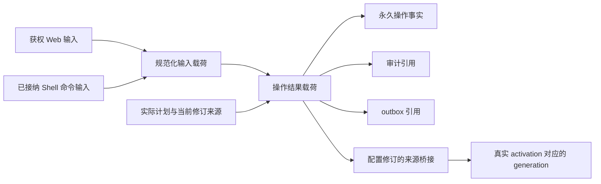

# 管理输入、操作回执与来源引用

本切片已接入并通过 Windows、Linux 与浏览器验证。它延续 [Kernel 载荷](p4-kernel-payloads.md)的永久事实与可清理正文分离，覆盖 Bot 管理操作及其直接关联的审计/outbox 副本。配置正文、Agent frozen spec、Job 定义、Shell 参数等尚未完成全部迁移；本文不将局部来源桥接等同全链路遗忘。

## 1. 同一请求的三个不同对象

| 对象 | 身份与保存内容 | 删除后的行为 |
| --- | --- | --- |
| 原管理操作事实 | Bot、operation ID、action、原 input digest、subject、issuer、原 ticket basis、创建时间 | 保持原事实；同 ID 异输入仍冲突，不再次执行 |
| 管理输入载荷 | Host 规范化 DTO 的 `{action, operation_id, value}` 信封，独立 CONTROL_INPUT 来源和实际父引用 | 使用原 input payload ID；缺失正文不能通过新 epoch 重建 |
| 管理结果载荷 | 同结构结果信封，继承真实输入与本次读取的计划/历史/当前值来源 | 操作、关联审计及 outbox 共用一份正文；失效后只返回事实 |

原 `input_digest` 是已签发业务请求的摘要，信封的 payload digest 是新增内容摘要，两者分别核验。SQL NULL 代表无正文副本；业务 JSON null 是实际结果。重放查询使用独立的“无记录”标记，不能把 JSON null 当作需要执行的新请求。

业务 DTO 在业务方法首次异步等待前固定，票据在授权守卫首次等待前固定。实际执行和入库均使用该输入快照，最终写入再次核对原输入摘要；调用方在等待锁或时间检查期间修改原字典，不能改变已授权的保存值。

规范化 DTO 不包含 API key、OneBot token、webhook secret 或会话凭据。已有秘密继续保存在独立 Vault，票据输入使用既有的秘密摘要/版本。普通组件的任意 JSON 配置尚无统一秘密字段契约，不应将它宣称为已支持完整秘密管理；后续配置迁移需要明确秘密引用方式。

## 2. 真实来源与事务边界



Web 管理者手工输入登记独立来源。Shell 输入继承原群命令的真实载荷，不因管理员身份而改成无父来源。Worker 或浏览器不能自行指定任意 parent IDs；实际计划、历史和当前值由 Host 在持有对应业务权限与锁的事务内确定。

最终写入保持 runtime/policy、当前权限、业务头与期限的守卫，然后取得 memory clock 并复验所有实际来源。输入、结果、操作事实及审计/outbox 引用在同一事务提交。删除先发生则不产生新的业务变更；操作先提交则保留原事实并使其派生正文随来源失效。网络发送和 Worker 交付仍遵守既有事务外许可及 UNKNOWN 对账协议。

计划来源桥接以固定 family 和真实 plan ID 为索引，核对真实计划行、主体、issuer、plan digest 与完整 values。修订从自身的 operation ID 关联原回执；新 apply 必须继承真实计划来源，preview 的 before/current 值必须继承相应旧修订来源。不按文本相似度猜父来源，也不允许用当前任意回执替代实际所属操作。

组件 Web activation 已在 Kernel 安装前持久登记。generation 注册从真实 activation → revision → 原操作回执取得父来源，并核对包、config 与 grants；在 Worker prepare 交付前进入既有 exposure 链。没有 Web activation 的 Host/Watch 安装仍按其既有独立输入处理；Watch 配置正文迁移继续后续工作。

人工裁定 UNKNOWN 工具结果时，实际工具结果继承本次管理输入，后续模型快照继续继承工具结果。送达人工对账的 reason/result 观察正文同样继承管理输入与原发送部分；原发送正文已失效时，SENT/SKIP 仍可只保存元数据事实完成对账。NOT_SENT 重新开放发送仍须验证原发送正文可用。删除回执不撤销已经发生的工具或平台效果，也不授权换 operation ID 重试这些效果。

## 3. 升级与严格旧列

- 039 增加独立 CONTROL_INPUT 域；该域参与删除依赖，不成为可召回聊天记忆。
- 040 将 `bot_web_operations.result` 移入结果载荷，并封闭旧列。旧请求只有摘要时，迁移标记 `input_legacy_unknown`，不反推请求正文。运行时不能新建该例外；读取必须核对真实不可变旧操作行。
- 041 将确切关联的管理审计/outbox 改为共享结果引用，封闭这些记录的原正文列；同 operation 的其他事件不凭 ID 自动冒充管理回执。已迁事件保持身份及时间，outbox 的投递元事实仍可推进。
- 旧计划/修订缺少可证明来源时，保存明确的保守 legacy 引用。升级前已经遗忘的内容不重新插入 body。无可用来源的计划不能借原明文列继续 apply。

旧组件配置升级后启动的新 Worker 仍须能够回复群聊。范围检查只对可由冻结 040/041 导入身份、真实组件计划/修订及所属操作证明的旧 `config` 叶保留原宿主配置语义；它不把通用 legacy 删除标记变成跨群读取授权。新配置结果继续检查全部父引用，混入未知私有缓存的分支仍拒绝。此例外不适用于任意管理结果，也不提高记忆来源的完整度；当前删除和来源范围检查仍生效。

所有升级使用同一迁移事务，失败回滚 DDL、导入和守卫；历史 SQL、handler 与冻结 helper 不改。原请求身份、原业务摘要、CAS 和授权依据保持不变。配置表中的旧 values 等未迁正文族仍需后续严格切换，不能因本片增加了依赖守卫就声称物理副本全部清理。

## 4. API 与页面的不可用回执

结果仍可用时，接口返回原业务值，包括合法 JSON null。结果已不可用时返回：

```json
{
  "operation_id": "原操作标识",
  "action": "config.apply",
  "operation_status": "RECORDED",
  "result_payload_state": "UNAVAILABLE"
}
```

`RECORDED` 仅表示该管理请求已有持久回执，不代表随后异步发生的组件切换、Agent 执行或平台送达已经完成。页面显示原操作编号并要求重新读取当前状态；不展示成功应用提示，不自动分配新 ID 重做请求。

页面收到不可用回执或 `CONTROL_CONTENT_REVOKED` 后清理相关旧预览与缓存，同时使同一 UI 资源在失效通知前发出的未完成读取失效。较晚返回的旧配置、历史或调用结果不能重新填回页面。屏障只保留到该组在途请求全部结束，后续显式读取继续由服务器核验，不建立无限增长的客户端回执缓存。

UI 资源粒度是 Bot + 组件 ID，或该 Bot 的 Agent、Memory、Job、Binding、Delivery 面板族。不同 Bot、组件和面板族互不失效；同一 Job/Binding 列表族采用保守失效，尚未声明逐条资源隔离。原浏览器已经取得的网络字节不属于服务器能够撤回的外部效果。

## 5. 验证入口与未完成范围

基础载荷与旧库升级见 [control payload 测试](../tests/test_control_payloads.py)和 [040 升级测试](../tests/test_control_results_upgrade.py)。组件页面的真实浏览器反例见 [组件表单冒烟脚本](../scripts/smoke_components_panel.py)，覆盖回执失效、延迟配置/历史响应及不自动重做。[管理回执浏览器脚本](../scripts/smoke_control_receipts.py)已通过 14 个 Edge 场景，包括五类面板失效、同面板重新加载、任务取消提示、跨 Bot 的迟到错误，以及注销后记忆配置和密钥清空。这些场景使用受控 HTTP fixture，不替代 PostgreSQL、真实平台或模型服务验收。最终 Windows 和非 root Linux 各通过 482 项综合测试；当前候选也通过完整 Edge/独立 Compose 流程，实际证据及边界见[实现状态](implementation-status.md)。

本片之外仍包括配置正文的完整迁移、Agent spec 到模型/Child 的来源边、Job 定义到 occurrence、Shell 参数/结果、自由取消原因与 checkpoint、副本不确定的其他事件，以及部署库、WAL、备份与公开遗忘管理。已有外部效果不因删除回执而变成“未执行”。
