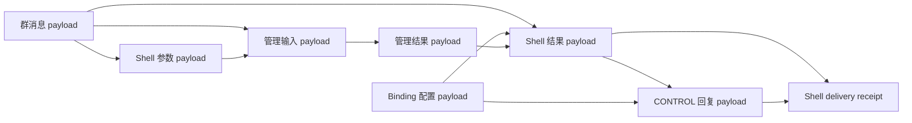

# P4 群聊 Shell 参数、结果与回复来源链

状态：已实现。对应 Bot 迁移 `062_schema_writer_v4.sql`、`063_shell_payloads.sql`。

## 1. 问题与边界

ShellGate 在任意插件和会话 Agent 之前确定性识别 `#forest`，并把类型化参数持久化后交给独立 CONTROL 调度器。迁移 062–063 已把 `bot_shell_requests.arguments/outcome/delivery` 从业务行移入来源约束的 payload body，并为 CONTROL 回复补齐实际管理结果的父链。取消原因、来源 ID、计划信息和诊断结果因此可以随原群消息的来源遗忘而立即失效，并由后台 scrub 清除托管正文。

本切片只治理 Shell 请求内容和回复来源，不改变命令语法、优先级、群作用域或产品 Agent。Shell 仍是宿主控制面，不占用群 Actor，不创建 Agent，也不让命令内容进入 Agent 上下文。

## 2. 永久事实与可清理正文

`bot_shell_requests` 永久保留：

- `command_id/event_id/conversation_id/binding_id` 路由身份；
- `command_name/gate_version/priority/raw_digest` 冻结接纳事实；
- claim epoch、owner、Host/Binding/policy fence、状态和时间；
- 参数及结果 payload ID/digest；
- 参数 schema 摘要、参数键名、结果 code 和 CONTROL delivery ID 等闭合元数据；
- 已完成、已取消及其固定终结原因。

以下正文只保存在 payload body：

```text
ShellArgumentsV1 = {
  gate_version,
  command_name,
  schema_digest,
  arguments
}

ShellOutcomeV1 = {
  command_id,
  outcome
}

ShellDeliveryV1 = {
  command_id,
  delivery
}
```

原 `arguments/outcome/delivery` 列迁移后必须为 SQL `NULL`。`delivery` 的安全路由回执投影保留在 `delivery_metadata`；实际回复文本仍只存在于既有 `delivery.payload`。合法 JSON `null`、空对象与正文不可用由 payload state 区分，不从旧列、发送副本或控制操作回执反推。

## 3. 身份和父链

参数 payload 使用 `owner_kind=shell.arguments`，owner ID 由 `command_id` 和固定 `shell-arguments-v1` 域生成；唯一直接父载荷是该命令的 `bot_message_inbox.payload_id`。正文中的 gate、命令名和 schema digest 必须与业务行的闭合元数据一致。未知命令仍冻结空参数和空 schema 摘要，不保存未识别的原始文本。

结果 payload 使用 `owner_kind=control.result`，owner ID 由 `command_id` 和固定 `shell-outcome-v1` 域生成。它至少继承原命令输入、参数 payload 和当次 Binding 配置；类型化管理方法产生可用的 `shell-action:<command_id>` 控制结果时，还必须继承该结果 payload。若执行器只观察到已经撤销的旧结果，只能生成固定的 `RECORDED_UNAVAILABLE` 回执，不得把进程中缓存的旧结果写回。

终端 delivery receipt 使用 `owner_kind=control.outbox` 和固定 `shell-delivery-v1` 身份，正文保存完整内部回执；业务行只保留已校验的 CONTROL intent 投影。新请求的 receipt 直接依赖 Shell 结果和每个实际发送 part，旧请求不能证明完整关系时标记 `legacy_result_untracked`，但仍继承原输入和可证明的父载荷。

CONTROL delivery 的各 part 以 Shell 结果 payload 和 Binding 配置为直接父载荷。因此证明链为：



内置 help/status、拒绝和坏语法没有管理结果 R，但仍继承 M 与 C。数据库插入/完成守卫复核 payload 身份、摘要、父边、闭合元数据和实际 SendIntent；Host 代码不能用任意 payload ID 替换来源。

## 4. 生命周期与并发

1. **ADMITTED**：消息事务先写入不可变输入 payload，再冻结参数 payload，最后插入 PENDING Shell 请求。两者共用同一 deletion epoch。
2. **CLAIMED**：调度器在 Binding 和请求行锁内 hydrate 参数。正文不可用时不执行命令，原子转为 `CANCELLED/CONTROL_CONTENT_REVOKED`。
3. **EXECUTING**：`ShellControl` 只比较 claim 中冻结的 payload 身份；业务仓库取得自身资源锁后，最终 `_time` 再 hydrate 参数并复核当前管理员和 Binding。这样不会形成“memory clock → 业务 head”与 Web 的“业务 head → memory clock”反向锁序。
4. **COMPLETING**：命令业务事务已经结束。完成事务锁定 Binding 和 Shell 行，复核参数仍可用，冻结结果 payload，创建依赖该结果的 CONTROL SendIntent，再冻结依赖实际发送 part 的 delivery receipt，最后一次性提交 `COMPLETED`。
5. **TERMINAL**：COMPLETED/CANCELLED 行不可修改或删除。重复完成只有在逻辑摘要、结果 payload 和 SendIntent 都一致时返回原回执；正文已经撤销时返回 `UNAVAILABLE`，绝不重执行业务动作。

高优先级命令仍不抢断已运行的 Python 代码。P0 预留槽、稳定 command ID 分页、页内 priority 排序及当前 Binding 管理员复核保持原契约。

## 5. 遗忘语义

遗忘原群消息来源会沿父链撤销参数、管理输入/结果、Shell 结果和未发送/托管的 CONTROL 回复。PENDING 或失效 CLAIMED 命令再次领取时变为 CANCELLED；它不会因 registry、当前配置或相同文本而重建参数。已完成命令仍保留 command/status/digest/delivery ID 等事实，已发生的平台效果仍保持已发生，外部群平台已收到的消息不能由本地 scrub 撤回。

管理读取正文时必须持有正常的 Bot/Binding 权限并 hydrate payload。正文不可用时显示稳定身份与 `arguments_payload_state/outcome_payload_state=UNAVAILABLE`，不得从 `raw_digest`、审计事件、SendIntent metadata 或管理操作摘要恢复自由文本。

## 6. 升级与 writer fence

迁移 062 将 `forest.writer_generation` 提升为 4，在同一事务中排除仍会写原 JSONB 列的 generation-3 进程。迁移 063 按 `command_id` 稳定分批导入 020–061 数据：参数继承消息 payload；结果继承消息 payload及可证明的控制结果。已经受抑制的父链只创建永久 REVOKED header，不重新插入旧正文。

旧 COMPLETED 行可能没有 operation 或 delivery；迁移保留这种历史缺口并标记 legacy metadata，不伪造一次发送。迁移不解析原命令、不按当前语法重解释参数，也不调用模型、Embedding、Adapter 或网络。

## 7. 验收

- 新请求的三个原 JSONB 列为空，参数/结果 body 与闭合元数据严格分离；
- Dispatcher 重启后从冻结参数 payload 恢复，不调用 parser；
- 来源遗忘与领取竞争只产生“执行在遗忘前完成”或“命令取消”两个线性结果，无正文复活；
- 类型化管理结果、Shell 结果和 CONTROL reply 具有实际父边，删除任一真实来源后不能发送缓存正文；
- generation-3 既有连接在 062 后永久失去 HostLease 写权限；
- 真实 020/061 非空旧库升级保持原参数/outcome 的逐值内容，正文列清空且迁移可重入；
- Shell、消息、delivery、控制回执、Job/Agent/Memory/组件管理回归与独立 Compose 浏览器流程继续通过。

## 8. v7 上下文命令兼容层

迁移 064–065 新增 `shell_registry_v7.py` 与 `shell_payloads_v7.py`，继承 v2–v6 已发布契约并加入 `context.read/context.compact`。旧 v6 registry 与 payload helper 仍由 063 checksum 固定，不能为了新命令原地修改。v7 参数、结果和 CONTROL 回复继续使用本页相同的来源父链与三种载荷身份；上下文请求本身只保存视图版本、状态和稳定 ID，不复制群消息正文。

`context compact` 完成 Shell 管理事务时只表示请求已经持久排队。唯一会话 Actor 在安全点提交 `APPLIED` 或 `CONFLICT`，Shell Dispatcher 不取得 ActorLease、不创建 Run，也不调用 Agent 或 Provider。`context inspect` 只投影本群元数据，并显示最近请求终态；它不 hydrate Context unit 的 payload，因此不能成为群消息正文的读取旁路。
