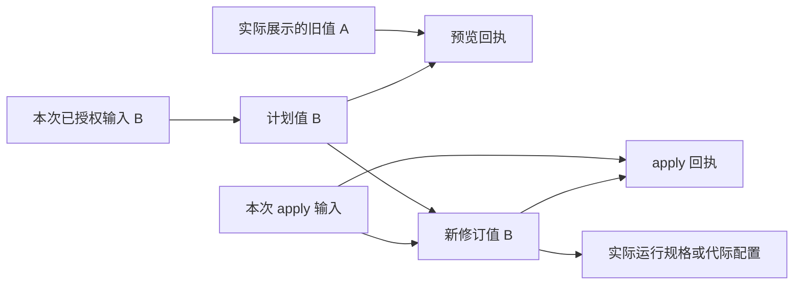

# 配置正文、运行规格与独立替换

本切片将 Bot 的 Agent、Memory、Binding、组件及开发 Watch 配置接入可清理正文存储。它延续[管理输入与回执](p4-control-payloads.md)的永久事实和可清理正文分离：删除正文不删除操作身份、修订号、CAS、预算账本或已经发生的外部效果。首版完整管理仍在实施，本文不代表全项目验收完成。

## 1. 保存值与预览回执分别建立来源

完整填写的新配置 B 可以独立于旧配置 A。预览需要展示 A，但不能因此让 B 永久依赖 A：

删除 A 可以使混合预览回执不可用；只要 B 的真实来源仍可用，管理员仍能基于原计划和当前权限应用 B。核验原计划身份使用不可变操作、计划行、摘要及实际来源边，不要求重新读取混合预览正文。若新值实际由旧值合并或复制生成，则必须继承参与生成的旧值，不能通过“完整输入”这一接口形式抹掉真实来源。

新 plan 在同一事务中创建输入载荷、计划值和带引用的计划行，再写预览回执、操作与来源桥。新 apply 先创建输入和修订值，再记录 apply 回执及原操作，随后插入修订行并推进配置头；这样保留已有即时操作外键，不插入临时空引用。事务最后重新核验权限、CAS 和期限；失败会回滚全部新事实。

通用值信封固定为 `{family, kind, resource, identity, values}`。正文读取核对实际 Bot、owner、摘要、字节、精确身份、父引用和当前删除状态。行级守卫另行证明该载荷确属当前计划或修订。通用读取器不反向要求尚未插入的业务行，避免循环依赖。

## 2. 已切换的正文族

| 对象 | 可清理正文与运行依赖 | 删除后仍保留的事实 |
| --- | --- | --- |
| Agent 配置 | plan/revision 值；Run frozen spec；实际步骤快照；升级前遗留 Child 的 spec 来源仅供清理与审计 | 修订、秘密版本、固定数值预算/期限、Run/step 身份、原 spec 摘要 |
| Memory 配置 | plan/revision 值；Embedding 请求的 profile、精确请求及 manifest 的实际配置父引用 | 修订、固定预算、dimensions/protocol、向量空间与 endpoint 身份摘要、费用 |
| Binding | 首次登记名称；plan/revision 值；effective 配置精确引用实际 V | 账号身份、期望/生效修订、Binding/connection epoch、永久送达事实 |
| 组件 | plan/revision 值；真实 activation 对应 generation 的配置来源 | 包摘要、能力集合、生命周期操作、代际和路由 fencing |
| 开发 Watch | `{source_identity, config, grants}` spec；实际初始化输入及发布代际来源 | Watch ID、请求/构建/发布序号、last-good 与租约身份 |

这些对象原来的正文列必须为 SQL NULL。JSON null 与 SQL NULL 分开处理；不能将缺失正文解释为默认值。metadata 使用各族封闭白名单，不能把 prompt、模型地址、显示名称或任意配置对象转存进 metadata。

Watch 的真实 Host 初始化记录 `watch.initialize` 输入并建立 spec，不伪造 Web 用户、票据或管理回执。开发源路径随 spec 读取；构建事实中的 artifact 路径仅指向受管不可变包缓存，不能当成旧用户源路径恢复配置。运行时不能回退使用进程内的旧 `self.config`。

记忆向量和已有图片不会仅因模型参数或许可选择而继承整份配置正文；真正包含配置文本的请求和 manifest 才建立相应父边。原聊天或图片来源被遗忘时，其派生向量和证据仍按真实来源清理。Embedding 继续支持文本、图片和混合输入；模型能力投影只影响当次 API 输入，原始多模态记忆保留。上下文裁剪仍不调用摘要模型。

## 3. 业务锁、删除锁与迟到结果

所有必需的业务头在读取配置正文、取得 memory clock 之前按既有顺序加锁。组件和 Watch 发布须再次核对真实配置头、当前 desired、实际 activation、Host/operation/policy fencing 与候选 generation；apply 的旧回执不是永久发布许可。

Agent 新模型调用、工具或媒体获取许可严格核验实际 spec/config 的当前可用性。媒体来源校验从实际 Agent 配置 V 读取允许的 origin，不再访问旧明文列。配置已清理时不发起新的 HTTP；已经开始的外部请求仍按原尝试身份记录已知费用和结果状态，不能因此恢复结果正文或发布新的内容。升级前 Child 只允许进入终结、费用结算和清理路径，不能产生新请求或候选结果。

已知完成事实可仅凭元数据结算。UNKNOWN 表示无法确认外部效果，不能自动重跑或释放其预算占用。明确取消会撤销原 Actor lease；失权旧执行者不能补写结果。升级迁移另行撤销遗留 Child lease。取消后的 UNKNOWN 保留待管理核对，不在本切片增加跨取消的无条件结果接纳通道。

## 4. 不改写旧摘要的升级

042 提升最低 writer generation；旧宿主不能对新 schema 恢复写入。001–041 SQL、handler 和原 helper 保持原样，042 之后使用独立版本化 checksum 信封。045–049 显式覆盖它们调用的冻结 044 dependency importer，避免迁移算法变化却沿用旧 checksum。

043 提供配置正文读取器。044 为旧载荷增加单独、不可修改的补充依赖表与闭包；不改旧 header、manifest、来源清单、业务摘要或原操作 ID。045–048 搬运各正文族，并用真实 Run、升级前遗留 Child、Embedding request、Binding revision、activation 或 Watch 行证明旧副本的对应关系。Child 证明只服务于旧数据清理和审计，不构成继续调度许可。

补充依赖参与实际读取、新派生、exact echo 的两个传播方向、exposure、遗忘和范围检查。先遗忘再升级时，新证明的旧副本立即继承原 suppression，不重新写入正文。迁移不能只截取前若干后代；正常读取和新写仍受完整来源数量限制，超限明确拒绝。

重放旧载荷时，当前补充依赖可能使有效来源多于最初登记的来源。只有原 body/encoding、owner、调用方直接来源、真实父身份及父的原始 manifest 能精确复现旧 input digest，才返回原永久回执；不接受任意来源子集。原回执为 REVOKED/SCRUBBED 时仍不重建 body。读取与新派生继续检查当前完整依赖。当前有效来源已经超过 4096 时仍保守拒绝；本片不承诺此超限情形也能恢复旧回执。

旧 Agent spec 的未知来源只允许由当前 Run 的真实 owner、spec 摘要和实际配置修订证明。多个 Run 共用同一旧配置，不能使一个 Run 的私有 spec 在另一 Run 中获得读取权限。普通消息来源、群/私聊限制、输入切口和删除检查始终执行。

049 另处理旧模板 Kernel 输入：旧调用没有固定 Binding revision，不能关联“现在的”模板或按文本相等推断历史来源。仅在实际 Kernel input 身份及 direct Context parents 能证明 Binding 范围时增加按调用固定的保守 legacy 身份锚点；正文仍存在时还核对真实模板调用摘要。该依赖向副本和后代传播，不反向污染原聊天。没有足够证据的历史内容保持不可证明，不伪造来源。

## 5. WebUI 的修复流程

配置读取返回原修订号与可用状态；正文不可用时 `values` 为 null。组件和 Binding 分别报告 desired/effective，历史列表逐项报告正文状态。页面清空旧表单和未提交的秘密，阻止旧值预览；不会自动把默认值显示成已保存配置。

管理员点击“填写新配置”后才进入独立草稿。Agent/Memory/Binding 使用明确的模板；组件从已登记包的真实 schema 构建新表单。新草稿继续携带原修订号进行 CAS。较晚返回的旧读取不得覆盖草稿，旧 Binding 列表不得降低页面已知的保存/生效修订。可用的历史配置可显式载入为新草稿；正文已清理的历史项保留修订编号并禁用载入。

组件历史草稿携带 `source_revision`，编辑字段不会清除该来源。Host 按当前组件核验实际旧 V，将它接入本次输入及计划值的父链；SQL 提交守卫再次核验声明和实际父边。复制前或计划产生后删除该来源，会阻止复制或 apply。只有显式选择“填写新配置”才清除历史来源并重新建立空模板；普通完整替换请求不因预览展示旧值而附加来源。

## 6. 验证与剩余边界

Forest 尚未发布，已删除冻结 041 包和从错误中间 schema 升级的兼容测试。当前测试从干净最终基线建立数据库，验证配置正文、SQL reader、writer generation、依赖传播和各配置族的运行时不变量；真正发布首版后才冻结该版本的升级夹具与 checksum。

[受控浏览器脚本](../scripts/smoke_control_receipts.py)已通过 22 个真实 Edge 场景，包含原管理回执屏障和四类配置的清理、独立替换及迟到读取；组件历史的可用/不可用项分别验证。该脚本使用发行页面和 JS、受控 HTTP 响应，不替代数据库或真实外部服务验收。最终跨平台和完整容器验收结果另记于[实现状态](implementation-status.md)。

会话 Job 的 settings/delegation 已由迁移 060/061 接入来源载荷，并在 occurrence 领取和 trigger claim 前复验可用性；Shell 参数、结果和 CONTROL 回复链由 062/063 接入。自由取消原因与部分 checkpoint、部署库正文、备份/WAL 和完整角色管理仍有后续工作。公开来源遗忘已经使用独立 plan/apply 与删除 epoch 接通 Web 和群聊 Shell；它只承诺当前托管载荷的立即抑制与后台 scrub。外部模型、平台及用户已经接收的字节不能由本地清理撤回。普通组件 JSON 尚无统一秘密字段契约。
